# Arquitectura del Portal de Implementación

Mapa del código para quien lo mantiene. Los diagramas están en [Mermaid](https://mermaid.js.org/): GitHub los dibuja directamente, y en VS Code se ven con la extensión *Markdown Preview Mermaid Support*. Describen la **versión del release**, pensada para implementadores humanos; lo que queda para la automatización está marcado en la última sección.

Índice: [1. Capas](#1-capas) · [2. Apps](#2-apps-y-dependencias) · [3. Modelo de datos](#3-modelo-de-datos) · [4. Wizard](#4-los-pasos-del-wizard) · [5. Estados](#5-estados-de-una-implementación) · [6. Recorrido completo](#6-recorrido-completo) · [7. Validar y congelar](#7-validar-y-congelar) · [8. Qué se registra](#8-qué-se-registra) · [9. Despliegue](#9-despliegue) · [10. Release y después](#10-qué-entra-en-el-release-y-qué-viene-después)

---

## 1. Capas

Una regla ordena todo el código: **las acciones y los servicios no conocen el `request`**. Reciben un *actor* (quién hace la cosa) y devuelven un resultado. Por eso el mismo código lo puede usar hoy una pantalla y mañana una API o un agente, sin reescribirlo.

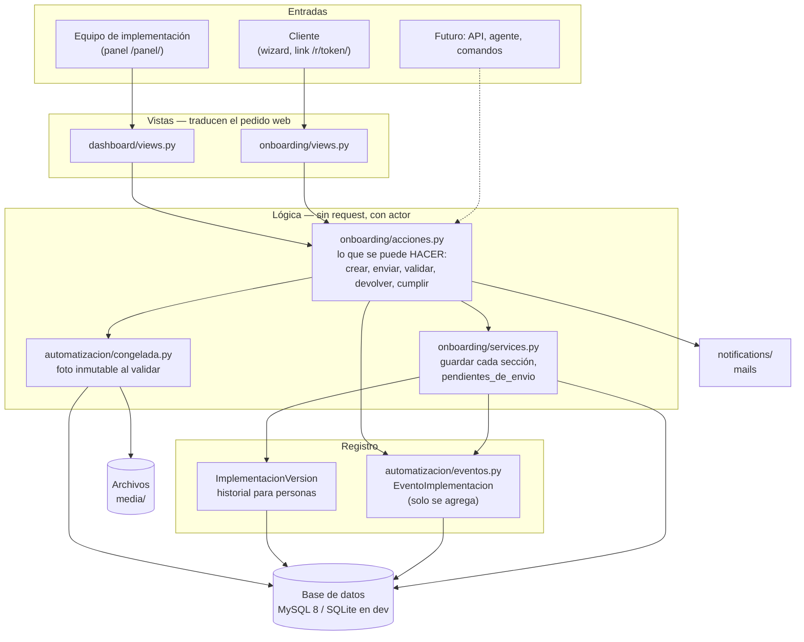

**Dónde mirar según lo que se busca**

| Quiero… | Está en |
|---|---|
| Una regla de qué falta para enviar o validar | `onboarding/services.py` → `pendientes_de_envio`, `pendientes_de_validacion` |
| Cambiar qué pasa al validar, devolver o cumplir | `onboarding/acciones.py` |
| Cambiar cómo se guarda una sección | `onboarding/services.py` (`guardar_*`) |
| Qué se foto-copia al validar | `automatizacion/congelada.py` |
| Una pantalla del cliente | `onboarding/views.py` + `templates/onboarding/` |
| La ficha del equipo | `dashboard/views.py` + `templates/dashboard/implementacion_detalle.html` |
| El editor de firma | `static/firma_editor.js` + `templates/onboarding/_editor_firma.html` |

---

## 2. Apps y dependencias

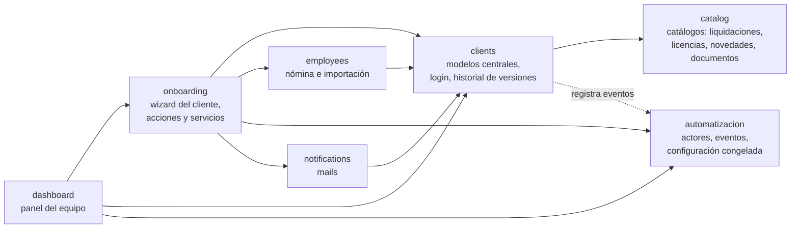

`automatizacion` no depende de nadie por modelo (apunta a `clients.Implementacion` por nombre), para que el registro de eventos pueda usarse desde cualquier app sin importarla.

---

## 3. Modelo de datos

**Lo que se releva** (el centro es `Implementacion`: un caso de implementación de un cliente).

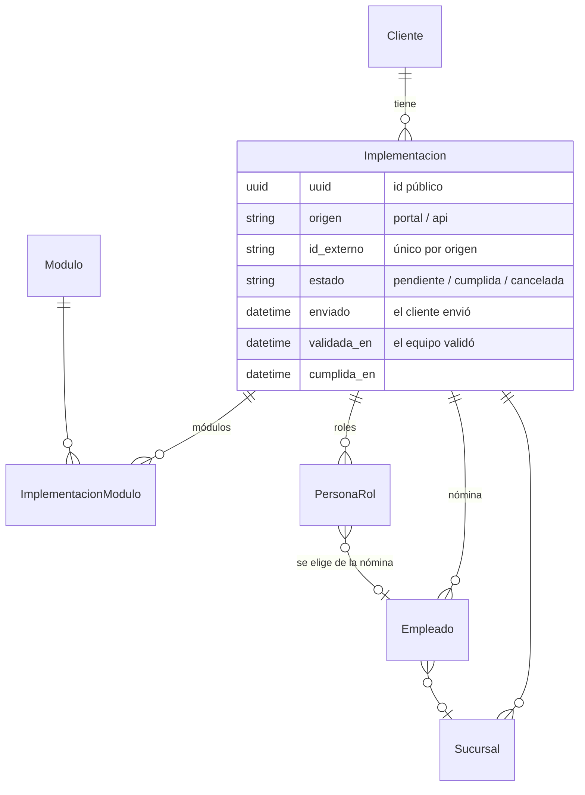

**Lo que se elige de los catálogos** (cada tabla `Implementacion…` guarda si la opción está activa).

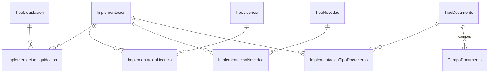

**Revisión y registro** (lo que se agrega a medida que el caso avanza).

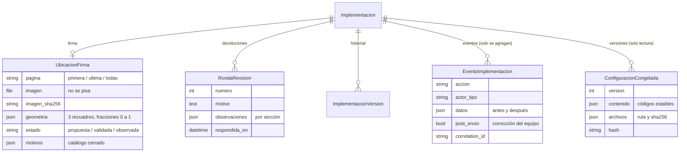

Los catálogos (`TipoLiquidacion`, `TipoLicencia`, …) y los módulos tienen un **`codigo` estable**: el nombre se puede corregir, el código no cambia nunca. Todo lo que dependa de «cuál es» (los pasos del wizard según el módulo, lo que se congela) se identifica por código.

---

## 4. Los pasos del wizard

Los números de paso están definidos una sola vez, como constantes, en `onboarding/services.py`. Un paso solo aparece si el cliente contrató un módulo que lo necesita.

```mermaid
flowchart LR
    P1["1 Datos de contacto"] --> P2["2 Módulos"]
    P2 --> P3["3 Sucursales"]
    P3 --> P4["4 Nómina"]
    P4 --> P5["5 Roles"]
    P5 --> P6["6 Configuración<br/>y adjuntos"]
    P6 --> P7["7 Firma del recibo"]
    P7 --> P8["8 Licencias<br/>y novedades"]
    P8 --> P9["9 Documentos<br/>de legajo"]
    P9 --> P10["10 Revisión y envío"]

    classDef siempre fill:#e3e8ff,stroke:#1c1699
    classDef cond fill:#f6ecff,stroke:#aa00ff,stroke-dasharray: 4 3
    class P1,P2,P4,P10 siempre
    class P3,P5,P6,P7,P8,P9 cond
```

| Paso | Cuándo aparece | Por qué ese orden |
|---|---|---|
| 3 Sucursales | con **Fichada** | antes de la nómina, para asignar a cada empleado la suya |
| 4 Nómina | siempre | antes de los roles, para elegir de ahí a las personas |
| 5 Roles | con **Recibo Digital** o **Legajos** | Apoderado y Liquidador salen de la nómina |
| 6 Configuración | con **Recibo Digital** | sube el modelo de recibo (PDF) y elige tipos de liquidación |
| 7 Firma | con **Recibo Digital** | necesita el modelo de recibo ya subido |
| 8 Licencias y novedades | con **Novedades** | |
| 9 Documentos de legajo | con **Legajos** | |

**Recibo Digital es obligatorio en toda implementación**: no se puede desmarcar, y si faltara figura como pendiente.

El paso 10 lista lo que falta (con link al paso) y no deja enviar hasta completarlo. El servidor lo valida igual, porque el cliente puede saltar de un paso a otro por la URL.

---

## 5. Estados de una implementación

El estado que ve el equipo **no es una columna**: se deriva de `estado`, `enviado` y `validada_en`, así no hay dos datos que puedan quedar contradictorios. La devolución al cliente no tiene estado propio: la implementación vuelve a «a completar» con la marca *Devuelta, ronda N*.

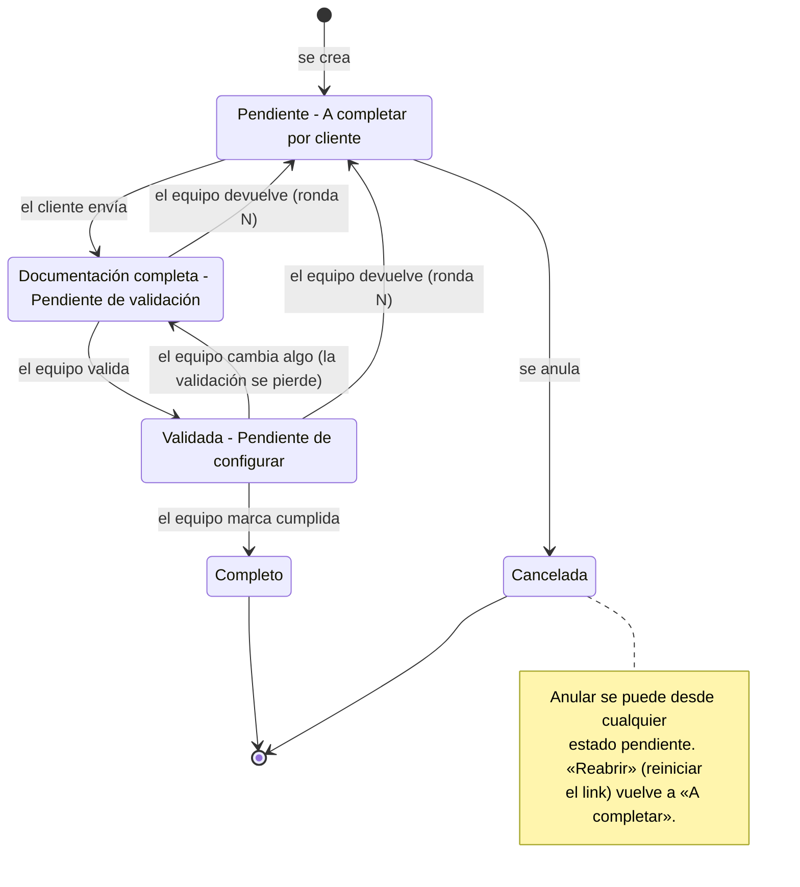

Reglas que ordenan las transiciones:

- **Validar** repite el control de faltantes del envío y además exige la **firma validada**.
- **Cumplir** solo se puede desde *Validada*.
- **Editar después de validar** (datos, módulos, roles, sucursales, liquidaciones, firma, licencias, documentos, nómina) quita la validación. Cambiar solo la fecha de implementación no la quita.
- **Una devolución** abre una ronda numerada y le avisa al cliente por mail. La ronda se cierra cuando el cliente vuelve a enviar.

---

## 6. Recorrido completo

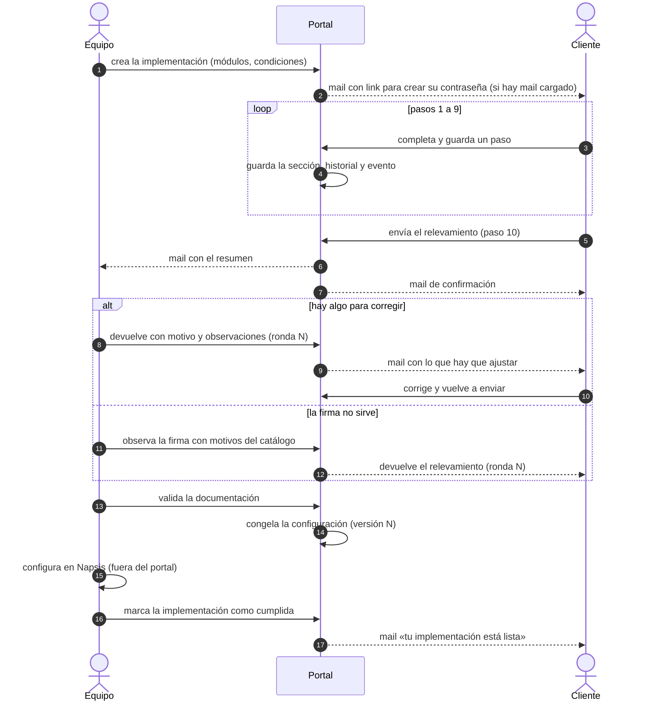

---

## 7. Validar y congelar

Al validar pasan, en una sola transacción, estas cosas. Si cualquiera falla (por ejemplo, un archivo que no se puede leer), no queda nada a medias.

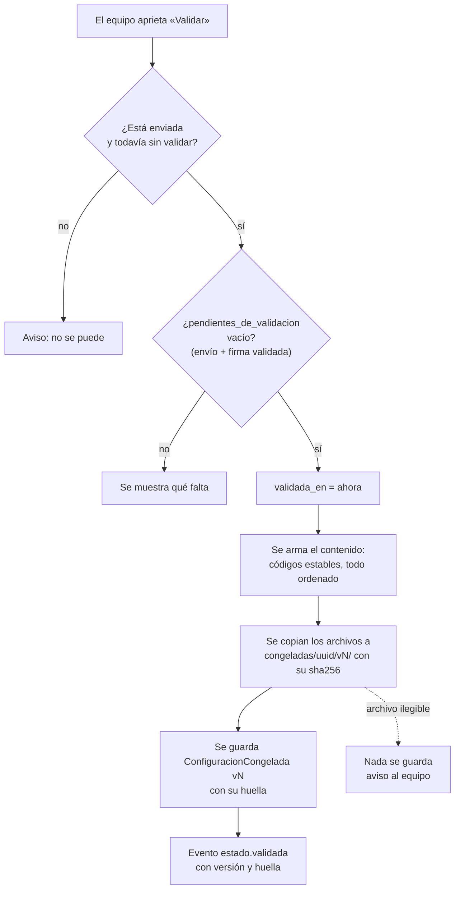

- **Qué contiene la congelada:** empresa, condiciones, módulos, liquidaciones, firma (página y recuadros), roles, sucursales, licencias, novedades y documentos. De la nómina solo van las **cantidades**: los datos personales ya los conserva la base.
- **La huella** depende del contenido y del `sha256` de cada archivo, no de las rutas: si se valida otra vez lo mismo, da la misma huella con otro número de versión.
- **Es de solo lectura**: no se modifica ni se borra, y sobrevive a la implementación (queda el `uuid`).

---

## 8. Qué se registra

Tres registros distintos, cada uno con su razón:

| Registro | Para quién | Qué guarda |
|---|---|---|
| **Historial de versiones** (`ImplementacionVersion`) | Personas: cliente y equipo | La foto de cada sección *antes* de cambiarla, para poder consultarla |
| **Eventos** (`EventoImplementacion`) | Auditoría y, más adelante, un agente | Quién hizo qué y cuándo, el antes y el después de lo que la base pisa o borra |
| **Configuración congelada** | Quien configura (hoy una persona, más adelante un agente) | Lo que se aprobó, con códigos estables y los archivos |

El principio del registro de eventos: **se guarda lo que la base pisa o borra; no se duplica lo que la base ya conserva** (por ejemplo, cada empleado de una nómina importada).

**Eventos que existen hoy**

| Familia | Eventos |
|---|---|
| Alta y acceso | `implementacion.creada`, `acceso.creado`, `implementacion.reasignada` |
| Pasos del cliente | `paso.guardado` (con el antes y el después), `validacion.fallida` (qué no pudo completar, sin los valores) |
| Nómina | `nomina.importada`, `empleado.agregado`, `empleado.editado`, `empleado.eliminado` |
| Envío | `envio.confirmado` |
| Estados | `estado.validada`, `estado.validacion_revocada`, `estado.cumplida`, `estado.cancelada`, `estado.reabierta` |
| Devoluciones | `ronda.devuelta` |
| Firma | `firma.propuesta`, `firma.validada`, `firma.observada`, `firma.corregida_por_implementador`, `archivo.reemplazado` |
| Contacto | `revision.solicitada`, `revision.atendida` |
| Mails | `mail.enviado`, `mail.fallido` (un mail caído no rompe nada: queda registrado) |

Cada evento lleva quién actuó (`cliente`, `implementador`, `admin`, `sistema`, `servicio`, `agente`), un identificador de correlación y la marca **`post_envio`**: indica que el equipo actuó con la documentación ya enviada, o sea, es una **corrección**. Es lo que más enseña a un agente. `manage.py exportar_eventos` los exporta.

---

## 9. Despliegue

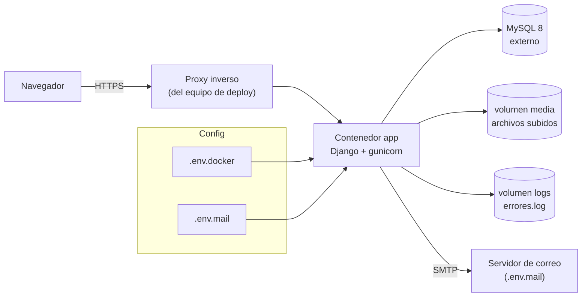

- La imagen se publica **solo al poner un tag `vX.Y.Z`**, no en cada push (`.github/workflows/docker.yml`).
- Al arrancar, `docker/entrypoint.sh` rechaza valores de ejemplo en la configuración y migra la base; `/salud/` es el chequeo de salud.
- Pasos de release y vuelta atrás: `deploy/RELEASE.md`. Correo: `deploy/CORREO.md`. Docker: `deploy/DOCKER.md`.
- La app es la única que decide quién ve qué archivo (`/media/` pasa por una vista con permisos), así que el proxy no sirve `/media/` por su cuenta.

---

## 10. Qué entra en el release y qué viene después

```mermaid
flowchart LR
    subgraph Release["Release (implementadores humanos)"]
        direction TB
        R1["Wizard de 10 pasos"]
        R2["Editor de firma"]
        R3["Validar, devolver y cumplir"]
        R4["Control de faltantes único"]
        R5["Eventos y rondas"]
        R6["Configuración congelada"]
        R7["Panel, reporte .xlsx"]
    end
    subgraph Despues["Después, con la automatización"]
        direction TB
        D1["RF-07 archivo de 8 columnas"]
        D2["RT-07 configuración ejecutada"]
        D3["RT-08 evaluación de automatizabilidad"]
        D4["RT-04 cola de tareas con reintentos"]
        D5["API y endpoint de HubSpot"]
        D6["Configurador en hr.napsis.ar"]
    end
    Release --> Despues
```

**La información se acumula desde el primer día**, sin necesidad de la cola: eventos con correcciones del equipo, rondas y sus motivos, firmas propuestas y corregidas, y configuraciones congeladas. La cola de tareas solo hace falta para *ejecutar* en segundo plano con reintentos.

**Qué se pierde sin el RT-07** (registro de la configuración ejecutada): el par «lo que pidió el cliente → cómo se configuró de verdad en Napsis». Hoy no hay dónde anotarlo. Es lo más valioso para entrenar a un agente y no necesita cola.
