# Base de datos: diagrama entidad-relación

Esquema real de la base (MySQL 8 en producción, SQLite en desarrollo), sacado de los modelos Django. Son **25 tablas propias** más `auth_user` de Django. El diagrama muestra las claves, los campos que sostienen cada relación y los más importantes de cada tabla; la lista completa de columnas está en los modelos (`*/models.py`).

**Cómo leerlo.** `||--o{` es «uno a muchos» (un cliente tiene muchas implementaciones); `||--o|` es «uno a cero o uno»; las líneas punteadas son relaciones débiles (referencias que pueden quedar vacías).

## Diagrama completo

```mermaid
erDiagram
    auth_user {
        int id PK
        string username UK
        string email
        bool is_staff
        bool is_superuser
        bool is_active
    }
    auth_group {
        int id PK
        string name UK "Supervisor"
    }

    clients_cliente {
        bigint id PK
        string nombre
        string razon_social
        string cuits "uno o varios, separados por coma"
        int usuario_id FK,UK "cuenta de login del cliente"
    }
    clients_implementacion {
        bigint id PK
        bigint cliente_id FK
        string token UK "link unico del wizard"
        uuid uuid UK "identidad estable"
        string estado "pendiente / cumplida / cancelada"
        smallint paso_actual
        datetime enviado "el cliente envio"
        datetime validada_en "el equipo valido"
        datetime cumplida_en
        datetime cancelada_en
        int implementador_asignado_id FK
        int creado_por_id FK
        string tipo_firma
        file banner
        file logo
        file modelo_recibo "PDF"
        date fecha_salida_productivo
    }

    clients_modulo {
        bigint id PK
        string codigo UK
        string nombre UK
    }
    clients_implementacionmodulo {
        bigint id PK
        bigint implementacion_id FK
        bigint modulo_id FK
        bool activo
    }

    clients_personarol {
        bigint id PK
        bigint implementacion_id FK
        string rol "apoderado / liquidador / admin_rrhh"
        string cuil
        bigint empleado_id FK "vinculo a la nomina, por CUIL"
    }
    clients_alcanceregla {
        bigint id PK
        bigint persona_id FK
        string campo "puesto, sector, gerencia..."
        string valor
    }
    clients_alcancepersona {
        bigint id PK
        bigint persona_id FK
        string cuil "persona suelta del alcance"
    }

    clients_sucursal {
        bigint id PK
        bigint implementacion_id FK
        string nombre
        string localidad
    }

    employees_importbatch {
        bigint id PK
        bigint implementacion_id FK
        string nombre_archivo
        int filas_importadas
        json errores
    }
    employees_empleado {
        bigint id PK
        bigint implementacion_id FK
        bigint import_batch_id FK
        bigint sucursal_id FK
        bigint reporta_a_id FK "otro empleado"
        bigint aprobador_id FK "otro empleado"
        string cuil
        string puesto
        string sector
        string gerencia
        bool es_supervisor
    }

    catalog_tipolicencia {
        bigint id PK
        string codigo UK
        string nombre UK
    }
    clients_implementacionlicencia {
        bigint id PK
        bigint implementacion_id FK
        bigint tipo_licencia_id FK
        bool activo
    }
    catalog_tiponovedad {
        bigint id PK
        string codigo UK
        string nombre UK
    }
    clients_implementacionnovedad {
        bigint id PK
        bigint implementacion_id FK
        bigint tipo_novedad_id FK
        bool activo
    }
    catalog_tipoliquidacion {
        bigint id PK
        string codigo UK
        string nombre UK
    }
    clients_implementacionliquidacion {
        bigint id PK
        bigint implementacion_id FK
        bigint tipo_liquidacion_id FK
        bool activo
    }
    catalog_tipodocumento {
        bigint id PK
        string codigo UK
        string nombre
        bigint implementacion_id FK "solo los personalizados"
        bool es_custom
    }
    catalog_campodocumento {
        bigint id PK
        bigint tipo_documento_id FK
        string nombre
        bool obligatorio
    }
    clients_implementaciontipodocumento {
        bigint id PK
        bigint implementacion_id FK
        bigint tipo_documento_id FK
        bool activo
    }

    clients_ubicacionfirma {
        bigint id PK
        bigint implementacion_id FK
        bigint tipo_liquidacion_id FK
        string estado "propuesta / validada / observada"
        json geometria "recuadros como fracciones"
        file imagen
        string imagen_sha256
    }
    clients_rondarevision {
        bigint id PK
        bigint implementacion_id FK
        int numero
        json observaciones
        datetime devuelta_en
        datetime respondida_en
    }
    clients_comentariointerno {
        bigint id PK
        bigint implementacion_id FK
        int autor_id FK
        text texto "solo se agrega"
    }
    clients_implementacionversion {
        bigint id PK
        bigint implementacion_id FK
        string seccion
        json datos "foto de la seccion"
        string editado_por
    }

    automatizacion_eventoimplementacion {
        bigint id PK
        bigint implementacion_id FK
        uuid implementacion_uuid "sobrevive al borrado"
        datetime momento
        string actor_tipo
        string accion
        json datos
    }
    automatizacion_configuracioncongelada {
        bigint id PK
        bigint implementacion_id FK
        uuid implementacion_uuid "sobrevive al borrado"
        int version
        json contenido "lo aprobado"
        json archivos "copia inmutable + sha256"
        string hash
    }

    auth_user ||--o| clients_cliente : "cuenta de login"
    auth_user }o--o{ auth_group : "pertenece"
    auth_user ||--o{ clients_implementacion : "asignada a"
    auth_user ||--o{ clients_implementacion : "creada por"
    auth_user ||--o{ clients_comentariointerno : "escribe"

    clients_cliente ||--o{ clients_implementacion : "tiene"

    clients_implementacion ||--o{ clients_implementacionmodulo : ""
    clients_modulo ||--o{ clients_implementacionmodulo : ""

    clients_implementacion ||--o{ clients_personarol : "roles"
    clients_personarol ||--o{ clients_alcanceregla : "alcance"
    clients_personarol ||--o{ clients_alcancepersona : "alcance"
    employees_empleado |o--o{ clients_personarol : "vinculo por CUIL"

    clients_implementacion ||--o{ clients_sucursal : ""
    clients_implementacion ||--o{ employees_importbatch : ""
    clients_implementacion ||--o{ employees_empleado : "nomina"
    employees_importbatch |o--o{ employees_empleado : "origen"
    clients_sucursal |o--o{ employees_empleado : "trabaja en"
    employees_empleado |o--o{ employees_empleado : "reporta a"
    employees_empleado |o--o{ employees_empleado : "aprobador"

    clients_implementacion ||--o{ clients_implementacionlicencia : ""
    catalog_tipolicencia ||--o{ clients_implementacionlicencia : ""
    clients_implementacion ||--o{ clients_implementacionnovedad : ""
    catalog_tiponovedad ||--o{ clients_implementacionnovedad : ""
    clients_implementacion ||--o{ clients_implementacionliquidacion : ""
    catalog_tipoliquidacion ||--o{ clients_implementacionliquidacion : ""
    clients_implementacion ||--o{ clients_implementaciontipodocumento : ""
    catalog_tipodocumento ||--o{ clients_implementaciontipodocumento : ""
    catalog_tipodocumento ||--o{ catalog_campodocumento : "campos"
    clients_implementacion |o--o{ catalog_tipodocumento : "documentos personalizados"

    clients_implementacion ||--o{ clients_ubicacionfirma : "firma"
    catalog_tipoliquidacion |o--o{ clients_ubicacionfirma : "por liquidacion"
    clients_implementacion ||--o{ clients_rondarevision : "devoluciones"
    clients_implementacion ||--o{ clients_comentariointerno : "comentarios"
    clients_implementacion ||--o{ clients_implementacionversion : "historial"

    clients_implementacion |o--o{ automatizacion_eventoimplementacion : "eventos"
    clients_implementacion |o--o{ automatizacion_configuracioncongelada : "versiones"
```

## Lo que hay que saber del modelo

**`Implementacion` es el centro.** Casi todo lo que el cliente completa en el wizard cuelga de ella y no de `Cliente`: así una misma empresa puede repetir el proceso sin arrastrar datos de una ronda anterior. `Cliente` es la empresa (persistente, con su cuenta de login); `Implementacion` es una ronda de relevamiento, con su link único (`token`) y su `uuid` estable.

**Estado derivado, no guardado.** No hay una columna «estado visible»: se calcula con `estado` + `enviado` + `validada_en` (+ las rondas de revisión). «Sin movimiento» tampoco se guarda: sale del último evento.

**Tablas de activación.** `ImplementacionModulo`, `ImplementacionLicencia`, `ImplementacionNovedad`, `ImplementacionLiquidacion` e `ImplementacionTipoDocumento` son tablas puente entre una implementación y un catálogo, con un `activo`. Los catálogos (`Modulo`, `TipoLicencia`, `TipoNovedad`, `TipoLiquidacion`, `TipoDocumento` + `CampoDocumento`) son datos de referencia que carga `seed_catalogos`/`seed_modulos`. Un `TipoDocumento` puede ser **personalizado** de una implementación (`implementacion_id` no nulo, `es_custom`).

**Nómina y roles.** `Empleado` pertenece a una implementación y se autorrelaciona (`reporta_a`, `aprobador`). `PersonaRol` (Apoderado, Liquidador, Admin. de RRHH) se vincula a su empleado **por CUIL** (`empleado_id`, vacío si el empleado se borra). El **alcance del liquidador** son filas de `AlcanceRegla` (grupos de la nómina) y `AlcancePersona` (personas sueltas por CUIL, que sobreviven a reimportar la nómina).

**Trazabilidad que no se pierde.** `EventoImplementacion` (solo se agrega) y `ConfiguracionCongelada` (inmutable, una fila por versión) guardan además `implementacion_uuid`: si la implementación se borra, la clave foránea queda en `NULL` pero el `uuid` conserva a qué caso pertenecían.

**JSON en la base.** Hay campos `JSONField` donde la forma es variable y no se consulta por columna: `geometria` y `motivos` (firma), `observaciones` (rondas), `datos` (versiones y eventos), `contenido` y `archivos` (congelada), `errores` (importaciones).

## Qué pasa al borrar (`on_delete`)

| Relación | Al borrar el padre | Por qué |
|---|---|---|
| `Cliente` → `Implementacion` | **CASCADE** | Sin la empresa no hay sus implementaciones. |
| `Implementacion` → roles, alcance, sucursales, nómina, importaciones, licencias, novedades, liquidaciones, documentos, firma, rondas, comentarios, versiones | **CASCADE** | Son datos de esa implementación. |
| Catálogo (`Modulo`, `TipoLicencia`, `TipoNovedad`, `TipoLiquidacion`) → tabla puente | **PROTECT** | No se puede borrar un ítem del catálogo que alguien está usando. |
| `TipoDocumento` → `ImplementacionTipoDocumento` | CASCADE | El tipo personalizado se va con su implementación. |
| `User` → `Implementacion` (asignada, creada por), `ComentarioInterno.autor` | **SET NULL** | La baja de una cuenta no debe borrar casos ni comentarios (igual, la baja es lógica: `is_active`). |
| `Cliente.usuario` → `User` | SET NULL | Si se borra la cuenta, la empresa se conserva. |
| `Implementacion` → `EventoImplementacion`, `ConfiguracionCongelada` | **SET NULL** | El registro de lo ocurrido y lo aprobado sobrevive; queda el `implementacion_uuid`. |
| `Empleado` → `PersonaRol.empleado`, `reporta_a`, `aprobador`; `Sucursal`/`ImportBatch` → `Empleado` | SET NULL | Borrar a una persona o una sucursal no borra a los demás. |

## Restricciones de unicidad que importan

- `Implementacion.token` y `Implementacion.uuid`: únicos (el link y la identidad).
- `Cliente.usuario`: uno a uno (una empresa, una cuenta de login).
- `AlcanceRegla (persona, campo, valor)` y `AlcancePersona (persona, cuil)`: sin duplicados.
- Catálogos: `codigo` y `nombre` únicos (los códigos son estables: el wizard depende de ellos, no del nombre).
