# Flujos de negocio

Cómo funciona cada proceso del portal, explicado con su regla de negocio, un diagrama y el lugar exacto del código donde vive. Es para quien mantiene el código: se asume que conoce Python pero no necesariamente Django, así que los términos de Django se explican en una línea la primera vez que aparecen (ver el [glosario](#términos-que-aparecen-en-el-documento)).

El resumen general del sistema (capas, apps, modelo de datos, despliegue) está en [`arquitectura.md`](arquitectura.md). Acá se baja al detalle de cada flujo. Los diagramas están en [Mermaid](https://mermaid.js.org/): GitHub los dibuja directamente. Todo lo que sigue ocurre **dentro del portal**: la herramienta es de estado, control y trabajo del equipo y no se integra con Napsis.

Índice: [Cómo leer](#cómo-leer-este-documento) · [Glosario](#términos-que-aparecen-en-el-documento) · [Mapa de estados](#el-mapa-de-estados) · [1. Alta](#1-alta-de-una-implementación) · [2. Guardar una sección](#2-cómo-guarda-una-sección-cualquier-pantalla) · [3. Wizard](#3-el-wizard-del-cliente) · [4. Faltantes](#4-el-control-de-faltantes) · [5. Envío](#5-el-envío-del-relevamiento-por-el-cliente) · [6. Validar y congelar](#6-validar-la-documentación-y-congelar-la-configuración) · [7. Devolver](#7-devolver-al-cliente-rondas-de-revisión) · [8. Firma](#8-la-firma-del-recibo) · [9. Invalidación](#9-la-invalidación-de-la-validación) · [10. Sin movimiento](#10-implementación-sin-movimiento) · [11. Cumplir, anular, reabrir](#11-cumplir-anular-y-reabrir) · [12. Nómina](#12-importación-de-la-nómina) · [13. Mails](#13-qué-mail-sale-en-cada-situación) · [14. Comentarios](#14-comentarios-internos-del-equipo)

---

## Cómo leer este documento

- Las rutas son relativas a la raíz del repositorio. En «Dónde está en el código» se indica el archivo y la función o clase.
- En los diagramas de decisión, cada rombo es una pregunta corta con salidas «sí» y «no». Los nombres con guion bajo (`pendientes_de_envio`, `estado.validada`) son nombres reales del código.
- **La regla que ordena todo:** las acciones (`onboarding/acciones.py`) y los servicios (`onboarding/services/`, `clients/services.py`, `employees/services.py`, `notifications/services.py`) **no conocen el `request`**: si necesitan la URL pública (para armar un link), les llega como parámetro (`base_url`). Las acciones reciben un *actor* (quién hace la cosa) y devuelven un *resultado*; los servicios reciben el actor cuando registran eventos y devuelven lo que corresponda a cada función. Las vistas son las que traducen el pedido web a una llamada de acción o servicio.
- Los tests están en cada app, en paquetes por tema, y sirven de ejemplo de uso. Cada flujo indica los que lo muestran.

## Términos que aparecen en el documento

| Término | Qué es, en una línea |
|---|---|
| **Actor** | `Actor(tipo, ref)` en `automatizacion/actores.py`: quién hace la acción. Los tipos son `cliente`, `implementador`, `admin`, `sistema`, `servicio` y `agente`. `Actor.de_usuario(usuario)` lo deduce de la cuenta: superusuario es admin, cuenta con `is_staff` es implementador, el resto es cliente, y sin sesión actúa el sistema. |
| **Resultado y Aviso** | Lo que devuelve una acción (`onboarding/acciones.py`). `Resultado.ok` es verdadero si no hay `errores`; `avisos` es una lista de `Aviso(nivel, texto)`; `ya_existia` marca un alta repetida. `mostrar(request)` pasa los avisos al sistema de mensajes. |
| **Evento** | Una fila de `EventoImplementacion` (`automatizacion/models.py`): quién, cuándo, qué, y el antes y el después. Solo se agrega: no se modifica ni se borra. Se escribe con `eventos.registrar(...)`. |
| **Vista (view)** | Función de Django que recibe el pedido web y devuelve una página o una redirección. Las del cliente están en `onboarding/views.py` y las del equipo en `dashboard/views.py`. |
| **`request`** | El pedido web: trae el usuario de la sesión, lo enviado por GET o POST y la URL pública. |
| **Formulario (form)** | Clase de Django que valida lo que llega por POST y lo deja limpio en `cleaned_data`. Un *formset* es un conjunto de formularios repetidos (las filas de roles o de sucursales). Un *ModelForm* es un formulario atado a un modelo. |
| **Modelo** | Clase de Django que representa una tabla (`Implementacion`, `Cliente`, `Empleado`...). |
| **Transacción** | `transaction.atomic()`: lo que ocurre dentro del bloque se guarda junto o no se guarda nada. Si hay una excepción, la base vuelve a como estaba (los archivos ya escritos en el disco no). |
| **Mensajes** | `django.contrib.messages`: avisos de una sola vez que se muestran en la pantalla siguiente (éxito, advertencia o error). |
| **Decorador** | Función que envuelve a otra para agregarle un control. `login_required` exige sesión iniciada y `staff_member_required` exige además una cuenta con `is_staff` (del equipo). |
| **Consulta (queryset) y anotación** | Un queryset es una consulta a la base que todavía no se ejecutó. `annotate` le suma una columna calculada a cada fila, dentro de la misma consulta SQL. |
| **Operaciones en lote** | `bulk_create` y `bulk_update` guardan muchas filas con pocas consultas, en vez de una consulta por fila. |
| **Token** | Texto secreto de la implementación. Forma el link `/r/<token>/` del cliente. |
| **Foto de una sección (snapshot)** | Diccionario (o lista, en roles, sucursales y empleados) legible con cómo está una sección en un momento. Es lo que se guarda en el historial (`ImplementacionVersion`). |
| **sha256 (huella)** | Resumen criptográfico de un contenido: si cambia un solo byte, cambia la huella. |
| **Plantilla (template)** | Archivo con partes variables. Las pantallas son HTML en `templates/` y los mails son `.txt` en `templates/notifications/`. |
| **Código estable** | Los módulos y los tipos de los catálogos (liquidación, licencia, novedad, documento) tienen un `codigo` que no cambia aunque se corrija el nombre. |

---

## El mapa de estados

La implementación no tiene una columna «estado visible». Lo que ve el equipo se **deriva** de tres campos de `Implementacion` (`estado`, `enviado`, `validada_en`), así no hay dos datos que puedan contradecirse. Encima de eso hay dos **marcas** que no son estados: «Devuelta, ronda N» y «Implementación sin movimiento».

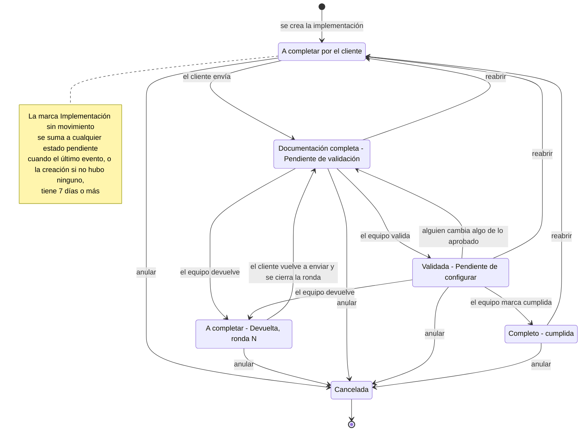

**De qué campos sale cada estado** (`Implementacion.estado_visual`, en `clients/models.py`). Se evalúa en este orden y se toma el primero que se cumpla:

| Orden | Lo que ve el equipo | `estado` | `enviado` | `validada_en` |
|---|---|---|---|---|
| 1 | Cancelada | `cancelada` | no se mira | no se mira |
| 2 | Completo | `cumplida` | no se mira | no se mira |
| 3 | Pendiente - A completar por cliente | `pendiente` | vacío | no se mira |
| 4 | Validada - Pendiente de configurar | `pendiente` | con fecha | con fecha |
| 5 | Documentación completa - Pendiente de validación | `pendiente` | con fecha | vacío |

**Las dos marcas**

- **«Devuelta, ronda N»** (`Implementacion.marca_de_devolucion`): aparece mientras exista una ronda de revisión sin responder (`RondaRevision.respondida_en` vacío). Devolver saca a la implementación del envío, así que una implementación con ronda abierta nunca está enviada y normalmente está en «A completar». La excepción es anular: no cierra la ronda, así que una devuelta que se anula queda «Cancelada» pero conserva la marca. En el listado del panel y en el del cliente (`/r/mis-implementaciones/`) la marca reemplaza al nombre del estado (también en una cancelada: se ve «Devuelta, ronda N» en lugar de «Cancelada»; la ficha del panel muestra las dos cosas). Ver el [flujo 7](#7-devolver-al-cliente-rondas-de-revisión).
- **«Implementación sin movimiento»** (`Implementacion.sin_movimiento`): una pendiente a la que nadie le registró un evento en 7 días. Ver el [flujo 10](#10-implementación-sin-movimiento).

**Detalles que el diagrama no muestra**

- La acción `reabrir` no controla desde qué estado se llama y la acción `anular` tampoco. Lo que limita es la ficha del panel: ofrece «Reiniciar link» y «Anular» mientras la implementación **no** esté cancelada (incluye las cumplidas). Por eso en el diagrama la cancelada es un final.
- `reabrir` y `anular` no tocan las rondas: si había una ronda abierta, la marca «Devuelta, ronda N» sigue.
- «Cumplida» no pierde `validada_en` si después alguien edita (ver [flujo 9](#9-la-invalidación-de-la-validación)).

**Dónde está en el código**

- `clients/models.py`: `Implementacion.estado_visual`, `VISUAL_LABELS`, `filtro_visual`, `ronda_abierta`, `marca_de_devolucion`, `sin_movimiento`.
- `clients/services.py`: `filtrar_y_ordenar_implementaciones` (el orden por estado usa `estado_orden`).
- Ejemplos en los tests: `onboarding/tests/revision/test_estados.py`, `clients/tests/modelos/test_sin_movimiento.py`.

---

## 1. Alta de una implementación

**La regla.** El equipo crea la implementación desde el modal «Nueva implementación» del panel. Elige un cliente existente o carga uno nuevo: para uno nuevo alcanza con el nombre, y la razón social y el CUIT son opcionales (si faltan, los completa el cliente en el paso 1). Si el cliente todavía no tiene cuenta de acceso, se le crea una: con mail, la cuenta nace **sin contraseña** y se le manda un link para crearla; sin mail, se genera una contraseña que se muestra **una única vez** en pantalla. **Recibo Digital va siempre activo**, aunque no se lo tilde. Las *condiciones del proceso* fijan lo que el cliente después no podrá cambiar. Cliente, cuenta, implementación y módulos se guardan juntos o no se guarda nada; el mail sale después, y si falla el alta ya está hecha.

### 1A. Qué se valida y qué se crea

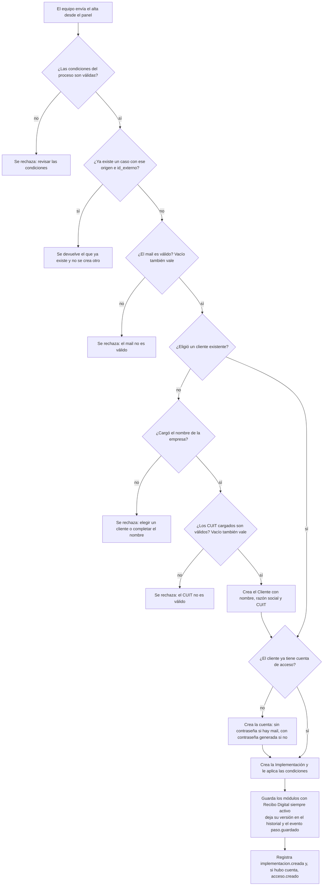

- La primera pregunta (condiciones) la hace la vista del panel; el resto lo hace la acción `crear_implementacion`. Los errores vuelven en `Resultado.errores` y el panel reabre el modal mostrándolos y conservando lo escrito.
- **CUIT válido** (`normalizar_cuits`): 11 dígitos con el dígito verificador correcto (módulo 11, como AFIP). Acepta varios separados por coma o punto y coma, con o sin guiones, y los guarda como `NN-NNNNNNNN-N`. Si el verificador da 10, el CUIT se emite con prefijo 23 y verificador 9 o 4: el código contempla ese caso.
- **Cliente existente con cuenta:** no se le toca la cuenta ni se le manda invitación, aunque se cargue un mail. Ese mail solo queda como `mail_contacto` de la implementación (así el paso 1 lo trae cargado).
- **`origen` + `id_externo`** identifican el caso en el sistema que lo originó (`portal` por defecto, también `hubspot` y `api`). El panel no los usa; sirven para quien llame a la acción desde otro sistema y no quiera duplicar casos.
- **Módulos:** `guardar_modulos` marca activo a Recibo Digital aunque no venga en la selección. El equipo tampoco puede sacarlo después.
- **Los eventos del alta, en orden:** `guardar_modulos` pasa por `cambio_de_seccion` (flujo 2) como cualquier otra sección, así que antes de `implementacion.creada` quedan la versión de «modulos» en el historial y un evento `paso.guardado` con `seccion = "modulos"`. Después viene `implementacion.creada` y, si hubo cuenta, `acceso.creado`.

**Las condiciones del proceso** (`CondicionesForm.aplicar`). Cada dato se bloquea cuando el equipo lo completa; si lo deja vacío, lo decide el cliente.

| Campo del alta | Si el equipo lo completa | Si lo deja vacío |
|---|---|---|
| Tipo de firma | Queda fijo (`tipo_firma_editable = False`) | Lo elige el cliente |
| Nomenclatura de los PDF | Queda fija (`nomenclatura_editable = False`) | La define el cliente |
| El liquidador ve todos los recibos | `segmentacion_liquidador = "AREA UNICA"`, fija | El cliente indica cómo segmentar |
| Máximo de personas con rol | Entre 3 y 6 | 6 |

**El permiso para editar los módulos no es una condición.** «Permitir que el cliente edite los módulos» es una casilla aparte del modal, que arranca tildada, y no pertenece a `CondicionesForm`: la vista del panel la lee del POST (`modulos_editables`) y la pasa a `crear_implementacion`, que la guarda en `modulos_editables_por_cliente`. Tildada, el cliente puede cambiar los módulos en el paso 2; sin tildar, los ve de solo lectura. No entra en la foto de la sección «condiciones»: en la ficha se cambia con la acción de módulos (`_accion_actualizar_modulos`), no con la de condiciones.

### 1B. Después de guardar: acceso y mail

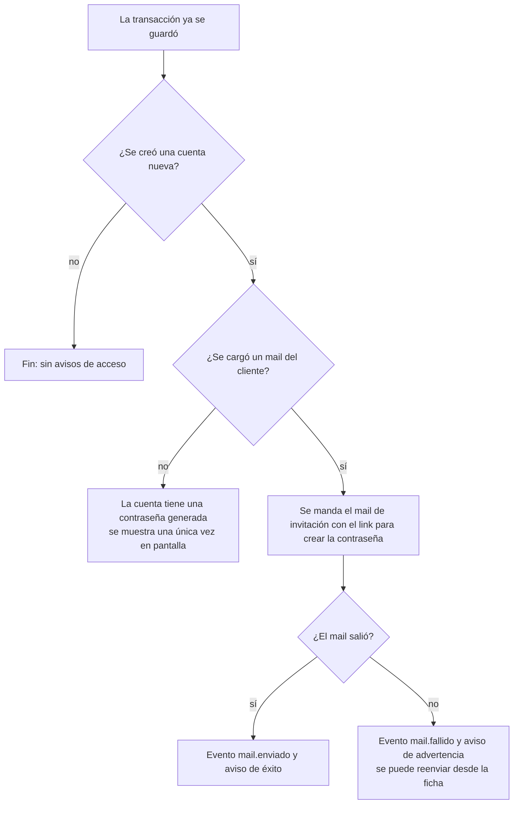

- El link de la invitación vence a los 7 días (`PASSWORD_RESET_TIMEOUT` en `config/settings.py`) y se anula al usarlo. No cambia ninguna contraseña existente.
- La contraseña generada nunca se guarda en un evento. `acceso.creado` (y `acceso.contrasena_reiniciada`, cuando se reinicia desde la ficha) registra el usuario (`username`) y si hubo invitación (`invitacion`), pero no la contraseña.
- Para entregar un acceso después del alta existen `entregar_acceso` (crea la cuenta o reinicia la contraseña) e `invitar_cliente` (reenvía el link al mail de la cuenta o, si no tiene, al de contacto de la implementación). Son los botones «Crear acceso», «Reiniciar contraseña» y «Enviar mail para crear contraseña» de la ficha.

**Dónde está en el código**

- `dashboard/views.py`: `home` (recibe el POST del modal), `_alta_de_implementacion`, `_implementador_elegido` (si no vino un implementador válido y activo, queda asignada a quien la crea), `_accion_actualizar_modulos` (en la ficha, guarda los módulos y la casilla de módulos editables).
- `onboarding/acciones.py`: `crear_implementacion`, `_validar_mail`, `_invitar`, `_aviso_de_credenciales`, `entregar_acceso`, `invitar_cliente`.
- `onboarding/forms.py`: `CondicionesForm` (`aplicar`).
- `clients/validators.py`: `normalizar_cuits`.
- `clients/services.py`: `crear_o_resetear_acceso`, `generar_password`.
- `onboarding/services/secciones.py`: `guardar_modulos`.
- `notifications/services.py`: `enviar_invitacion`.
- Ejemplos en los tests: `onboarding/tests/acciones/test_crear.py`, `onboarding/tests/acciones/test_acceso.py`, `notifications/tests/test_mails_al_cliente.py`.

---

## 2. Cómo guarda una sección cualquier pantalla

**La regla.** El wizard del cliente y la ficha del equipo guardan cada sección con **la misma función de servicio**, así aplican exactamente las mismas reglas. Esa función no escribe directo: pasa por `cambio_de_seccion`, que en **una sola transacción** (1) guarda en el historial cómo estaba la sección, (2) deja que se aplique el cambio, (3) registra un evento con el antes y el después y (4) quita la validación si la implementación estaba validada y algo cambió. Si algo falla en el medio no queda nada: ni el cambio ni su historia.

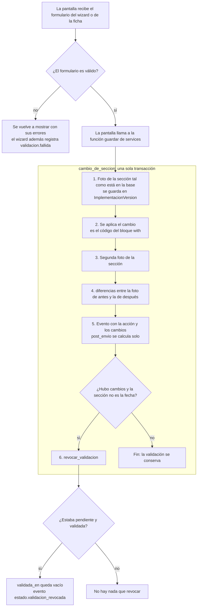

Detalles que conviene tener presentes:

- **Las fotos salen de la base, no del objeto que llega.** `_fresca` vuelve a leer la implementación, porque un formulario de modelo (ModelForm) escribe en la instancia al validar y las relaciones precargadas quedan viejas después de guardar.
- **La foto es para personas** (nombres legibles como «Razón social»); la configuración congelada usa códigos estables. Son dos cosas distintas (ver [flujo 6](#6-validar-la-documentación-y-congelar-la-configuración)).
- **El evento** lleva `accion` (por defecto `paso.guardado`), `seccion` y `datos` con los `cambios`. `post_envio` se calcula solo: es verdadero si actúa alguien que no es el cliente y la implementación ya fue enviada. Eso marca las correcciones del equipo.
- **Guardar lo mismo no cambia nada:** si `diferencias` da vacío no hay revocación, aunque el evento se registre igual.
- **Cuando el formulario del wizard no valida**, la vista llama a `_invalido`, que registra `validacion.fallida` con los campos que fallaron y el texto de cada error, **no los valores cargados**. Ojo: algún mensaje repite lo que se tipeó (el del CUIT inválido incluye el CUIT escrito), así que ese texto sí llega al evento. Los pasos de módulos, licencias y novedades y documentos no la llaman.
- **La nómina es la excepción:** no usa `cambio_de_seccion`. Cada función (`importar_archivo_empleados`, `agregar_empleado`, `editar_empleado`, `eliminar_empleado`) guarda la versión, registra su evento y revoca la validación por su cuenta. Su foto la registra la app `employees` con `registrar_snapshot_builder` (en `employees/apps.py`).

**Qué función guarda cada sección**

| Sección (`seccion`) | Función en `onboarding/services/` | Acción del evento |
|---|---|---|
| `datos_contacto` (empresa, contacto, configuración y archivos) | `guardar_datos_contacto` | `paso.guardado` |
| `modulos` | `guardar_modulos` | `paso.guardado` |
| `sucursales` | `guardar_sucursales` | `paso.guardado` |
| `roles` | `guardar_roles` | `paso.guardado` |
| `liquidaciones` | `guardar_liquidaciones` | `paso.guardado` |
| `licencias_novedades` | `guardar_licencias_y_novedades` | `paso.guardado` |
| `documentos` | `guardar_documentos` | `paso.guardado` |
| `condiciones` | `guardar_condiciones` | `implementacion.condiciones_actualizadas` |
| `fecha_implementacion` | `guardar_fecha_implementacion` | `implementacion.fecha_cambiada` |
| `firma` | `guardar_firma` (en `firma.py`) | `firma.propuesta` o `firma.corregida_por_implementador` |
| `empleados` | funciones de `nomina.py` | `nomina.importada`, `empleado.agregado`, `empleado.editado`, `empleado.eliminado` |

**Dónde está en el código**

- `clients/services.py`: `cambio_de_seccion`, `guardar_version`, `foto_de_seccion`, `_fresca`, `_SNAPSHOT_BUILDERS`, `registrar_snapshot_builder`, `revocar_validacion`, `SECCIONES_QUE_NO_INVALIDAN`.
- `automatizacion/eventos.py`: `registrar`, `diferencias`.
- `onboarding/services/secciones.py`, `roles.py`, `firma.py`, `nomina.py`: las funciones `guardar_*` de la tabla.
- `onboarding/views.py`: `_invalido`, `_errores_de` (el wizard). `dashboard/views.py`: `ACCIONES_DE_LA_FICHA` y las funciones `_accion_actualizar_*` (el panel).
- Ejemplos en los tests: `onboarding/tests/servicios/test_guardado.py`, `onboarding/tests/acciones/test_validaciones_registradas.py`, `automatizacion/tests/test_eventos.py`.

---

## 3. El wizard del cliente

**La regla.** El cliente completa su relevamiento en un wizard de varios pasos (hoy son 10) en `/r/<token>/paso/<n>/`. Los números de paso de este documento son los de hoy: el orden y el total se definen una sola vez en `onboarding/services/pasos.py` (`TOTAL_PASOS` y las constantes `PASO_*`). Para entrar tiene que haber iniciado sesión **con la cuenta del cliente dueño de esa implementación**: el token identifica la implementación pero no reemplaza el login. Los pasos que se le muestran dependen de los **módulos** que tiene activos, y el orden está pensado para que cada paso tenga lo que necesita del anterior. El cliente puede saltar de un paso a otro cambiando la URL, por eso la validación que de verdad protege el envío es el control de faltantes del último paso (flujo 4).

### 3A. Quién puede entrar y qué ve

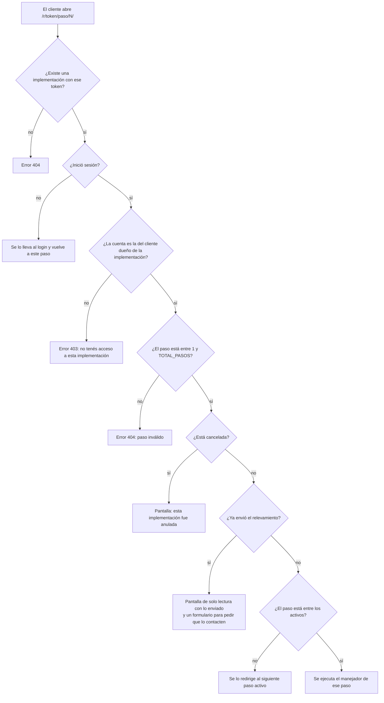

- Una cuenta sin empresa asociada (por ejemplo, una del equipo) recibe 403: el equipo trabaja desde la ficha del panel, no desde el wizard.
- Una implementación **ya enviada** es de solo lectura aunque el equipo todavía no haya terminado de implementar: «enviado» y «cumplida» son cosas distintas.
- Después del login, `PortalLoginView` vuelve a la dirección a la que la persona quería entrar (el parámetro `next`) si es compatible con su tipo de cuenta: el equipo solo vuelve a direcciones de `/panel/` y el cliente solo a las que no lo son. Por eso un cliente que abrió el link de un paso vuelve a ese paso. Sin un `next` válido, los destinos por defecto son `/r/mis-implementaciones/` (el listado de sus implementaciones) para el cliente y `/panel/` para el equipo.

### 3B. Cómo se calculan los pasos activos

Hay cuatro pasos **universales** (1 Datos de contacto, 2 Módulos, 4 Nómina y 10 Revisión y envío). El resto aparece solo si el cliente tiene activo algún módulo que lo necesita (`PASO_REQUIERE_MODULO`, evaluado por `pasos_activos`). El módulo Comunicación no agrega pasos.

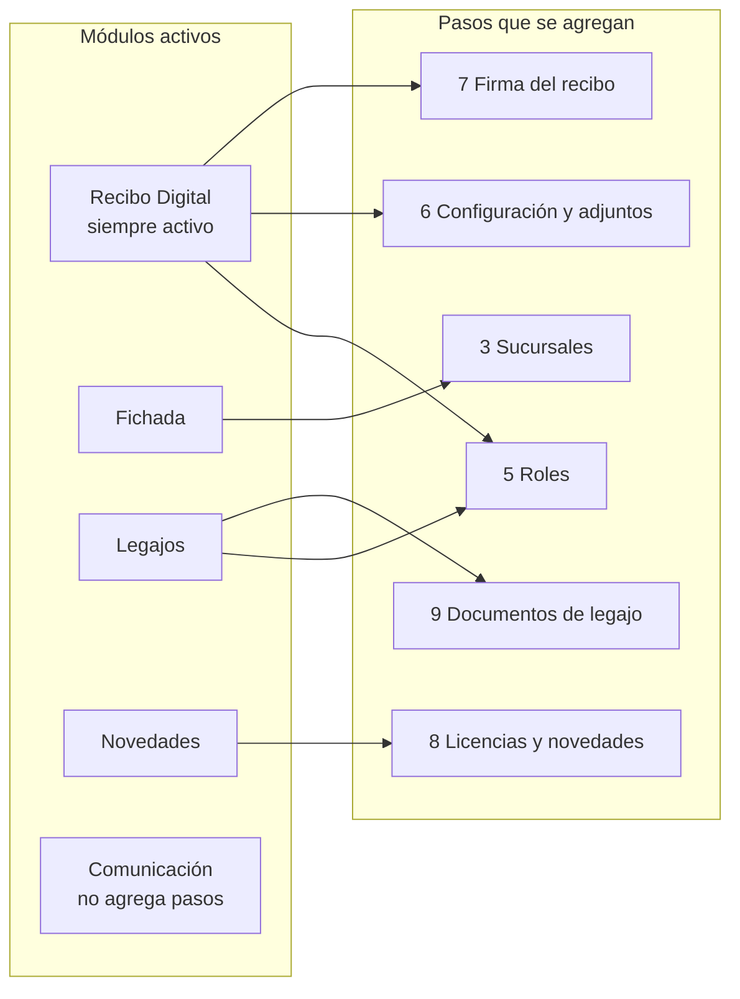

Si el cliente cambia los módulos en el paso 2, los pasos cambian; lo ya cargado en un paso que deja de aplicar no se borra. Solo cuenta para el envío lo que corresponde a los pasos activos.

### 3C. Por qué ese orden

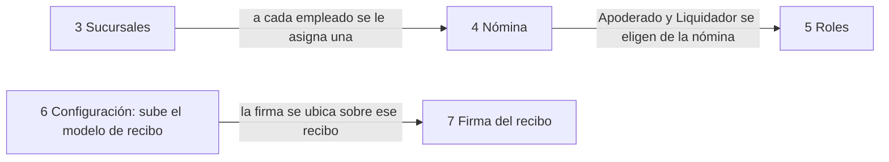

- La firma sin modelo de recibo no se puede ubicar: el paso 7 muestra el pedido de subir el modelo y manda al paso 6.
- Los roles de Apoderado y Liquidador tienen que ser empleados de la nómina (se verifica por CUIL), así que sin nómina cargada el paso 5 no deja guardar.

**Qué hace cada paso al guardar**

| Paso | Manejador en `onboarding/views.py` | Lo que llama |
|---|---|---|
| 1 | `_step_empresa` | `guardar_datos_contacto` |
| 2 | `_step_modulos` | `guardar_modulos` (si el equipo bloqueó los módulos, el POST solo avanza) |
| 3 | `_step_sucursales` | `guardar_sucursales` |
| 4 | `_step_empleados` | `importar_archivo_empleados`, `agregar_empleado`, `editar_empleado`, `eliminar_empleado` (cada una deja al cliente en el mismo paso) |
| 5 | `_step_roles` | `guardar_roles` |
| 6 | `_step_configuracion` | `guardar_datos_contacto` y `guardar_liquidaciones` |
| 7 | `_step_firma` | `guardar_firma` |
| 8 | `_step_licencias_novedades` | `guardar_licencias_y_novedades` |
| 9 | `_step_documentos` | `guardar_documentos` |
| 10 | `_step_revision` | `enviar_relevamiento` (flujo 5) |

En los pasos de formulario, al guardar bien, `_redirect_next` lleva al **siguiente paso activo** y `_marcar_progreso` sube `paso_actual` solo si el nuevo paso es mayor (es el indicador «paso N/total» que se ve en los listados). El paso 4 es distinto: importar, agregar, editar y eliminar empleados dejan al cliente en el mismo paso, y solo la acción «continuar» avanza con `_redirect_next`, y únicamente si hay al menos un empleado (si no, muestra el error «Tenés que cargar la nómina (al menos un empleado) para poder continuar.»). El paso 7, sin modelo de recibo cargado, no procesa ningún POST: solo muestra el pedido de subirlo. Mientras hay una devolución abierta, cada paso muestra el motivo general y la observación de ese paso (`_devolucion`).

**Dónde está en el código**

- `onboarding/views.py`: `wizard_step`, `_verificar_acceso_cliente`, `_get_implementacion`, `_vista_solo_lectura`, `_paso_siguiente`, `_paso_anterior`, `_redirect_next`, `_marcar_progreso`, `_wizard_context`, `_devolucion`, `_HANDLERS`.
- `onboarding/services/pasos.py`: `pasos_activos`, `PASO_REQUIERE_MODULO`, `TOTAL_PASOS`, `CODIGO_DE_PASO`, `TITULOS_PASO`.
- `clients/views.py`: `PortalLoginView`.
- Ejemplos en los tests: `onboarding/tests/wizard/test_acceso.py`, `onboarding/tests/wizard/test_orden.py`, `onboarding/tests/servicios/test_pasos.py`.

---

## 4. El control de faltantes

**La regla.** Hay **un solo lugar** que dice qué falta: `pendientes_de_envio` (qué falta para que el cliente pueda enviar) y `pendientes_de_validacion` (qué falta para que el equipo pueda validar). Lo usan el último paso del wizard, la ficha del panel y la acción de validar. `pendientes_de_envio` devuelve una lista de `{"paso": N, "mensaje": ...}` (vacía significa listo) ordenada por número de paso. Los controles son **independientes**: no se corta en el primero que falla, todos suman su mensaje. Cada rombo de los diagramas se lee como «¿falta esto?».

### 4A. Empresa, módulo, sucursales y roles

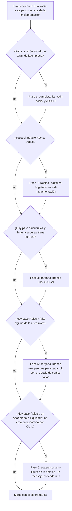

- Los tres roles son Apoderado / Firmante, Liquidador y Admin. de RRHH (`PersonaRol.ROL_CHOICES`). Una persona sin apellido y nombre no cuenta.
- Solo el Apoderado y el Liquidador (`PersonaRol.ROLES_EN_NOMINA`) tienen que estar en la nómina: se compara su CUIL, normalizado, con los CUIL de los empleados. Admin. de RRHH no.
- El paso Sucursales existe con Fichada; el paso Roles, con Recibo Digital o Legajos.

### 4B. Configuración, firma y nómina

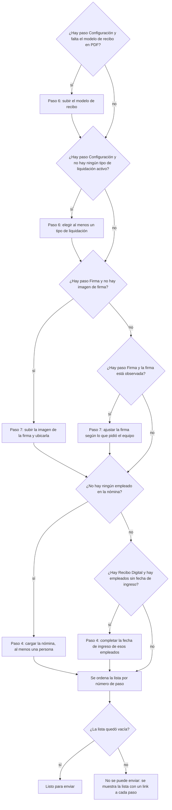

- La firma se mira en dos pasos excluyentes: sin imagen se pide subirla, y recién si hay imagen se mira si está observada. Una firma «propuesta» no bloquea el **envío**.
- La fecha de ingreso solo es obligatoria con Recibo Digital. Si no hay empleados se pide la nómina y no se mira la fecha de ingreso (son excluyentes).

### 4C. Qué falta para validar

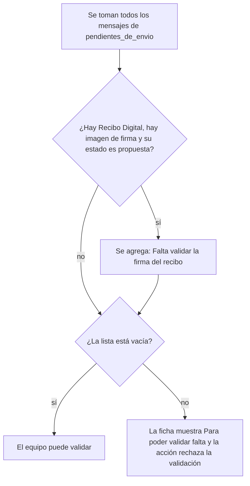

Validar exige entonces lo mismo que enviar **más** que la firma esté validada: una firma observada ya figura como pendiente de envío, y una propuesta suma «Falta validar la firma del recibo». Se vuelve a controlar al validar porque el equipo pudo cambiar datos después del envío.

**Quién usa cada control**

| Control | Quién lo llama |
|---|---|
| `pendientes_de_envio` | `_step_revision` (el último paso del wizard) y, por dentro, `pendientes_de_validacion` |
| `pendientes_de_validacion` | `aprobar_para_configurar` y `implementacion_detalle` (la ficha lo muestra solo si está enviada y sin validar) |

`enviar_relevamiento` **no** vuelve a controlar: confía en que quien lo llama (la vista del último paso) ya lo hizo.

**Dónde está en el código**

- `onboarding/services/faltantes.py`: `pendientes_de_envio`, `pendientes_de_validacion`.
- `onboarding/services/pasos.py`: `pasos_activos`.
- `clients/models.py`: `PersonaRol.ROL_CHOICES`, `PersonaRol.ROLES_EN_NOMINA`.
- `employees/services.py`: `normalizar_cuil`.
- Ejemplos en los tests: `onboarding/tests/servicios/test_pendientes.py`, `onboarding/tests/revision/test_reglas.py`, `onboarding/tests/servicios/test_ingreso_obligatorio.py`.

---

## 5. El envío del relevamiento por el cliente

**La regla.** En el último paso el cliente ve lo que falta (flujo 4) y, si no falta nada, puede enviar. Puede pedir una **fecha de salida en productivo**, que es opcional pero, si la pide, tiene que ser a partir de `DIAS_HABILES_MINIMOS_CLIENTE` **días hábiles** (hoy 10; lunes a viernes, sin descontar feriados) desde hoy. Si el equipo ya había puesto una fecha anterior a ese mínimo, esa se acepta tal cual. Primero se registra el envío y recién después se avisa por mail al equipo y al cliente: si el mail falla (SMTP caído, por ejemplo) el cliente no pierde lo que terminó. Enviar no cumple la implementación: recién ahí empieza el trabajo del equipo.

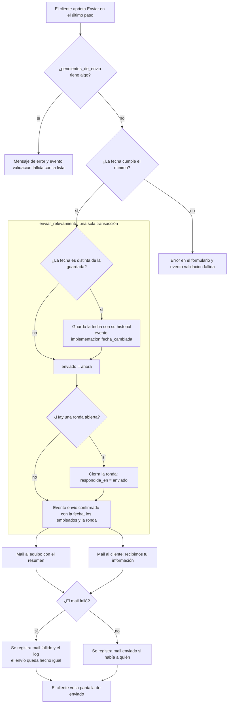

- **El orden de los controles** en la vista: primero los pendientes y, si no hay, la fecha. Con pendientes la fecha ni se mira.
- **La fecha mínima** es `sumar_dias_habiles(hoy, DIAS_HABILES_MINIMOS_CLIENTE)`: avanza día por día y solo cuenta lunes a viernes. El mínimo se calcula al armar el formulario. Un campo vacío es válido: si ya había una fecha guardada y el campo llega vacío, se borra (`guardar_fecha_implementacion` con `None`).
- **Cambiar la fecha no quita la validación** (flujo 9): la fecha no se configura.
- **Cada mail se intenta por separado.** Si no hay destinatario (equipo sin configurar o cliente sin mail) no se manda y no se registra nada. Detalle en el [flujo 13](#13-qué-mail-sale-en-cada-situación).
- **Cierre de ronda:** si el envío responde a una devolución, `respondida_en` toma la fecha del envío y el evento `envio.confirmado` lleva el número de ronda (flujo 7).

**Dónde está en el código**

- `onboarding/views.py`: `_step_revision`, `enviado`.
- `onboarding/forms.py`: `FechaImplementacionForm`.
- `onboarding/services/fechas.py`: `fecha_minima_para_cliente`, `sumar_dias_habiles`, `DIAS_HABILES_MINIMOS_CLIENTE`.
- `onboarding/acciones.py`: `enviar_relevamiento`, `registrar_validacion_fallida`.
- `onboarding/services/secciones.py`: `guardar_fecha_implementacion`.
- `notifications/services.py`: `notificar_implementacion_completa`, `notificar_cliente_relevamiento_recibido`.
- Ejemplos en los tests: `onboarding/tests/wizard/test_envio.py`, `onboarding/tests/acciones/test_envio.py`, `onboarding/tests/servicios/test_pasos.py` (días hábiles).

---

## 6. Validar la documentación y congelar la configuración

**La regla.** El equipo valida cuando la documentación enviada está completa: queda «Validada - Pendiente de configurar». Solo se valida una implementación **pendiente, ya enviada y todavía sin validar**, y solo si el control de faltantes para validar (flujo 4C) da vacío. Al validar se **congela** la configuración: una foto inmutable de todo lo aprobado, con códigos estables y una copia de los archivos con su `sha256`. Es lo que el equipo usa de referencia para configurar a mano. Todo ocurre en una transacción: si un archivo no se puede leer, no queda nada guardado.

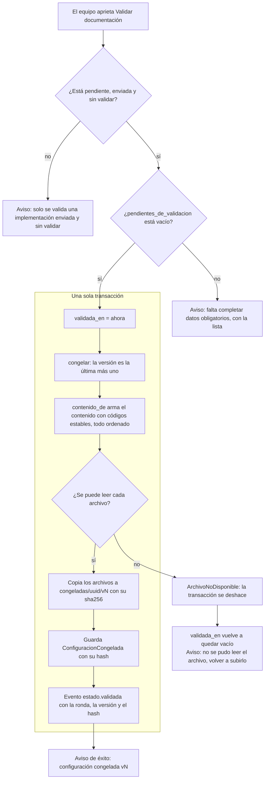

**El caso del archivo ilegible.** `_copiar_archivos` abre cada archivo (modelo de recibo, logo, banner e imagen de la firma, los que existan). Si uno no se puede leer levanta `ArchivoNoDisponible(campo)`. Como eso ocurre dentro de la transacción, la base se deshace: no queda `validada_en`, ni versión congelada, ni evento. La acción devuelve un aviso de error con el nombre del campo («no se pudo leer el archivo...») y restablece `validada_en = None` en el objeto que tiene en memoria. Un detalle del código: los archivos que ya se habían copiado al disco antes del que falló no se borran (la transacción deshace la base, no el almacenamiento).

**Qué contiene la congelada** (`contenido_de`, con un esquema versionado: ver `VERSION_ESQUEMA`): `esquema`; `implementacion` (uuid, origen, id_externo); `empresa` (razón social, CUIT como lista, teléfono, mail); `fecha_salida_productivo`; `condiciones`; `modulos`, `liquidaciones`, `licencias`, `novedades` (por código estable, ordenados); `firma` (página, recuadros, estado); `roles`; `sucursales`; `documentos` (los del catálogo por código; los «Otros» con su nombre y campos); y de la `nomina` solo las **cantidades** (empleados y cuántos tienen fecha de ingreso), porque los datos personales ya los conserva la base. Los comentarios internos no forman parte.

**Propiedades que importan**

- **La huella** (`hash_de`) se calcula con el contenido y el `sha256` de cada archivo, no con las rutas: validar dos veces lo mismo da la misma huella con otro número de versión.
- **Solo lectura:** `ConfiguracionCongelada` rechaza modificar o borrar (también en lote) y la versión `(uuid, version)` es única. Si algo cambia, se crea una versión nueva; las anteriores quedan como historia.
- **La versión vigente** es la última, mientras `validada_en` tenga fecha. Si la validación se pierde, la ficha lo indica y ninguna versión figura como vigente.
- **Descarga:** la ficha ofrece cada versión como `.json` (`como_documento`).

**Dónde está en el código**

- `onboarding/acciones.py`: `aprobar_para_configurar`, `_puede_revisarse`.
- `automatizacion/congelada.py`: `congelar`, `contenido_de`, `_archivos_de`, `_copiar_archivos`, `hash_de`, `como_documento`, `ArchivoNoDisponible`, `VERSION_ESQUEMA`.
- `automatizacion/models.py`: `ConfiguracionCongelada`, `CongeladaInmutable`.
- `dashboard/views.py`: `_accion_aprobar_para_configurar`, `descargar_congelada`.
- Ejemplos en los tests: `onboarding/tests/revision/test_aprobar.py`, `automatizacion/tests/congelada/test_creacion.py`, `automatizacion/tests/congelada/test_inmutabilidad.py`, `automatizacion/tests/congelada/test_versiones.py`.

---

## 7. Devolver al cliente: rondas de revisión

**La regla.** Si el equipo ve algo para corregir o completar, **devuelve** el relevamiento al cliente con un motivo (obligatorio) y, opcionalmente, una observación por sección. Solo se puede devolver una implementación **pendiente y ya enviada**: o sea, desde «Documentación completa» o desde «Validada». La devolución abre una **ronda numerada**, saca la implementación del envío (`enviado` y `validada_en` quedan vacíos), deja `paso_actual` en el paso de revisión y le avisa al cliente por mail. Ese `paso_actual` es solo el indicador «paso N/total» de los listados: el cliente entra igual por el paso 1, desde el link del mail o desde su listado. La implementación vuelve a «A completar» con la marca «Devuelta, ronda N». **La ronda se cierra cuando el cliente vuelve a enviar.**

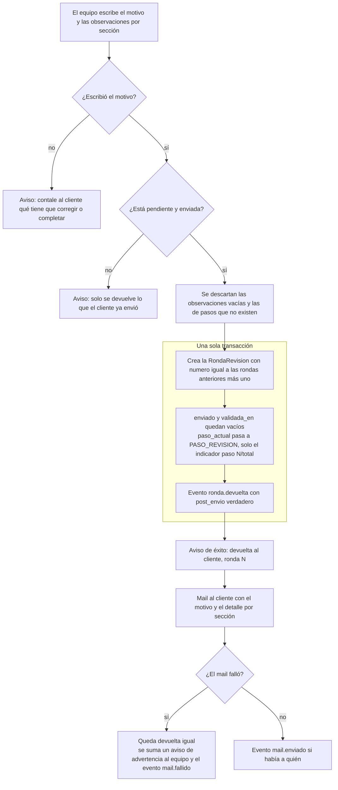

**De qué estado a cuál, y cuándo se cierra**

- **Estado:** de «Documentación completa» o «Validada» a «A completar» con la marca. Es la única vía que abre una ronda y deja la marca «Devuelta, ronda N»: `reabrir` (flujo 11) también vuelve a «A completar», pero en el paso 1 y sin ronda ni marca. No existe un estado «Devuelta» propio.
- **El aviso de éxito sale siempre**, también cuando el mail falla: en ese caso se suma el aviso de advertencia («Quedó devuelta, pero no se pudo avisarle al cliente por mail.»).
- **Se abre** con `devolver_al_cliente`: crea la `RondaRevision` con `devuelta_por` (la referencia del actor) y `respondida_en` vacío.
- **Se cierra** en `enviar_relevamiento`: si hay `ronda_abierta`, le pone `respondida_en` igual al momento del envío y el evento `envio.confirmado` lleva el número de ronda. Al cerrarse desaparece la marca.
- **Una segunda devolución es la ronda 2:** el número es la cantidad de rondas previas más uno. Las rondas se conservan para siempre como historial de idas y vueltas.
- **Las observaciones se guardan por código de paso** (`datos`, `modulos`, `sucursales`, `nomina`, `roles`, `configuracion`, `firma`, `licencias`, `documentos`, `revision`), no por número, así no se pierden si cambia el orden. El cliente ve cada una en su paso.
- **La congelada anterior** queda como historia: sin `validada_en` ninguna versión figura como vigente. Para volver a «Validada» hay que validar de nuevo (versión siguiente).
- **Observar la firma** pasa por esta misma acción (flujo 8).

**Dónde está en el código**

- `onboarding/acciones.py`: `devolver_al_cliente`, `enviar_relevamiento` (cierra la ronda).
- `clients/models.py`: `RondaRevision`, `Implementacion.ronda_abierta`, `marca_de_devolucion`.
- `onboarding/services/pasos.py`: `CODIGO_DE_PASO`.
- `onboarding/views.py`: `_devolucion` (lo que ve el cliente en cada paso).
- `notifications/services.py`: `notificar_cliente_devuelta`.
- `dashboard/views.py`: `_accion_devolver_al_cliente`.
- Ejemplos en los tests: `onboarding/tests/revision/test_devolver.py`.

---

## 8. La firma del recibo

**La regla.** El cliente sube la imagen de la firma del apoderado y ubica sobre su modelo de recibo tres recuadros (firma de la empresa, empleado en conformidad y empleado en disconformidad), en qué página va, y eso queda **propuesto**. El equipo la revisa: la **valida**, la **observa** (con motivos de un catálogo cerrado, y eso la devuelve al cliente) o la **corrige** él mismo (queda validada). Es solo la **intención del cliente**: el portal no la traduce a Napsis. Los recuadros se guardan como fracciones de 0 a 1 de la página, para no depender del tamaño del PDF. Ninguna imagen se pisa: al subir otra, la anterior queda en el disco.

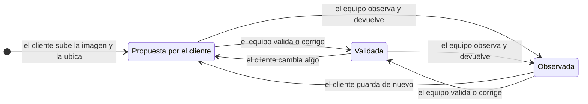

Qué pasa en cada transición:

- **El cliente guarda** (`guardar_firma` con un actor cliente, acción `firma.propuesta`): si algo cambió (página, recuadros o imagen nueva) o si estaba observada, queda «propuesta» y se limpian motivos, comentario y quién la validó. Guardar sin cambios una firma ya validada **no** pierde la validación. Si estaba observada, cualquier guardado es su respuesta.
- **El equipo valida** (`validar_firma`): exige que haya imagen; si ya estaba validada no hace nada. Deja `validada_por` y `validada_en`, y limpia motivos y comentario.
- **El equipo corrige** (`guardar_firma` con un actor del equipo, acción `firma.corregida_por_implementador`): aplica el cambio y la deja validada. Si sube una imagen nueva, el evento `archivo.reemplazado` apunta a la ruta y al `sha256` de las dos.
- **El equipo observa** (`observar_firma`): el diagrama siguiente muestra el orden de los controles.

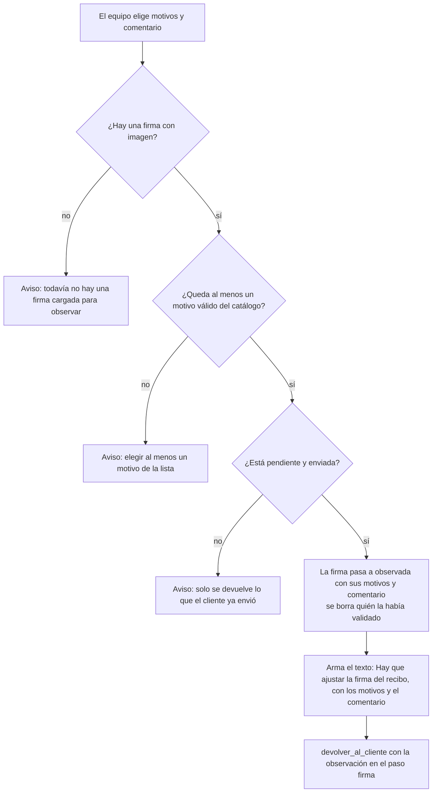

- Los motivos que no estén en el catálogo se descartan en silencio (y se quitan los repetidos). Se guarda el **código**, no el texto.
- Si la implementación estaba validada, el cambio de estado de la firma ya revoca la validación (flujo 9). Quedan los eventos en este orden: `firma.observada`, `estado.validacion_revocada` y, ya dentro de `devolver_al_cliente`, `ronda.devuelta`.

**El catálogo cerrado de motivos** (`UbicacionFirma.MOTIVOS`)

| Código | Texto |
|---|---|
| `ilegible` | La firma no se lee bien |
| `baja_calidad` | La imagen es de baja calidad |
| `tamano_excesivo` | La firma quedó demasiado grande o demasiado chica |
| `superpone_texto` | Se superpone con el texto del recibo |
| `no_replicable` | No se puede replicar así en Napsis |
| `otro` | Otro motivo |

**Cómo se cruza con el control de faltantes**

- Una firma **observada** bloquea el envío: figura como pendiente en el paso 7 hasta que el cliente la ajuste.
- Una firma **propuesta** bloquea la validación: «Falta validar la firma del recibo».
- Validar la firma no exige que el relevamiento esté enviado; observarla sí.

**Condiciones de la imagen** (`FirmaForm`): JPG o PNG, de al menos 200 × 60 px, y cada recuadro debe medir al menos 1% de la página de ancho y de alto sin salirse de ella.

**Dónde está en el código**

- `onboarding/acciones.py`: `validar_firma`, `observar_firma`, `devolver_al_cliente`.
- `onboarding/services/firma.py`: `guardar_firma`, `contexto_del_editor_de_firma`.
- `clients/models.py`: `UbicacionFirma` (estados, `MOTIVOS`, `ELEMENTOS`, `geometria`).
- `onboarding/forms.py`: `FirmaForm`.
- `onboarding/views.py`: `_step_firma`. `dashboard/views.py`: `_accion_validar_firma`, `_accion_observar_firma`, `_accion_corregir_firma`.
- Ejemplos en los tests: `onboarding/tests/firma/test_servicio.py`, `onboarding/tests/firma/test_revision.py`, `onboarding/tests/firma/test_panel.py`.

---

## 9. La invalidación de la validación

**La regla.** No se configura con datos distintos a los que se aprobaron. Por eso, si la implementación ya estaba validada y alguien cambia algo **de lo que se va a configurar**, la validación se pierde: vuelve a «Documentación completa - Pendiente de validación» y hay que volver a validar (se crea otra versión congelada; la anterior queda como historia). Editar la **fecha de implementación** no la quita, porque la fecha no se configura. Guardar **lo mismo** tampoco.

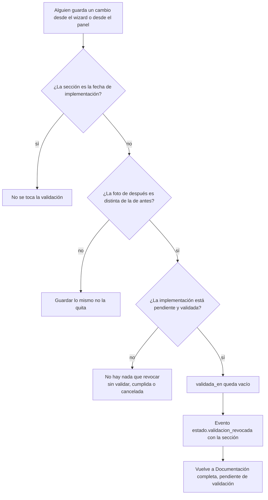

**Qué cambios la quitan y cuáles no**

| Cambio | ¿Quita la validación? | Cómo |
|---|---|---|
| Datos de contacto, empresa o configuración (razón social, CUIT, teléfono, mail, tipo de firma, liquidador, nomenclatura, cantidad de capitas, segmentación, logo, banner, modelo de recibo) | Sí, si algún valor cambió | `cambio_de_seccion` |
| Módulos | Sí, si cambió algún módulo | `cambio_de_seccion` |
| Roles, sucursales, licencias y novedades, tipos de liquidación, documentos de legajo | Sí, si cambió algo | `cambio_de_seccion` |
| Condiciones del proceso | Sí, si cambió algo | `cambio_de_seccion` |
| Corrección de la firma por el equipo | Sí, si algo cambió | `cambio_de_seccion` |
| Observar la firma | Sí (y además devuelve al cliente) | `cambio_de_seccion` y `devolver_al_cliente` |
| Agregar un empleado | Sí, siempre | `revocar_validacion` directo |
| Editar un empleado | Solo si algún campo cambió | `revocar_validacion` directo |
| Eliminar un empleado | Sí, siempre | `revocar_validacion` directo |
| Importar la nómina | Sí, si hubo empleados nuevos o actualizados | `revocar_validacion` directo |
| **Fecha de implementación** | **No** | está en `SECCIONES_QUE_NO_INVALIDAN` |
| La marca «el cliente puede editar los módulos» | No | la ficha la guarda sin pasar por `cambio_de_seccion` |
| Comentarios internos, reasignar el implementador, atender un pedido de contacto, entregar o reiniciar el acceso | No | no tocan una sección |

Otras cosas a saber:

- **Solo si está pendiente.** `revocar_validacion` actualiza únicamente si `estado` es `pendiente` y `validada_en` tiene fecha. Una implementación **cumplida** conserva su `validada_en` aunque después alguien edite.
- **Otras dos vías dejan `validada_en` vacío**, pero no son invalidaciones: `devolver_al_cliente` (flujo 7) y `reabrir` (flujo 11).
- Una importación en la que solo cambió Reporta A o Aprobador (sin empleados nuevos ni campos distintos) no cuenta como cambio: la condición mira únicamente empleados nuevos o actualizados, y esos dos campos no se comparan.

**Dónde está en el código**

- `clients/services.py`: `revocar_validacion`, `SECCIONES_QUE_NO_INVALIDAN`, `cambio_de_seccion`.
- `onboarding/services/nomina.py`: `agregar_empleado`, `editar_empleado`, `eliminar_empleado`, `_cargar_empleados`.
- `dashboard/views.py`: `_accion_actualizar_modulos` (guarda la marca de módulos editables).
- Ejemplos en los tests: `onboarding/tests/revision/test_invalidacion.py`.

---

## 10. «Implementación sin movimiento»

**La regla.** Es una **marca**, no un estado: la implementación sigue donde estaba. Se le pone a una implementación **pendiente** cuando **nadie hizo nada en ella en los últimos 7 días**. «Hacer algo» es cualquier evento registrado: una acción del cliente o del equipo, un comentario, un envío, un mail. Si no tuvo ningún evento, cuenta desde que se creó. Las cumplidas y las canceladas nunca la tienen. Se saca sola en cuanto se registra un evento nuevo.

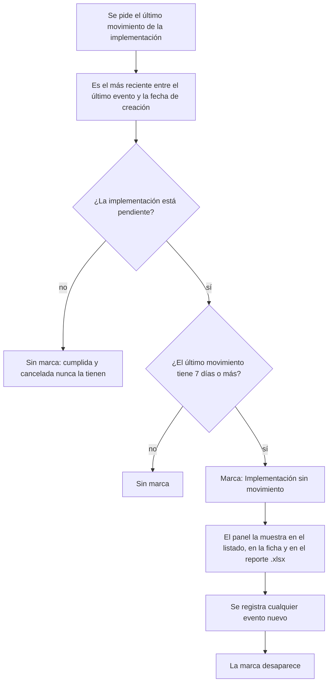

- **El umbral** es `Implementacion.DIAS_SIN_MOVIMIENTO = 7`. La comparación incluye el límite: con exactamente 7 días ya cuenta como sin movimiento (el límite es `ahora - 7 días` y se compara con «menor o igual»).
- **Qué cuenta como movimiento:** todo evento registrado **con esa implementación**: guardar un paso, enviar, validar, devolver, cumplir, anular, reabrir, reasignar, comentar, pedir o atender una revisión, los intentos que fallan la validación y los mails (enviados o fallidos). Dar o reiniciar un acceso cuenta solo si se hace desde la ficha de la implementación (desde la ficha del cliente el evento queda sin implementación). **No** cuenta mirar una pantalla ni entrar a la cuenta.
- **Cómo se calcula sin una consulta por fila:** en los listados, `con_ultimo_movimiento` agrega (con `annotate`) la columna `movimiento_en` con una subconsulta al último evento; si no hay ninguno usa `creado`, y siempre toma el mayor de los dos. Fuera de los listados, `ultimo_movimiento` hace una consulta propia.
- **Dónde se ve:** en el listado del panel (en negrita, arriba del estado, con los días sin actividad en el texto que aparece al pasar el mouse), como opción del filtro «Estado», en un aviso arriba de la ficha, y en el reporte `.xlsx` (columnas «Última actividad» y «Sin movimiento»).

**Dónde está en el código**

- `clients/models.py`: `DIAS_SIN_MOVIMIENTO`, `SIN_MOVIMIENTO`, `SIN_MOVIMIENTO_LABEL`, `limite_sin_movimiento`, `ultimo_movimiento`, `sin_movimiento`, `dias_sin_movimiento`, `opciones_de_filtro_de_estado`.
- `clients/services.py`: `con_ultimo_movimiento`, `filtrar_y_ordenar_implementaciones` (el filtro `estado=sin_movimiento`).
- `dashboard/reportes.py`: `generar_reporte_implementaciones_xlsx`.
- `templates/dashboard/home.html` y `templates/dashboard/implementacion_detalle.html`.
- Ejemplos en los tests: `clients/tests/modelos/test_sin_movimiento.py`, `dashboard/tests/panel/test_seguimiento.py`.

---

## 11. Cumplir, anular y reabrir

**La regla.** Tres acciones del equipo, desde la ficha:

- **Cumplir:** el equipo terminó de implementar. Solo se cumple lo que está **pendiente, enviado y validado**: la configuración parte de lo que se aprobó. Se avisa al cliente por mail; si el mail falla, queda cumplida igual.
- **Anular:** la implementación pasa a cancelada y el cliente ya no puede completarla (ve «Esta implementación fue anulada»). No manda mail.
- **Reabrir** (botón «Reiniciar link»): la deja como recién creada para el cliente. El estado vuelve a pendiente, en el paso 1 y sin envío ni validación. No borra nada de lo cargado.

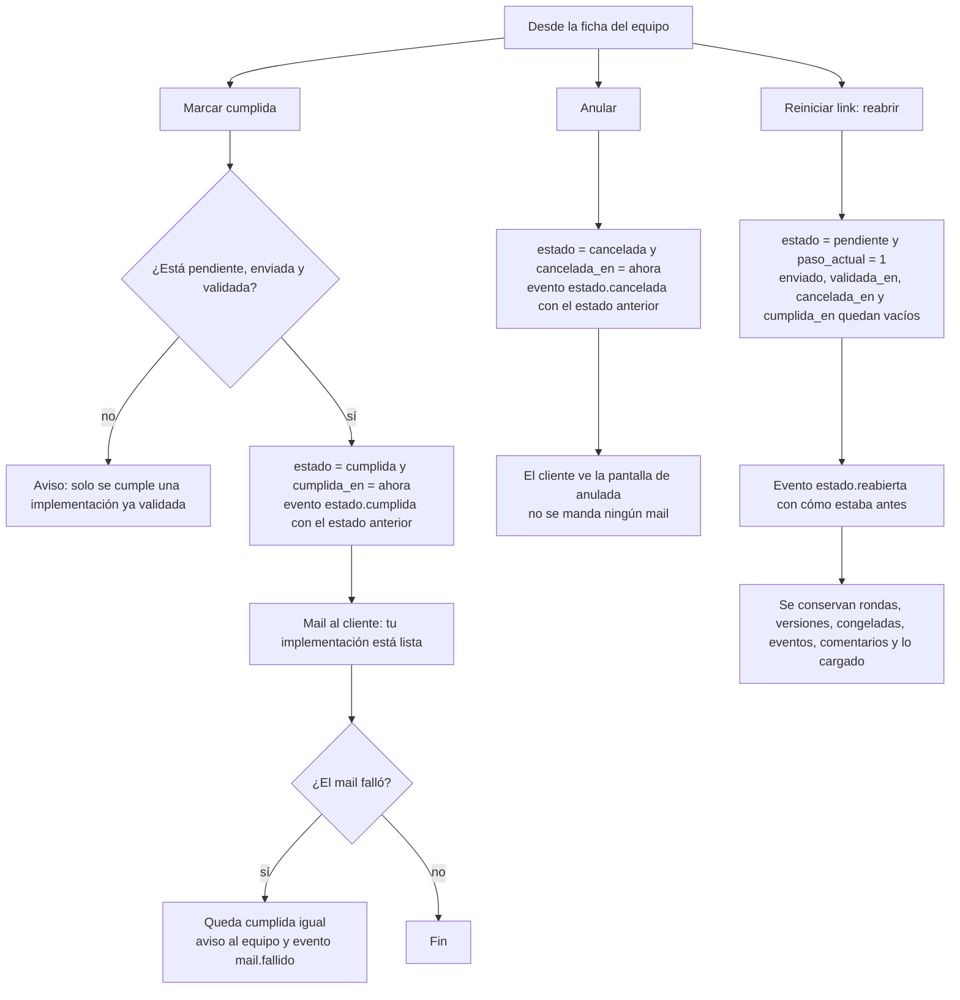

- **Cumplir:** el botón solo aparece cuando la implementación está validada, y la acción lo vuelve a comprobar (un pedido armado a mano al panel tampoco la cumple). Una cumplida pasa a «Completo» y deja de poder marcarse «sin movimiento».
- **Anular:** la acción no comprueba desde qué estado se llama; la ficha ofrece el botón mientras no esté cancelada. El evento guarda `estado_anterior`. No cierra las rondas: anular una devuelta deja la ronda abierta, y el listado sigue mostrando «Devuelta, ronda N» en lugar de «Cancelada».
- **Reabrir:** el evento `estado.reabierta` guarda en `antes` el estado, el paso, `enviado`, `cancelada_en`, `cumplida_en` y `validada_en`, y se marca `post_envio` si estaba enviada. Como no toca las rondas, una ronda abierta sigue abierta. La ficha no ofrece «Reiniciar link» ni «Anular» cuando la implementación está cancelada.

**Dónde está en el código**

- `onboarding/acciones.py`: `marcar_cumplida`, `anular`, `reabrir`, `_puede_revisarse`.
- `clients/models.py`: `Implementacion.marcar_cumplida`, `anular`.
- `dashboard/views.py`: `_accion_marcar_cumplida`, `_accion_anular`, `_accion_regenerar_link`.
- `templates/dashboard/implementacion_detalle.html`: qué botones se muestran en cada estado.
- `onboarding/views.py`: `wizard_step` (la pantalla de anulada).
- `notifications/services.py`: `notificar_cliente_implementacion_cumplida`.
- Ejemplos en los tests: `onboarding/tests/acciones/test_estado.py`, `onboarding/tests/revision/test_cumplir.py`.

---

## 12. Importación de la nómina

**La regla.** El cliente (en el paso 4) o el equipo (en la ficha) pueden cargar la nómina desde un archivo `.xlsx` o `.csv`, a partir de la plantilla descargable. La importación es **todo o nada**: si algo se rompe a mitad de la carga no queda una nómina a medias. Si el archivo en sí no sirve (ilegible, sin las columnas obligatorias, vacío o demasiado grande) se rechaza **antes de tocar nada**. Si el archivo sirve, las filas con errores se informan y **no se cargan**, pero no impiden cargar las demás. Volver a subir una planilla actualiza a los empleados existentes (se reconocen por el CUIL): solo se reescriben los que difieren de lo cargado, pero de cada uno se reescriben **todos** los campos de la planilla, así que una columna ausente o una celda vacía deja ese dato en blanco. Conviene volver a subir la planilla completa. Reporta A y Aprobador son la excepción: una celda vacía no los borra.

### 12A. Leer el archivo y validar las filas

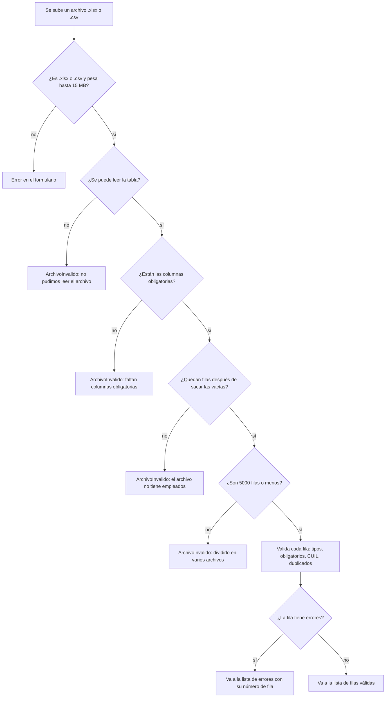

- **Lectura:** los `.csv` se decodifican como UTF-8 o, si no, como cp1252 (los que guarda Excel en español), y el separador se elige entre `;`, `,` y tabulación según la primera línea. Los encabezados toleran mayúsculas, tildes y espacios de más, pero tienen que ser los de la plantilla completos, incluido el texto entre paréntesis (por ejemplo «Fecha Ingreso (DD/MM/AAAA)» o «Reporta A (CUIL)»). Las columnas que no se reconocen se **ignoran** y se informan: una columna «Fecha Ingreso» o «Reporta A» sin el paréntesis no se reconoce (y con Recibo Digital activo, sin la fecha de ingreso el archivo se rechaza).
- **Columnas obligatorias:** CUIL, Nombre y Apellido; con **Recibo Digital** activo, también la Fecha de ingreso.
- **Validación por fila:** CUIL de 11 dígitos y no repetido dentro del archivo; nombre y apellido normalizados (mayúsculas, sin tildes); mail válido; fechas interpretables (fecha real, número de serie de Excel o texto `DD/MM/AAAA` y variantes, con año entre 1900 y 2100); largos máximos de cada campo; CUIL de Reporta A y Aprobador de 11 dígitos.
- **Cuando el archivo en sí no sirve** (`ArchivoInvalido`) se muestra distinto según la pantalla: en el wizard como error del paso (y se registra `validacion.fallida` con el motivo), en el panel como error del campo archivo.

### 12B. Carga en lote

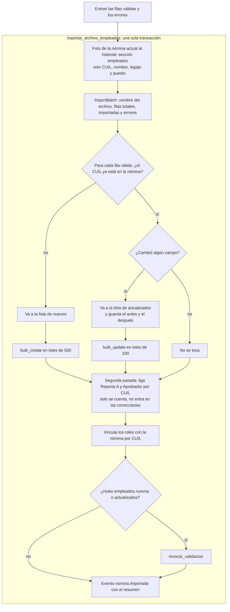

- **Por qué en lote:** una nómina de miles de filas con una consulta por fila eran decenas de miles de consultas dentro del pedido web (y el proxy corta los pedidos largos: el tiempo depende de la configuración del despliegue, ver `deploy/DOCKER.md`). `LOTE_ACTUALIZACION = 100` porque con lotes grandes MySQL tarda mucho más que con varios chicos.
- **Jerarquías en una segunda pasada:** un empleado puede referenciar a otro que está más abajo en el archivo, así que Reporta A y Aprobador se ligan cuando ya están todos cargados. Si el CUIL referenciado no existe en la nómina, esa relación no se toca y se agrega una advertencia.
- **Después de importar**, la pantalla muestra un resumen (`resumen_importacion`): cuántos se importaron, cuántas filas fallaron y hasta 5 advertencias; el panel agrega las primeras 5 filas rechazadas.

**Qué se guarda y qué no**

| Se guarda | No se guarda |
|---|---|
| Los empleados nuevos y los cambios de los existentes, en `Empleado` | **El archivo**: tiene datos personales y no se vuelve a usar (solo queda su nombre) |
| Un `ImportBatch` con el nombre del archivo, las filas leídas e importadas y todos los errores | Las filas con errores (solo se informan) |
| La foto de la nómina *antes* de importar (historial), pero solo con CUIL, apellido y nombre, legajo y puesto de cada empleado: no alcanza para restaurar la nómina completa | El detalle de cada empleado **nuevo** en el evento: ya está en `Empleado` |
| El evento `nomina.importada` con el resumen: cantidades, columnas ignoradas, hasta 50 errores y hasta 500 correcciones | Relaciones Reporta A / Aprobador hacia un CUIL que no está en la nómina |
| En las correcciones, el antes y el después de los campos de la planilla que se **pisaron** en empleados existentes (la base solo conserva lo nuevo) | Las columnas desconocidas |
| | La sucursal del empleado: no viene en el archivo (no figura en las columnas) |
| | Los cambios de Reporta A y Aprobador en empleados existentes: no entran en las correcciones, solo se cuentan en `jerarquias_vinculadas` |

Importar **no borra** a nadie: los empleados que no están en el archivo se quedan. El principio del registro: se guarda lo que la base pisa o borra, no lo que ya conserva. La excepción son Reporta A y Aprobador: esas relaciones se pisan sin detallar el antes y el después, y por sí solas no cuentan como «actualizado» (el rombo «¿Hubo empleados nuevos o actualizados?» no las mira), así que una importación en la que solo cambiaron ellas no revoca la validación (ver [flujo 9](#9-la-invalidación-de-la-validación)).

**Alta, edición y baja manual.** Cada una guarda la versión de la sección antes de cambiar y registra su evento (`empleado.agregado`, `empleado.editado` con los `cambios`, `empleado.eliminado` con la foto completa de lo borrado). Un CUIL repetido (por ejemplo por un doble clic) vuelve como error del campo, no como error del servidor. Con Recibo Digital la fecha de ingreso es obligatoria.

**Dónde está en el código**

- `employees/services.py`: `leer_archivo_empleados`, `_leer_tabla`, `COLUMNAS`, `MAX_FILAS_IMPORTACION`, `ArchivoInvalido`, `normalizar_cuil`, `normalizar_texto`.
- `employees/forms.py`: `ImportarArchivoForm`, `EmpleadoForm`.
- `employees/models.py`: `ImportBatch`, `Empleado`.
- `onboarding/services/nomina.py`: `importar_archivo_empleados`, `_cargar_empleados`, `_resolver_jerarquia_importada`, `resumen_importacion`, `agregar_empleado`, `editar_empleado`, `eliminar_empleado`, `LOTE_ACTUALIZACION`, `MAX_CORRECCIONES_EN_EVENTO`, `MAX_ERRORES_EN_EVENTO`.
- `onboarding/services/roles.py`: `vincular_roles_con_nomina`.
- `onboarding/views.py`: `_step_empleados`, `_importar_archivo_empleados`. `dashboard/views.py`: `_accion_importar_empleados`.
- Ejemplos en los tests: `employees/tests/test_importacion.py`, `onboarding/tests/servicios/test_empleados.py`, `onboarding/tests/wizard/test_paso_nomina.py`.

---

## 13. Qué mail sale en cada situación

**La regla.** Las acciones mandan seis tipos de mail, según la situación. **Un mail caído nunca rompe nada:** primero se guarda todo en la transacción y recién después se intenta cada mail; si falla, queda registrado (evento `mail.fallido` y línea de log) y, en algunos casos, se avisa al equipo en pantalla, pero lo ya hecho no se deshace.

### 13A. Qué situación dispara cada mail

```mermaid
flowchart LR
    subgraph sit["Situación"]
        s1["Alta con cuenta nueva y mail"]
        s2["«Crear acceso» con mail o «Enviar mail para crear contraseña»"]
        s3["El cliente envía el relevamiento"]
        s4["El cliente pide que lo contacten"]
        s5["El equipo devuelve o observa la firma"]
        s6["El equipo marca cumplida"]
    end
    subgraph mails["Mail"]
        m1["invitacion al cliente"]
        m2["equipo_resumen al equipo"]
        m3["cliente_recibido al cliente"]
        m4["equipo_revision_solicitada al equipo"]
        m5["cliente_devuelta al cliente"]
        m6["cliente_cumplida al cliente"]
    end
    s1 --> m1
    s2 --> m1
    s3 --> m2
    s3 --> m3
    s4 --> m4
    s5 --> m5
    s6 --> m6
```

| Situación | `tipo` en los eventos | Asunto | A quién | Si falla |
|---|---|---|---|---|
| Alta con cuenta nueva y mail; «Crear acceso» con mail; «Enviar mail para crear contraseña» | `invitacion` | Tu acceso al Portal de Implementación de Napsis | El mail de la cuenta | Aviso de advertencia con el usuario y cómo reenviarlo |
| El cliente envía el relevamiento | `equipo_resumen` | Nueva implementación completada: nombre del cliente | `IMPLEMENTATION_TEAM_EMAILS` más el implementador asignado, sin repetir | Solo evento y log |
| El cliente envía el relevamiento | `cliente_recibido` | Recibimos tu información | El mail de contacto de la implementación o, si no hay, el de la cuenta | Solo evento y log |
| El cliente pide que lo contacten | `equipo_revision_solicitada` | Pedido de contacto: nombre del cliente | El equipo, igual que el resumen | Solo evento y log |
| El equipo devuelve (o observa la firma) | `cliente_devuelta` | Necesitamos que revises algunos datos de tu implementación | El cliente | Aviso: quedó devuelta, pero no se pudo avisar por mail |
| El equipo marca cumplida | `cliente_cumplida` | Tu implementación está lista | El cliente | Aviso: quedó cumplida, pero no se pudo avisar por mail |

**Situaciones que no mandan mail:** validar, anular, reabrir, validar o corregir la firma, reasignar, comentar, atender un pedido de contacto, cualquier cambio de una sección y reiniciar la contraseña de una cuenta que ya existe (la contraseña nueva se muestra una única vez en pantalla; `entregar_acceso` solo invita cuando la cuenta es nueva y se cargó un mail). En el pedido de contacto, el cliente ve el aviso de éxito aunque el mail al equipo haya fallado: el pedido queda guardado y se ve en la ficha.

Fuera de estas acciones hay dos mails más: el de **recuperar contraseña** (`RecuperarClaveView` en `clients/views.py`, con un tope de un pedido por mail cada 10 minutos y hasta 10 por IP en esa ventana) y la **alerta de error 500**, que va a las direcciones de `ERROR_ALERT_EMAILS` (`notifications/alertas.py`, un mail por tipo de error y lugar del código cada 10 minutos; trae método, ruta, usuario, mensaje y traceback, pero no el cuerpo del pedido).

### 13B. Por qué un mail caído no rompe nada

```mermaid
flowchart TD
    a1["La acción guarda todo en su transacción"]
    a2["Recién después se intenta cada mail"]
    a3["_avisar_por_mail ejecuta el envío dentro de un try"]
    d1{"¿El envío lanzó una excepción?"}
    f1["Se escribe el error en el log"]
    f2["Evento mail.fallido con el tipo y el nombre de la excepción"]
    d2{"¿Ese mail tiene un texto de falla para el equipo?"}
    f3["Se devuelve un aviso de advertencia"]
    f4["No hay aviso en pantalla: queda el log y el evento"]
    d3{"¿Había destinatario?"}
    k1["Evento mail.enviado con los destinatarios"]
    k2["No se manda ni se registra nada<br/>no hay mail cargado o no hay equipo configurado"]
    z1["El Resultado vuelve con ok verdadero: lo hecho no se deshace"]

    a1 --> a2
    a2 --> a3
    a3 --> d1
    d1 -->|sí| f1
    f1 --> f2
    f2 --> d2
    d2 -->|sí| f3
    d2 -->|no| f4
    d1 -->|no| d3
    d3 -->|sí| k1
    d3 -->|no| k2
    f3 --> z1
    f4 --> z1
    k1 --> z1
    k2 --> z1
```

- **Fuera de la transacción:** el mail se manda después de que la transacción se confirmó, así que ninguna excepción puede deshacer el cambio.
- **`try` amplio:** `_avisar_por_mail` captura cualquier excepción; el evento guarda solo el **nombre** de la excepción (no el mensaje ni datos).
- **Los avisos al equipo no son errores:** `Resultado.ok` depende de `errores`, y un mail fallido solo agrega un aviso de advertencia.
- **Sin destinatario no es una falla:** el cliente sin mail cargado, o un equipo sin lista configurada, simplemente no recibe nada (en el segundo caso queda una advertencia en el log).
- **Los textos** son plantillas `.txt` sin escape de HTML, para que la razón social salga tal cual.

**Dónde está en el código**

- `onboarding/acciones.py`: `_avisar_por_mail`, `_invitar`, y cada acción que manda mail (`crear_implementacion`, `entregar_acceso`, `invitar_cliente`, `enviar_relevamiento`, `pedir_revision`, `devolver_al_cliente`, `marcar_cumplida`).
- `notifications/services.py`: `enviar_invitacion`, `notificar_implementacion_completa`, `notificar_revision_solicitada`, `notificar_cliente_relevamiento_recibido`, `notificar_cliente_devuelta`, `notificar_cliente_implementacion_cumplida`, `mail_del_cliente`, `_destinatarios`, `_enviar_mail_equipo`, `_enviar_mail_cliente`.
- `templates/notifications/`: `mail_invitacion.txt`, `mail_resumen.txt`, `mail_cliente_recibido.txt`, `mail_revision_solicitada.txt`, `mail_cliente_devuelta.txt`, `mail_cliente_cumplida.txt`.
- `config/settings.py`: `IMPLEMENTATION_TEAM_EMAILS`, `SITE_BASE_URL`, `PASSWORD_RESET_TIMEOUT`. La URL del link llega a la acción como `base_url` (la acción no conoce el `request`); sin ella se usa `SITE_BASE_URL`.
- Ejemplos en los tests: `notifications/tests/test_mails_al_cliente.py`, `notifications/tests/test_services.py`, `onboarding/tests/acciones/test_envio.py`.

---

## 14. Comentarios internos del equipo

**La regla.** El equipo puede dejar notas sobre una implementación. Son **privadas**: el cliente nunca las ve, ni en sus pantallas, ni en sus mails, ni en la configuración congelada. Solo se **agregan**: no se editan ni se borran (no hay acción ni pantalla para hacerlo, y el modelo no está registrado en el admin de Django), así queda el hilo de lo que se fue hablando. Agregar un comentario **cuenta como movimiento**: saca la marca «Implementación sin movimiento».

```mermaid
flowchart TD
    s1["El equipo escribe un comentario en la ficha"]
    d1{"¿El actor es implementador o admin?"}
    e1["Aviso: solo el equipo puede dejar comentarios"]
    d2{"¿Hay texto después de sacar los espacios?"}
    e2["Aviso: escribir el comentario"]
    d3{"¿Tiene 2000 caracteres o menos?"}
    e3["Aviso: el comentario puede tener hasta 2000 caracteres"]
    t1["Se guarda el ComentarioInterno con su autor y el nombre del autor"]
    t2["Evento comentario.agregado con solo el id, sin el texto"]
    t3["Cuenta como movimiento: la marca de sin movimiento se saca"]

    s1 --> d1
    d1 -->|no| e1
    d1 -->|sí| d2
    d2 -->|no| e2
    d2 -->|sí| d3
    d3 -->|no| e3
    d3 -->|sí| t1
    t1 --> t2
    t2 --> t3
```

**Quién ve el comentario y quién no**

```mermaid
flowchart LR
    c1["Comentario interno"]
    v1["Ficha del equipo en el panel<br/>solo cuentas del equipo"]
    z1["Pantallas del cliente<br/>wizard, enviado, mis implementaciones"]
    z2["Mails al cliente"]
    z3["Configuración congelada"]

    c1 --> v1
    c1 -. "no llega" .-> z1
    c1 -. "no llega" .-> z2
    c1 -. "no llega" .-> z3
```

- **Por qué un cliente no puede comentar:** la acción comprueba que el actor sea del equipo (`actores.TIPOS_DEL_EQUIPO`: implementador o admin), y además la ficha del panel exige una cuenta del equipo (`staff_member_required`). Un cliente que arme el POST a mano no deja nada.
- **El autor** queda como `autor` (la cuenta, que puede borrarse sin perder el comentario) y como `autor_nombre` (nombre completo o usuario, que se conserva igual).
- **El texto no se repite en el evento:** el evento solo guarda el id del comentario, porque el texto ya lo conserva `ComentarioInterno`.
- **El HTML se escapa** al mostrarlo: lo escrito se ve como texto.
- **El orden** es del más nuevo al más viejo.
- **Por qué no está en lo que ve el cliente:** `resumen_implementacion` (el contexto que comparten la ficha y la consulta del cliente) no incluye los comentarios, y la ficha del equipo los suma aparte. Tampoco forman parte de `contenido_de` (la congelada).

**Dónde está en el código**

- `onboarding/acciones.py`: `agregar_comentario`.
- `clients/models.py`: `ComentarioInterno` (`MAX_LARGO = 2000`).
- `automatizacion/actores.py`: `TIPOS_DEL_EQUIPO`.
- `dashboard/views.py`: `_accion_agregar_comentario`, `implementacion_detalle` (agrega `comentarios` al contexto).
- `clients/services.py`: `resumen_implementacion` (no incluye comentarios).
- `templates/dashboard/implementacion_detalle.html`: el bloque «Comentarios del equipo».
- Ejemplos en los tests: `onboarding/tests/acciones/test_comentarios.py` (incluye las pruebas de privacidad), `dashboard/tests/panel/test_seguimiento.py`.
