# Módulos `automatizacion` y `dashboard`

Referencia de dos apps del portal: qué hace cada una, cómo está armada por dentro y quién usa cada pieza. Complementa el mapa general de [arquitectura.md](../arquitectura.md). Los diagramas están en [Mermaid](https://mermaid.js.org/): GitHub los dibuja directamente.

Todo nombre de archivo, función, clase, campo y evento que aparece acá se leyó en el código. Los tests de cada app (`automatizacion/tests/`, `dashboard/tests/`) son el ejemplo ejecutable de cada comportamiento; al final de cada parte hay un mapa de qué test mira qué.

| App | En una frase |
|---|---|
| `automatizacion` | Quién hace cada cosa (el *actor*), qué pasó (el *registro de eventos*) y qué se aprobó (la *configuración congelada*). No depende de otras apps. |
| `dashboard` | El panel del equipo de implementación, en `/panel/`: listado, ficha de cada implementación, gestión de implementadores y reporte. Es la capa que sí conoce el `request`: traduce lo que llega del formulario en una llamada con actor. |

Índice: [Términos](#términos-que-aparecen) · [1. automatizacion](#1-automatizacion) · [2. dashboard](#2-dashboard) · [Detalles que conviene conocer](#detalles-que-conviene-conocer)

**Dónde mirar según lo que se busca**

| Quiero… | Está en |
|---|---|
| Saber quién hizo una acción y cómo se identifica | 1.4 (`automatizacion/actores.py`) |
| Registrar un evento nuevo | 1.5 (`automatizacion/eventos.py`) |
| Entender qué se foto-copia al validar y para qué sirve la huella | 1.6 (`automatizacion/congelada.py`) |
| Exportar los eventos | 1.7 (`exportar_eventos`) |
| Agregar un botón o una acción a la ficha de una implementación | 2.7 (`dashboard/views.py`, `ACCIONES_DE_LA_FICHA`) |
| Cambiar los filtros o el orden del listado | 2.8 (`clients/services.py`, usada por `dashboard/views.py`) |
| Cambiar el reporte `.xlsx` | 2.9 (`dashboard/reportes.py`) |
| Ver quién puede entrar a cada pantalla | 2.5 (`dashboard/permisos.py`) |

---

## Términos que aparecen

Se explican una sola vez, acá. El resto del documento los usa sin repetirlos.

| Término | En una línea |
|---|---|
| app | Carpeta de Python con su propia responsabilidad (modelos, vistas, etc.), registrada en `config/settings.py`. |
| modelo | Clase de Python que representa una tabla de la base; cada instancia es una fila. |
| queryset y `objects` | Un *queryset* es una consulta a la base que se arma con `.filter()`, `.order_by()`, etc. y se ejecuta recién cuando se lee. `objects` es el *manager* de un modelo: la puerta de entrada a sus consultas. |
| `uuid` | Identificador único de 36 caracteres que no revela nada. El `uuid` de una implementación es público; su `token` (el link del cliente) es secreto. |
| `ForeignKey`, `SET_NULL`, `related_name` | `ForeignKey` es una columna que apunta a una fila de otra tabla. `SET_NULL` significa que, si esa fila se borra, la columna queda en nulo en vez de borrar esta. `related_name` es el nombre para recorrer la relación al revés (por ejemplo `implementacion.eventos`). |
| `JSONField` | Columna que guarda un JSON (diccionarios y listas). |
| `annotate`, `select_related`, `prefetch_related` | `annotate` suma columnas calculadas a una consulta. `select_related` y `prefetch_related` piden a la base, junto con las filas principales, los registros relacionados (cliente, módulos…), para no hacer una consulta por cada fila. |
| migración | Archivo que cambia la estructura de la base (carpeta `migrations/`). |
| vista | Función que recibe el `request` (el pedido web) y devuelve una respuesta: una página, una redirección o un archivo. |
| plantilla (template) y contexto | La plantilla es HTML con marcas `` y `{{ }}` que la vista rellena (carpeta `templates/`). El *contexto* es el diccionario de datos que la vista le pasa. |
| formulario (`Form`, `ModelForm`, formset) | Objeto que valida lo que llega por POST. `ModelForm` se arma a partir de un modelo; un *formset* agrupa varios formularios iguales (`RolFormSet`, `SucursalFormSet`). |
| decorador | Línea `@nombre` sobre una función que la envuelve para agregarle algo, por ejemplo exigir un permiso. |
| middleware | Código que envuelve cada pedido web: corre antes y después de la vista. |
| `ContextVar` | Variable (módulo `contextvars`) cuyo valor es propio de cada pedido en curso: dos pedidos simultáneos no se pisan. |
| dataclass `frozen` | Clase de datos cuyos campos no se pueden reasignar una vez creada; dos instancias con los mismos valores son iguales. |
| `transaction.atomic` | Bloque «todo o nada»: si algo falla adentro, la base vuelve a como estaba. |
| `messages` | Avisos de una sola vez («Guardado») que Django muestra en la página siguiente. |
| redirect | Respuesta que manda al navegador a otra URL. Tras un POST exitoso evita que recargar la página reenvíe el formulario. |
| comando de `manage.py` | Script que se corre con `python manage.py <nombre>`. |
| `ModelAdmin` | Configuración de cómo se ve un modelo en el sitio `/admin/` de Django. |
| sha256 / huella | Resumen de 64 caracteres hexadecimales de un contenido: el mismo contenido da siempre la misma huella y cualquier cambio la modifica. |
| JSONL | Archivo de texto con un JSON por línea. |
| staff y superusuario | Banderas de la cuenta de Django: `is_staff` deja entrar al panel; `is_superuser` da todos los permisos. |
| Actor y `Resultado` | Conceptos del proyecto: el *actor* es quien hace una acción; el `Resultado` es lo que devuelve una acción (errores y avisos). |
| implementación, wizard, ficha, sección | *Implementación*: el caso de un cliente (modelo `Implementacion`). *Wizard*: el formulario de 10 pasos que completa el cliente. *Ficha*: la pantalla de detalle de una implementación en el panel. *Sección*: cada parte del relevamiento que se guarda por separado (datos de contacto, módulos, roles, sucursales, etc.). |

---

## 1. `automatizacion`

### 1.1 Propósito

Reúne tres piezas que usa el resto del código y que no dependen de ninguna otra app:

1. **El actor** (`actores.py`): un objeto que dice quién hace una cosa (cliente, implementador, admin, sistema, y a futuro un servicio o un agente).
2. **El registro de eventos** (`eventos.py`, `correlacion.py` y el modelo `EventoImplementacion`): un libro de solo agregado con quién hizo qué, cuándo, y el antes y el después de lo que la base pisa o borra. Se exporta con `exportar_eventos`.
3. **La configuración congelada** (`congelada.py` y el modelo `ConfiguracionCongelada`): la foto inmutable de lo que el equipo aprobó al validar, con los archivos copiados.

Sus dos modelos apuntan a `clients.Implementacion` escribiendo el nombre como texto (`"clients.Implementacion"`), sin importar la clase. `clients` sí importa de `automatizacion`: `clients/services.py` usa `eventos`, y `clients/models.py` importa `EventoImplementacion` dentro de una propiedad (import diferido, en el momento de usarla).

### 1.2 Componentes

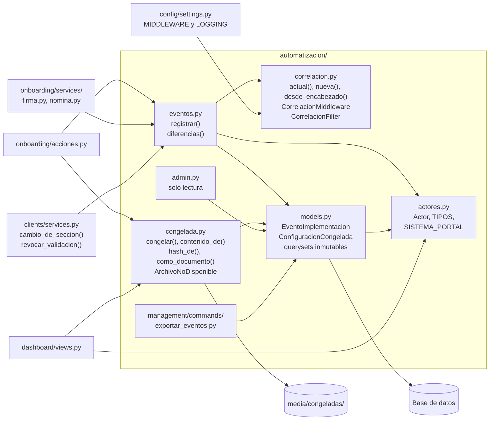

Una flecha `A --> B` significa «A usa a B». Los cuadros de afuera de `automatizacion/` son los que la usan hoy.

### 1.3 Modelos

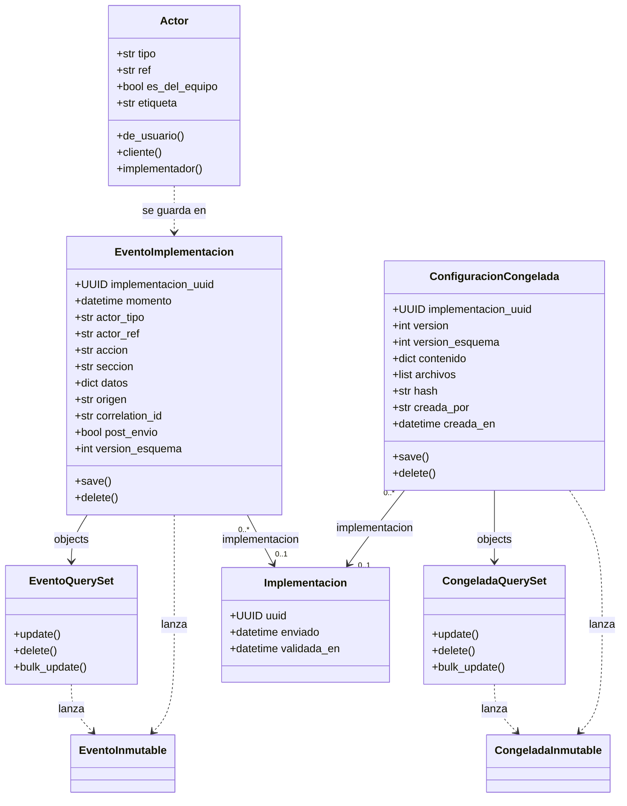

`Actor` no es un modelo (no tiene tabla): es una dataclass `frozen` de `actores.py`; aparece porque `EventoImplementacion` guarda su `tipo` y su `ref` en `actor_tipo` y `actor_ref`. `Implementacion` es de la app `clients`. Los dos modelos de `automatizacion` guardan además `implementacion_uuid`, que sobrevive aunque la implementación se borre.

### 1.4 El actor

Toda acción sobre una implementación la hace un actor. Se usa un objeto y no un texto suelto («Cliente», el nombre de usuario…) para poder registrar y filtrar por tipo.

**`Actor(tipo, ref="")`** es una dataclass `frozen` con dos campos: `tipo` (uno de `TIPOS`; si no, levanta `ValueError`) y `ref` (texto libre: el nombre de usuario, `"portal"`, etc.).

| Tipo | Constante | Quién es | ¿Del equipo? |
|---|---|---|---|
| `cliente` | `CLIENTE` | Quien completa el wizard | no |
| `implementador` | `IMPLEMENTADOR` | Cuenta staff que no es superusuario | sí |
| `admin` | `ADMIN` | Superusuario | sí |
| `sistema` | `SISTEMA` | El propio portal, o un pedido sin cuenta | no |
| `servicio` | `SERVICIO` | A futuro: un servicio externo (el CRM) | no |
| `agente` | `AGENTE` | A futuro: un agente | no |

`TIPOS` reúne los seis; `TIPOS_DEL_EQUIPO` es `(IMPLEMENTADOR, ADMIN)`. Hoy ninguna pantalla crea actores `servicio` ni `agente`: existen para una API o un agente futuros.

**Cómo se elige el actor de un pedido web:** `Actor.de_usuario(request.user)`.

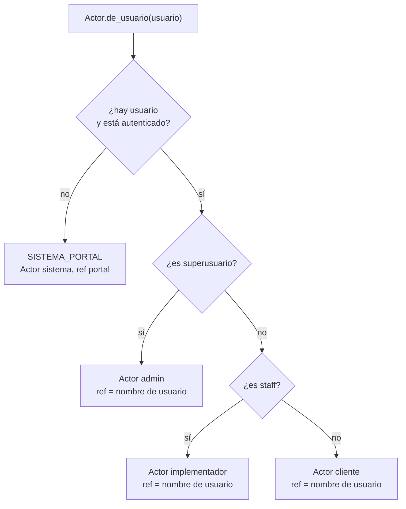

Otros miembros:

- `Actor.cliente(ref)` y `Actor.implementador(ref)`: atajos para crear un actor de ese tipo.
- `es_del_equipo` (propiedad): verdadero si el tipo está en `TIPOS_DEL_EQUIPO`.
- `etiqueta` (propiedad): el texto que se guarda como «editado por» en el historial de versiones. Es `"Cliente"` para el cliente y, para el resto, el `ref` (o el tipo si no hay `ref`). También es lo que se guarda en `creada_por` de la configuración congelada.
- `SISTEMA_PORTAL = Actor(SISTEMA, "portal")`: el actor de un pedido sin cuenta.

### 1.5 El registro de eventos

#### Qué es un evento

Un `EventoImplementacion` es una fila que dice qué pasó en una implementación. Se guarda **dentro de la misma transacción que el cambio que describe**: si el cambio se deshace, el evento también. El principio es registrar lo que la base pisa o borra y no duplicar lo que ya conserva (por ejemplo, cada empleado de una nómina importada).

| Campo | Qué guarda |
|---|---|
| `implementacion` | `ForeignKey` a `clients.Implementacion`, con `SET_NULL` y `related_name="eventos"`. |
| `implementacion_uuid` | El `uuid` público de la implementación, con índice. Queda aunque la implementación se borre. |
| `momento` | Cuándo ocurrió (por defecto `timezone.now`; no editable). |
| `actor_tipo`, `actor_ref` | El tipo de actor (uno de `actores.TIPOS`) y su referencia. |
| `accion` | Qué pasó, con forma `familia.accion` (por ejemplo `estado.validada`). Hasta 60 caracteres, con índice. |
| `seccion` | La sección del relevamiento que tocó (vacía si no aplica). |
| `datos` | JSON con el detalle: el antes y el después, ids, resúmenes. Se serializa con `DjangoJSONEncoder`, así que acepta fechas y UUID. |
| `origen` | `web`, `api`, `sistema` o `comando` (por defecto `web`). |
| `correlation_id` | El identificador del pedido que lo originó (ver más abajo). |
| `post_envio` | Marca de corrección del equipo (ver más abajo). |
| `version_esquema` | Versión del formato del evento (por defecto 1). |

El orden natural es `momento`, `id`. Hay dos índices: `(implementacion_uuid, momento)` para recorrer la historia de una implementación y `(accion, momento)` para buscar por acción.

#### Cómo se registra: `registrar`

```python
eventos.registrar(actor, "estado.cancelada", implementacion, datos={"estado_anterior": estado_anterior})
```

Firma: `registrar(actor, accion, implementacion=None, *, seccion="", datos=None, post_envio=None, origen=None)`. Devuelve el evento creado. La implementación puede ser `None`: el evento queda sin `implementacion_uuid`.

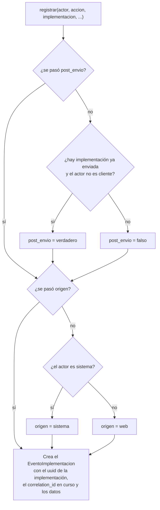

Los `datos` tienen que poder convertirse a JSON. `ORIGEN_API` y `ORIGEN_COMANDO` existen como valores posibles, pero ningún código de producción los pasa todavía: hoy el origen es `web` o `sistema`.

#### `post_envio`: la marca de corrección

Indica que **alguien que no es el cliente actuó cuando la documentación ya había sido enviada**. En la práctica son las correcciones del equipo sobre lo que el cliente declaró, y es la señal que más información da a un agente futuro.

- Se calcula solo: `implementacion is not None`, `implementacion.enviado` con valor, y `actor.tipo != CLIENTE`.
- Se puede forzar pasando `post_envio=True` o `False`. Lo hacen `ronda.devuelta` (siempre `True`) y `estado.reabierta` (`True` si la implementación estaba enviada).
- Al devolver al cliente, `enviado` queda en nulo (la devolución saca la implementación del envío), así que lo que pase hasta el próximo envío no se marca.

#### La correlación: unir todo lo de un pedido

Cada pedido web recibe un identificador. Todos los eventos que genera el pedido, y las líneas de error del log, llevan el mismo, así que se puede reconstruir qué pasó en un pedido concreto.

- `CorrelacionMiddleware` (está en `MIDDLEWARE`, justo después de `SecurityMiddleware`) toma el encabezado `X-Request-ID` que mande el proxy, si cumple el formato (`^[A-Za-z0-9._-]{8,64}$`); si no, genera uno nuevo (32 caracteres hexadecimales). Lo guarda en una `ContextVar`, y lo devuelve en el encabezado `X-Request-ID` de la respuesta.
- `actual()` devuelve el id en curso (cadena vacía fuera de un pedido). `registrar` lo copia a `correlation_id`.
- `nueva()` abre una correlación nueva en el contexto actual, pensada para comandos y tareas fuera de un pedido web. Hoy solo la usan los tests.
- `CorrelacionFilter` agrega `record.correlacion` a cada registro del log (`"-"` si no hay). Está enganchado al handler `errores_archivo` de `LOGGING`, que escribe `errores.log` con el formato `con_fecha` (`%(asctime)s %(levelname)s [%(correlacion)s] ...`). La consola no lo usa.

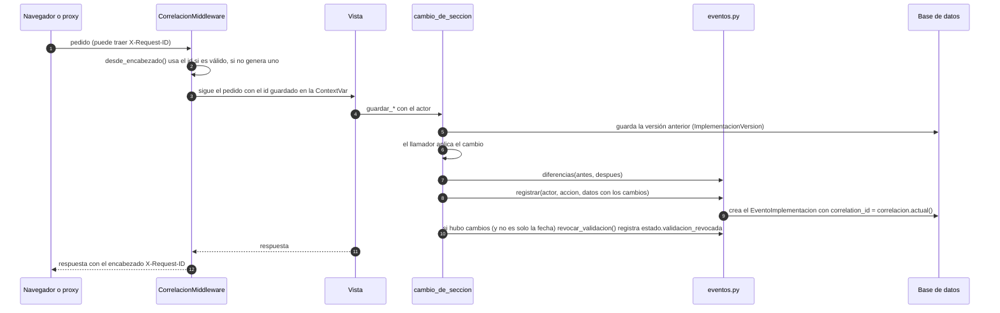

`cambio_de_seccion` (en `clients/services.py`) es el punto por donde pasan casi todos los guardados de secciones. Se usa así:

```python
with cambio_de_seccion(implementacion, "modulos", actor):
    ...  # aquí se aplica el cambio
```

Toma la foto anterior de la sección, deja que el bloque aplique el cambio, toma la foto posterior, calcula `diferencias`, registra el evento (acción por defecto `paso.guardado`) y, si hubo cambios y la sección no es `fecha_implementacion`, revoca la validación. Todo en una `transaction.atomic`.

#### Inmutabilidad: solo se agrega

El registro no se modifica ni se borra, a propósito. Lo garantizan estas piezas de `models.py`:

| Pieza | Qué bloquea |
|---|---|
| `EventoImplementacion.save()` | Si la fila ya existe (`not self._state.adding`), levanta `EventoInmutable`. |
| `EventoImplementacion.delete()` | Siempre levanta `EventoInmutable`. |
| `EventoQuerySet.update()`, `.delete()`, `.bulk_update()` | Siempre levantan `EventoInmutable`. El `objects` del modelo es este queryset. |
| `EventoImplementacionAdmin` | No da permiso de alta, cambio ni baja. |

Borrar la implementación no rompe nada: la `ForeignKey` es `SET_NULL`, el evento queda con `implementacion` en nulo y conserva `implementacion_uuid`. La protección es del modelo, no de la base: las migraciones solo crean la tabla, así que quien escriba SQL directo puede saltearla.

#### `diferencias`: qué cambió entre dos fotos

`diferencias(antes, despues, prefijo="")` compara dos fotos de una sección y devuelve solo lo que cambió, como `{campo: {"antes": a, "despues": d}}`.

- Si ambas fotos son diccionarios, compara campo por campo. Un campo que está de un solo lado cuenta como `None` del otro. Los diccionarios anidados se recorren y el campo se nombra con el camino `Grupo › campo` (por ejemplo, en la foto de licencias y novedades, `{"Licencias": {"X": True}}` da el campo `Licencias › X`).
- Si no son diccionarios (listas, por ejemplo las de roles o sucursales), compara la lista entera y, si difiere, la devuelve bajo la clave `"lista"`.
- Si no cambió nada, devuelve `{}`.

Ejemplo (adaptado de los tests): `diferencias({"Teléfono": "111", "Mail": "a@a.com"}, {"Teléfono": "222", "Mail": "a@a.com"})` da `{"Teléfono": {"antes": "111", "despues": "222"}}`. La usa `cambio_de_seccion`.

#### Qué acciones se registran hoy

La tabla sale del código. Incluye acciones que el resumen de `arquitectura.md` (sección 8) no lista, como `comentario.agregado` y `acceso.contrasena_reiniciada`.

| `accion` | La registra | `datos` y notas |
|---|---|---|
| `implementacion.creada` | `acciones.crear_implementacion` | `origen`, `id_externo`, `cliente_id`, `cliente_nuevo`, `implementador`, `modulos` (códigos), `condiciones`, `con_invitacion` |
| `acceso.creado` | `acciones.crear_implementacion`, `acciones.entregar_acceso` | `username`, `invitacion` (y `cliente_id` en `entregar_acceso`) |
| `acceso.contrasena_reiniciada` | `acciones.entregar_acceso` (la cuenta ya existía) | `cliente_id`, `username`, `invitacion` |
| `implementacion.reasignada` | `acciones.reasignar` | `desde`, `hacia` |
| `estado.reabierta` | `acciones.reabrir` | `antes` (estado, paso, fechas); `post_envio` forzado |
| `estado.cancelada` | `acciones.anular` | `estado_anterior` |
| `estado.validada` | `acciones.aprobar_para_configurar` | `ronda`, `congelada` (`version` y `hash`) |
| `estado.validacion_revocada` | `clients.services.revocar_validacion` | `seccion` = la que cambió |
| `estado.cumplida` | `acciones.marcar_cumplida` | `estado_anterior` |
| `ronda.devuelta` | `acciones.devolver_al_cliente` | `ronda`, `motivo`, `observaciones`; `post_envio` siempre verdadero |
| `comentario.agregado` | `acciones.agregar_comentario` | `comentario_id` (el texto ya lo guarda el comentario) |
| `revision.solicitada` | `acciones.pedir_revision` | `mensaje` |
| `revision.atendida` | `acciones.atender_revision` | sin datos |
| `validacion.fallida` | `acciones.registrar_validacion_fallida` | `paso`, `errores` (qué falló, sin los valores) |
| `envio.confirmado` | `acciones.enviar_relevamiento` | `fecha_salida_productivo`, `empleados`, `ronda` (si había una abierta) |
| `mail.enviado` | `acciones._avisar_por_mail` | `tipo`, `destinatarios` |
| `mail.fallido` | `acciones._avisar_por_mail` | `tipo`, `error` (nombre de la excepción) |
| `paso.guardado` | `cambio_de_seccion` (acción por defecto), vía `guardar_datos_contacto`, `guardar_modulos`, `guardar_roles`, `guardar_sucursales`, `guardar_licencias_y_novedades`, `guardar_liquidaciones`, `guardar_documentos` | `seccion` y `cambios` |
| `implementacion.condiciones_actualizadas` | `guardar_condiciones` | `seccion` = `condiciones`, `cambios` |
| `implementacion.fecha_cambiada` | `guardar_fecha_implementacion` | `seccion` = `fecha_implementacion`, `cambios`; no revoca la validación |
| `firma.propuesta` | `guardar_firma` (actor cliente) | `cambios` |
| `firma.corregida_por_implementador` | `guardar_firma` (actor que no es cliente) | `cambios`; deja la firma validada |
| `firma.validada` | `acciones.validar_firma` | `cambios` |
| `firma.observada` | `acciones.observar_firma` | `motivos`, `comentario`, `cambios` |
| `archivo.reemplazado` | `guardar_firma` (si había una imagen anterior) | `campo`, `anterior` y `nuevo` (`ruta` y `sha256`) |
| `nomina.importada` | `importar_archivo_empleados` | Resumen: `archivo`, `filas_leidas`, `nuevos`, `actualizados`, `jerarquias_vinculadas`, `filas_con_error`, `errores` (hasta 50), `columnas_ignoradas`, `advertencias`, `correcciones` (hasta 500) y los indicadores de truncado |
| `empleado.agregado` | `agregar_empleado` | `empleado_id` |
| `empleado.editado` | `editar_empleado` | `empleado_id`, `cambios` |
| `empleado.eliminado` | `eliminar_empleado` | `empleado_id`, `foto` (todos los campos, porque la base los pierde) |

Los tipos de mail que se registran son `invitacion`, `cliente_devuelta`, `cliente_cumplida`, `equipo_resumen`, `cliente_recibido` y `equipo_revision_solicitada`. Un mail que falla no deshace lo hecho: queda como `mail.fallido`.

**Para registrar un evento nuevo:** llamar a `eventos.registrar(actor, "familia.accion", implementacion, datos=...)` dentro de la misma transacción que el cambio. Si es el guardado de una sección, usar `cambio_de_seccion` con el nombre de acción.

### 1.6 La configuración congelada

Al validar la documentación se arma, de una sola vez, la foto de lo que el equipo aprobó. Es lo que lee quien configure (hoy una persona, más adelante un agente). Se guarda en `ConfiguracionCongelada`, de solo lectura.

#### Qué guarda

| Campo | Qué es |
|---|---|
| `version` | Número de versión por implementación (1, 2, 3…). Hay una restricción única `congelada_version_unica` sobre `(implementacion_uuid, version)`. |
| `version_esquema` | Versión del formato del contenido. Hoy `VERSION_ESQUEMA = 1`. |
| `contenido` | Los datos aprobados, como JSON con **códigos estables** (no nombres que se puedan corregir). |
| `archivos` | Lista de copias inmutables de los archivos: `campo`, `ruta`, `sha256`, `bytes`, `nombre_original`. |
| `hash` | La huella de todo lo anterior (64 caracteres). |
| `creada_por`, `creada_en` | La `etiqueta` del actor que validó y cuándo. |
| `implementacion`, `implementacion_uuid` | A qué implementación pertenece; el `uuid` queda aunque se borre (`related_name="congeladas"`). |

**Contenido** (`contenido_de(implementacion)`). Todo va ordenado para que el mismo contenido dé siempre el mismo hash:

| Clave | Qué lleva |
|---|---|
| `esquema` | `VERSION_ESQUEMA` |
| `implementacion` | `uuid`, `origen`, `id_externo` |
| `empresa` | `razon_social`, `cuits` (como lista), `telefono`, `mail_contacto` |
| `fecha_salida_productivo` | Fecha ISO o `None` |
| `condiciones` | `tipo_firma`, `nomenclatura_pdf`, `segmentacion_liquidador`, `liquidador_utilizado`, `cantidad_capitas`, `max_roles` |
| `modulos`, `liquidaciones`, `licencias`, `novedades` | Listas ordenadas de códigos de los ítems activos |
| `firma` | `None` si no hay, o `pagina`, `geometria` y `estado` |
| `roles` | Lista ordenada de `rol`, `apellido_nombre`, `cuil`, `mail` |
| `sucursales` | Lista ordenada con nombre, dirección, localidad, etc. |
| `documentos` | Los tipos del catálogo, por `codigo` (`personalizado: false`); los tipos «Otros» del cliente no tienen código global, así que van con `nombre` y sus `campos` (`personalizado: true`) |
| `nomina` | Solo cantidades: `empleados` y `con_fecha_ingreso`. Los datos personales ya los conserva la base. |

Si un ítem de catálogo todavía no tuviera código, `_codigo` usa `nombre:<nombre>`.

**Archivos** (`_archivos_de`): `modelo_recibo`, `logo`, `banner` y `firma_imagen`, solo los que existan.

#### Cómo se crea

`congelar(implementacion, actor)` se llama dentro de la transacción de la aprobación (la hace `acciones.aprobar_para_configurar`).

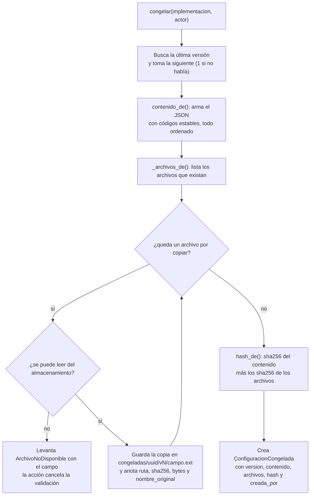

Si el archivo no se puede leer, `aprobar_para_configurar` atrapa `ArchivoNoDisponible`, deja `validada_en` en nulo y avisa al equipo qué archivo hay que volver a subir; como todo corre en una transacción, no queda ni la validación ni el evento ni la versión.

#### La huella

`hash_de(contenido, archivos)` serializa `{"contenido": ..., "archivos": [(campo, sha256), ...]}` como JSON con las claves ordenadas y le saca el `sha256`. Entran el contenido y el `sha256` de cada archivo; **no entran las rutas, los bytes ni el nombre original**. Por eso, validar dos veces lo mismo da la misma huella con otro número de versión, y cualquier cambio en los datos o en un archivo cambia la huella.

#### Versiones y vigencia

Cada validación crea una versión nueva; las anteriores quedan como historia y nunca se modifican. `ConfiguracionCongelada` bloquea `save()` sobre una fila existente, `delete()` y las operaciones en lote de su queryset (`CongeladaInmutable`), igual que los eventos, y `ConfiguracionCongeladaAdmin` es de solo lectura.

La «vigente» no es una columna: la ficha del panel considera vigente a la última versión **mientras la implementación esté validada** (`validada_en` con valor). Si se pierde la validación, ninguna versión es vigente hasta que se vuelva a validar.

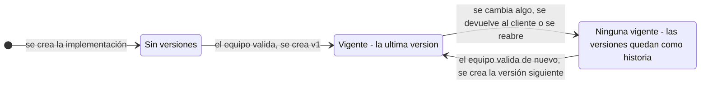

Marcar la implementación como cumplida no quita la validación, así que la última versión sigue vigente.

`como_documento(congelada)` devuelve la versión como un único diccionario (`version`, `version_esquema`, `hash`, `creada_por`, `creada_en`, `contenido`, `archivos`); el panel lo ofrece como descarga `.json` (ver 2.4).

### 1.7 El comando `exportar_eventos`

Exporta el registro de eventos a JSONL (un JSON por evento), por ejemplo para auditar o entrenar. Es una decisión explícita: nada sale solo del portal, y exportar no registra eventos.

```
venv/Scripts/python manage.py exportar_eventos --desde 2026-10-01 --hasta 2026-10-31 --salida eventos.jsonl
```

| Opción | Qué hace |
|---|---|
| `--desde AAAA-MM-DD` | Eventos desde esa fecha, inclusive (`momento__date__gte`). |
| `--hasta AAAA-MM-DD` | Eventos hasta esa fecha, inclusive (`momento__date__lte`). |
| `--implementacion UUID` | Solo los de esa implementación (`implementacion_uuid`). |
| `--salida ARCHIVO` | Escribe en ese archivo (UTF-8). Sin esta opción escribe en la salida estándar. |

Si `--desde` o `--hasta` no son una fecha válida, falla con `CommandError`. Cada línea lleva: `id`, `momento`, `implementacion` (el uuid, no el id de la fila), `actor_tipo`, `actor_ref`, `accion`, `seccion`, `datos`, `origen`, `correlation_id`, `post_envio` y `version_esquema`. Lee con `iterator()`, así que no carga todo en memoria. Al terminar con `--salida`, informa por la salida de errores cuántos eventos exportó.

### 1.8 Admin

Los dos modelos se ven en `/admin/` y son de solo lectura (sin permiso de alta, cambio ni baja).

| Clase | Qué muestra |
|---|---|
| `EventoImplementacionAdmin` | Lista con `momento`, `accion`, `actor_tipo`, `actor_ref`, `seccion`, `post_envio`, `implementacion`. Filtros por `accion`, `actor_tipo`, `post_envio`, `origen`. Búsqueda por `actor_ref`, `accion`, `correlation_id`, `implementacion_uuid`. Navegación por fecha. |
| `ConfiguracionCongeladaAdmin` | Lista con `implementacion_uuid`, `version`, `creada_por`, `creada_en`, `hash`. Todos los campos como solo lectura. |

### 1.9 Referencia por archivo

#### `automatizacion/actores.py`

| Función, clase o modelo | Qué hace | Quién la usa |
|---|---|---|
| `CLIENTE`, `IMPLEMENTADOR`, `ADMIN`, `SISTEMA`, `SERVICIO`, `AGENTE` | Los seis tipos de actor, como texto. | `eventos.registrar` (`CLIENTE`, `SISTEMA`), `onboarding/services/firma.py` (`CLIENTE`) |
| `TIPOS` | Tupla con los seis tipos. | `Actor.__post_init__` (valida), `EventoImplementacion.actor_tipo` (opciones) |
| `TIPOS_DEL_EQUIPO` | `(IMPLEMENTADOR, ADMIN)`. | `Actor.es_del_equipo`, `acciones.agregar_comentario` |
| `Actor` | Quién hace una acción (`tipo` y `ref`); rechaza tipos desconocidos. | `dashboard/views.py` y `onboarding/views.py` (vía `de_usuario`), `seed_demo`; todas las acciones y servicios lo reciben como parámetro |
| `Actor.de_usuario(usuario)` | El actor que corresponde a una cuenta (ver 1.4). | `dashboard/views.py` (alta, ficha y cliente), `onboarding/views.py` (`_actor`) |
| `Actor.cliente(ref)`, `Actor.implementador(ref)` | Atajos para crear un actor de ese tipo. | `dashboard/management/commands/seed_demo.py`, tests |
| `Actor.es_del_equipo` | Si el tipo es del equipo. | Solo tests: no hay otro uso en el código de producción |
| `Actor.etiqueta` | Texto de «editado por»: `"Cliente"` o el `ref`. | `congelada.congelar` (`creada_por`), `clients/services.guardar_version` (`editado_por`), `acciones.validar_firma`, `services/firma.guardar_firma` |
| `SISTEMA_PORTAL` | El actor `sistema` con `ref` `"portal"`. | `Actor.de_usuario` |

#### `automatizacion/eventos.py`

| Función, clase o modelo | Qué hace | Quién la usa |
|---|---|---|
| `registrar(actor, accion, implementacion=None, *, seccion, datos, post_envio, origen)` | Guarda un `EventoImplementacion`; calcula `post_envio` y `origen` si no se pasan. | `onboarding/acciones.py`, `onboarding/services/firma.py`, `onboarding/services/nomina.py`, `clients/services.py` |
| `diferencias(antes, despues, prefijo="")` | Devuelve solo lo que cambió entre dos fotos de una sección. | `clients/services.cambio_de_seccion` (y ella misma, para los diccionarios anidados) |

#### `automatizacion/correlacion.py`

| Función, clase o modelo | Qué hace | Quién la usa |
|---|---|---|
| `_actual` (`ContextVar`) | Guarda el id del pedido en curso (por defecto `""`). | `actual`, `nueva`, `CorrelacionMiddleware` |
| `_VALIDO` | Expresión regular del formato aceptado para `X-Request-ID`. | `desde_encabezado` |
| `actual()` | El id en curso. | `eventos.registrar`, `CorrelacionFilter` |
| `nueva()` | Abre una correlación nueva (comandos y tareas fuera de un pedido). | Solo tests: ningún código de producción la llama todavía |
| `desde_encabezado(valor)` | Acepta el `X-Request-ID` si tiene formato razonable; si no, genera uno. | `CorrelacionMiddleware` |
| `CorrelacionMiddleware` | Asigna un id a cada pedido y lo devuelve en `X-Request-ID`. | `config/settings.py` (`MIDDLEWARE`) |
| `CorrelacionFilter` | Agrega el id a cada línea del log. | `config/settings.py` (`LOGGING`, handler `errores_archivo`) |

#### `automatizacion/models.py`

| Función, clase o modelo | Qué hace | Quién la usa |
|---|---|---|
| `EventoInmutable` | Excepción: los eventos no se modifican ni se borran. | `EventoImplementacion`, `EventoQuerySet` |
| `EventoQuerySet` | Queryset que prohíbe `update`, `delete` y `bulk_update`. | `EventoImplementacion.objects` |
| `EventoImplementacion` | Un evento de una implementación (ver 1.5). | `eventos.registrar` (lo crea); `exportar_eventos`, `Implementacion.ultimo_movimiento` y `clients/services.con_ultimo_movimiento` (lo leen); admin |
| `CongeladaInmutable` | Excepción: una congelada no se modifica ni se borra. | `ConfiguracionCongelada`, `CongeladaQuerySet` |
| `CongeladaQuerySet` | Queryset que prohíbe `update`, `delete` y `bulk_update`. | `ConfiguracionCongelada.objects` |
| `ConfiguracionCongelada` | Una versión de la configuración aprobada (ver 1.6). | `congelada.congelar` (la crea); `dashboard/views.descargar_congelada` y la ficha (la leen); admin |

#### `automatizacion/congelada.py`

| Función, clase o modelo | Qué hace | Quién la usa |
|---|---|---|
| `VERSION_ESQUEMA` | Versión del formato del contenido (hoy 1). | `contenido_de`, `congelar`, tests |
| `ArchivoNoDisponible` | Excepción: un archivo de la configuración no se pudo leer; guarda el `campo`. | `_copiar_archivos` la levanta; `acciones.aprobar_para_configurar` la atrapa |
| `_codigo(item)` | Código estable de un ítem de catálogo (o `nombre:<nombre>`). | `contenido_de`, `_documentos` |
| `_cuits(texto)` | Parte el texto de CUITs por comas. | `contenido_de` |
| `_documentos(implementacion)` | Arma la lista de documentos de legajo activos, ordenada. | `contenido_de` |
| `contenido_de(implementacion)` | Arma el contenido estructurado y ordenado. | `congelar`, tests |
| `_archivos_de(implementacion)` | Lista los archivos que forman parte de la configuración. | `_copiar_archivos` |
| `_copiar_archivos(implementacion, version)` | Copia cada archivo a `congeladas/<uuid>/v<version>/` con su `sha256`. | `congelar` |
| `hash_de(contenido, archivos)` | Calcula la huella. | `congelar`, tests |
| `congelar(implementacion, actor)` | Crea la versión siguiente. | `acciones.aprobar_para_configurar` |
| `como_documento(congelada)` | La versión como un único diccionario descargable. | `dashboard/views.descargar_congelada` |

#### Los otros archivos

| Archivo | Qué hace | Quién lo usa |
|---|---|---|
| `admin.py`: `EventoImplementacionAdmin`, `ConfiguracionCongeladaAdmin` | Pantallas de solo lectura en `/admin/` (ver 1.8). | El sitio de administración de Django |
| `apps.py`: `AutomatizacionConfig` | Configuración de la app (`name = "automatizacion"`). | Django, al arrancar |
| `management/commands/exportar_eventos.py`: `Command` | Comando `exportar_eventos` (ver 1.7). | Quien lo corre a mano; tests |
| `migrations/0001_initial.py` | Crea `EventoImplementacion`. | Django, al migrar |
| `migrations/0002_configuracion_congelada.py` | Crea `ConfiguracionCongelada`. | Django, al migrar |

### 1.10 Dónde ver ejemplos en los tests

Se corren con, por ejemplo, `venv/Scripts/python manage.py test automatizacion.tests.congelada`.

| Archivo | Qué muestra |
|---|---|
| `automatizacion/tests/test_eventos.py` | `Actor` y sus tipos, `registrar`, `post_envio`, inmutabilidad, `diferencias`, correlación y `exportar_eventos` |
| `automatizacion/tests/test_servicios_eventos.py` | Qué eventos deja cada servicio de guardado (secciones, empleados, importación de nómina) |
| `automatizacion/tests/congelada/test_creacion.py` | Qué contiene la versión 1, los códigos estables, la nómina como cantidades y la copia de archivos |
| `automatizacion/tests/congelada/test_versiones.py` | La huella: depende del contenido y los archivos, no de las rutas |
| `automatizacion/tests/congelada/test_inmutabilidad.py` | No se modifica ni se borra; si un archivo no se lee, no queda nada a medias |
| `automatizacion/tests/congelada/test_panel.py` | La ficha muestra la versión vigente y el equipo descarga el `.json` |

---

## 2. `dashboard`

### 2.1 Propósito

Es el panel del equipo de implementación (`/panel/`). Trabaja con tres ideas:

1. **Delega las reglas de negocio.** La vista recibe el pedido, identifica al actor (`Actor.de_usuario(request.user)`), llama a una operación de `onboarding/acciones.py` o de `onboarding/services/` y muestra el resultado. Las reglas viven allá (las pocas excepciones están anotadas en «Detalles que conviene conocer»).
2. **Es solo para el equipo.** Cada vista exige cuenta de staff; las dos de gestión de implementadores exigen además ser admin.
3. **Compone a las demás apps.** Por eso también aloja el comando `seed_demo`, que ya necesita a todas.

`dashboard` **no define modelos**: `models.py` y `admin.py` están vacíos y no hay migraciones. Guarda sus cuentas en `django.contrib.auth.User` y sus datos en los modelos de `clients`, `employees` y `automatizacion`.

Dos alias para no confundirse al leer `dashboard/views.py`: `cuentas` es `dashboard/services.py` (cuentas de implementadores) y `onboarding_services` es el paquete `onboarding/services/` (guardado de secciones).

### 2.2 Componentes

**Por dentro**

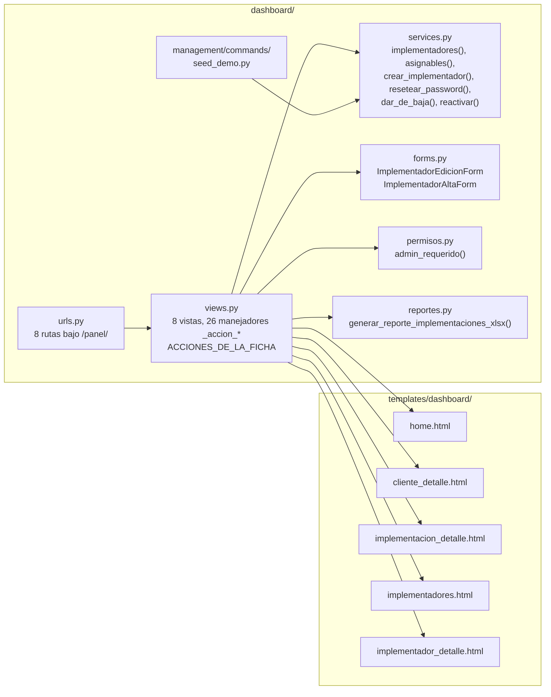

**Qué usa de otras apps**

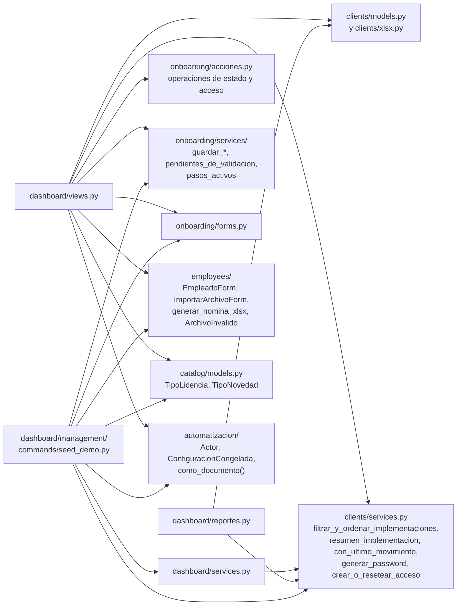

### 2.3 Modelos

`dashboard` no tiene modelos propios. Este diagrama muestra sus dos clases (los formularios de implementadores) y los modelos de otras apps que el panel lee y escribe, con los campos que aparecen en el código del panel.

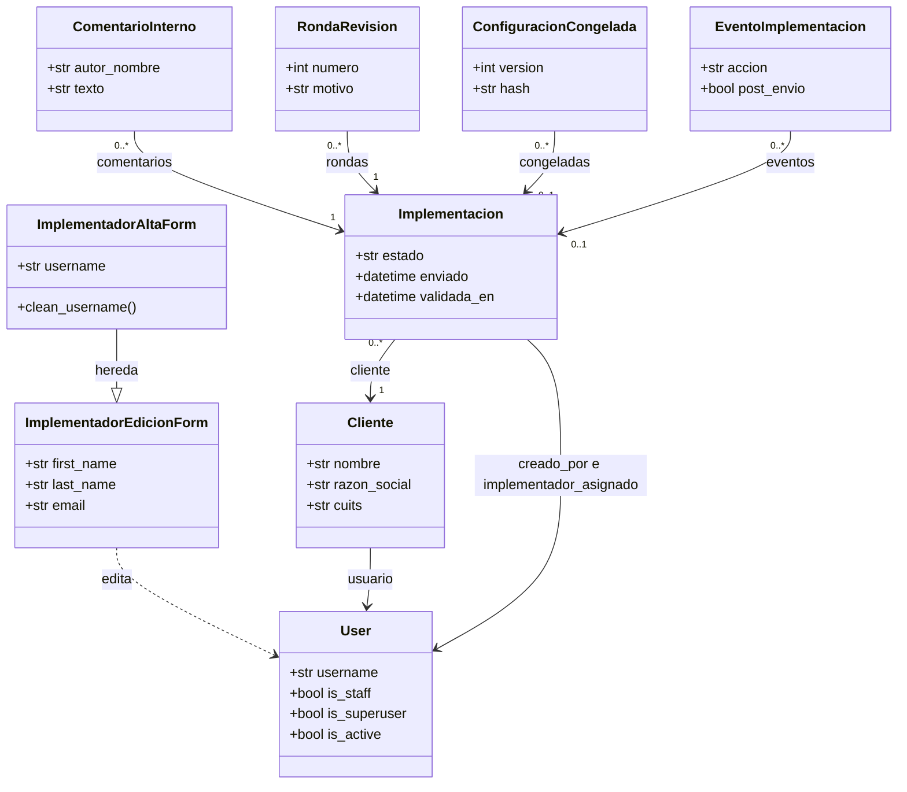

`ImplementadorEdicionForm` es un `ModelForm` sobre `User` con `first_name`, `last_name` y `email` (los tres obligatorios). `ImplementadorAltaForm` le suma `username` y rechaza un usuario repetido sin distinguir mayúsculas. No incluye `is_staff` ni `is_superuser`: por eso no se puede crear un admin mandando campos de más (lo verifica un test).

### 2.4 Pantallas y URLs

`config/urls.py` monta las rutas de `dashboard/urls.py` bajo `panel/`; el espacio de nombres (`app_name`) es `dashboard`: el prefijo con el que se nombran las rutas, por ejemplo `dashboard:home`.

| URL | Vista | Plantilla | Para qué sirve | Quién entra |
|---|---|---|---|---|
| `/panel/` | `home` | `home.html` | Listado de implementaciones con filtros y orden, botón «Nueva implementación» (alta en un modal) y botón «Exportar (.xlsx)» | Equipo |
| `/panel/clientes/<pk>/` | `cliente_detalle` | `cliente_detalle.html` | Datos de la empresa, su usuario de acceso (crear, reiniciar contraseña, reenviar invitación) y sus implementaciones | Equipo |
| `/panel/implementaciones/<pk>/` | `implementacion_detalle` | `implementacion_detalle.html` | La ficha: todo lo relevado, las acciones sobre el caso y los registros (ver más abajo) | Equipo |
| `/panel/implementaciones/<pk>/congelada/<version>/` | `descargar_congelada` | (descarga) | Una versión de la configuración congelada como `.json` | Equipo |
| `/panel/implementaciones/<pk>/nomina.xlsx` | `descargar_nomina` | (descarga) | La nómina cargada, en `.xlsx` | Equipo |
| `/panel/exportar/` | `exportar_implementaciones` | (descarga) | Reporte `.xlsx` de todas las implementaciones | Equipo |
| `/panel/implementadores/` | `implementadores_lista` | `implementadores.html` | Lista de implementadores y alta de uno nuevo | Solo admin |
| `/panel/implementadores/<pk>/` | `implementador_detalle` | `implementador_detalle.html` | Editar datos, reiniciar contraseña, dar de baja o reactivar | Solo admin |

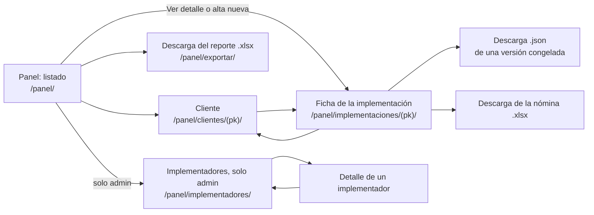

**La ficha de la implementación**, de arriba hacia abajo. Cada sección editable tiene un desplegable «Modificar sección» con su formulario.

| Tarjeta | Qué muestra | Acciones (`accion`) que envía |
|---|---|---|
| Cabecera | Cliente, implementador asignado, estado (con la marca «Devuelta, ronda N» y el paso si está a completar), aviso de «Implementación sin movimiento», aviso de pedido de contacto, link de autoservicio, usuario de acceso, lo que falta para validar, botones de estado | `reasignar`, `atender_revision`, `regenerar_acceso`, `enviar_invitacion`, `aprobar_para_configurar`, `marcar_cumplida`, `regenerar_link` (botón «Reiniciar link»), `anular` |
| Revisión con el cliente | Formulario para devolver (motivo y una observación por paso) y la tabla de rondas. Aparece si hay rondas, o si está enviada y pendiente | `devolver_al_cliente` |
| Comentarios del equipo | Notas internas, que el cliente nunca ve | `agregar_comentario` |
| Configuración congelada | Versiones con huella, archivos y descarga `.json`. Aparece si hay versiones | (solo lectura y descargas) |
| Datos de contacto | Datos de la empresa y de configuración | `actualizar_datos` |
| Condiciones del proceso | Qué deja fijo el equipo y qué decide el cliente | `actualizar_condiciones` |
| Módulos contratados | Módulos activos y si el cliente puede editarlos | `actualizar_modulos` |
| Roles | Personas con rol | `actualizar_roles` |
| Sucursales | Sucursales cargadas | `actualizar_sucursales` |
| Tipos de liquidación | Tipos elegidos | `actualizar_liquidaciones` |
| Firma del recibo | Estado, editor de solo lectura, validar, observar, corregir. Solo si usa Recibo Digital | `validar_firma`, `observar_firma`, `corregir_firma` |
| Licencias y Novedades | Activas de cada una | `actualizar_licencias_novedades` |
| Documentos de Legajo Digital | Tipos de documento incluidos | `actualizar_documentos` |
| Fecha de implementación | Fecha estimada (si ya está cumplida, la fecha real) | `actualizar_fecha_productivo` |
| Empleados | Nómina, edición, descarga `.xlsx`, alta manual e importación | `editar_empleado` (se abre con `?editar_empleado=<id>`), `eliminar_empleado`, `agregar_empleado`, `importar_empleados` |
| Historial de versiones | La foto anterior de cada sección (plantilla `clients/_historial_versiones.html`) | (solo lectura) |

### 2.5 Permisos

Los roles del equipo se definen en `permisos.py`:

| Rol | Cómo se reconoce | Qué puede |
|---|---|---|
| Cliente | Cuenta sin `is_staff` | No entra al panel: lo redirigen al login. Completa su wizard en `/r/`. |
| Implementador | `is_staff` y no superusuario | Todo el panel, menos gestionar implementadores (recibe 403). |
| Admin | Superusuario | Todo el panel, incluida la gestión de implementadores. |
| Cuenta dada de baja | `is_active` en falso | Ninguna vista del panel la deja pasar: ambos controles piden cuenta activa. |

Hay dos controles:

- **Equipo** (6 vistas): el decorador `staff_member_required(login_url="login")` de Django, que exige cuenta activa con `is_staff` y, si no, redirige al login.
- **Admin** (2 vistas, las de implementadores): `admin_requerido`, definido en `permisos.py`.

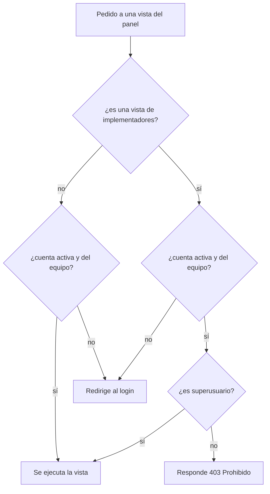

A un implementador logueado se le responde 403 en lugar de redirigirlo al login: el login lo devolvería al mismo panel (ya está autenticado) y se armaría un bucle de redirecciones. El menú (`templates/base.html`) muestra el enlace «Implementadores» solo si el usuario es superusuario, y rotula al usuario como «Admin» o «Implementador».

El rol también se refleja en el actor: `Actor.de_usuario` convierte un superusuario en `admin` y un staff en `implementador`, y eso queda en los eventos y en el historial de versiones.

### 2.6 Alta de una implementación

El alta vive en un modal (`<dialog id="modal-alta">`) de `home.html`. Es un POST a `/panel/` con `accion=crear_implementacion`. Si falla, el modal se reabre solo mostrando los errores y lo que ya se había escrito.

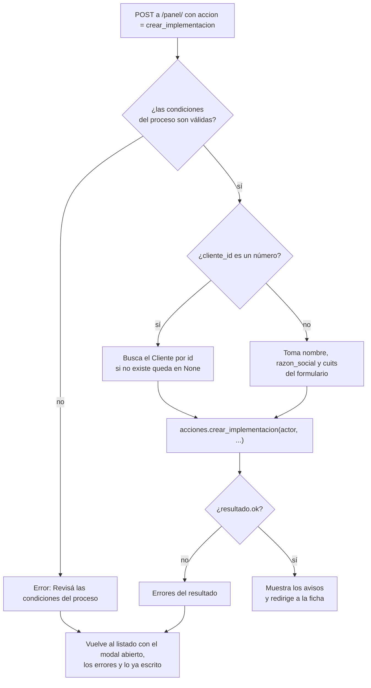

Detalles de `_alta_de_implementacion`:

- Los módulos llegan como lista `modulos` (ids numéricos) y `modulos_editables` como casilla. «Recibo Digital» viene tildado y bloqueado en el modal porque es obligatorio.
- El implementador asignado sale de `_implementador_elegido`: el `implementador_id` del formulario si es un número y corresponde a una cuenta de `asignables()`; si no, quien está creando la implementación.
- Con un `cliente_id` numérico que no existe, `crear_implementacion` responde «Elegí un cliente existente o completá el nombre de la empresa.» y el modal se reabre.
- Si el cliente todavía no tiene cuenta, `crear_implementacion` se la crea: con mail de cliente lo invita a crear su contraseña; sin mail, genera una y la muestra una sola vez en los avisos.

### 2.7 La ficha: despacho de acciones

La ficha (`implementacion_detalle`) recibe todos sus formularios por POST en la misma URL. El campo oculto `accion` dice cuál. En vez de una cadena larga de `if`, hay un diccionario, `ACCIONES_DE_LA_FICHA`, que mapea cada valor de `accion` a una función `_accion_<nombre>(request, implementacion, actor)`.

Cada manejador devuelve una de tres cosas: **un redirect** (se hizo), **un diccionario con el formulario que falló** (se vuelve a mostrar la página con sus errores, sin redirigir) o **`None`** (acción desconocida).

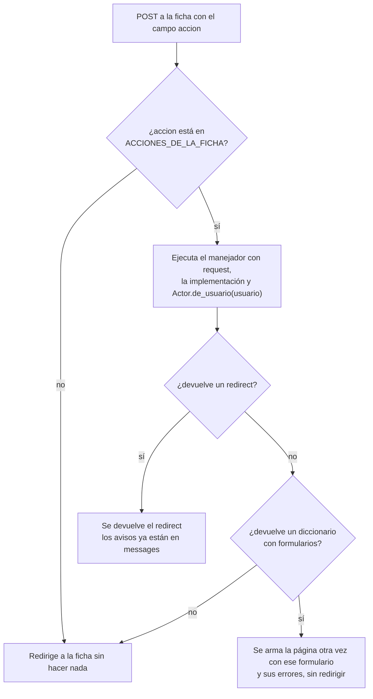

Si el manejador no devuelve ni un redirect ni un diccionario, devolvió `None`: la vista redirige a la ficha sin más.

Los manejadores tienen dos formas:

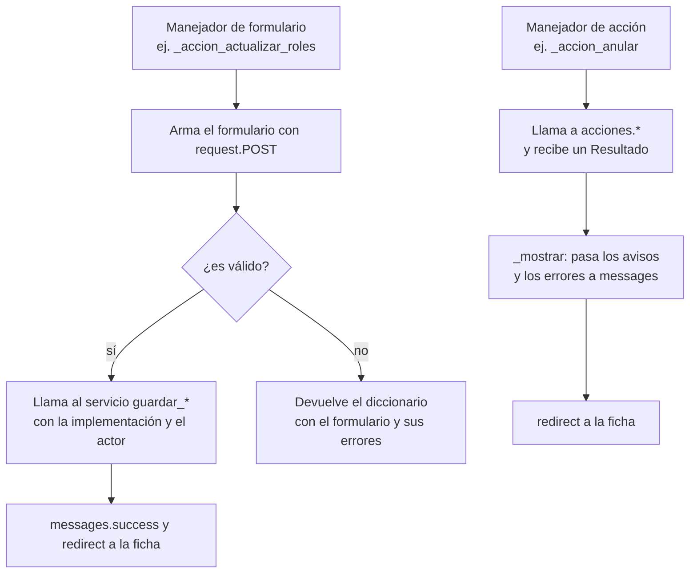

`_mostrar(request, resultado)` llama a `resultado.mostrar(request)` (los avisos van a `messages` con su nivel) y agrega cada error de `resultado.errores` como `messages.error`. El link público que necesitan los mails (`base_url`) lo arma la vista con `request.build_absolute_uri("/")`, porque las acciones no conocen el `request`.

#### Todas las acciones de la ficha

26 valores de `accion`. «Servicio» es una función de `onboarding/services/` (se llama `onboarding_services.<función>`); «acción» es una de `onboarding/acciones.py`.

| `accion` | Manejador | Operación pública a la que llama | Qué lee y qué pasa si falla |
|---|---|---|---|
| `actualizar_datos` | `_accion_actualizar_datos` | servicio `guardar_datos_contacto(implementacion, form, actor)` | `ImplementacionDatosForm` (con archivos). Si es inválido, devuelve `datos_form`. |
| `actualizar_modulos` | `_accion_actualizar_modulos` | servicio `guardar_modulos(implementacion, modulos_qs, activos_ids, actor)` | Lista `modulos` (ids numéricos). Después guarda `modulos_editables_por_cliente` directo, fuera del servicio. No tiene validación. |
| `actualizar_roles` | `_accion_actualizar_roles` | servicio `guardar_roles(implementacion, formset, actor)` | `RolFormSet` (prefijo `roles`). Si es inválido, devuelve `roles_formset`. |
| `actualizar_sucursales` | `_accion_actualizar_sucursales` | servicio `guardar_sucursales(implementacion, formset, actor)` | `SucursalFormSet` (prefijo `sucursales`). Devuelve `sucursales_formset`. |
| `actualizar_licencias_novedades` | `_accion_actualizar_licencias_novedades` | servicio `guardar_licencias_y_novedades(implementacion, form, licencias_qs, novedades_qs, actor)` | `LicenciasNovedadesForm`. Devuelve `licencias_novedades_form`. |
| `actualizar_documentos` | `_accion_actualizar_documentos` | servicio `guardar_documentos(implementacion, form, todos_qs, actor)` | `DocumentosLegajoForm`. Devuelve `documentos_form`. |
| `actualizar_liquidaciones` | `_accion_actualizar_liquidaciones` | servicio `guardar_liquidaciones(implementacion, tipos, actor)` | `LiquidacionesForm`; pasa `tipos_liquidacion`. Devuelve `liquidaciones_form`. |
| `actualizar_condiciones` | `_accion_actualizar_condiciones` | servicio `guardar_condiciones(implementacion, form, actor)` | `CondicionesForm`. Devuelve `condiciones_form`. |
| `actualizar_fecha_productivo` | `_accion_actualizar_fecha_productivo` | servicio `guardar_fecha_implementacion(implementacion, fecha, actor)` | Lee `fecha_salida_productivo` con `parse_date`. Sin el mínimo que se le exige al cliente; un campo vacío da `None` y borra la fecha. |
| `validar_firma` | `_accion_validar_firma` | acción `validar_firma(actor, implementacion)` | Los errores van a `messages`. |
| `observar_firma` | `_accion_observar_firma` | acción `observar_firma(actor, implementacion, motivos, comentario, base_url=)` | Lee la lista `motivos` y `comentario`. Si pasa los controles, termina llamando a `devolver_al_cliente`. Los errores van a `messages`. |
| `corregir_firma` | `_accion_corregir_firma` | servicio `guardar_firma(implementacion, actor, pagina=, geometria=, imagen=)` | `FirmaForm` (con archivos). Si es inválido, devuelve `firma_form`. Deja la firma validada. |
| `agregar_empleado` | `_accion_agregar_empleado` | servicio `agregar_empleado(implementacion, empleado_form, actor)` | `EmpleadoForm`. Si devuelve falso (inválido o CUIL repetido), devuelve `empleado_form`. |
| `editar_empleado` | `_accion_editar_empleado` | servicio `editar_empleado(implementacion, empleado_form, actor)` | Busca el empleado en la implementación (`empleado_id`); si no existe, vuelve sin hacer nada. Si falla, devuelve `empleado_edit_form` y `empleado_editando`. |
| `eliminar_empleado` | `_accion_eliminar_empleado` | servicio `eliminar_empleado(implementacion, empleado_id, actor)` | Siempre muestra «Empleado eliminado.»; el servicio ignora un id inválido o inexistente. |
| `importar_empleados` | `_accion_importar_empleados` | servicio `importar_archivo_empleados(implementacion, archivo, actor)` y `resumen_importacion` | `ImportarArchivoForm`. Un `ArchivoInvalido` se convierte en error del campo `archivo`; si falla, devuelve `import_form`. Muestra el resumen y hasta 5 filas rechazadas. |
| `reasignar` | `_accion_reasignar` | acción `reasignar(actor, implementacion, nuevo)` | `implementador_id` tiene que ser un número y estar en `asignables()`; si no, no hace nada. |
| `regenerar_link` | `_accion_regenerar_link` | acción `reabrir(actor, implementacion)` | Botón «Reiniciar link». |
| `anular` | `_accion_anular` | acción `anular(actor, implementacion)` | |
| `aprobar_para_configurar` | `_accion_aprobar_para_configurar` | acción `aprobar_para_configurar(actor, implementacion)` | Botón «Validar documentación y dejar lista para configurar». Si falta algo o falla un archivo, el error va a `messages`. |
| `marcar_cumplida` | `_accion_marcar_cumplida` | acción `marcar_cumplida(actor, implementacion, base_url=)` | Solo se puede desde «Validada». |
| `devolver_al_cliente` | `_accion_devolver_al_cliente` | acción `devolver_al_cliente(actor, implementacion, motivo, observaciones, base_url=)` | Lee `motivo` y un campo `obs_<código>` por cada código de `CODIGO_DE_PASO`. |
| `atender_revision` | `_accion_atender_revision` | acción `atender_revision(actor, implementacion)` | Marca atendido el pedido de contacto del cliente. |
| `agregar_comentario` | `_accion_agregar_comentario` | acción `agregar_comentario(actor, implementacion, texto, autor=)` | Pasa `autor=request.user`. Un texto vacío o demasiado largo vuelve como error en `messages`. |
| `regenerar_acceso` | `_accion_regenerar_acceso` | acción `entregar_acceso(actor, cliente, username, mail, base_url=, implementacion=)` | Crea el acceso del cliente o reinicia su contraseña. |
| `enviar_invitacion` | `_accion_enviar_invitacion` | acción `invitar_cliente(actor, cliente, implementacion=, base_url=)` | Reenvía el mail para crear la contraseña. |

#### Acciones que no pasan por `ACCIONES_DE_LA_FICHA`

| Dónde | Condición | Operación pública |
|---|---|---|
| `home` | POST con `accion=crear_implementacion` | acción `crear_implementacion` (ver 2.6) |
| `cliente_detalle` | POST con `accion=regenerar_acceso` | acción `entregar_acceso(actor, cliente, username, mail, base_url=)` |
| `cliente_detalle` | POST con `accion=enviar_invitacion` | acción `invitar_cliente(actor, cliente, base_url=)` |

#### Qué más hace la vista al mostrar la ficha

Después de procesar un POST (o directamente en un GET), `implementacion_detalle` arma el contexto: parte de `resumen_implementacion(implementacion)` (lo relevado, solo lectura; sale de `clients/services.py`) y agrega el link de autoservicio, las rondas, los comentarios, las versiones congeladas y la vigente, lo que falta para validar (`pendientes_de_validacion`, solo si está enviada y sin validar), los pasos sobre los que se puede observar (`pasos_observables`, los pasos activos menos el de revisión), las cuentas asignables y los formularios de cada sección. Para cada formulario usa el que vino con errores si lo hay, o uno nuevo.

Con `?editar_empleado=<id>` en un GET se abre el formulario de edición de ese empleado.

#### Para agregar una acción nueva a la ficha

1. Crear la operación en `onboarding/acciones.py` (si cambia el estado del caso) o en `onboarding/services/` (si guarda una sección), con actor y sin `request`.
2. Escribir `_accion_<nombre>(request, implementacion, actor)` en `dashboard/views.py`: devuelve `_volver(implementacion)`, o un diccionario con el formulario que falló.
3. Registrarla en `ACCIONES_DE_LA_FICHA`.
4. Agregar el `<form method="post">` con `<input type="hidden" name="accion" value="...">` en `implementacion_detalle.html`.
5. Escribir el test en `dashboard/tests/panel/` (hay una clase base, `BasePanel`, en `dashboard/tests/base.py`).

### 2.8 El listado: filtros y orden

`home` arma el listado con `filtrar_y_ordenar_implementaciones(queryset, request.GET)`, que vive en `clients/services.py`. Los parámetros llegan por querystring (lo que va después del `?` en la URL).

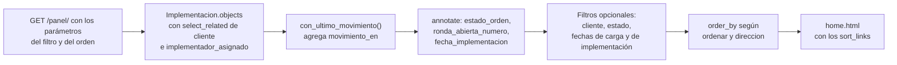

**Columnas que agrega** (`annotate`, que suma columnas calculadas a la consulta):

| Columna | Qué es |
|---|---|
| `movimiento_en` | El mayor entre el momento del último evento de la implementación (o `creado` si no hay) y `creado`. Se calcula en una sola consulta, sin una por fila. |
| `estado_orden` | Número para ordenar por estado: cancelada 4, cumplida 3, validada 2, enviada 1, el resto 0. |
| `ronda_abierta_numero` | Número de la devolución que el cliente todavía no respondió (alimenta la marca «Devuelta, ronda N»). |
| `fecha_implementacion` | La fecha real (`cumplida_en`, como fecha) si está cumplida; si no, `fecha_salida_productivo`. |

**Filtros** (todos opcionales):

| Parámetro | Efecto |
|---|---|
| `cliente` | Nombre de la empresa que contenga el texto (sin distinguir mayúsculas). |
| `estado` | Ver la tabla siguiente. |
| `creado_desde`, `creado_hasta` | Fecha de creación, ambos extremos inclusive. |
| `fecha_impl_desde`, `fecha_impl_hasta` | Sobre `fecha_implementacion`, ambos extremos inclusive. |

Valores de `estado` (los ofrece `Implementacion.opciones_de_filtro_de_estado()`):

| Valor | Condición |
|---|---|
| `a_completar` | `estado` pendiente y todavía no enviada |
| `completado_cliente` | Pendiente, enviada y sin validar |
| `validada` | Pendiente, enviada y validada |
| `completo` | `estado` cumplida |
| `cancelada` | `estado` cancelada |
| `sin_movimiento` | Pendiente y con `movimiento_en` de hace 7 días o más (`DIAS_SIN_MOVIMIENTO`). Es una marca derivada, no un estado más |

**Orden:** `ordenar` acepta `cliente`, `estado`, `fecha_implementacion` y `creado` (las claves de `COLUMNAS_ORDENABLES`); cualquier otro valor cae en `creado`. `direccion` es `asc` o `desc`; por defecto es `desc` para `creado` y `asc` para el resto, y cualquier valor distinto de `desc` ordena ascendente.

**Los links de las columnas** (`_sort_links` en `dashboard/views.py`): para cada columna ordenable arma la URL que alterna ascendente y descendente conservando los demás filtros, e indica si esa columna es la activa y en qué dirección (la plantilla dibuja ▲ o ▼).

### 2.9 Reportes y descargas

**Reporte de implementaciones** (`exportar_implementaciones`, botón «Exportar (.xlsx)» al pie del listado). Descarga `implementaciones_AAAA-MM-DD.xlsx` con todas las implementaciones, **sin aplicar los filtros del listado**, de la más nueva a la más vieja. Lo genera `generar_reporte_implementaciones_xlsx()` en `reportes.py`:

- La consulta usa `con_ultimo_movimiento`, `select_related` de cliente, implementador asignado y creador, `prefetch_related` de los módulos, y tres conteos con `Count(..., distinct=True)` (empleados, sucursales, rondas) para que los cruces entre tablas no multipliquen filas.
- Hoja «Implementaciones», con encabezado en negrita y primera fila fija. Una fila por implementación, con las 21 columnas de `COLUMNAS`:

| Columnas |
|---|
| Empresa · Razón social · CUIT(s) · Estado · Paso actual · Implementador asignado · Creada por · Mail de contacto · Teléfono · Fecha de solicitud · Fecha de envío del cliente · Fecha de implementación · Tipo de fecha de implementación · Módulos · Empleados · Sucursales · Pidió contacto sin atender · Fecha de validación · Rondas de devolución · Última actividad · Sin movimiento |

- **Estado** es la marca «Devuelta, ronda N» si la hay, o si no la etiqueta del estado visual. **Paso actual** solo se llena si está a completar por el cliente.
- **Fecha de implementación** y su **tipo**: `Real` (la de `cumplida_en`) si está cumplida; `Estimada` (`fecha_salida_productivo`) si no, y vacío si no hay ninguna.
- **Módulos** lista los activos. **Pidió contacto sin atender** es «Sí» si hay un pedido sin atender. **Sin movimiento** es «Sí» o «No».
- Cada celda se escribe con `escribir_celda` (`clients/xlsx.py`), que fuerza el tipo texto: un dato que cargó un cliente y empiece con `=` no se ejecuta como fórmula al abrir el archivo en Excel.

**Otras descargas del panel**

| Vista | Qué descarga |
|---|---|
| `descargar_nomina` | `nomina_<cliente>.xlsx` (espacios cambiados por `_`) con la nómina de la implementación, con `generar_nomina_xlsx` de `employees` |
| `descargar_congelada` | `configuracion_<pk>_v<version>.json` con `como_documento(congelada)`: JSON con sangría y claves ordenadas. Si la versión no existe, 404 |

Los archivos copiados de una versión congelada se enlazan desde la ficha por `/media/<ruta>`: esa vista (`media_protegida`) deja pasar al equipo a cualquier archivo, y a un cliente solo a su logo, banner, firma y modelo de recibo, así que las copias congeladas le dan 404.

### 2.10 Gestión de implementadores

Solo para admins. El implementador es una cuenta de staff sin superusuario.

| Función (`services.py`) | Qué hace |
|---|---|
| `implementadores()` | Las cuentas con rol Implementador: `is_staff` y no superusuario, con la cantidad de implementaciones que crearon (`creadas`), activas primero y por usuario. Los admins y los clientes no aparecen, así que no se pueden tocar por esta vía. |
| `asignables()` | Las cuentas a las que se puede asignar una implementación: todo el equipo activo, implementadores y admins. |
| `crear_implementador(username, first_name, last_name, email)` | Crea la cuenta con una contraseña generada (`generar_password`, de `clients/services.py`). Devuelve `(usuario, password_en_claro)`: la contraseña solo se ve esa vez. |
| `resetear_password(usuario)` | Genera una contraseña nueva; según su docstring, la anterior y las sesiones abiertas dejan de valer. |
| `dar_de_baja(usuario)` | Baja lógica: `is_active` en falso. La cuenta se conserva para no perder a quién se atribuyen las implementaciones que creó. |
| `reactivar(usuario)` | `is_active` en verdadero. |

Las vistas:

- `implementadores_lista`: muestra la lista y el formulario `ImplementadorAltaForm`. Con un POST válido llama a `crear_implementador(**form.cleaned_data)` y muestra el usuario y la contraseña **una única vez**, en un aviso (`_avisar_credenciales`).
- `implementador_detalle(pk)`: abre solo cuentas de `implementadores()` (un admin o un cliente da 404) y procesa la `accion` del POST.

| `accion` | Qué hace |
|---|---|
| `guardar` | Valida `ImplementadorEdicionForm` y guarda nombre, apellido y mail. El usuario no se cambia: el historial de versiones lo guarda como texto para atribuir cada edición. |
| `resetear_password` | `resetear_password` y muestra la contraseña nueva una vez. |
| `dar_de_baja` | `dar_de_baja`: ya no puede ingresar, ni siquiera con una sesión abierta (ambos controles piden cuenta activa). |
| `reactivar` | `reactivar`. |

### 2.11 El comando `seed_demo`

Pobla una base de desarrollo con datos ficticios: llama a `seed_catalogos` y `seed_modulos`, y crea los clientes de `PERFILES` (8 clientes y 9 implementaciones, en todos los estados posibles, con sucursales, roles, licencias, documentos, nómina, firma e historial de versiones) y dos implementadores de ejemplo (`IMPLEMENTADORES_DEMO`: uno activo y uno dado de baja). Todas las cuentas demo usan la contraseña de la constante `DEMO_PASSWORD`.

```
venv/Scripts/python manage.py seed_demo            # crea lo que falte
venv/Scripts/python manage.py seed_demo --reset    # borra y regenera solo los clientes demo
```

- Es idempotente: un cliente demo que ya existe se saltea.
- `--reset` borra solo los clientes de esa lista (y sus cuentas) y los implementadores demo; no toca otros.
- No corre con `DEBUG=False` salvo `--force`.
- Escribe los datos directamente y usa `guardar_version` para el historial; **no pasa por las acciones, así que no genera eventos**.

### 2.12 Referencia por archivo

#### `dashboard/views.py`

| Función, clase o modelo | Qué hace | Quién la usa |
|---|---|---|
| `_avisar_credenciales(request, titulo, username, password)` | Muestra una única vez las credenciales recién generadas. | `implementadores_lista`, `implementador_detalle` |
| `_mostrar(request, resultado)` | Pasa los avisos y los errores de un `Resultado` a `messages`. | `cliente_detalle` y los manejadores que llaman a `acciones.*` |
| `_base_url(request)` | La URL pública del portal (para los links de los mails). | `_alta_de_implementacion`, `cliente_detalle` y los manejadores que mandan mail |
| `_implementador_elegido(request)` | El implementador del formulario si es válido; si no, quien crea. | `_alta_de_implementacion` |
| `_sort_links(request)` | Arma los links de orden de cada columna. | `home` |
| `_alta_de_implementacion(request, condiciones_form)` | Valida y crea la implementación con `acciones.crear_implementacion`. Devuelve `(implementacion, errores)`. | `home` |
| `home(request)` | Listado, filtros, orden y alta. | `urls.py` (`dashboard:home`) |
| `cliente_detalle(request, pk)` | Ficha de la empresa, su acceso y sus implementaciones. | `urls.py`; enlaces de `home.html` y de la ficha |
| `_empleado_del_panel(implementacion, empleado_id)` | El empleado de esa implementación, o `None`. | `_accion_editar_empleado`, `implementacion_detalle` |
| `_volver(implementacion)` | Redirect a la ficha. | Todos los manejadores |
| `_accion_*` (26) | Un manejador por acción de la ficha (ver 2.7). | `ACCIONES_DE_LA_FICHA` |
| `ACCIONES_DE_LA_FICHA` | Diccionario `accion` → manejador. | `_manejar_accion_implementacion` |
| `_manejar_accion_implementacion(request, implementacion)` | Busca el manejador y lo ejecuta con el actor del usuario. | `implementacion_detalle` |
| `implementacion_detalle(request, pk)` | Despacha los POST y arma la ficha. | `urls.py`; enlaces de `home.html`, `cliente_detalle.html` y del alta |
| `descargar_congelada(request, pk, version)` | Descarga una versión congelada como `.json`. | `urls.py`; enlace de la ficha |
| `descargar_nomina(request, pk)` | Descarga la nómina como `.xlsx`. | `urls.py`; enlace de la ficha |
| `exportar_implementaciones(request)` | Descarga el reporte de todas las implementaciones. | `urls.py`; botón de `home.html` |
| `implementadores_lista(request)` | Lista y alta de implementadores (admin). | `urls.py`; enlace del menú |
| `implementador_detalle(request, pk)` | Edición, contraseña, baja y reactivación (admin). | `urls.py`; enlace de `implementadores.html` |

#### `dashboard/services.py`

| Función, clase o modelo | Qué hace | Quién la usa |
|---|---|---|
| `implementadores()` | Cuentas con rol Implementador, con su cantidad de creadas. | `implementadores_lista`, `implementador_detalle` |
| `asignables()` | Equipo activo al que se puede asignar una implementación. | `home`, `implementacion_detalle`, `_implementador_elegido`, `_accion_reasignar` |
| `crear_implementador(...)` | Crea la cuenta con contraseña generada. | `implementadores_lista`, `seed_demo` |
| `resetear_password(usuario)` | Genera una contraseña nueva. | `implementador_detalle` |
| `dar_de_baja(usuario)` | Baja lógica. | `implementador_detalle` |
| `reactivar(usuario)` | Vuelve a activar la cuenta. | `implementador_detalle` |

#### `dashboard/forms.py`, `permisos.py`, `reportes.py`, `urls.py`

| Función, clase o modelo | Qué hace | Quién la usa |
|---|---|---|
| `ImplementadorEdicionForm` | `ModelForm` de `User`: nombre, apellido y mail, todos obligatorios. | `implementador_detalle`; base de `ImplementadorAltaForm` |
| `ImplementadorAltaForm` | Suma `username` y rechaza uno repetido sin distinguir mayúsculas (`clean_username`). | `implementadores_lista` |
| `admin_requerido(vista)` | Decorador: solo deja pasar a superusuarios (ver 2.5). | `implementadores_lista`, `implementador_detalle` |
| `COLUMNAS` (`reportes.py`) | Título y ancho de las 21 columnas del reporte. | `generar_reporte_implementaciones_xlsx` |
| `_fecha(valor)` | Fecha `dd/mm/aaaa` en hora local, o vacío. | `generar_reporte_implementaciones_xlsx` |
| `generar_reporte_implementaciones_xlsx()` | Arma el reporte y devuelve el archivo en memoria. | `exportar_implementaciones`, tests |
| `app_name`, `urlpatterns` (`urls.py`) | Las 8 rutas del panel, con el espacio de nombres `dashboard`. | `config/urls.py` (bajo `panel/`) |

#### El resto

| Archivo | Qué hace | Quién lo usa |
|---|---|---|
| `models.py`, `admin.py`, `migrations/` | Vacíos: la app no tiene modelos propios. | |
| `apps.py`: `DashboardConfig` | Configuración de la app. | Django, al arrancar |
| `management/commands/seed_demo.py`: `Command` y sus ayudas (`_con_verificador`, `_cuits_validos`, `_cuil`, `_persona`, `_banner_png`, `_pdf_minimo`) | Datos de demostración (ver 2.11). | Quien lo corre a mano; `dashboard/tests/test_seed_demo.py` |

#### Plantillas (`templates/dashboard/`)

| Plantilla | Vista | Qué envía |
|---|---|---|
| `home.html` | `home` | GET de filtros y orden; POST `crear_implementacion` desde el modal (el modal lo abre y cierra un script dentro de la misma plantilla) |
| `cliente_detalle.html` | `cliente_detalle` | `regenerar_acceso`, `enviar_invitacion` |
| `implementacion_detalle.html` | `implementacion_detalle` | Las 26 acciones de `ACCIONES_DE_LA_FICHA`; incluye `onboarding/_editor_firma.html` y `clients/_historial_versiones.html` |
| `implementadores.html` | `implementadores_lista` | POST de alta (`ImplementadorAltaForm`) |
| `implementador_detalle.html` | `implementador_detalle` | `guardar`, `resetear_password`, `dar_de_baja`, `reactivar` |

### 2.13 Dónde ver ejemplos en los tests

| Archivo | Qué muestra |
|---|---|
| `dashboard/tests/panel/test_views.py` | Acceso al panel por tipo de cuenta, alta básica y entradas no numéricas |
| `dashboard/tests/panel/test_asignado.py` | Implementador asignado en el alta, reasignar y fecha de implementación del equipo |
| `dashboard/tests/panel/test_condiciones.py` | Condiciones del proceso en el alta y en la ficha |
| `dashboard/tests/panel/test_modal_alta.py` | El modal del alta y cómo se reabre con errores |
| `dashboard/tests/panel/test_reporte_y_empleados.py` | El reporte `.xlsx`, la edición e importación de empleados desde la ficha y el alta atómica |
| `dashboard/tests/panel/test_seguimiento.py` | La marca «Implementación sin movimiento», su filtro y los comentarios internos |
| `dashboard/tests/equipo/test_implementadores.py` | Permisos por rol y alta, edición, baja y reactivación de implementadores |
| `dashboard/tests/test_seed_demo.py` | El comando `seed_demo` |
| `dashboard/tests/configuracion/test_settings.py` | Configuración del proyecto (clave secreta, HTTPS, correo, log de errores): no es del panel, solo vive en esta carpeta |
| `automatizacion/tests/congelada/test_panel.py` | La sección «Configuración congelada» de la ficha y su descarga |

---

## Detalles que conviene conocer

Cosas que salen de leer el código y que sorprenden si no se saben:

1. **`post_envio` se decide por «no es cliente», no por «es del equipo».** La condición es `actor.tipo != CLIENTE`: un actor `sistema`, `servicio` o `agente` también marca la corrección si la implementación ya fue enviada. El test `test_el_cliente_o_el_sistema_no_se_marcan_como_correccion_del_equipo` solo verifica al cliente.
2. **Hay piezas previstas para más adelante que el código de producción todavía no usa**: `Actor.es_del_equipo` y `correlacion.nueva()` (las ejercitan solo los tests), los tipos de actor `servicio` y `agente`, y los orígenes `api` y `comando` (nadie se los pasa a `registrar`).
3. **La inmutabilidad es del modelo, no de la base.** Ver 1.5.
4. **`congelar` no limpia las copias parciales.** Si un archivo no se puede leer, la transacción deshace la base, pero los archivos que ya se habían copiado a `congeladas/` quedan en disco (`_copiar_archivos` no tiene limpieza).
5. **`_accion_actualizar_modulos` guarda `modulos_editables_por_cliente` por fuera de `guardar_modulos`**, así que ese cambio no deja versión en el historial ni evento.
6. **`_accion_eliminar_empleado` muestra siempre «Empleado eliminado.»**, aunque el servicio haya ignorado un id inexistente.
7. **Los links de orden y el servicio difieren en el valor por defecto de `direccion`**: `_sort_links` supone `desc` cuando falta, el servicio supone `asc` salvo para `creado`. Los links que genera la página siempre llevan ambos parámetros, así que solo se nota con una URL escrita a mano con `?ordenar=cliente` y sin `direccion`.
8. **La demo (`seed_demo`) no genera eventos**, así que la marca «sin movimiento» y la columna «Última actividad» de esos datos se calculan con la fecha de creación.
