# Módulos `clients` y `catalog`

Documentación de las dos apps que guardan los datos del portal: **`clients`** (la empresa cliente, la implementación y todo lo que se releva de ella, más el login y el acceso a los archivos subidos) y **`catalog`** (las listas cerradas de las que el cliente elige: licencias, novedades, tipos de liquidación y documentos de legajo). El resumen general del sistema está en [`../arquitectura.md`](../arquitectura.md); acá se baja un nivel: qué hay en cada archivo, qué hace cada función y quién la usa.

Los diagramas están en [Mermaid](https://mermaid.js.org/): GitHub los dibuja directamente. En los diagramas de clases los tipos están simplificados (`str`, `int`, `datetime`, `json`…) y los atributos calculados (propiedades, que no son columnas) figuran como atributos comunes; la tabla de cada archivo aclara cuáles son.

Índice: [Glosario](#glosario-de-términos) · [1. `clients`](#1-la-app-clients) · [2. `catalog`](#2-la-app-catalog) · [3. Al tocar estas apps](#3-al-tocar-estas-apps)

---

## Glosario de términos

Cada término técnico se explica una sola vez, acá. El resto del documento los usa sin repetir la explicación.

| Término | Qué es |
|---|---|
| App | Carpeta de Django con su propio conjunto de modelos, vistas y comandos. El proyecto se arma juntando apps (`clients`, `catalog`, `onboarding`…). |
| Modelo | Clase Python que representa una tabla: cada campo es una columna y cada instancia es una fila. |
| `ForeignKey` / `OneToOneField` | Campo que apunta a una fila de otra tabla (muchos a uno / uno a uno). `on_delete` dice qué pasa si se borra la fila apuntada: `CASCADE` borra también esta fila, `PROTECT` impide el borrado y `SET_NULL` deja el campo vacío. |
| Referencia por texto | Un `ForeignKey` puede apuntar con un texto `"app.Modelo"` (por ejemplo `"catalog.TipoLicencia"`) en vez de importar la clase; así dos apps pueden referirse entre sí sin un ciclo de imports. |
| `related_name` | Nombre con el que se navega una relación a la inversa: `implementacion.roles` devuelve los `PersonaRol` de esa implementación. |
| `UniqueConstraint` / `unique_together` | Regla de la base que impide repetir una combinación de campos. |
| `choices` y `get_X_display()` | `choices` es la lista cerrada de valores válidos de un campo; `get_estado_display()` devuelve el texto legible del valor guardado. |
| `JSONField` | Campo que guarda un diccionario o una lista como JSON dentro de la columna. |
| `ImageField` / `FileField` | Campo para archivos subidos: el archivo va a la carpeta `MEDIA_ROOT` (`media/`) y en la base queda solo su ruta. |
| Propiedad (`@property`) | Método que se lee como un atributo (`imp.estado_visual`). No es una columna: se calcula cada vez que se lee. |
| QuerySet | Consulta a la base que se arma de forma encadenada y se ejecuta recién cuando se la recorre (`.filter(...)`, `.exists()`). |
| `Q()` | Condición de filtro que se puede guardar, combinar con otras y reutilizar. |
| Anotación (`annotate`) | Agrega a cada fila de una consulta un valor calculado por la base. Evita hacer una consulta extra por cada fila. |
| `Subquery` | Consulta anidada dentro de otra (por ejemplo, «el último evento de esta implementación»). |
| Migración | Archivo que describe un cambio de la estructura de la base (o de sus datos); `manage.py migrate` las aplica en orden. |
| Clase abstracta / mixin | Clase con `abstract = True` que presta campos y métodos a otras y no tiene tabla propia. |
| Validador | Función que recibe un valor y lanza `ValidationError` si no sirve. Django la corre al validar un formulario o un modelo, no al hacer `.save()`. |
| Vista | Función o clase que recibe el pedido web (`request`) y devuelve la respuesta. |
| Admin | Sitio de administración (`/admin/`) que Django arma solo a partir de los modelos. `ModelAdmin` configura cómo se ve cada uno y un *inline* es una tabla de modelos relacionados editada dentro de la pantalla del modelo padre. |
| Comando de gestión | Script que se corre con `manage.py <nombre>` (por ejemplo `seed_modulos`). *Sembrar* (`seed`) es cargar datos iniciales. |
| Idempotente | Que se puede correr varias veces y deja el mismo resultado que correrlo una. |
| Filtro de plantilla | Función Python que se usa dentro de una plantilla HTML con la forma `valor` seguido de `|nombre`. |
| Middleware | Capa que ve cada pedido antes de que llegue a la vista y cada respuesta antes de que salga. |
| Caché | Almacén clave-valor temporal, con vencimiento. Acá es una carpeta temporal en producción y memoria en los tests. |
| `django-axes` | Librería que cuenta los intentos fallidos de login y bloquea. |
| Transacción (`transaction.atomic`) | Bloque en el que todos los cambios a la base se confirman juntos o no se confirma ninguno. |
| `ready()` | Método de la configuración de una app (`AppConfig`) que Django ejecuta una vez al arrancar. |
| Proxy reverso | Servidor que recibe los pedidos de internet y se los reenvía a la app. Detrás de él, la app ve como origen la IP del proxy, no la del usuario. |
| `X-Forwarded-For` / `REMOTE_ADDR` | `X-Forwarded-For` es el encabezado en el que cada proxy anota la IP de quien le habló; `REMOTE_ADDR` es la IP de quien se conectó directo con la app. |
| Token | Cadena larga y aleatoria que funciona como llave secreta. |
| UUID | Identificador único universal: una cadena aleatoria que se puede mostrar sin revelar nada. |
| `sha256` | Huella de un archivo o texto: si cambia un solo byte, cambia la huella. |
| Códigos HTTP 404 / 429 / 503 | Respuestas del servidor: «no encontrado», «demasiados intentos» y «servicio no disponible». |
| Snapshot (foto) | Copia del estado de una sección en un momento dado. |
| Actor | Objeto inmutable (`automatizacion/actores.py`) que dice quién hace una acción: tiene un `tipo` (`cliente`, `implementador`, `admin`, `sistema`, `servicio`, `agente`) y un `ref` (por ejemplo el nombre de usuario). Su propiedad `etiqueta` es «Cliente» para el cliente y el `ref` para el resto (o el `tipo`, si no tiene `ref`). |
| Evento | Registro de que algo pasó en una implementación (`EventoImplementacion`, app `automatizacion`); solo se agregan, nunca se editan ni se borran. |

---

# 1. La app `clients`

## 1.1 Propósito

`clients` es el centro de datos del portal. Hace cinco cosas:

1. **Modelos centrales.** `Cliente` (la empresa), `Implementacion` (un proceso puntual de relevamiento de ese cliente) y todo lo que cuelga de ella: módulos contratados, roles, sucursales, licencias, novedades, liquidaciones y documentos elegidos, firma, rondas de devolución, comentarios internos e historial de versiones.
2. **Estado derivado.** El estado que ve el equipo no es una columna: se calcula de `estado`, `enviado` y `validada_en` (y las marcas «Devuelta, ronda N» y «Implementación sin movimiento» se calculan de las rondas y de los eventos). Una sola fuente de verdad.
3. **Historial de versiones por sección.** Antes de cada cambio se guarda una foto de la sección (`cambio_de_seccion`) y, si la implementación estaba validada y el cambio fue real y de una sección que se configura, se revoca la validación (`revocar_validacion`). El detalle está en [1.5](#15-historial-de-versiones).
4. **Acceso.** Login único para clientes y equipo, límite de intentos, recuperación y cambio de contraseña, y creación de la cuenta del cliente.
5. **Piezas compartidas.** Acceso protegido a los archivos subidos (`media_protegida`), chequeo de salud (`salud`), validadores (tamaño de archivo, medidas de imagen, CUIT) y una utilidad para escribir planillas `.xlsx` sin que Excel ejecute fórmulas.

Dependencias: `clients` hereda de `catalog` (`ConCodigo`), registra eventos en `automatizacion` y apunta por texto a `catalog.*`, `employees.Empleado` y `auth.User`. La dependencia inversa se evita con un registro: `employees` le avisa a `clients` cómo sacar la foto de la nómina (ver [1.5](#15-historial-de-versiones)).

## 1.2 Archivos

| Archivo | Qué contiene |
|---|---|
| `models.py` | Los modelos de la app. |
| `services.py` | Funciones sin `request`: cuentas de acceso, listado y ficha del panel, historial de versiones. |
| `views.py` | Login, perfil, recuperación de contraseña, `media_protegida` y `salud`. |
| `forms.py` | `RecuperarClaveForm`. |
| `security.py` | `ip_del_cliente`, que usa el límite de intentos de login. |
| `validators.py` | Validadores de tamaño de archivo, medidas de imagen y CUIT. |
| `xlsx.py` | `escribir_celda`. |
| `admin.py` | Configuración del admin de Django. |
| `apps.py` | `ClientsConfig`. |
| `templatetags/clients_extras.py` | Filtro `formato_snapshot`. |
| `management/commands/` | `ensure_superuser` y `seed_modulos`. |
| `migrations/` | Las migraciones de la app. |
| `tests/` | Paquetes `modelos/`, `acceso/` y `operacion/`. |

No hay `clients/urls.py`: las rutas de las vistas de `clients` están en `config/urls.py`.

| Ruta | Vista | Nombre |
|---|---|---|
| `/login/` | `PortalLoginView` | `login` |
| `/clave/olvide/` | `RecuperarClaveView` | `clave_recuperar` |
| `/clave/enviada/` | `ClaveEnviadaView` | `clave_enviada` |
| `/clave/nueva/<uidb64>/<token>/` | `ClaveConfirmarView` | `clave_confirmar` |
| `/clave/lista/` | `ClaveListaView` | `clave_lista` |
| `/salud/` | `salud` | `salud` |
| `/perfil/` | `PerfilView` | `perfil` |
| `/media/<path:ruta>` | `media_protegida` | `media` |

## 1.3 Modelos y relaciones

Los modelos se dibujan en tres diagramas para que se lean: el núcleo, lo que se elige de los catálogos y lo que se agrega durante la revisión. `Implementacion` aparece en los tres como punto de unión.

### El núcleo: cliente, implementación, módulos, roles y sucursales

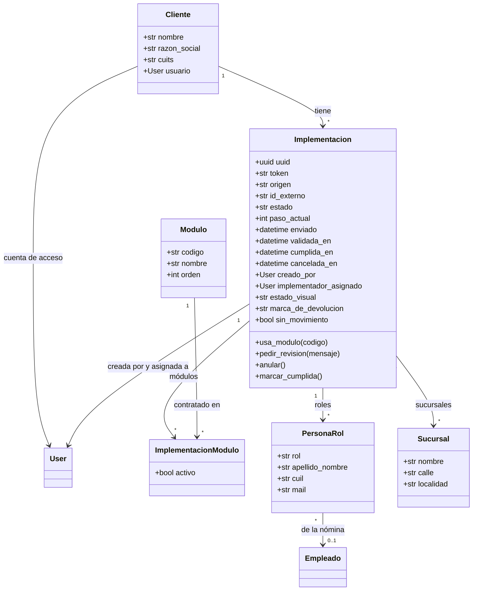

`User` y `Empleado` son de otras apps (`auth` y `employees`). Un `Cliente` tiene como mucho una cuenta (`OneToOneField`), y esa cuenta es con la que inicia sesión.

### Lo que se elige de los catálogos

Cada tabla `Implementacion…` es una tabla intermedia: guarda, para una implementación, si una opción del catálogo está activa. Cada pareja (implementación, opción) es única.

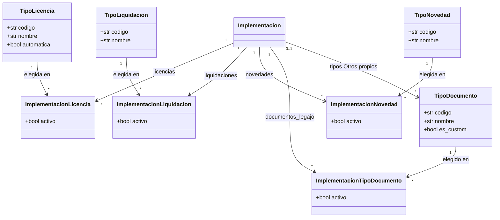

### Revisión, firma y registro

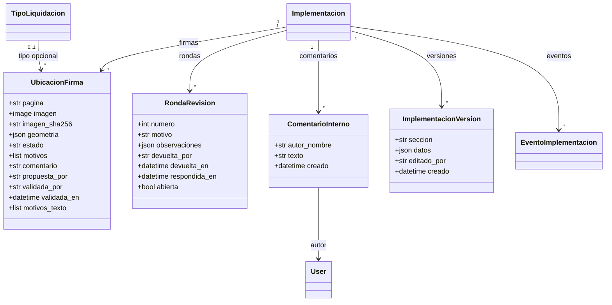

`EventoImplementacion` pertenece a `automatizacion` y es ese modelo el que guarda la relación (`related_name="eventos"`); acá se dibuja solo para mostrar que `Implementacion` lo lee.

### Campos de `Implementacion`, por grupo

| Grupo | Campos | Para qué |
|---|---|---|
| Identificación | `token`, `uuid`, `origen`, `id_externo` | El `token` es secreto: es el link del cliente (`get_absolute_url`). El `uuid` es público y no revela nada. `origen` (`portal`, `hubspot` o `api`) más `id_externo` identifican el caso en el sistema que lo originó y evitan duplicarlo (restricción `implementacion_origen_id_externo_unico`). `id_externo` queda en `NULL` y no en cadena vacía: con `NULL` varios casos sin ID externo conviven, y MySQL no admite índices parciales. |
| Estado y fechas | `estado`, `paso_actual`, `enviado`, `validada_en`, `cumplida_en`, `cancelada_en`, `expira`, `creado`, `actualizado` | `estado` es `pendiente`, `cumplida` o `cancelada`. `paso_actual` es el paso del wizard en el que está el cliente: `onboarding/views.py` lo sube a medida que avanza, `acciones.reabrir` lo vuelve a 1 y `acciones.devolver_al_cliente` lo lleva al paso de revisión. `enviado` es cuándo el cliente envió el relevamiento; `validada_en`, cuándo el equipo lo validó. `expira` existe en el modelo pero el código de la aplicación no lo usa (el admin de Django lo muestra como campo editable). |
| Datos de contacto y empresa | `telefono`, `mail_contacto`, `tipo_firma`, `liquidador_utilizado`, `nomenclatura_pdf`, `cantidad_capitas`, `segmentacion_liquidador` | Lo que releva el wizard: `telefono` y `mail_contacto` en el paso de datos (`EmpresaForm`) y el resto en el de configuración (`ConfiguracionForm`, que también pide el banner, el logo y el modelo de recibo). La razón social y los CUIT no están acá: viven en `Cliente`. `segmentacion_liquidador` arranca en «AREA UNICA». |
| Condiciones del proceso | `modulos_editables_por_cliente`, `tipo_firma_editable`, `nomenclatura_editable`, `segmentacion_editable`, `max_roles` | Qué decide el cliente y qué deja fijo el equipo. Con un dato bloqueado, el valor lo carga el implementador y el cliente lo ve sin poder cambiarlo. `max_roles` va de 3 (uno por rol obligatorio) a 6. |
| Archivos | `banner`, `logo`, `modelo_recibo` | Se guardan en `implementaciones/banners/`, `implementaciones/logos/` e `implementaciones/modelos_recibo/`, y validan el tamaño con `validar_tamanio_archivo`. |
| Fecha de implementación | `fecha_salida_productivo` | Fecha estimada de salida en productivo. Es única para toda la implementación, no por ítem. |
| Pedido de revisión | `revision_solicitada`, `revision_solicitada_en`, `revision_mensaje`, `revision_atendida_en` | El cliente le avisa al equipo que necesita que lo contacten (`pedir_revision`) y el equipo lo marca atendido (`marcar_revision_atendida`). |
| Responsables | `cliente`, `creado_por`, `implementador_asignado` | `implementador_asignado` es quien lleva el caso y recibe las notificaciones; por defecto, quien la creó. |

### Qué pasa al borrar (`on_delete`)

| Relación | Comportamiento |
|---|---|
| `Implementacion.cliente`, y todo lo de `clients` que apunta a `Implementacion` (módulos, roles, sucursales, licencias, liquidaciones, novedades, documentos, firmas, rondas, comentarios, versiones) | `CASCADE`: al borrar la implementación se borra todo lo que cuelga de ella en `clients`. |
| `TipoDocumento.implementacion` (los tipos «Otros», app `catalog`), `Empleado.implementacion` e `ImportBatch.implementacion` (app `employees`) | `CASCADE`: también se borran con la implementación. |
| `EventoImplementacion.implementacion` y `ConfiguracionCongelada.implementacion` (app `automatizacion`) | `SET_NULL`: sobreviven a la implementación y conservan su `implementacion_uuid`. |
| `Implementacion.creado_por`, `Implementacion.implementador_asignado`, `Cliente.usuario`, `ComentarioInterno.autor`, `PersonaRol.empleado` | `SET_NULL`: el campo queda vacío. Por eso `ComentarioInterno` guarda también `autor_nombre`: el nombre queda aunque se borre la cuenta. |
| `ImplementacionModulo.modulo`, `ImplementacionLicencia.tipo_licencia`, `ImplementacionLiquidacion.tipo_liquidacion`, `ImplementacionNovedad.tipo_novedad` | `PROTECT`: no se puede borrar del catálogo algo que alguna implementación usa. |
| `ImplementacionTipoDocumento.tipo_documento`, `UbicacionFirma.tipo_liquidacion` | `CASCADE`. |

---

## 1.4 Estados derivados de `Implementacion`

### Qué columnas mandan

`estado` solo distingue tres cosas (`pendiente`, `cumplida`, `cancelada`). Todo lo demás que ve el equipo se **deriva** de tres columnas: `estado`, `enviado` y `validada_en`. No hay un campo «estado visual»: así no puede quedar contradictorio con las fechas.

| `estado` | `enviado` | `validada_en` | `estado_visual` | Texto (`VISUAL_LABELS`) |
|---|---|---|---|---|
| `cancelada` | cualquiera | cualquiera | `cancelada` | Cancelada |
| `cumplida` | cualquiera | cualquiera | `completo` | Completo |
| `pendiente` | vacío | cualquiera | `a_completar` | Pendiente - A completar por cliente |
| `pendiente` | con fecha | vacío | `completado_cliente` | Documentación completa - Pendiente de validación |
| `pendiente` | con fecha | con fecha | `validada` | Validada - Pendiente de configurar |

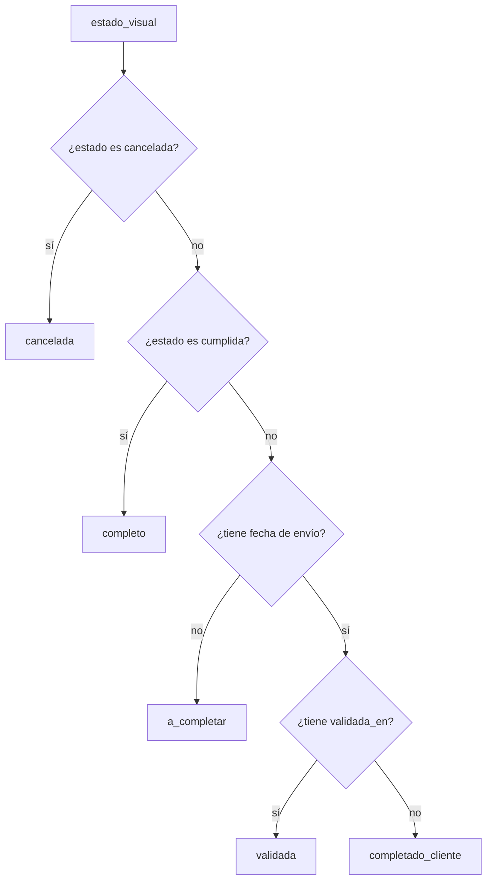

`filtro_visual(clave)` es la misma regla escrita como `Q()` para filtrar en la base (el listado del panel filtra por estado sin cargar las filas). Las dos versiones tienen que decir lo mismo: un test las compara (`EstadoVisualTests`). Hay una tercera copia de la regla, que ese test no mira: la anotación `estado_orden` de `filtrar_y_ordenar_implementaciones`, que le da a cada estado un número para ordenar el listado (ver la tabla del parámetro `ordenar`). Si se agrega un estado visual nuevo hay que tocar `VISUAL_LABELS`, `estado_visual`, `filtro_visual` y `estado_orden`.

### Cómo se mueve una implementación entre estados

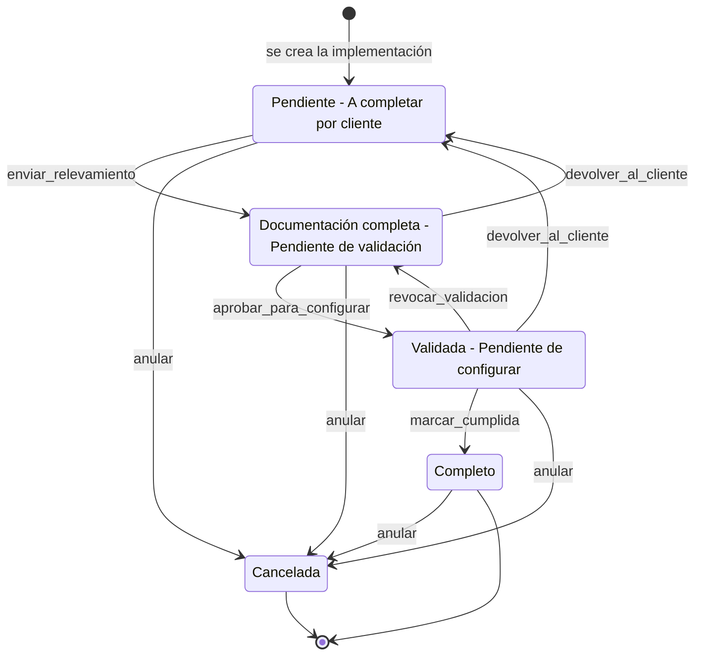

Las transiciones las ejecutan funciones de `onboarding/acciones.py` (salvo `revocar_validacion`, que es de `clients/services.py`). Ni `Implementacion.anular()` ni `acciones.anular` comprueban desde qué estado se llama: el panel ofrece el botón «Anular implementación» mientras la implementación no esté cancelada. `acciones.reabrir` («Reiniciar link») la devuelve a «a completar» desde cualquier estado.

### Quién escribe cada columna de estado

| Columna | La pone | La borra |
|---|---|---|
| `estado` | `Implementacion.anular()` (`cancelada`), `Implementacion.marcar_cumplida()` (`cumplida`), `acciones.reabrir` (`pendiente`). Al crear arranca en `pendiente`. | — |
| `enviado` | `acciones.enviar_relevamiento` (ahora) | `acciones.devolver_al_cliente`, `acciones.reabrir` |
| `validada_en` | `acciones.aprobar_para_configurar` (ahora) | `revocar_validacion`, `acciones.devolver_al_cliente`, `acciones.reabrir` |
| `cumplida_en` | `Implementacion.marcar_cumplida()` | `acciones.reabrir` |
| `cancelada_en` | `Implementacion.anular()` | `acciones.reabrir` |

Fuera de estas acciones, solo el admin de Django (`ImplementacionAdmin` deja editables estas columnas) y el comando `seed_demo` las escriben, y lo hacen sin registrar ningún evento.

### Las propiedades derivadas

| Propiedad | Se calcula de | Valor |
|---|---|---|
| `estado_visual` | `estado`, `enviado`, `validada_en` | una de las cinco claves de la tabla de arriba |
| `estado_visual_label` | `estado_visual` | el texto de `VISUAL_LABELS` |
| `ronda_abierta` | `RondaRevision` | la devolución más nueva con `respondida_en` vacío, o `None` |
| `marca_de_devolucion` | `ronda_abierta` | `«Devuelta, ronda N»` mientras haya una ronda abierta; si no, `""` |
| `ultimo_movimiento` | `EventoImplementacion.momento`, `creado` | cuándo pasó lo último |
| `sin_movimiento` | `estado`, `ultimo_movimiento` | `True` si es pendiente y el último movimiento es de hace 7 días o más |
| `dias_sin_movimiento` | `ultimo_movimiento` | días enteros desde entonces (mínimo 0) |
| `firma` | `UbicacionFirma` | la firma con `tipo_liquidacion` vacío (la que vale para todos los tipos) o `None` |
| `asignado_nombre` | `implementador_asignado` | nombre completo, o el usuario si no tiene nombre, o `""` |

**La devolución no es un estado.** `devolver_al_cliente` abre una `RondaRevision`, pone `enviado` y `validada_en` en vacío y lleva el paso a la revisión: la implementación vuelve a «a completar» y muestra la marca `Devuelta, ronda N` mientras la ronda siga abierta. Cuando el cliente vuelve a enviar, `enviar_relevamiento` completa `respondida_en` en esa ronda y la marca desaparece. Las rondas quedan para siempre como historial.

### «Implementación sin movimiento»

Es una marca, no un estado: la implementación sigue donde estaba (`test_no_es_un_estado_nuevo_sigue_figurando_donde_estaba`). Una implementación **pendiente** se marca cuando su último movimiento es de hace 7 días o más (`DIAS_SIN_MOVIMIENTO = 7`). El último movimiento es el último evento de la implementación —cualquier acción del cliente o del equipo, un comentario, un envío— o, si no tiene ninguno, su fecha de creación.

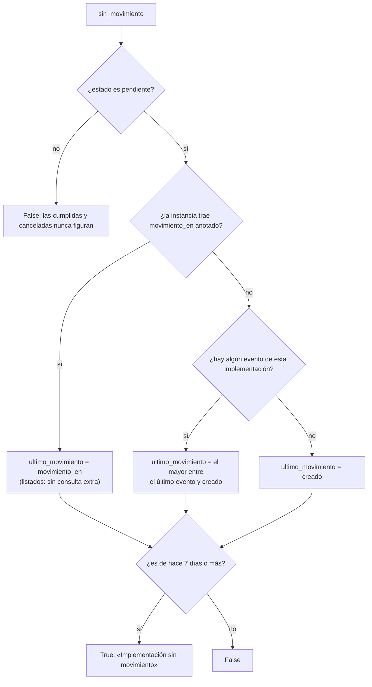

`con_ultimo_movimiento(queryset)` calcula lo mismo en la base con una `Subquery` y lo deja en cada fila como `movimiento_en`: así el listado no hace una consulta por fila. Un test (`test_la_anotacion_coincide_con_la_propiedad`) verifica que la anotación y la propiedad den siempre lo mismo.

`marca_de_devolucion` hace lo mismo con el número de ronda: `filtrar_y_ordenar_implementaciones` anota `ronda_abierta_numero`. En cambio, el reporte `.xlsx` (`dashboard/reportes.py`) usa `con_ultimo_movimiento` pero no esa anotación, así que ahí `marca_de_devolucion` consulta la base una vez por fila.

### Qué hace `filtrar_y_ordenar_implementaciones`

Recibe un queryset y los parámetros del querystring (`request.GET`) y devuelve el queryset anotado, filtrado y ordenado. Lo usa el listado del panel. Anota `movimiento_en`, `estado_orden`, `ronda_abierta_numero` y `fecha_implementacion`.

| Parámetro | Efecto |
|---|---|
| `cliente` | `cliente__nombre__icontains`: el nombre contiene el texto, sin distinguir mayúsculas. |
| `estado` | Si es una clave de `VISUAL_LABELS`, aplica `filtro_visual`. Si es `sin_movimiento`, trae las pendientes con `movimiento_en` anterior o igual al límite. Cualquier otro valor se ignora (no filtra). |
| `creado_desde`, `creado_hasta` | Filtra por la fecha de `creado`. Si el valor no tiene forma de fecha, se ignora. Una fecha con formato válido pero inexistente (`2024-02-31`) lanza `ValueError`, y el listado del panel no lo captura. |
| `fecha_impl_desde`, `fecha_impl_hasta` | Filtra por `fecha_implementacion`, que es la fecha de cumplimiento (`cumplida_en`) si existe y si no `fecha_salida_productivo`. El valor se interpreta igual que en `creado_desde` y `creado_hasta`. |
| `ordenar` | `cliente`, `estado`, `fecha_implementacion` o `creado` (`COLUMNAS_ORDENABLES`). Una columna desconocida cae a `creado`. `estado` ordena por `estado_orden`: pendiente sin enviar 0, enviada 1, validada 2, cumplida 3, cancelada 4. |
| `direccion` | `desc` ordena descendente; cualquier otro valor, ascendente. Si no viene, es `desc` para `creado` y `asc` para las demás columnas. |

---

## 1.5 Historial de versiones

### Idea

Cada vez que se cambia una sección de la implementación, **antes** de aplicar el cambio se guarda una foto de cómo estaba (`ImplementacionVersion`). El cliente y el equipo consultan esas fotos en la tabla «Historial de versiones anteriores» (`templates/clients/_historial_versiones.html`, que muestran la ficha del panel y la pantalla «ya enviado» del cliente).

Además, el cambio queda como evento (con el antes y el después) y, si la implementación estaba validada y lo que cambió es parte de lo que se configura, se pierde la validación. Todo en una sola transacción.

### Las secciones y sus constructores de fotos

Cada sección tiene un **constructor de foto** (*snapshot builder*): una función que recibe la implementación y devuelve un diccionario o una lista con el estado de esa sección. Están en el diccionario `_SNAPSHOT_BUILDERS` de `services.py`, indexadas por el código de la sección (el mismo de `ImplementacionVersion.SECCION_CHOICES`).

| Código | Etiqueta | Constructor | Qué guarda la foto |
|---|---|---|---|
| `datos_contacto` | Datos de contacto | `_snapshot_datos_contacto` | Razón social y CUIT(s) (de `Cliente`), teléfono, mail de contacto, tipo de firma, liquidador utilizado, nomenclatura de PDFs, cantidad de cápitas, segmentación del liquidador y las URL del logo, el banner y el modelo de recibo. |
| `modulos` | Módulos | `_snapshot_modulos` | `{nombre del módulo: activo}` |
| `roles` | Roles | `_snapshot_roles` | Lista con rol, apellido y nombre, CUIL y mail de cada persona. |
| `sucursales` | Sucursales | `_snapshot_sucursales` | Lista con nombre, calle, altura, piso/depto, CP, localidad, entre calles y observaciones. |
| `licencias_novedades` | Licencias y Novedades | `_snapshot_licencias_novedades` | `{"Licencias": {nombre: activo}, "Novedades": {nombre: activo}}` |
| `liquidaciones` | Tipos de liquidación | `_snapshot_liquidaciones` | `{nombre del tipo: activo}` |
| `firma` | Firma del recibo | `_snapshot_firma` | Si no hay firma, `{}`. Si hay: estado, página, URL y `sha256` de la imagen, los tres recuadros (`x`, `y`, `ancho`, `alto`) y, si fue observada, motivos y comentario. |
| `documentos` | Documentos de Legajo | `_snapshot_documentos` | `{nombre del tipo: activo}` |
| `empleados` | Empleados | `snapshot_empleados` (de `employees/services.py`) | Lista con CUIL, apellido y nombre, legajo y puesto. |
| `fecha_implementacion` | Fecha de implementación | `_snapshot_fecha_implementacion` | La fecha estimada de salida en productivo. |
| `condiciones` | Condiciones del proceso | `_snapshot_condiciones` | Tipo de firma (o «Que lo elija el cliente»), nomenclatura de PDFs (o «Que la defina el cliente»), «Solo Área única» (Sí o No) y máximo de personas con rol. |

`empleados` no está en `_SNAPSHOT_BUILDERS` desde el principio: `Empleado` es un modelo de `employees`, y `clients` no importa esa app. Es `employees` quien lo registra al arrancar, con `registrar_snapshot_builder("empleados", snapshot_empleados)` dentro de `EmployeesConfig.ready()` (`employees/apps.py`). Un test (`test_empleados_ya_esta_registrado_por_la_app_employees`) avisa si ese registro falta.

### Las funciones

| Función | Qué hace |
|---|---|
| `foto_de_seccion(implementacion, seccion)` | Devuelve cómo está **hoy** una sección, con el mismo formato que usa el historial. No guarda nada. |
| `guardar_version(implementacion, seccion, actor)` | Crea una `ImplementacionVersion` con la foto del estado **actual**; `editado_por` es `actor.etiqueta`. |
| `revocar_validacion(implementacion, actor, seccion)` | Si estaba validada, la deja sin validar y registra el evento. Devuelve si revocó. |
| `cambio_de_seccion(implementacion, seccion, actor, accion="paso.guardado", datos=None)` | *Context manager* que envuelve todo el guardado de una sección. Es la forma de guardar una sección. |
| `_fresca(implementacion)` | La implementación tal como está en la base ahora. Las fotos se toman de acá y no del objeto que llega: ese puede venir con datos ya modificados por un formulario (Django escribe en la instancia al validar) o con relaciones precargadas que quedaron viejas. |

### `cambio_de_seccion` paso a paso

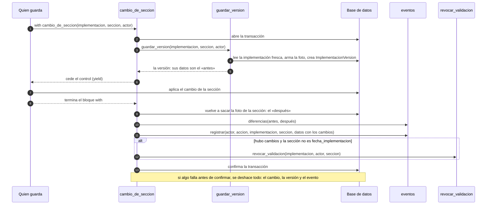

Un ejemplo real, de `onboarding/services/secciones.py`: guardar la fecha de implementación.

```python
with cambio_de_seccion(implementacion, "fecha_implementacion", actor, accion="implementacion.fecha_cambiada"):
    implementacion.fecha_salida_productivo = fecha
    implementacion.save(update_fields=["fecha_salida_productivo"])
```

Detalles que conviene saber:

- El evento se registra **siempre**, incluso si no cambió nada (con `cambios` vacío). La validación se revoca solo si **hubo** cambios.
- `eventos.diferencias(antes, despues)` compara las dos fotos campo por campo y devuelve `{campo: {"antes": a, "despues": d}}`. Los diccionarios anidados se comparan por dentro y el campo lleva el camino «Grupo › campo» (por ejemplo, «Licencias › nombre de la licencia»). Si la foto es una lista, compara la lista entera bajo el campo `lista`.
- `datos` (opcional) se suma al evento junto con `cambios`.
- `SECCIONES_QUE_NO_INVALIDAN = {"fecha_implementacion"}`: la fecha estimada no forma parte de lo que se configura, así que cambiarla no quita la validación.
- La nómina no usa `cambio_de_seccion`: `onboarding/services/nomina.py` llama directamente a `guardar_version(..., "empleados", ...)` y a `revocar_validacion(..., "empleados")`.

### `revocar_validacion`

Si la implementación ya estaba validada y alguien cambia algo de lo que se va a configurar, vuelve a «Documentación completa - Pendiente de validación»: no se configura con datos distintos de los que se aprobaron. La `ConfiguracionCongelada` anterior queda como historia.

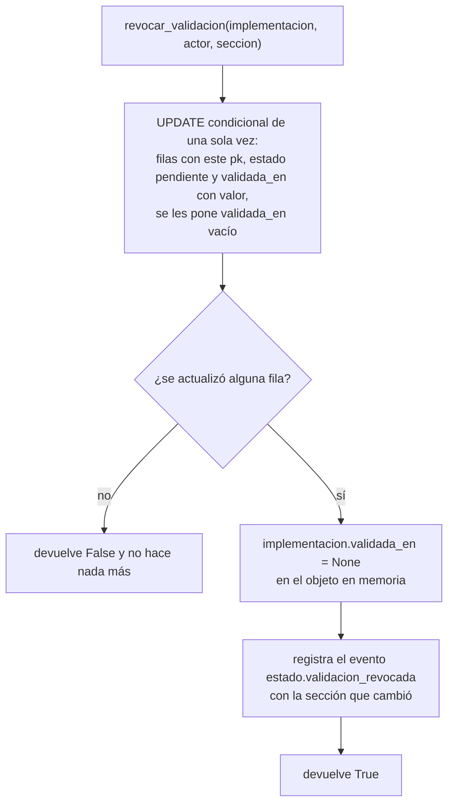

El `UPDATE` con las condiciones en el `WHERE` hace de comprobación y de cambio en un solo paso, así que dos cambios simultáneos no la revocan dos veces. El evento queda con `post_envio` verdadero cuando actúa alguien que no es el cliente y la implementación ya fue enviada (lo calcula `eventos.registrar`).

### Cómo agregar una sección al historial

1. Sumarla a `ImplementacionVersion.SECCION_CHOICES` (Django genera una migración al cambiar `choices`).
2. Escribir su constructor de foto y agregarlo a `_SNAPSHOT_BUILDERS`; si la sección pertenece a otra app, que esa app lo registre con `registrar_snapshot_builder` desde su `ready()`.
3. Envolver el guardado con `cambio_de_seccion`. Si el cambio no debe quitar la validación, agregar la sección a `SECCIONES_QUE_NO_INVALIDAN`.

### Cómo se muestra: `formato_snapshot`

El filtro `formato_snapshot` (`templatetags/clients_extras.py`) convierte `ImplementacionVersion.datos` en una línea legible, porque la forma del dato cambia según la sección:

| `datos` es… | Resultado |
|---|---|
| Una lista vacía | `(vacío)` |
| Una lista de diccionarios | Una fila por ítem, `clave: valor, clave: valor`, sin los valores `None`, vacíos o `False`; las filas separadas por ` \| `. |
| Un diccionario | Pares `clave: valor`, separados por coma. Un diccionario anidado se muestra como `clave: nombres de los activos` (o `(ninguna)`); un `True` muestra solo la clave; se omiten `False`, `None` y vacíos. Sin ningún dato, `(vacío)`. |
| Cualquier otra cosa | `str(datos)` |

---

## 1.6 Acceso: login, intentos y contraseñas

### Un solo login para todos

`PortalLoginView` (`/login/`) es el login único de clientes y equipo. Redirige según la cuenta: el equipo (`is_staff`) va al panel (`dashboard:home`) y el cliente a su listado (`onboarding:mis_implementaciones`). Con `redirect_authenticated_user = True`, quien ya tiene sesión y abre `/login/` va directo a ese destino.

Lo delicado es el parámetro `?next=` (la página a la que se quería entrar antes de loguearse). Un cliente con un link viejo a `/panel/` entraría al panel, que lo rebota al login con el mismo `next`: un bucle. Por eso `get_success_url` solo respeta el `next` si coincide con el tipo de cuenta.

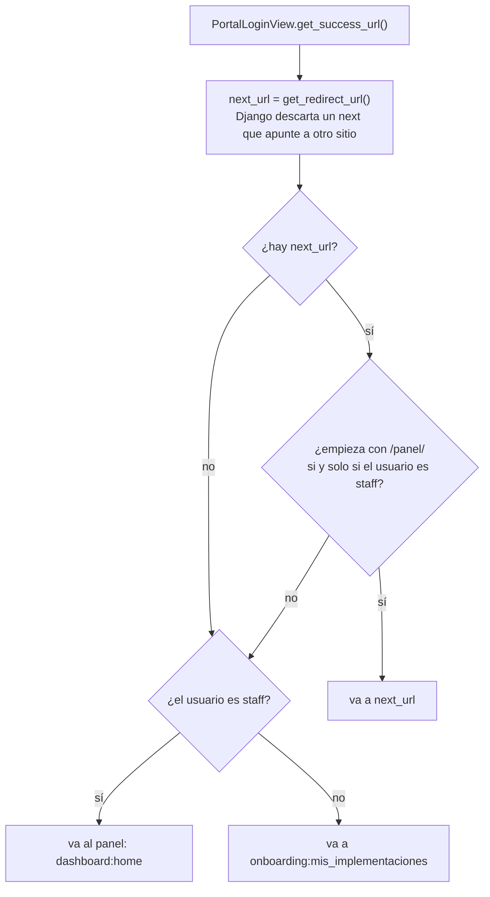

La condición es una igualdad entre «`next` empieza con `/panel/`» y «el usuario es staff». Va a `next_url` el staff con un `next` bajo `/panel/` y también el cliente con un `next` que no está bajo `/panel/` (por ejemplo, `/r/mis-implementaciones/`). Va al destino por defecto el staff con un `next` fuera del panel y el cliente con un `next` bajo `/panel/`.

Consecuencia directa de la regla: un staff que llega con `?next=/admin/` termina en el panel, no en el admin, porque `/admin/` no empieza con `/panel/`.

### Límite de intentos (`django-axes`)

Cubre `/login/` y `/admin/login/`. **5 fallos seguidos con el mismo usuario desde la misma IP bloquean ese par durante 30 minutos**; un ingreso correcto reinicia la cuenta. Se cuenta por (IP, usuario) y no por usuario solo, para que nadie pueda dejar afuera a un cliente ajeno mandando intentos con su nombre desde otra IP.

| Ajuste (`config/settings.py`) | Valor | Efecto |
|---|---|---|
| `AUTHENTICATION_BACKENDS` | `axes.backends.AxesStandaloneBackend` primero, después `ModelBackend` | Axes ve cada intento de autenticación. |
| `MIDDLEWARE` | `axes.middleware.AxesMiddleware`, «siempre al final» | La parte de Axes que atiende los pedidos bloqueados. |
| `AXES_FAILURE_LIMIT` | `5` | Fallos seguidos que bloquean. |
| `AXES_COOLOFF_TIME` | 30 minutos | Cuánto dura el bloqueo. |
| `AXES_LOCKOUT_PARAMETERS` | `[["ip_address", "username"]]` | El bloqueo es del par IP y usuario. |
| `AXES_RESET_ON_SUCCESS` | `True` | Un ingreso correcto reinicia el contador. |
| `AXES_LOCKOUT_TEMPLATE` | `lockout.html` | Pantalla «Acceso bloqueado temporalmente» (responde 429, según los tests). |
| `AXES_CLIENT_IP_CALLABLE` | `clients.security.ip_del_cliente` | De dónde saca Axes la IP. |
| `TRUSTED_PROXY_COUNT` | variable de entorno; por defecto `1` en producción y `0` en desarrollo | Cuántos proxies propios hay delante de la app. |

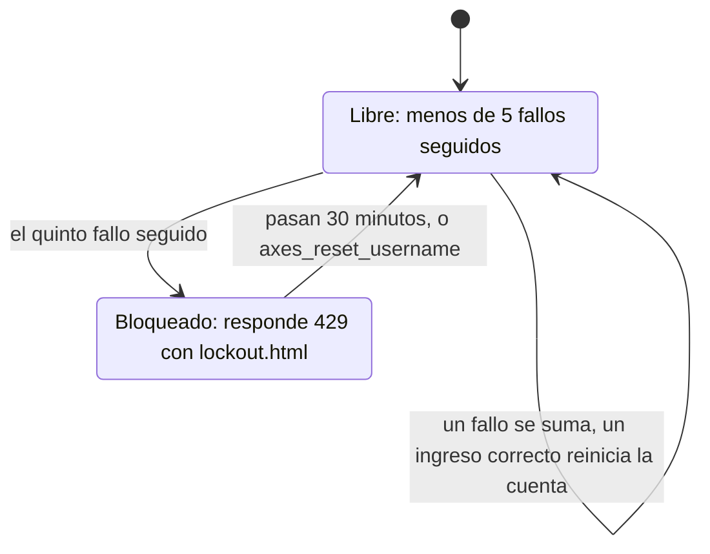

Mientras está bloqueado, ni la clave correcta entra (`test_al_quinto_fallo_se_bloquea_aun_con_la_clave_correcta`). Para desbloquear a alguien antes de tiempo: `manage.py axes_reset_username <usuario>` (README).

**`ip_del_cliente(request)`.** Detrás de un proxy reverso, `REMOTE_ADDR` es siempre la IP del proxy: sin esta función, todos los usuarios compartirían una IP. El proxy agrega al final de `X-Forwarded-For` la IP de quien le habló, así que la del cliente es la N-ésima **desde la derecha**, con N igual a `TRUSTED_PROXY_COUNT`. Lo que venga más a la izquierda lo escribe el cliente y se ignora: inventar un `X-Forwarded-For` no sirve para evadir el límite.

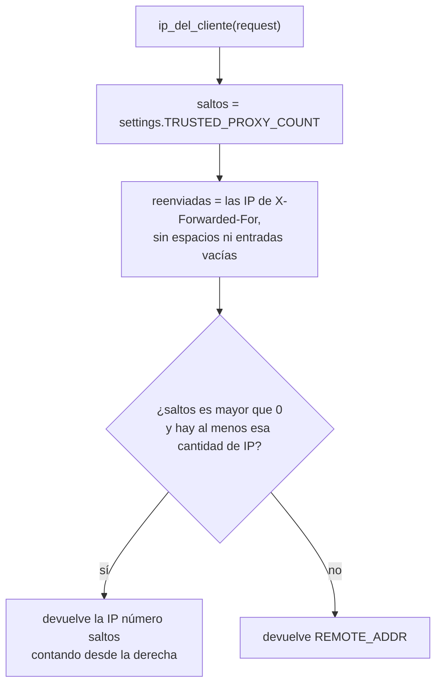

La usan dos lugares: Axes (por la configuración) y `RecuperarClaveView._dentro_del_limite`.

### Contraseñas: perfil y recuperación

- **`PerfilView`** (`/perfil/`, «Mi perfil»): cambio de contraseña para cualquier cuenta con sesión, cliente o equipo. El cambio mantiene abierta la sesión actual y muestra «Tu contraseña se cambió correctamente.»
- **`RecuperarClaveView`** (`/clave/olvide/`, pantalla «Recuperar contraseña», a la que lleva el link «¿Olvidaste tu contraseña?» del login): manda un link por mail. El link vale `PASSWORD_RESET_TIMEOUT` (7 días), lo mismo que el de la invitación. Su formulario, `RecuperarClaveForm`, alcanza también a las cuentas todavía **sin contraseña** (clientes invitados que no llegaron a crearla); el formulario de Django las excluiría y esos clientes no podrían pedir un link nuevo.
- **`ClaveEnviadaView`**, **`ClaveConfirmarView`** y **`ClaveListaView`** son las pantallas del recorrido: «Revisá tu mail», «Creá tu contraseña» (donde cae el link, para crearla o cambiarla; si el link venció o ya se usó, la pantalla dice «El link no es válido») y «Contraseña guardada». Al terminar, `ClaveConfirmarView` manda a `clave_lista`.

**Tope de pedidos.** Para que nadie use el portal para llenar de mails una casilla ajena ni para ocupar a los workers, `RecuperarClaveView` limita: **el mismo mail, un pedido cada 10 minutos** (`VENTANA_SEGUNDOS = 600`), y **una misma IP, hasta 10** (`MAXIMO_POR_IP = 10`) dentro de esa ventana. Cuando se pasa el tope, la respuesta es la misma que si el mail hubiera salido: no se revela nada, solo no se reenvía. Un mail desconocido también gasta cupo.

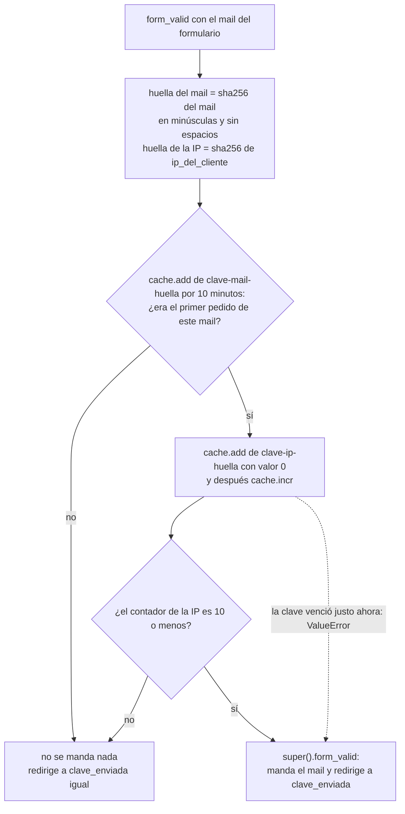

`cache.add` crea la clave solo si no existía, y devuelve si la creó: es lo que distingue «primer pedido» de «repetido». En producción la caché es compartida entre los workers de gunicorn (`FileBasedCache` en una carpeta temporal): si se borra, solo se reinician los contadores.

### Crear la cuenta del cliente

`crear_o_resetear_acceso(cliente, username=None, email="")` crea —o resetea la contraseña de— la cuenta con la que el cliente inicia sesión. Devuelve `(username, password_en_claro)`; la contraseña solo se puede ver esa vez. Si es una cuenta nueva y se dio un `email`, queda **sin contraseña** (es una invitación: el cliente la crea con el link del mail) y la contraseña devuelta es `None`.

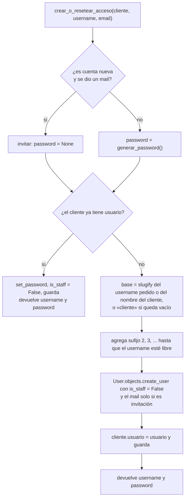

- Resetear **fuerza `is_staff = False`**: si a esa cuenta la promovieron a mano, un reseteo de contraseña de cliente no la deja con acceso al panel.
- `generar_password()` devuelve 10 caracteres sin los que se confunden al copiarlos (`0`, `1`, `i`, `I`, `l`, `L`, `o`, `O`).
- El username es siempre un *slug*: minúsculas, números, guiones y guiones bajos (más un sufijo numérico si el nombre ya existe).

---

## 1.7 Archivos subidos

Los archivos subidos (logo, banner, modelo de recibo, imagen de la firma) se sirven por `media_protegida` (`/media/<ruta>`), nunca directamente desde el disco. Así **la app es la única que decide quién ve qué archivo** y el proxy reverso no necesita servir `/media/` por su cuenta (no hay que publicarlo).

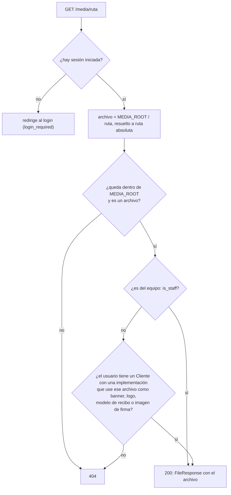

- **El equipo** accede a cualquier archivo.
- **Un cliente** solo a los suyos. «Suyo» es: existe una implementación de su `Cliente` cuyo `banner`, `logo`, `modelo_recibo` o `firmas__imagen` es exactamente esa ruta relativa a `MEDIA_ROOT`. Cualquier otro archivo (por ejemplo, planillas de nómina importadas antes de que se dejara de guardarlas) solo lo ve el equipo.
- **No se revela si el archivo existe**: ante cualquier negativa (no existe, no es tuyo, intenta salir de la carpeta) la respuesta es 404, no 403.
- **Protección contra `..`**: la ruta se resuelve a su forma absoluta antes de compararla; si queda fuera de `MEDIA_ROOT`, es 404 (`test_no_se_puede_salir_de_media_con_dos_puntos`).
- `request.user.cliente` es la relación inversa de `Cliente.usuario`; un usuario sin `Cliente` (el equipo, por ejemplo) devuelve `None` por el `getattr`.

---

## 1.8 Validadores y utilidades

### Tamaño de archivo

`validar_tamanio_archivo(archivo)` rechaza archivos de más de `settings.MAX_UPLOAD_SIZE_BYTES` (hoy 15 MB) con «El archivo no puede pesar más de 15MB.». Está puesto en los campos de archivo de los modelos (`banner`, `logo`, `modelo_recibo`, `UbicacionFirma.imagen`), en `ImportBatch.archivo` y en los formularios de importación de nómina y de firma.

### Medidas de imagen

Son las medidas que acepta el wizard de Napsis; fuera de rango rechaza la imagen y el paso se traba, así que el portal avisa antes.

| Validador | Regla |
|---|---|
| `validar_medidas_logo` | Hasta 200 × 200 px (`LOGO_MAX`). |
| `validar_medidas_banner` | Entre 1500 × 200 y 1600 × 400 px (`BANNER_MIN`, `BANNER_MAX`). |

Los dos usan `_medidas(imagen)`, que lee el ancho y el alto con `get_image_dimensions` y **vuelve a poner el archivo al principio** (`seek(0)`) para que después se pueda guardar entero. Si no se puede leer la imagen, no se queja: eso ya lo rechaza el propio campo de imagen. El mensaje de error dice cuánto mide la imagen subida.

A diferencia del de tamaño, **estos validadores no están en los modelos**: los agrega el formulario con `ImagenesConMedidasMixin` (`onboarding/forms.py`), que además cambia el texto de ayuda para avisar las medidas antes de subir. Lo usan `ConfiguracionForm` (el paso de configuración del wizard) e `ImplementacionDatosForm` (la edición desde el panel).

### CUIT

`normalizar_cuits(valor)` valida **uno o varios CUIT** separados por coma (o punto y coma), con o sin guiones, y los devuelve formateados como `NN-NNNNNNNN-N`, separados por coma. Ignora las entradas vacías. Si alguno es inválido lanza `ValidationError` diciendo cuál (`El CUIT '30-50001091-3' no es válido: revisá los 11 dígitos.`): un CUIT mal tipeado en el alta es retrabajo asegurado.

La regla (la misma de AFIP) está en `_cuit_valido`, con `_digito_verificador` para el módulo 11:

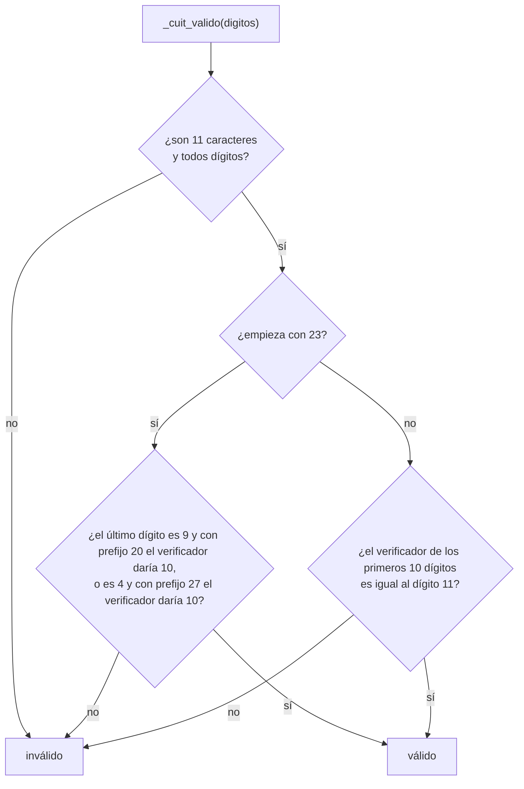

- **Verificador** (`_digito_verificador`): se multiplican los primeros 10 dígitos por `5, 4, 3, 2, 7, 6, 5, 4, 3, 2` y se suman; el verificador es `11` menos el resto de dividir esa suma por 11. Si da 11 vale 0; si da 10 significa «no representable» (no entra en un dígito).
- **Caso especial 23**: cuando el verificador da 10, el CUIT se emite con prefijo 23 y último dígito 9 (si habría sido prefijo 20) o 4 (si habría sido 27). Por eso, un CUIT que empieza con 23 solo es válido en ese caso, y los demás se validan con la regla común.

Quién lo usa: `CamposEmpresaMixin.clean_cuits` (`onboarding/forms.py`, la razón social y el CUIT del paso 1 y de la edición desde el panel) y `acciones.crear_implementacion` (el alta de un cliente nuevo).

### Planillas `.xlsx`: `escribir_celda`

`escribir_celda(hoja, fila, columna, valor)` escribe una celda tratando **siempre los textos como texto**. `openpyxl` interpreta como fórmula cualquier texto que empiece con `=`; como las planillas del portal llevan datos que cargó un cliente (nómina, razón social…), un valor como `=HYPERLINK(...)` se ejecutaría al abrir el archivo en Excel. La función detecta que la celda quedó como fórmula (`data_type == "f"`) y la fuerza a texto (`"s"`). Se ve tal cual y no se ejecuta.

La usan `dashboard/reportes.py` (`generar_reporte_implementaciones_xlsx`) y `employees/services.py` (`generar_nomina_xlsx`).

---

## 1.9 Chequeo de salud

`salud(request)` (`/salud/`) responde `200` con `{"estado": "ok"}` solo si la app llega a la base de datos: ejecuta `SELECT 1`. Si cualquier cosa falla, responde `503` con `{"estado": "error"}`. No pide login y no expone datos: nada más que «ok» o error.

La usan el monitoreo y el healthcheck del contenedor: `docker/healthcheck.py` (que `docker-compose.yml` ejecuta) pide `/salud/` con el `Host` correcto y como si llegara por HTTPS, y falla si no recibe 200. En `config/settings.py`, cuando se fuerza HTTPS, `/salud/` está exenta de la redirección a HTTPS (`SECURE_REDIRECT_EXEMPT`).

---

## 1.10 Componentes: archivos y funciones

### `models.py`

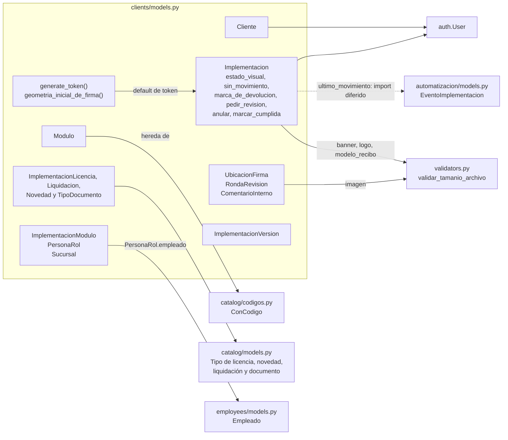

### `services.py`

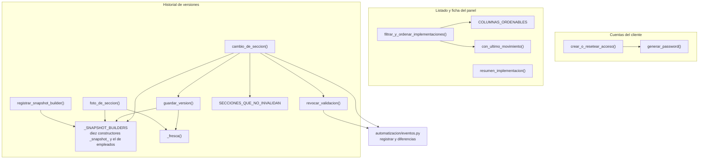

El diccionario trae diez constructores propios (`datos_contacto` a `condiciones`, sin `empleados`); el de `empleados` se suma al arrancar, desde `employees`.

### `views.py`, `forms.py` y `security.py`

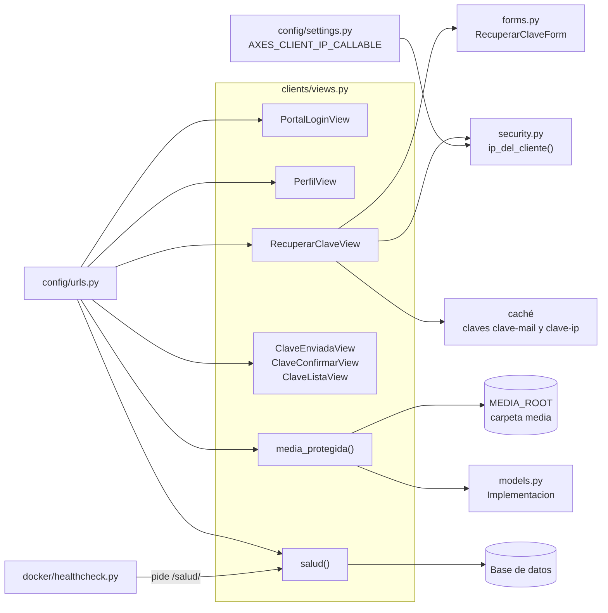

### Validadores, utilidades, filtro y comandos

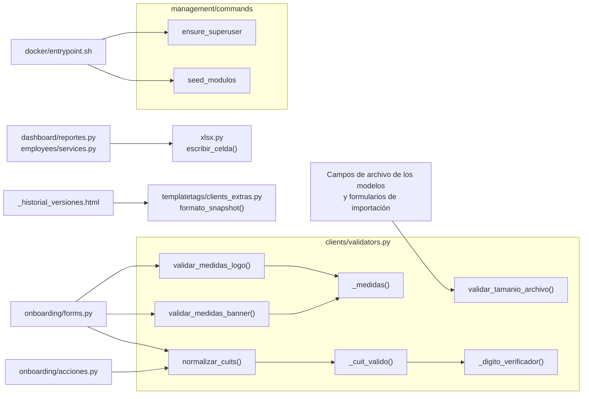

---

## 1.11 Tablas por archivo

### `clients/models.py`

Los atributos calculados (propiedades) están marcados «propiedad». «Quién la usa» nombra los archivos que la tocan.

| Función, clase o modelo | Qué hace | Quién la usa |
|---|---|---|
| `generate_token()` | Devuelve `secrets.token_urlsafe(32)`: el valor por defecto de `Implementacion.token`. | `Implementacion.token` (default). |
| `Cliente` | La empresa cliente. Persistente: puede tener varias implementaciones a lo largo del tiempo. Campos `nombre`, `razon_social`, `cuits`, `usuario` (cuenta de acceso). Se ordena por nombre. | `onboarding/acciones.py` (`crear_implementacion`, `entregar_acceso`), `onboarding/forms.py` (razón social y CUIT), `dashboard/views.py` (alta, listado y ficha), `crear_o_resetear_acceso`, `media_protegida`, `clients/admin.py`. |
| `Modulo` | Catálogo de módulos contratables, con código estable (`ConCodigo`). Constantes `RECIBO_DIGITAL`, `COMUNICACION`, `FICHADA`, `LEGAJOS`, `NOVEDADES` con el código de cada uno. Los pasos del wizard dependen del **código**, no del nombre. | `onboarding/services/pasos.py` (`PASO_REQUIERE_MODULO`), `faltantes.py`, `nomina.py`, `secciones.py` (`guardar_modulos`), `Implementacion.usa_modulo`, `seed_modulos`, `employees/forms.py`, `dashboard/views.py`. |
| `Implementacion` | Un proceso de relevamiento puntual de un cliente: todo lo relevado en ese proceso. Se ordena de la más nueva a la más vieja. Restricción única (`origen`, `id_externo`). | Todas las apps: wizard, acciones, panel, congelada, mails, reportes. |
| `Implementacion.opciones_de_filtro_de_estado()` (método de clase) | Lista de pares (clave, texto) con los cinco estados visibles más «Implementación sin movimiento». | `dashboard/views.py` (el filtro «Estado» del listado). |
| `Implementacion.limite_sin_movimiento(ahora=None)` (método de clase) | Ahora menos 7 días: lo último que puede haber pasado para que ya cuente como sin movimiento. | `sin_movimiento`, `filtrar_y_ordenar_implementaciones`. |
| `Implementacion.filtro_visual(clave)` (método de clase) | Devuelve el `Q()` de un estado visual, para filtrar en la base. Acepta solo las cinco claves de `VISUAL_LABELS` (otra clave da `KeyError`). | `filtrar_y_ordenar_implementaciones`. |
| `Implementacion.estado_visual` (propiedad) | El estado que ve el equipo, derivado de `estado`, `enviado` y `validada_en`. | `dashboard/reportes.py`, plantillas del panel y del cliente. |
| `Implementacion.estado_visual_label` (propiedad) | El texto del estado visual. | `dashboard/reportes.py`, plantillas. |
| `Implementacion.ultimo_movimiento` (propiedad) | Cuándo pasó lo último: el último evento o, sin eventos, `creado`. Usa `movimiento_en` si el listado lo trae anotado. | `sin_movimiento`, `dias_sin_movimiento`, `dashboard/reportes.py`, la ficha del panel. |
| `Implementacion.sin_movimiento` (propiedad) | `True` si es pendiente y su último movimiento es de hace 7 días o más. | Listado y ficha del panel, `dashboard/reportes.py`. |
| `Implementacion.dias_sin_movimiento` (propiedad) | Días enteros desde el último movimiento (mínimo 0). | Plantillas del listado y de la ficha. |
| `Implementacion.ronda_abierta` (propiedad) | La devolución que el cliente todavía no respondió, o `None`. Usa un atributo `_ronda_abierta` si la instancia lo trae precargado (hoy nada lo asigna). | `acciones.enviar_relevamiento` (la cierra), `onboarding/views.py`, `marca_de_devolucion`. |
| `Implementacion.marca_de_devolucion` (propiedad) | `«Devuelta, ronda N»` si hay una ronda abierta; si no, `""`. Usa `ronda_abierta_numero` si el listado lo trae anotado. | Listados y ficha, `dashboard/reportes.py`, `mis_implementaciones.html`. |
| `Implementacion.asignado_nombre` (propiedad) | Nombre de quien lleva la implementación (nombre completo, o el usuario); `""` si no hay asignado. | `notifications/services.py`, `dashboard/reportes.py`, plantillas del panel. |
| `Implementacion.usa_modulo(codigo)` | ¿Tiene contratado y activo el módulo con ese código? | `onboarding/services/faltantes.py` y `nomina.py`, `dashboard/views.py`, `employees/forms.py`. |
| `Implementacion.get_absolute_url()` | La URL del wizard del cliente (`onboarding:wizard_step`, con el `token` y el paso 1). | `notifications/services.py` (links de los mails), `dashboard/views.py`, `mis_implementaciones.html`. |
| `Implementacion.firma` (propiedad) | La `UbicacionFirma` con `tipo_liquidacion` vacío, o `None` si todavía no se cargó. | `automatizacion/congelada.py`, `clients/services.py`, `onboarding/acciones.py`, `forms.py`, `faltantes.py`, `onboarding/views.py`, `dashboard/views.py`. |
| `Implementacion.pedir_revision(mensaje="")` | El cliente pide que el equipo se contacte: marca la solicitud, guarda fecha y mensaje y borra la atención previa. | `acciones.pedir_revision`, `seed_demo`. |
| `Implementacion.marcar_revision_atendida()` | Guarda la fecha en que el equipo atendió el pedido. | `acciones.atender_revision`, `seed_demo`. |
| `Implementacion.anular()` | Pasa a `cancelada` y guarda `cancelada_en`. | `acciones.anular`. |
| `Implementacion.marcar_cumplida()` | Pasa a `cumplida` y guarda `cumplida_en`. Que el cliente haya enviado (`enviado`) no significa cumplida: ahí arranca el trabajo del equipo. | `acciones.marcar_cumplida`. |
| `geometria_inicial_de_firma()` | Dónde arrancan los tres recuadros de la firma sobre el recibo, como fracciones de la página (de 0 a 1): `empresa`, `conforme` y `disconforme`. | `UbicacionFirma.geometria` (default), `onboarding/forms.py` (`FirmaForm`). |
| `UbicacionFirma` | La intención del cliente sobre dónde va su firma en su modelo de recibo: imagen del apoderado y tres recuadros con posición y tamaño relativos a la página. El portal no la traduce a Napsis. Los archivos no se pisan ni se borran. Estados `propuesta`, `validada`, `observada`; páginas `primera`, `ultima`, `todas`; `ELEMENTOS` (los tres recuadros); `MOTIVOS`, un catálogo cerrado de seis códigos (`ilegible`, `baja_calidad`, `tamano_excesivo`, `superpone_texto`, `no_replicable`, `otro`): lo que se guarda es el código, no el texto. | `onboarding/services/firma.py` (`guardar_firma`), `onboarding/acciones.py` (`validar_firma`, `observar_firma`), `onboarding/forms.py`, `faltantes.py`, `automatizacion/congelada.py`, `dashboard/views.py`. |
| `UbicacionFirma.motivos_texto` (propiedad) | Los motivos de la observación como texto legible. | Ficha del panel (`implementacion_detalle.html`). |
| `ComentarioInterno` | Nota del equipo sobre una implementación. **Privada**: el cliente nunca la ve (ni en pantallas, ni en mails, ni en la configuración congelada). Solo se agrega: no se edita ni se borra. Largo máximo `MAX_LARGO = 2000`. | `acciones.agregar_comentario`, `dashboard/views.py`. |
| `RondaRevision` | Una devolución al cliente: qué tiene que corregir o completar antes de validar. Se queda para siempre; se cierra cuando el cliente vuelve a enviar. Única por (`implementacion`, `numero`). Las `observaciones` van por código estable de paso. | `acciones.devolver_al_cliente` (la crea), `acciones.enviar_relevamiento` (la cierra), `filtrar_y_ordenar_implementaciones` (la anota), `dashboard/views.py`. |
| `RondaRevision.abierta` (propiedad) | `True` mientras `respondida_en` esté vacío. | Nadie hoy: el panel y `Implementacion.ronda_abierta` miran `respondida_en` directamente. |
| `ImplementacionModulo` | Qué módulos tiene contratados una implementación (`activo`). Única por pareja. | `Implementacion.usa_modulo`, `pasos.py` (`pasos_activos`), `secciones.guardar_modulos`, `congelada.py`, `notifications/services.py`, `dashboard/reportes.py`. |
| `PersonaRol` | Apoderado/s, Liquidador y Admin de RRHH declarados en la implementación. `ROLES_EN_NOMINA` (apoderado y liquidador) son los que tienen que existir en la nómina importada; `empleado` apunta a esa persona (por CUIL). | `onboarding/services/roles.py`, `forms.py`, `faltantes.py`, `congelada.py`, `dashboard/views.py`. |
| `Sucursal` | Una sucursal de la implementación (nombre, dirección y observaciones), para el módulo Fichada. | `onboarding/services/secciones.py` (`guardar_sucursales`), `onboarding/forms.py`, `employees/models.py` (cada `Empleado` puede tener una), `congelada.py`. |
| `ImplementacionLicencia` | Qué tipos de licencia elige la implementación. Única por pareja. | `onboarding/services/secciones.py` (`guardar_licencias_y_novedades`), `congelada.py`, `onboarding/views.py`. |
| `ImplementacionLiquidacion` | Qué tipos de liquidación usa la empresa (Recibo Digital). Única por pareja. | `onboarding/services/secciones.py` (`guardar_liquidaciones`), `onboarding/forms.py`, `faltantes.py`, `congelada.py`. |
| `ImplementacionNovedad` | Qué tipos de novedad elige la implementación. Única por pareja. | `secciones.guardar_licencias_y_novedades`, `congelada.py`, `onboarding/views.py`. |
| `ImplementacionTipoDocumento` | Activación de un `TipoDocumento` para una implementación. La fecha de puesta en vigencia no es por ítem: es única (`Implementacion.fecha_salida_productivo`). | `onboarding/services/secciones.py` (`guardar_documentos`), `congelada.py`. |
| `ImplementacionVersion` | Foto de cómo estaba una sección justo **antes** de un cambio. `SECCION_CHOICES` lista las once secciones; `datos` es un `JSONField`; `editado_por` es «Cliente» o el usuario del equipo. Se ordena de la más nueva a la más vieja. | `guardar_version` (la crea), `resumen_implementacion` (las últimas 50), `_historial_versiones.html`, `clients/admin.py`. |

### `clients/services.py`

| Función, clase o modelo | Qué hace | Quién la usa |
|---|---|---|
| `generar_password()` | Contraseña temporal legible de 10 caracteres, sin los que se confunden al transcribirlos. No queda guardada en texto plano. | `crear_o_resetear_acceso`, `dashboard/services.py` (cuentas del equipo). |
| `crear_o_resetear_acceso(cliente, username=None, email="")` | Crea o resetea la cuenta de login del cliente; devuelve `(username, password)`. Con mail y cuenta nueva deja la cuenta sin contraseña (invitación). | `onboarding/acciones.py` (`crear_implementacion`, `entregar_acceso`), `seed_demo`. |
| `COLUMNAS_ORDENABLES` | Qué columnas del listado se pueden ordenar y con qué campo (`cliente`, `estado`, `fecha_implementacion`, `creado`). | `filtrar_y_ordenar_implementaciones`, `dashboard/views.py` (`_sort_links`). |
| `con_ultimo_movimiento(queryset)` | Anota `movimiento_en` (cuándo pasó lo último) en cada implementación, sin una consulta por fila. | `filtrar_y_ordenar_implementaciones`, `dashboard/reportes.py`. |
| `filtrar_y_ordenar_implementaciones(queryset, params)` | Aplica al listado los filtros y el orden del querystring (ver 1.4). | `dashboard/views.py` (el listado del panel). |
| `resumen_implementacion(implementacion)` | Contexto de solo lectura con todo lo relevado: módulos activos, roles, sucursales, licencias, novedades, liquidaciones y documentos activos, firma, empleados y las últimas 50 versiones. | `dashboard/views.py` (la ficha) y `onboarding/views.py` (la consulta del cliente). |
| `_snapshot_datos_contacto`, `_snapshot_modulos`, `_snapshot_roles`, `_snapshot_sucursales`, `_snapshot_licencias_novedades`, `_snapshot_liquidaciones`, `_snapshot_firma`, `_snapshot_documentos`, `_snapshot_condiciones`, `_snapshot_fecha_implementacion` | Los diez constructores de foto propios de `clients` (ver la tabla de la sección 1.5). | `_SNAPSHOT_BUILDERS`. |
| `_SNAPSHOT_BUILDERS` | Diccionario `{código de sección: constructor}`. | `foto_de_seccion`, `guardar_version`, `cambio_de_seccion`, `registrar_snapshot_builder`. |
| `registrar_snapshot_builder(seccion, builder)` | Permite que otra app registre cómo sacar la foto de una sección que ella posee, sin que `clients` la importe. | `employees/apps.py` (`ready()`, sección `empleados`). |
| `_fresca(implementacion)` | La implementación (con su cliente) leída de nuevo de la base. | `foto_de_seccion`, `guardar_version`, `cambio_de_seccion`. |
| `foto_de_seccion(implementacion, seccion)` | Cómo está hoy una sección, en el formato del historial. No guarda. | `acciones.crear_implementacion` (la foto de `condiciones` para el evento de alta). |
| `guardar_version(implementacion, seccion, actor)` | Guarda la foto actual de una sección como `ImplementacionVersion`. | `cambio_de_seccion`, `onboarding/services/nomina.py`, `seed_demo`. |
| `SECCIONES_QUE_NO_INVALIDAN` | Secciones cuyo cambio no quita la validación (hoy `fecha_implementacion`). | `cambio_de_seccion`. |
| `revocar_validacion(implementacion, actor, seccion)` | Quita la validación de una implementación validada y registra `estado.validacion_revocada`. Devuelve si revocó. | `cambio_de_seccion`, `onboarding/services/nomina.py`. |
| `cambio_de_seccion(implementacion, seccion, actor, accion="paso.guardado", datos=None)` | Foto anterior, cambio, evento con el antes y el después y revocación de la validación, todo en una transacción. | `onboarding/services/secciones.py`, `roles.py`, `firma.py` y `onboarding/acciones.py` (`validar_firma`, `observar_firma`). |

### `clients/views.py`

| Función, clase o modelo | Qué hace | Quién la usa |
|---|---|---|
| `PerfilView` | «Mi perfil»: cambio de contraseña para cualquier cuenta con sesión. Mantiene abierta la sesión. | Ruta `/perfil/`; el menú de usuario. |
| `RecuperarClaveView` | «Recuperar contraseña»: manda el link por mail, con tope de pedidos (`VENTANA_SEGUNDOS`, `MAXIMO_POR_IP`). | Ruta `/clave/olvide/`. |
| `RecuperarClaveView._dentro_del_limite(email)` | Aplica el tope por mail y por IP usando la caché. Devuelve si el pedido puede seguir. | `RecuperarClaveView.form_valid`. |
| `ClaveEnviadaView` | Pantalla «Revisá tu mail». | Ruta `/clave/enviada/`. |
| `ClaveConfirmarView` | Donde cae el link del mail: sirve para crear la contraseña (invitación) o cambiarla. Al terminar manda a `clave_lista`. | Ruta `/clave/nueva/<uidb64>/<token>/`. |
| `ClaveListaView` | Pantalla «Contraseña guardada». | Ruta `/clave/lista/`. |
| `PortalLoginView` | Login único del portal; `get_success_url` redirige según el tipo de cuenta y respeta el `next` solo si corresponde. | Ruta `/login/`; `LOGIN_URL = "login"`. |
| `media_protegida(request, ruta)` | Sirve los archivos subidos con permisos (ver 1.7). | Ruta `/media/<ruta>`. |
| `salud(request)` | Chequeo de salud: 200 si llega a la base, 503 si no. | Ruta `/salud/`; `docker/healthcheck.py`; monitoreo. |

### `clients/forms.py`, `clients/security.py` y `clients/xlsx.py`

| Función, clase o modelo | Qué hace | Quién la usa |
|---|---|---|
| `RecuperarClaveForm` (con `get_users(email)`) | Como el formulario de Django, pero alcanza a las cuentas activas aunque todavía no tengan contraseña. Compara el mail sin distinguir mayúsculas. | `RecuperarClaveView` (`form_class`). |
| `ip_del_cliente(request)` | La IP real del cliente detrás de nuestro proxy: la N-ésima desde la derecha de `X-Forwarded-For`, con N igual a `TRUSTED_PROXY_COUNT`; si no hay proxy o el encabezado es corto, `REMOTE_ADDR`. | Axes (`AXES_CLIENT_IP_CALLABLE`), `RecuperarClaveView`. |
| `escribir_celda(hoja, fila, columna, valor)` | Escribe una celda de `.xlsx` tratando los textos siempre como texto (evita que Excel ejecute `=…`). Devuelve la celda. | `dashboard/reportes.py`, `employees/services.py`. |

### `clients/validators.py`

| Función, clase o modelo | Qué hace | Quién la usa |
|---|---|---|
| `validar_tamanio_archivo(archivo)` | Rechaza archivos de más de `MAX_UPLOAD_SIZE_BYTES` (15 MB). | Campos de archivo de `models.py`, `employees/models.py` y `employees/forms.py`, `onboarding/forms.py` (`FirmaForm`). |
| `LOGO_MAX`, `BANNER_MIN`, `BANNER_MAX` | Las medidas límite en píxeles: logo hasta 200 × 200, banner de 1500 × 200 a 1600 × 400. | Los dos validadores de medidas. |
| `_medidas(imagen)` | Ancho y alto de la imagen (`None` si no se puede leer); deja el archivo al principio. | `validar_medidas_logo`, `validar_medidas_banner`. |
| `validar_medidas_logo(imagen)` | Rechaza un logo de más de 200 × 200 px. | `ImagenesConMedidasMixin` (`onboarding/forms.py`). |
| `validar_medidas_banner(imagen)` | Rechaza un banner fuera de 1500 × 200 a 1600 × 400 px. | `ImagenesConMedidasMixin`. |
| `_digito_verificador(base)` | Verificador módulo 11 de los primeros 10 dígitos (10 significa «no representable»). | `_cuit_valido`. |
| `_cuit_valido(digitos)` | Un CUIT de 11 dígitos con el verificador correcto, con el caso especial del prefijo 23. | `normalizar_cuits`. |
| `normalizar_cuits(valor)` | Valida uno o varios CUIT y los devuelve como `NN-NNNNNNNN-N` separados por coma; falla indicando cuál es inválido. | `onboarding/forms.py` (`CamposEmpresaMixin.clean_cuits`), `onboarding/acciones.py` (`crear_implementacion`). |

### `clients/admin.py`, `apps.py`, `templatetags/` y `management/commands/`

| Función, clase o modelo | Qué hace | Quién la usa |
|---|---|---|
| `ImplementacionInline` | Lista las implementaciones dentro de la pantalla de un cliente (estado, paso, creado y enviado), con link al cambio. | `ClienteAdmin`. |
| `ClienteAdmin` | Admin de `Cliente`: lista nombre, CUIT(s) y fecha; busca por nombre y CUIT. | Sitio `/admin/`. |
| `ImplementacionModuloInline`, `PersonaRolInline`, `SucursalInline` | Tablas editables dentro de la implementación. | `ImplementacionAdmin`. |
| `ImplementacionAdmin` | Admin de `Implementacion`: filtros por estado, pedido de revisión y origen; `token` y `uuid` de solo lectura. | Sitio `/admin/`. |
| `ModuloAdmin` (con `AdminConCodigo`) | Admin de `Modulo`: el código se ve pero no se edita al modificar. Renombrar un módulo es seguro; borrarlo no. | Sitio `/admin/`. |
| Registros simples | `ImplementacionLicencia`, `ImplementacionLiquidacion`, `ImplementacionNovedad` e `ImplementacionTipoDocumento` se registran sin configuración. | Sitio `/admin/`. |
| `ImplementacionVersionAdmin` | Admin de las versiones: lista y filtra por sección, y todos los campos son de solo lectura. | Sitio `/admin/`. |
| (sin admin) | `UbicacionFirma`, `RondaRevision` y `ComentarioInterno` no están registrados en el admin. | — |
| `ClientsConfig` (`apps.py`) | Configuración de la app. | `INSTALLED_APPS`. |
| `formato_snapshot(datos)` (`templatetags/clients_extras.py`) | Filtro que convierte los `datos` de una versión en una línea legible (ver 1.5). | `templates/clients/_historial_versiones.html`. |
| `ensure_superuser` | Crea el superusuario inicial con `DJANGO_SUPERUSER_USERNAME`, `DJANGO_SUPERUSER_PASSWORD` y `DJANGO_SUPERUSER_EMAIL`. Sin usuario y contraseña, no hace nada; si el usuario ya existe, no lo toca (no pisa una contraseña cambiada); si la contraseña no pasa los validadores de Django, falla con `CommandError`. | `docker/entrypoint.sh` (en cada arranque). |
| `seed_modulos` (con la lista `MODULOS`) | Carga el catálogo de módulos. Idempotente: solo crea los que faltan, no modifica los existentes y adopta con su código a un módulo viejo sin código que tenga el mismo nombre. | `docker/entrypoint.sh`, `deploy/sin-docker/deploy.sh`, desarrollo. |

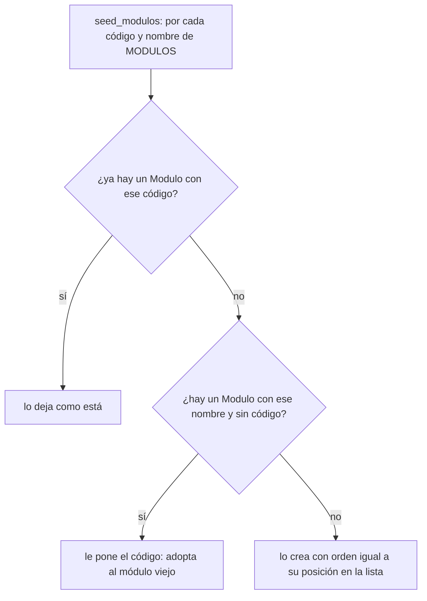

`MODULOS` está en el orden `recibo_digital`, `comunicacion`, `fichada`, `legajos`, `novedades`. Los módulos no se siembran en una migración a propósito: `manage.py migrate` también arma la base de test, que así arranca vacía (`BaseDeTestSinCatalogoSembradoTests`).

## 1.12 Tests que sirven de ejemplo

| Archivo | Muestra |
|---|---|
| `clients/tests/modelos/test_models.py` | Las combinaciones de `estado_visual` (la de «validada» se prueba en `onboarding/tests/revision/test_estados.py`), que `filtro_visual` encuentra lo mismo que la propiedad, `anular`, `marcar_cumplida`, `pedir_revision` y `asignado_nombre`. |
| `clients/tests/modelos/test_sin_movimiento.py` | La marca «sin movimiento»: el límite de 7 días, qué la saca y que el listado no hace una consulta por fila. |
| `clients/tests/modelos/test_services.py` | `generar_password`, `crear_o_resetear_acceso`, filtros del listado y el registro de constructores de foto. |
| `clients/tests/modelos/test_identificadores.py` | `uuid`, `origen` e `id_externo` y la migración que reparte un `uuid` distinto a cada implementación existente. |
| `clients/tests/modelos/test_validators.py` | `normalizar_cuits`, incluido el prefijo 23. |
| `clients/tests/acceso/test_login_limite.py` | `ip_del_cliente` con y sin proxy y el bloqueo a los 5 fallos, también en el admin. |
| `clients/tests/acceso/test_views.py` | Redirecciones del login (sin bucle) y `media_protegida`. |
| `clients/tests/acceso/test_perfil.py` | El cambio de contraseña desde «Mi perfil». |
| `clients/tests/operacion/test_salud_y_limites.py` | `salud`, el tope de pedidos de recuperación y el superusuario inicial. |
| `clients/tests/operacion/test_commands.py` | `seed_modulos` y `ensure_superuser`. |

Para correrlos: `venv/Scripts/python manage.py test clients` (toda la app) o `manage.py test clients.tests.acceso` (un paquete).

---

# 2. La app `catalog`

## 2.1 Propósito

`catalog` guarda las **listas cerradas** de las que el cliente elige durante el wizard: tipos de licencia, de novedad, de liquidación y de documento de legajo (con los campos de cada documento). Son datos de referencia: se cargan con un comando (`seed_catalogos`), no con una migración, y se corrigen desde el admin.

Su pieza más importante es el **código estable** (`ConCodigo`): cada elemento tiene, además del nombre, un `codigo` que no cambia aunque se corrija el nombre. Todo lo que dependa de «cuál es» (los pasos del wizard según el módulo, lo que se congela) se identifica por código. `clients.Modulo` usa el mismo mecanismo.

| Archivo | Qué contiene |
|---|---|
| `models.py` | `TipoLicencia`, `TipoNovedad`, `TipoLiquidacion`, `TipoDocumento` y `CampoDocumento`. |
| `codigos.py` | `codigo_desde_nombre`, `ConCodigo` y `AdminConCodigo`. |
| `admin.py` | El admin de los cuatro tipos del catálogo (licencia, novedad, liquidación y documento). Los campos de cada documento (`CampoDocumento`) se editan como inline dentro del tipo de documento. |
| `management/commands/seed_catalogos.py` | La carga inicial. |
| `apps.py` | `CatalogConfig`. |
| `views.py` | Vacío: `catalog` no tiene pantallas. |
| `migrations/` | Las migraciones de la app. |
| `tests/` | `test_codigos.py`, `test_models.py`, `test_commands.py`. |

## 2.2 Modelos y relaciones

```mermaid
classDiagram
    class ConCodigo {
        +str codigo
        +save()
        +_codigo_aplica()
        +_codigo_libre(base)
    }
    class AdminConCodigo {
        +get_readonly_fields(request, obj)
    }
    class Modulo {
        +str nombre
        +int orden
    }
    class TipoLicencia {
        +str nombre
        +int orden
        +bool automatica
    }
    class TipoNovedad {
        +str nombre
        +int orden
    }
    class TipoLiquidacion {
        +str nombre
        +int orden
    }
    class TipoDocumento {
        +str nombre
        +bool es_custom
        +bool requiere_firma
        +str circuito_aprobacion
        +int orden
    }
    class CampoDocumento {
        +str nombre
        +bool obligatorio
        +int permite_multiples_adjuntos
        +int orden
    }
    class Implementacion

    ConCodigo <|-- Modulo : hereda desde clients
    ConCodigo <|-- TipoLicencia : hereda
    ConCodigo <|-- TipoNovedad : hereda
    ConCodigo <|-- TipoLiquidacion : hereda
    ConCodigo <|-- TipoDocumento : hereda
    AdminConCodigo ..> ConCodigo : protege su codigo en el admin
    TipoDocumento "1" --> "*" CampoDocumento : campos
    Implementacion "0..1" --> "*" TipoDocumento : tipos Otros propios
```

`ConCodigo` es una clase abstracta: no tiene tabla propia, presta el campo `codigo` y su lógica a los cinco modelos que la heredan. `AdminConCodigo` no es un modelo sino una clase auxiliar para los `ModelAdmin`.

**Cómo se usa cada catálogo**

| Modelo | Qué representa | Detalles |
|---|---|---|
| `TipoLicencia` | Los tipos de licencia relevados en «Licencias y Novedades.xlsx» (16). | `automatica`: Napsis la crea sola al finalizar la configuración, así que el cliente no la elige (hoy solo «Vacaciones»). En el wizard aparece marcada y deshabilitada. |
| `TipoNovedad` | Los tipos de novedad del mismo relevamiento (10). | — |
| `TipoLiquidacion` | Tipos de liquidación que puede usar una empresa con Recibo Digital (10). El `orden` es el del wizard de Napsis. | Cada implementación tiene una sola firma de recibo (`UbicacionFirma` con `tipo_liquidacion` vacío) que vale para todos los tipos de liquidación activos, sin importar cuántos sean. El modelo admite una firma por tipo (clave foránea vacía permitida y unicidad por implementación y tipo), pero la pantalla no lo ofrece. |
| `TipoDocumento` | Tipo de documento del Legajo Digital (16 globales). | `implementacion` vacío es catálogo global; con valor y `es_custom=True` es un tipo «Otros» que agregó esa implementación y que no aparece en las demás. Los «Otros» **no llevan código** (ver 2.3). `nombre` no es único: el código sí. |
| `CampoDocumento` | Un campo de un tipo de documento: `obligatorio` y cuántos adjuntos permite (`permite_multiples_adjuntos`, 1 es uno solo). | Se ordenan por tipo y `orden`. |

Todos los catálogos se muestran siempre por el campo `orden` y después por nombre (`Meta.ordering`), no alfabéticamente: es el orden fijo del relevamiento original, y si se rompiera el checklist del wizard se reordenaría solo (`OrdenamientoDeCatalogosTests`).

---

## 2.3 Códigos estables (`ConCodigo`)

### La regla

El **nombre** se puede corregir en el admin; el **código** no cambia. Un módulo llamado «Fichada» tiene el código `fichada`; si se lo renombra a «Control de asistencia», el código sigue siendo `fichada` y los pasos del wizard (que dependen del código) siguen funcionando. Antes dependían del nombre: corregir un texto hacía desaparecer pasos sin avisar (`RenombrarUnModuloNoRompeLosPasosTests`).

### Cómo se genera

`codigo_desde_nombre(nombre)` pasa el nombre a un código: normaliza los acentos (NFKD) y descarta lo que no sea ASCII, pasa a minúsculas, reemplaza cada tramo que no sea letra ni número por un guion bajo, saca los guiones bajos de los extremos y corta a 80 caracteres. Si no queda nada, devuelve `item`.

| Nombre | Código |
|---|---|
| Recibo Digital | `recibo_digital` |
| Comunicación | `comunicacion` |
| Licencia por Accidente de Trabajo (ART) | `licencia_por_accidente_de_trabajo_art` |
| Horas Extra al 50% | `horas_extra_al_50` |
| `???` | `item` |

```mermaid
flowchart TD
    A["save() de un modelo con ConCodigo"] --> B{"¿ya tiene codigo?"}
    B -- sí --> Z["guarda sin tocar el código"]
    B -- no --> C{"¿tiene nombre?"}
    C -- no --> Z
    C -- sí --> D{"¿_codigo_aplica() es verdadero?"}
    D -- no --> Z
    D -- sí --> E["base = codigo_desde_nombre(nombre)"]
    E --> F{"¿otro registro del mismo modelo<br/>ya usa ese código?"}
    F -- sí --> G["prueba base_2, base_3 y así hasta encontrar uno libre"]
    F -- no --> H["usa base"]
    G --> I["asigna el código y guarda"]
    H --> I
```

- **Único por modelo**: `codigo` es `unique`. `_codigo_libre` busca entre los registros del mismo modelo (sin contar el propio) y agrega un sufijo si hace falta: «Gimnasio» y después «gimnasio » dan `gimnasio` y `gimnasio_2`.
- **Opcional**: el campo acepta `NULL` y vacío. Los tipos «Otros» de un cliente no son parte del catálogo, así que `TipoDocumento._codigo_aplica()` devuelve falso para ellos (`implementacion` con valor o `es_custom`) y quedan sin código. `automatizacion/congelada.py` los trata aparte: los congela con su definición completa (nombre y campos) en vez de por código.
- **Qué lo protege.** El modelo no impide cambiar `codigo` por código Python. Lo cuidan tres cosas: `save()` solo lo genera si está vacío, el admin lo muestra de solo lectura al editar (`AdminConCodigo.get_readonly_fields`) y renombrar no lo toca.
- **Lo que no pasa por `save()` no genera código.** `bulk_create` y `QuerySet.update` se saltean `save()`: un registro creado con `bulk_create` queda sin código hasta que alguien lo asigne. `seed_modulos` cubre ese caso para los módulos: le pone el código al módulo viejo que coincide por nombre.
- **Migraciones.** `clients/migrations/0012_codigos_estables.py` y `catalog/migrations/0003_codigos_estables.py` les dieron código a los registros que ya existían, a partir del nombre (con sufijo `_2` si se repetía). Importan `codigo_desde_nombre`: cambiar esa función cambiaría los códigos de una base nueva, así que no se debe modificar su resultado.

### En el admin

`AdminConCodigo` es una mezcla para los `ModelAdmin`. En la pantalla de **alta** el campo `codigo` es editable y opcional: si se deja vacío, se genera solo a partir del nombre al guardar (y quien administra puede escribir uno a mano). Al **editar** un registro existente pasa a ser de solo lectura. La usan `TipoDocumentoAdmin`, `TipoLicenciaAdmin`, `TipoLiquidacionAdmin` y `TipoNovedadAdmin` (en `catalog/admin.py`) y `ModuloAdmin` (en `clients/admin.py`).

---

## 2.4 Carga inicial: `seed_catalogos`

`manage.py seed_catalogos` carga licencias, novedades, tipos de liquidación y tipos de documento (con sus campos). Vivía como migración de datos, pero entonces `manage.py migrate` —y con él la base de test— insertaba siempre este catálogo. Como comando aparte, las bases de test arrancan limpias; en producción lo corre `docker/entrypoint.sh` en cada arranque, después de migrar (con `RUN_MIGRATIONS=1`, que es el valor por defecto), y `deploy/sin-docker/deploy.sh` en cada deploy.

Como se corre tantas veces, **no puede pisar lo que se corrigió a mano**: un nombre corregido en el admin («Prestamo» a «Préstamo») no puede quedar duplicado y algo borrado a propósito no puede reaparecer.

```mermaid
flowchart TD
    A["manage.py seed_catalogos"] --> B{"¿se pasó --completar?"}
    B -- sí --> C["siembra las cuatro familias:<br/>licencias, novedades, liquidaciones y documentos"]
    B -- no --> D["siembra solo las familias cuya tabla está vacía<br/>(en documentos: sin tipos globales)"]
    C --> E["por cada nombre de la lista:<br/>get_or_create con codigo = codigo_desde_nombre(nombre)<br/>y el resto en defaults"]
    D --> E
    E --> F["en documentos, por cada campo:<br/>get_or_create por tipo y nombre"]
    F --> G["imprime el tamaño de las listas de origen<br/>y, aparte, qué familias omitió"]
```

- Se busca por **código**, no por nombre: por eso un nombre corregido no se duplica.
- Sin opciones, una familia que ya tiene datos se **omite entera** y el comando lo informa («Ya tenían datos y no se tocaron: …»).
- `--completar` agrega lo que falte de la lista original aunque la familia ya tenga datos. Puede volver a crear algo que se haya borrado a propósito; lo renombrado no se recrea, porque conserva su código y se reconoce por él.
- Qué carga: `LICENCIAS` (16, y `LICENCIAS_AUTOMATICAS` marca «Vacaciones» como `automatica`), `LIQUIDACIONES` (10, en el orden del wizard de Napsis), `NOVEDADES` (10) y `TIPOS_DOCUMENTO` (16, cada uno con su lista de campos, si es obligatorio y cuántos adjuntos permite). Los documentos se cargan como catálogo global: `implementacion=None`, `es_custom=False`.

Los módulos de `clients` se cargan aparte, con `seed_modulos` (ver 1.11).

---

## 2.5 Componentes: archivos y funciones

```mermaid
flowchart LR
    subgraph codigos["catalog/codigos.py"]
        K1["codigo_desde_nombre()"]
        K2["ConCodigo<br/>save, _codigo_aplica, _codigo_libre"]
        K3["AdminConCodigo<br/>get_readonly_fields"]
    end
    subgraph modelos["catalog/models.py"]
        M1["TipoLicencia"]
        M2["TipoNovedad"]
        M3["TipoLiquidacion"]
        M4["TipoDocumento<br/>_codigo_aplica"]
        M5["CampoDocumento"]
    end
    subgraph adminpy["catalog/admin.py"]
        A1["TipoLicenciaAdmin, TipoNovedadAdmin,<br/>TipoLiquidacionAdmin, TipoDocumentoAdmin"]
        A2["CampoDocumentoInline"]
    end
    subgraph seed["management/commands/seed_catalogos.py"]
        S1["Command.handle()"]
        S2["LICENCIAS, NOVEDADES, LIQUIDACIONES,<br/>TIPOS_DOCUMENTO"]
    end
    EXT1["clients/models.py<br/>Modulo"]
    EXT2["clients/admin.py<br/>ModuloAdmin"]
    EXT3["migraciones<br/>clients 0012 y catalog 0003"]

    K2 --> K1
    M1 --> K2
    M2 --> K2
    M3 --> K2
    M4 --> K2
    EXT1 --> K2
    A1 --> K3
    EXT2 --> K3
    A1 --> A2
    S1 --> K1
    S1 --> S2
    S1 --> M1
    S1 --> M2
    S1 --> M3
    S1 --> M4
    S1 --> M5
    EXT3 --> K1
```

---

## 2.6 Tablas por archivo

### `catalog/models.py`

| Función, clase o modelo | Qué hace | Quién la usa |
|---|---|---|
| `TipoLicencia` | Catálogo de tipos de licencia (nombre único, `orden`, `automatica`). | `onboarding/forms.py` (`LicenciasNovedadesForm`), `onboarding/views.py` y `dashboard/views.py` (la lista del paso y de la ficha), `ImplementacionLicencia`, `congelada.py` (por código), `seed_catalogos`. |
| `TipoNovedad` | Catálogo de tipos de novedad (nombre único, `orden`). | Igual que `TipoLicencia`, con `ImplementacionNovedad`. |
| `TipoLiquidacion` | Catálogo de tipos de liquidación (nombre único, `orden`). | `onboarding/forms.py` (`LiquidacionesForm`), `onboarding/services/secciones.py` (`guardar_liquidaciones`), `ImplementacionLiquidacion`, `UbicacionFirma.tipo_liquidacion`, `congelada.py`, `seed_catalogos`. |
| `TipoDocumento` | Tipo de documento del legajo: catálogo global o tipo «Otros» de una implementación. Campos `requiere_firma` y `circuito_aprobacion`. | `onboarding/services/secciones.py` (`tipos_documento_disponibles`, `guardar_documentos`), `ImplementacionTipoDocumento`, `congelada.py`, `seed_catalogos`. |
| `TipoDocumento._codigo_aplica()` | Devuelve verdadero solo para los tipos globales (`implementacion` vacío y `es_custom` falso). | `ConCodigo.save`. |
| `CampoDocumento` | Un campo de un tipo de documento: nombre, `obligatorio`, adjuntos permitidos y orden. | Plantillas `step_documentos.html` y `implementacion_detalle.html`, `secciones.guardar_documentos` (crea los campos de un tipo «Otros»), `congelada.py` (los campos de los tipos «Otros»), `seed_catalogos`. |

### `catalog/codigos.py`

| Función, clase o modelo | Qué hace | Quién la usa |
|---|---|---|
| `codigo_desde_nombre(nombre)` | Convierte un nombre en un código: sin tildes, en minúsculas y con guiones bajos (`item` si no queda nada). | `ConCodigo.save`, `seed_catalogos`, `clients/migrations/0012` y `catalog/migrations/0003`. |
| `ConCodigo` | Clase abstracta que agrega `codigo` (`SlugField` de hasta 80, único, opcional) a un modelo de catálogo. | `Modulo`, `TipoLicencia`, `TipoNovedad`, `TipoLiquidacion` y `TipoDocumento`. |
| `ConCodigo.save()` | Genera el código a partir del nombre si falta, si hay nombre y si corresponde. | Cualquier `.save()` o `.create()` de esos modelos. |
| `ConCodigo._codigo_aplica()` | Dice si este registro lleva código (por defecto sí). Se sobreescribe para los tipos «Otros». | `ConCodigo.save`, `TipoDocumento`. |
| `ConCodigo._codigo_libre(base)` | Devuelve `base`, o `base_2`, `base_3`… hasta que no lo use otro registro del mismo modelo. | `ConCodigo.save`. |
| `AdminConCodigo.get_readonly_fields(request, obj=None)` | Agrega `codigo` a los campos de solo lectura cuando se edita un registro existente. | `TipoDocumentoAdmin`, `TipoLicenciaAdmin`, `TipoLiquidacionAdmin`, `TipoNovedadAdmin` y `clients.ModuloAdmin`. |

### `catalog/admin.py` y `catalog/apps.py`

| Función, clase o modelo | Qué hace | Quién la usa |
|---|---|---|
| `CampoDocumentoInline` | Los campos de un documento, editables dentro de la pantalla del tipo. | `TipoDocumentoAdmin`. |
| `TipoDocumentoAdmin` | Admin de `TipoDocumento`: lista nombre, código, implementación, `es_custom`, `requiere_firma` y orden; filtra por `es_custom` y `requiere_firma`. | Sitio `/admin/`. |
| `TipoLicenciaAdmin` | Admin de `TipoLicencia`: nombre, código, `automatica` y orden. | Sitio `/admin/`. |
| `TipoLiquidacionAdmin` | Admin de `TipoLiquidacion`: nombre, código y orden. | Sitio `/admin/`. |
| `TipoNovedadAdmin` | Admin de `TipoNovedad`: nombre, código y orden. | Sitio `/admin/`. |
| `CatalogConfig` (`apps.py`) | Configuración de la app. | `INSTALLED_APPS`. |
| `views.py` | Archivo vacío. | — |

### `catalog/management/commands/seed_catalogos.py`

| Función, clase o modelo | Qué hace | Quién la usa |
|---|---|---|
| `LICENCIAS`, `LICENCIAS_AUTOMATICAS`, `LIQUIDACIONES`, `NOVEDADES`, `TIPOS_DOCUMENTO` | Las listas de origen: nombres (y, para los documentos, si requieren firma y sus campos con obligatorio y máximo de adjuntos). | `Command.handle`. |
| `Command.add_arguments(parser)` | Define la opción `--completar`. | `manage.py`. |
| `Command.handle()` | Siembra solo lo que está vacío (o todo con `--completar`) usando `get_or_create` por código, e informa el tamaño de las listas de origen (no lo que hay en la base) y qué familias omitió. | `docker/entrypoint.sh`, `deploy/sin-docker/deploy.sh`, desarrollo. |

## 2.7 Tests que sirven de ejemplo

| Archivo | Muestra |
|---|---|
| `catalog/tests/test_codigos.py` | `codigo_desde_nombre`, la generación y el sufijo de los códigos, que no cambian al renombrar, los tipos «Otros» sin código, el admin de solo lectura, que renombrar un módulo no rompe los pasos, las semillas por código y la migración que asigna códigos a lo existente. |
| `catalog/tests/test_models.py` | Que la base de test arranca sin catálogo sembrado, el orden por `orden` y los tipos de documento propios de una implementación. |
| `catalog/tests/test_commands.py` | `seed_catalogos`: cuánto carga, que es idempotente, que no pisa lo corregido en el admin y qué hace `--completar`. |

Para correrlos: `venv/Scripts/python manage.py test catalog`.

---

# 3. Al tocar estas apps

- **Un estado visual nuevo** se agrega en cuatro lugares a la vez: `VISUAL_LABELS`, `estado_visual`, `filtro_visual` y la anotación `estado_orden` de `filtrar_y_ordenar_implementaciones` (`clients/services.py`). Hay un test que mantiene sincronizados `estado_visual` y `filtro_visual`, pero no mira `estado_orden` (el orden del listado).
- **Un dato calculado que se muestra en un listado** (como `sin_movimiento` o `marca_de_devolucion`) tiene dos versiones: la propiedad del modelo y una anotación en `services.py`. Si se cambia una, hay que cambiar la otra.
- **Guardar una sección** se hace dentro de `cambio_de_seccion`, y no con un `save()` suelto: deja la foto anterior y el evento, y revoca la validación si hubo cambios reales (salvo en la fecha de implementación, que no invalida). La nómina (sección «empleados») tiene su propio camino en `onboarding/services/nomina.py`, que repite a mano los tres pasos: foto anterior, evento propio (`nomina.importada`, `empleado.agregado`, …) y revocación de la validación.
- **Un catálogo nuevo** que necesite código estable hereda de `ConCodigo` y usa `AdminConCodigo` en su admin; si tiene casos que no son parte del catálogo, sobreescribe `_codigo_aplica`.
- **Un catálogo nuevo se siembra con un comando**, no con una migración: así `migrate` (y la base de test) no lo cargan solos.
- **No cambiar el resultado de `codigo_desde_nombre`**: dos migraciones lo importan, y los códigos ya guardados en producción son la referencia de todo lo que se congeló.
- **Los archivos subidos siempre se sirven por `/media/` con permisos**: no se publica `media/` desde el proxy.
