# Módulos `employees` y `notifications`

Cómo está armado el código de la **nómina** (`employees`) y de los **mails** (`notifications`): para qué sirve cada archivo, qué hace cada función o clase y quién la usa. Para el panorama general (capas, estados, recorrido completo) ver [`../arquitectura.md`](../arquitectura.md).

Está escrito para quien mantiene el código: se asume que conocés Python, pero no necesariamente Django. Los términos de Django o del proyecto se explican una sola vez, en la tabla de abajo.

Índice: [Palabras que vas a ver](#palabras-que-vas-a-ver) · [1. `employees`](#1-employees) · [2. `notifications`](#2-notifications)

## Palabras que vas a ver

| Término | Qué es |
|---|---|
| **App** | Un paquete de Django con una responsabilidad propia. Se activa en `INSTALLED_APPS` de `config/settings.py`. Acá: `employees` y `notifications`. |
| **Modelo** | Clase Python que representa una tabla de la base: cada atributo `models.XxxField` es una columna. |
| **Migración** | Archivo de `migrations/` que cambia la estructura de una tabla. Se aplica con `manage.py migrate`. |
| **Clave foránea (FK)** | Campo que apunta a una fila de otra tabla. `on_delete` dice qué pasa si esa fila se borra: `CASCADE` borra también esta fila y `SET_NULL` deja el campo vacío. `related_name` es el nombre para llegar «al revés» (por ejemplo `implementacion.empleados`). |
| **Formulario (`Form`, `ModelForm`)** | Clase que recibe lo que llegó por HTTP, lo valida y lo limpia. Un `ModelForm` además sabe guardar en un modelo. Un método `clean_<campo>` valida o normaliza ese campo. |
| **Vista** | Función que recibe el pedido web (el `request`) y devuelve la respuesta. En este proyecto son finas: traducen el pedido y llaman a las acciones y servicios. |
| **Plantilla (template)** | Archivo de texto con `{{ variable }}` y `` que Django completa con datos. Los mails son plantillas `.txt`. No confundir con la «plantilla de importación» de la nómina: el `.xlsx` vacío con las columnas que el cliente descarga y completa. |
| **`ready()`** | Método de la configuración de una app que Django llama una vez, cuando terminó de cargar todas las apps. |
| **Admin** | Sitio de administración (`/admin/`) que Django arma solo a partir de los modelos registrados. |
| **Transacción atómica** | `transaction.atomic()`: todo lo que se hace adentro se guarda junto o no se guarda nada. |
| **`bulk_create`, `bulk_update`** | Guardan muchas filas con pocas consultas, en lugar de una consulta por fila. |
| **Backend de correo** | La pieza de Django que de verdad entrega el mail (`EMAIL_BACKEND`): consola en desarrollo, SMTP (el protocolo con que se envía el correo) en producción. |
| **`send_mail`** | Función de Django que manda un mail. Con `fail_silently=False`, una falla de envío levanta una excepción en lugar de ignorarse. |
| **Caché** | Memoria compartida de Django para guardar valores con vencimiento. |
| **pandas, openpyxl** | Librerías que leen tablas (`pandas.read_excel`, `pandas.read_csv`) y que arman archivos `.xlsx`. |
| **Implementación** | El caso de un cliente (`clients.Implementacion`). Todo lo que se releva cuelga de ella. |
| **Implementador asignado** | La cuenta del equipo que lleva una implementación (`implementador_asignado`). Recibe sus notificaciones. |
| **Wizard** | El formulario de 10 pasos que completa el cliente con su link único (`/r/<token>/`). El paso 4 es la carga de empleados. |
| **Panel y ficha** | El sitio interno del equipo (`/panel/`). La ficha es la página de una implementación. |
| **Módulo (contratado)** | Producto de Napsis que el cliente contrata (Recibo Digital, Fichada, Legajos, Novedades...). Decide qué pasos del wizard aparecen y qué exige cada uno. |
| **Ronda** | Cada devolución del equipo al cliente (`clients.RondaRevision`), con su motivo y sus observaciones por sección. |
| **Validación** | Cuando el equipo da por buena la documentación enviada (`validada_en` en la implementación). Si después alguien cambia algo de lo que se va a configurar, la validación se pierde (`revocar_validacion`). |
| **CUIL y CUIT** | Identificador de 11 dígitos de una persona (CUIL) o de una empresa (CUIT). |
| **Actor** | Quién hace una cosa: cliente, implementador, admin, sistema, servicio o agente (`automatizacion/actores.py`). Las acciones y los servicios lo reciben en lugar del `request`. |
| **Evento** | Registro de que pasó algo (`automatizacion/eventos.py`, función `registrar`). Solo se agregan, nunca se editan. |
| **Historial de versiones** | `ImplementacionVersion`: la foto de una sección *antes* de cambiarla (`clients.services.guardar_version`). |

---

## 1. `employees`

### 1.1 Para qué sirve

`employees` es la **nómina**. Guarda a los empleados que el cliente informa en una implementación (`Empleado`) y deja el registro de cada archivo masivo que se importó (`ImportBatch`). Además lee y valida la planilla de importación, genera la plantilla vacía y la nómina descargable, y aporta la foto de la sección «empleados» para el historial de versiones.

No tiene pantallas propias (`views.py` está vacío). Las pantallas del wizard (`onboarding/views.py`) y de la ficha del equipo (`dashboard/views.py`) usan sus formularios y servicios.

**El trabajo está repartido en dos lugares**, y conviene tenerlo claro antes de tocar la importación:

| Dónde | Qué hace | Toca la base |
|---|---|---|
| `employees/services.py` | **Leer y validar** el archivo: columnas, tipos, fechas, CUIL, largos. | No escribe. |
| `onboarding/services/nomina.py` | **Cargar**: transacción, alta y actualización en lote, jerarquía (a quién reporta cada empleado y quién lo aprueba), vínculo con roles, evento. También el alta, edición y baja manual. | Sí. |

### 1.2 Componentes

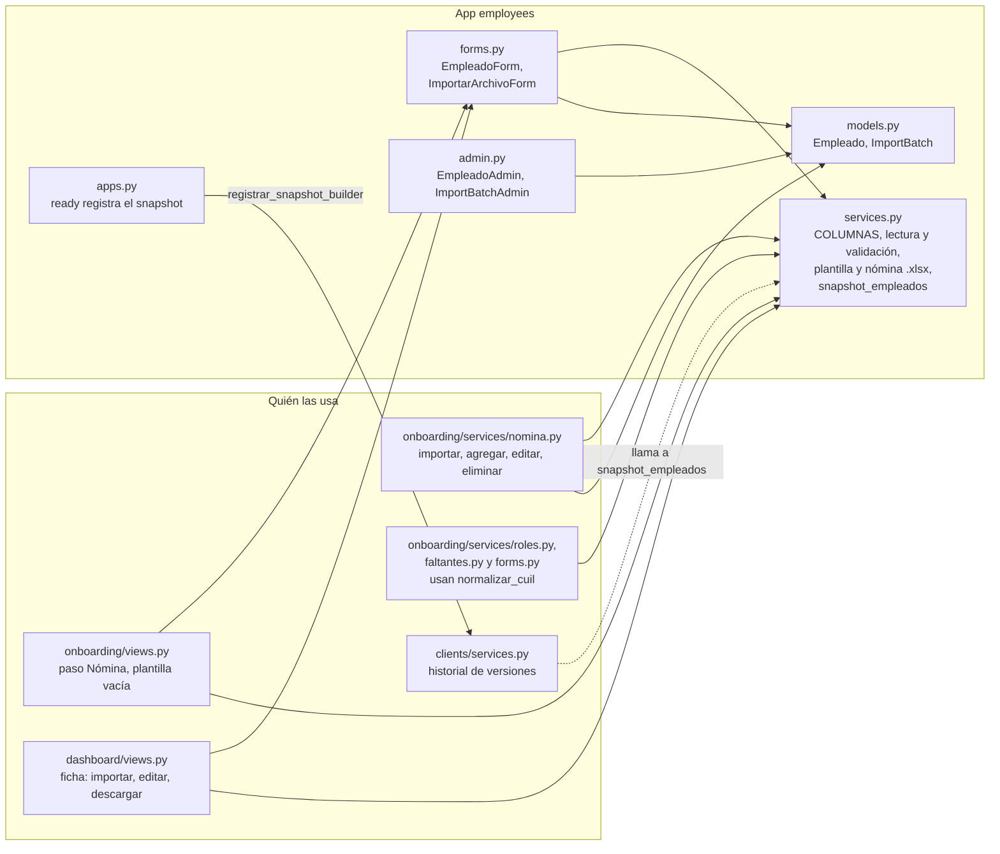

### 1.3 Modelos

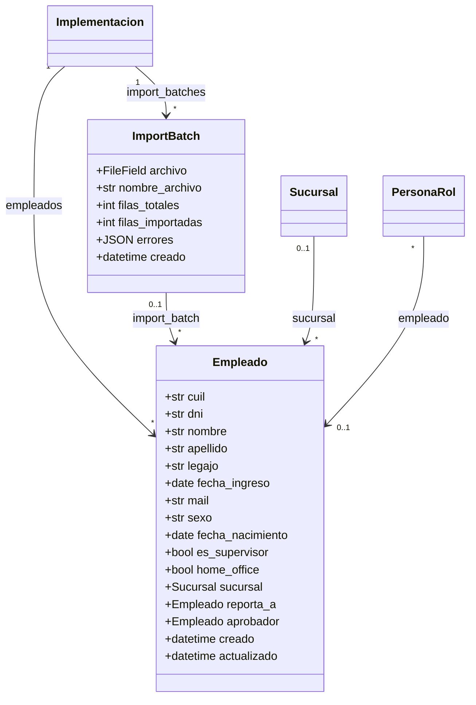

El diagrama muestra solo los campos principales; la tabla de abajo los lista todos. `reporta_a` y `aprobador` apuntan a otro `Empleado` de la misma tabla (una relación del modelo consigo mismo, con `related_name` `reportes` y `aprobaciones`).

Qué pasa al borrar una fila relacionada (`on_delete`):

| Campo | Apunta a | Si se borra lo apuntado |
|---|---|---|
| `Empleado.implementacion` | `clients.Implementacion` | Se borran sus empleados (`CASCADE`). |
| `Empleado.import_batch` | `ImportBatch` | El empleado queda sin lote (`SET_NULL`). |
| `Empleado.sucursal` | `clients.Sucursal` | El empleado queda sin sucursal (`SET_NULL`). |
| `Empleado.reporta_a`, `Empleado.aprobador` | `Empleado` | El campo queda vacío (`SET_NULL`). |
| `ImportBatch.implementacion` | `clients.Implementacion` | Se borran sus lotes (`CASCADE`). |
| `PersonaRol.empleado` (en `clients`) | `Empleado` | La persona con rol queda sin empleado vinculado (`SET_NULL`). |

### 1.4 Qué hay en cada archivo

#### `employees/models.py`

| Función, clase o modelo | Qué hace | Quién la usa |
|---|---|---|
| `ImportBatch` | Registro de **cada archivo de nómina subido**: `nombre_archivo`, `filas_totales`, `filas_importadas`, `errores` (lista JSON de `{fila, mensaje}`) y `creado`. Se ordena del más nuevo al más viejo. El campo `archivo` (`FileField`) quedó para las importaciones viejas: las nuevas **no guardan el archivo**. | Lo crea `onboarding/services/nomina.py::_cargar_empleados`. Se ve en el admin; ninguna plantilla HTML lo muestra. |
| `Empleado` | Un empleado relevado en una implementación, por carga manual o por importación. Se ordena por `apellido`, `nombre`. **`unique_together = (implementacion, cuil)`**: un CUIL no se repite dentro de una implementación (sí puede estar en otra). `__str__` da `APELLIDO, NOMBRE (cuil)`. | `onboarding/services/nomina.py` (alta, edición, baja, importación), `employees/forms.py`, `onboarding/services/faltantes.py` y `roles.py` (vía `implementacion.empleados`), `automatizacion/congelada.py` y `notifications/services.py` (solo cuentan), `clients.PersonaRol.empleado` (FK). |

Campos de `Empleado`, agrupados (entre paréntesis, el largo máximo):

| Grupo | Campos |
|---|---|
| Identidad | `cuil` (20), `dni` (20), `nombre` (150), `apellido` (150), `legajo` (50), `fecha_ingreso` (fecha, puede quedar vacía), `mail`, `sexo` (`F` o `M`, 1), `fecha_nacimiento` (fecha, vacía permitida), `lugar_nacimiento` (150), `nacionalidad` (100), `estado_civil` (50) |
| Domicilio y contacto | `domicilio` (255), `planta_vivienda` (100), `codigo_postal` (20), `localidad` (150), `telefono` (50) |
| Laboral | `obra_social`, `centro_costo`, `puesto`, `gerencia`, `sector`, `funcion` (150 cada uno) |
| Indicadores | `es_supervisor`, `home_office` (sí/no, por defecto no) |
| Relaciones | `implementacion`, `import_batch`, `sucursal`, `reporta_a`, `aprobador` |
| Auditoría | `creado` (al crear), `actualizado` (se renueva en cada guardado) |

#### `employees/services.py`

| Función, clase o modelo | Qué hace | Quién la usa |
|---|---|---|
| `COLUMNAS` | Lista de 27 tuplas `(encabezado, campo del modelo, obligatorio, tipo)`. **Es la única definición de la plantilla**: de acá salen los encabezados de la plantilla vacía y de la nómina descargable, el reconocimiento de columnas al leer y los campos que se importan. Detalle en [1.5.2](#152-la-plantilla-columnas). | Este archivo y `onboarding/services/nomina.py` (`CAMPOS_EMPLEADO_IMPORTADOS`). |
| `CUIL_RE` | Expresión `^\d{11}$`: exactamente 11 dígitos. | `leer_archivo_empleados`, `EmpleadoForm.clean_cuil`, `RolForm.clean_cuil` (`onboarding/forms.py`). |
| `MAX_FILAS_IMPORTACION` | `5000`: tope de filas por archivo. El comentario del código lo explica: la carga corre dentro del pedido web. | `leer_archivo_empleados`. Un test lo reemplaza con `patch`. |
| `ResultadoLectura` | `namedtuple` con `filas`, `errores` y `columnas_ignoradas`: lo que devuelve la lectura. | Lo devuelve `leer_archivo_empleados`; lo consume `onboarding/services/nomina.py::_cargar_empleados`. |
| `ArchivoInvalido` | Excepción: el archivo en sí no sirve. Su mensaje está pensado para mostrárselo a quien lo subió. | La levantan `_leer_tabla` y `leer_archivo_empleados`. La atrapan `onboarding/views.py::_importar_archivo_empleados` y `dashboard/views.py::_accion_importar_empleados`. |
| `normalizar_texto(valor)` | Texto normalizado: recorta, pasa a MAYÚSCULAS, saca tildes y colapsa espacios repetidos. `None` da `""`. | `leer_archivo_empleados`, `_parse_booleano`, `EmpleadoForm.clean_nombre` y `clean_apellido`. |
| `normalizar_cuil(valor)` | Deja solo los dígitos. `None` da `""`. | `leer_archivo_empleados`, `EmpleadoForm.clean_cuil`, `RolForm.clean_cuil`, `vincular_roles_con_nomina` (`roles.py`), `pendientes_de_envio` (`faltantes.py`). |
| `_armar_hoja_con_headers()` | Crea un libro `.xlsx` con una hoja llamada `Empleados` y los encabezados de `COLUMNAS` en negrita (ancho de columna: el mayor entre 18 y el largo del encabezado más 2). | `generar_plantilla_xlsx`, `generar_nomina_xlsx`. |
| `generar_plantilla_xlsx()` | Devuelve (en memoria) el `.xlsx` vacío, solo con los encabezados, para que el cliente lo descargue y complete. | `onboarding/views.py::descargar_plantilla_empleados`. |
| `generar_nomina_xlsx(empleados)` | Devuelve el `.xlsx` con la nómina ya cargada, con las mismas columnas que la plantilla. Escribe `SI`/`NO` en los booleanos, `DD/MM/AAAA` en las fechas y, en Reporta A y Aprobador, el CUIL de esa persona. Cada celda pasa por `clients.xlsx.escribir_celda`, que fuerza tipo texto para que un valor que empieza con `=` no se ejecute como fórmula al abrir el archivo en Excel. | `dashboard/views.py::descargar_nomina`. |
| `_FORMATOS_FECHA` | Los formatos de texto que se prueban, en este orden: `%d/%m/%Y`, `%d-%m-%Y`, `%Y-%m-%d`, `%d.%m.%Y`, `%Y/%m/%d`. | `_parse_fecha`. |
| `_celda_a_texto(valor)` | Pasa el valor de una celda a texto tal como lo escribió quien armó el archivo. Un número de Excel llega como `float` (un CUIL tipeado sin formato llega como `20123456786.0`): lo convierte a entero para que no quede con el «.0». Una fecha se escribe como `DD/MM/AAAA`. Vacío, `None` y `NaN` dan `""`. | `leer_archivo_empleados`. |
| `_parse_fecha(valor)` | Devuelve un `date`, `None` si la celda está vacía, o levanta `ValueError` si no se entiende. Formatos en [1.5.6](#156-fechas-aceptadas). | `leer_archivo_empleados`. |
| `_parse_booleano(valor)` | Verdadero si el valor normalizado es `SI`, `SÍ`, `TRUE`, `1` o `X`. Cualquier otro valor es falso, sin error. | `leer_archivo_empleados`. |
| `_decodificar(contenido)` | Decodifica un CSV: primero UTF-8 (con o sin BOM, una marca invisible al inicio que agregan algunos programas) y, si no se puede, `cp1252` (la codificación de Windows con la que Excel en español guarda los CSV), reemplazando lo ilegible. | `_leer_tabla`. |
| `_separador(texto)` | Elige el separador del CSV: el que más veces aparece en la primera línea entre `;`, `,` y tabulación (si empatan, `;`). | `_leer_tabla`. |
| `_leer_tabla(django_file)` | Lee el archivo como tabla de valores crudos (con pandas, todo como objeto y sin convertir vacíos en `NaN`). Si el nombre termina en `.csv`, usa `_decodificar` y `_separador`; si no, lee el Excel. Cualquier falla de lectura se convierte en `ArchivoInvalido` con un mensaje claro. | `leer_archivo_empleados`. |
| `leer_archivo_empleados(django_file, ingreso_obligatorio=False)` | **La función central.** Lee un `.xlsx` o `.csv` y devuelve un `ResultadoLectura(filas, errores, columnas_ignoradas)`. `filas` son diccionarios listos para crear o actualizar un `Empleado` (con `numero_fila`); `errores`, `{fila, mensaje}` de las filas rechazadas. Con `ingreso_obligatorio=True` (Recibo Digital) la fecha de ingreso es obligatoria en cada fila. Importa `Empleado` dentro de la función (el módulo se importa al cargar las apps) para leer los largos máximos de los campos. Todo el detalle en [1.5](#15-la-importación-de-la-nómina). | `onboarding/services/nomina.py::importar_archivo_empleados`. |
| `parse_archivo_empleados(django_file, ingreso_obligatorio=False)` | Versión corta: llama a `leer_archivo_empleados` y devuelve solo `(filas, errores)`. | Solo los tests (`employees/tests/test_services.py`). |
| `snapshot_empleados(implementacion)` | Foto de los empleados para el historial de versiones: una lista con, por empleado, solo `CUIL`, `Apellido y Nombre`, `Legajo` y `Puesto`. | Se registra en `apps.py`; la llama `clients.services` (`guardar_version` y `foto_de_seccion`). |

#### `employees/forms.py`

| Función, clase o modelo | Qué hace | Quién la usa |
|---|---|---|
| `EmpleadoForm` | `ModelForm` de `Empleado` para el alta y la edición manual. Incluye todos los campos salvo `implementacion`, `import_batch`, `creado` y `actualizado` (o sea que `sucursal`, `reporta_a` y `aprobador` sí están). `fecha_ingreso` y `fecha_nacimiento` se dibujan como `<input type="date">`. | `onboarding/views.py` (`_agregar_empleado_manual`, `_step_empleados`) y `dashboard/views.py` (`_accion_agregar_empleado`, `_accion_editar_empleado`, armado de la ficha). Se le pasa a `agregar_empleado` y `editar_empleado`. |
| `EmpleadoForm.__init__(..., implementacion=None)` | Con la implementación: limita los combos a lo de **esa** implementación (`sucursal` = sus sucursales; `reporta_a` y `aprobador` = sus empleados, sin incluir al que se edita) y, si tiene Recibo Digital, vuelve obligatoria la `fecha_ingreso`. Sin ella, Django ofrecería *todos* los registros de la base. **Siempre hay que pasarla.** | Todas las vistas de arriba. |
| `EmpleadoForm.clean_cuil` | Normaliza el CUIL (`normalizar_cuil`), exige 11 dígitos («El CUIL tiene que tener 11 dígitos.») y rechaza uno ya cargado en la misma implementación (al editar, no se compara con el propio empleado): «Ya hay un empleado cargado con ese CUIL.» | Lo ejecuta Django al validar el formulario. |
| `EmpleadoForm.clean_nombre`, `clean_apellido` | Aplican `normalizar_texto`, igual que la importación. | Ídem. |
| `ImportarArchivoForm` | Formulario de un solo campo, `archivo` («Archivo de empleados (.xlsx o .csv)»). Valida el tamaño con `clients.validators.validar_tamanio_archivo`. | `onboarding/views.py::_importar_archivo_empleados` y `dashboard/views.py::_accion_importar_empleados`. |
| `ImportarArchivoForm.clean_archivo` | Exige que el nombre termine en `.xlsx` o `.csv` (sin distinguir mayúsculas): «El archivo debe ser .xlsx o .csv». | Lo ejecuta Django al validar. |

#### `employees/apps.py`, `admin.py`, `views.py`, `migrations/`

| Archivo | Qué hay | Quién lo usa |
|---|---|---|
| `apps.py` → `EmployeesConfig.ready()` | Al arrancar, llama a `clients.services.registrar_snapshot_builder("empleados", snapshot_empleados)`. Así `clients` puede sacar la foto de la sección «empleados» sin importar esta app ni conocer sus modelos (el comentario de `clients/services.py` lo explica). | Django, al cargar las apps. |
| `admin.py` → `EmpleadoAdmin`, `ImportBatchAdmin` | Registran los dos modelos en el admin. `EmpleadoAdmin`: lista por apellido, nombre, CUIL, implementación, legajo y puesto; filtro por implementación; búsqueda por apellido, nombre, CUIL y DNI. `ImportBatchAdmin`: lista por implementación, filas totales, filas importadas y fecha. | El sitio `/admin/`. |
| `views.py` | Vacío. | — |
| `migrations/` | `0001_initial`, `0002_alter_importbatch_archivo` y `0003_importacion_sin_archivo` (agrega `nombre_archivo` y hace opcional `archivo`: es el cambio de «ya no se guarda el archivo»). | `manage.py migrate`. |

### 1.5 La importación de la nómina

#### 1.5.1 Visión general

El cliente (en el paso «Carga de empleados» del wizard) o el equipo (en la ficha) suben un `.xlsx` o `.csv`. Pasa por cuatro etapas:

1. **El formulario** (`ImportarArchivoForm`) controla extensión y tamaño.
2. **La lectura** (`leer_archivo_empleados`) revisa el archivo y cada fila. No escribe en la base.
3. **La carga** (`onboarding/services/nomina.py::importar_archivo_empleados`) guarda todo en una transacción.
4. **El resumen** (`resumen_importacion`, en el mismo módulo de `onboarding`) arma los mensajes que se le muestran a la persona: «Se importaron N empleados correctamente.», o «Se importaron N empleados. M filas tuvieron errores y no se cargaron.», más hasta 5 advertencias y «... y K avisos más.».

Principios que ordenan todo:

- **Si el archivo en sí no sirve, no se toca nada** (ilegible, sin columnas obligatorias, vacío o demasiado grande): se levanta `ArchivoInvalido` antes de escribir.
- **Una fila con error no impide cargar las demás.** Se informa con su número de fila.
- **La carga es todo o nada** (una transacción): si algo falla a mitad de camino, no queda una nómina a medias.
- **El archivo no se guarda**: tiene datos personales y no se vuelve a usar.

#### 1.5.2 La plantilla: `COLUMNAS`

La primera fila del archivo son los encabezados. Las 27 columnas, en el orden de la plantilla:

| # | Encabezado en la plantilla | Campo | Obligatoria | Tipo | Máximo | Qué se hace con el valor |
|---|---|---|---|---|---|---|
| 1 | `CUIL` | `cuil` | **Sí** | texto | — | Se dejan solo los dígitos; tienen que ser 11. No se repite en el archivo. |
| 2 | `DNI` | `dni` | No | texto | 20 | Tal cual (recortado). |
| 3 | `Nombre` | `nombre` | **Sí** | texto | 150 | `normalizar_texto`. |
| 4 | `Apellido` | `apellido` | **Sí** | texto | 150 | `normalizar_texto`. |
| 5 | `Legajo` | `legajo` | No | texto | 50 | Tal cual. |
| 6 | `Fecha Ingreso (DD/MM/AAAA)` | `fecha_ingreso` | No (**sí** si la implementación tiene Recibo Digital) | fecha | — | `_parse_fecha`. |
| 7 | `Mail` | `mail` | No | mail | 254 | Se valida el formato con `validate_email`. No se cambian las mayúsculas. |
| 8 | `Sexo (F/M)` | `sexo` | No | sexo | — | Solo `F` o `M` (sin distinguir mayúsculas). Cualquier otro valor queda vacío, **sin error**. |
| 9 | `Fecha Nacimiento (DD/MM/AAAA)` | `fecha_nacimiento` | No | fecha | — | `_parse_fecha`. |
| 10 | `Lugar de Nacimiento` | `lugar_nacimiento` | No | texto | 150 | Tal cual. |
| 11 | `Nacionalidad` | `nacionalidad` | No | texto | 100 | Tal cual. |
| 12 | `Estado Civil` | `estado_civil` | No | texto | 50 | Tal cual. |
| 13 | `Domicilio` | `domicilio` | No | texto | 255 | Tal cual. |
| 14 | `Planta/Vivienda` | `planta_vivienda` | No | texto | 100 | Tal cual. |
| 15 | `Codigo Postal` | `codigo_postal` | No | texto | 20 | Tal cual. |
| 16 | `Localidad` | `localidad` | No | texto | 150 | Tal cual. |
| 17 | `Telefono` | `telefono` | No | texto | 50 | Tal cual. |
| 18 | `Obra Social` | `obra_social` | No | texto | 150 | Tal cual. |
| 19 | `Centro de Costo` | `centro_costo` | No | texto | 150 | Tal cual. |
| 20 | `Puesto` | `puesto` | No | texto | 150 | Tal cual. |
| 21 | `Gerencia` | `gerencia` | No | texto | 150 | Tal cual. |
| 22 | `Sector` | `sector` | No | texto | 150 | Tal cual. |
| 23 | `Funcion` | `funcion` | No | texto | 150 | Tal cual. |
| 24 | `Es Supervisor (SI/NO)` | `es_supervisor` | No | booleano | — | `SI`, `SÍ`, `TRUE`, `1` o `X` es verdadero; todo lo demás, falso (sin error). |
| 25 | `Home Office (SI/NO)` | `home_office` | No | booleano | — | Ídem. |
| 26 | `Reporta A (CUIL)` | `reporta_a` | No | cuil_ref | — | Solo dígitos; si hay algo, tienen que ser 11. Se vincula después de cargar (ver [1.5.9](#159-la-carga-a-la-base)). |
| 27 | `Aprobador (CUIL)` | `aprobador` | No | cuil_ref | — | Ídem. |

Cómo se reconocen los encabezados del archivo:

- Se comparan con `normalizar_texto` de los dos lados: no importan las mayúsculas, las tildes ni los espacios de más (`cuil `, `CUIL` y `Cuil` valen igual; `Código Postal` vale como `Codigo Postal`).
- **El encabezado completo tiene que estar, con su paréntesis.** `Sexo` solo no se reconoce (hay que escribir `Sexo (F/M)`), ni `Fecha Ingreso` (hay que escribir `Fecha Ingreso (DD/MM/AAAA)`), ni `Reporta A` sin `(CUIL)`. Una columna que no se reconoce se ignora y se avisa; si era obligatoria, el archivo se rechaza.
- Las columnas opcionales pueden faltar del todo.
- Si dos encabezados distintos corresponden al mismo campo, se usa el primero y el otro se informa como columna ignorada.
- Los encabezados vacíos o «Unnamed» no se informan.
- **La sucursal no es una columna de la plantilla**: no se asigna al importar. Se elige a mano en el formulario del empleado.
- En los mensajes de error, la etiqueta de una columna es el encabezado sin el paréntesis (por ejemplo `Fecha Ingreso` o `Reporta A`).

#### 1.5.3 Formatos de archivo y límites

| Qué | Valor | Dónde se controla | Si no se cumple |
|---|---|---|---|
| Extensión | `.xlsx` o `.csv` | `ImportarArchivoForm.clean_archivo` | Error en el formulario. |
| Tamaño | 15 MB (`MAX_UPLOAD_SIZE_BYTES` en `config/settings.py`) | `validar_tamanio_archivo` (`clients/validators.py`) | Error en el formulario: «El archivo no puede pesar más de 15MB.» |
| Filas | 5.000 (`MAX_FILAS_IMPORTACION`), sin contar las filas totalmente vacías | `leer_archivo_empleados` | `ArchivoInvalido`: no se carga nada. |
| Largo de cada campo de texto | Según la tabla de `COLUMNAS` | `leer_archivo_empleados` | Error de esa fila. |
| Hoja de Excel | La primera (no se indica otra, y pandas toma esa por defecto) | `_leer_tabla` | — |
| Codificación del CSV | UTF-8 (con o sin BOM) o `cp1252` | `_decodificar` | Con `cp1252` los caracteres ilegibles se reemplazan, no fallan. |
| Separador del CSV | `;`, `,` o tabulación (el que más aparece en la primera línea) | `_separador` | — |
| Detalle en el evento de importación | 50 errores (`MAX_ERRORES_EN_EVENTO`) y 500 correcciones (`MAX_CORRECCIONES_EN_EVENTO`) | `onboarding/services/nomina.py` | El resto queda contado en el resumen; `ImportBatch.errores` guarda **todos** los errores. |
| Lotes de guardado | 500 para altas (`bulk_create`), 100 para actualizaciones (`LOTE_ACTUALIZACION`) | `onboarding/services/nomina.py` | — |

Según el comentario del código, el lote de actualización es chico a propósito: con lotes grandes MySQL tarda mucho más que con varios lotes chicos.

#### 1.5.4 Chequeos del archivo

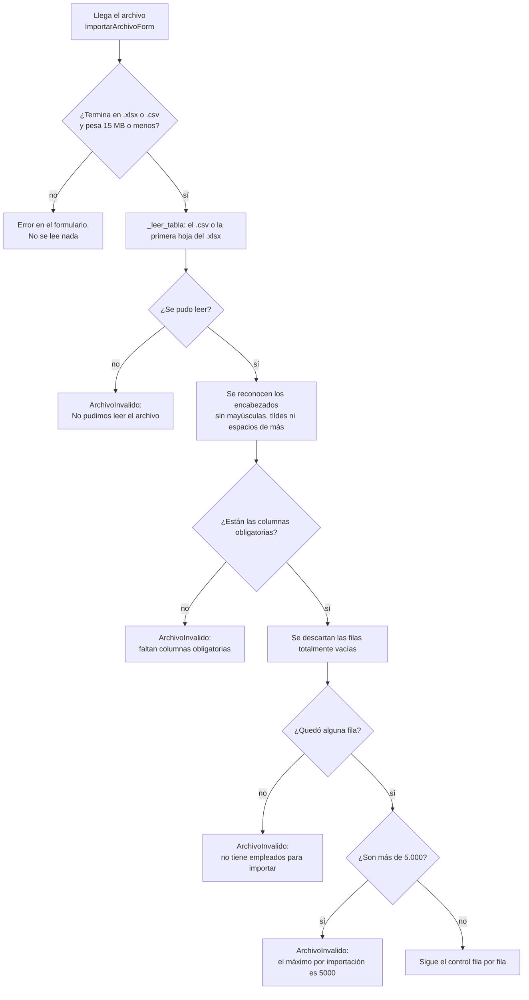

Las columnas obligatorias son `CUIL`, `Nombre` y `Apellido`, más `Fecha Ingreso (DD/MM/AAAA)` cuando se lee con `ingreso_obligatorio=True`. Si faltan varias, el mensaje las lista todas juntas (una sola vez, no fila por fila).

#### 1.5.5 Lectura de cada fila

El número de fila que se informa es el de la fila del archivo: la 1 es el encabezado, así que el primer empleado es la fila 2. Las filas totalmente vacías se descartan antes de leer, pero el número de las demás se mantiene.

**Cómo se lee cada campo, según su tipo:**

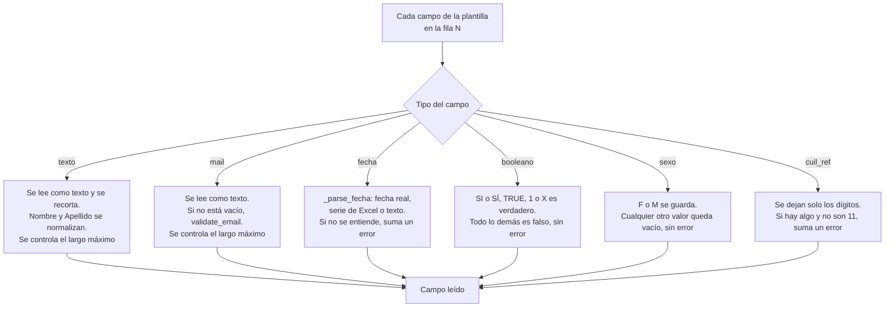

**Qué se controla en la fila y cómo se decide si entra o se rechaza:**

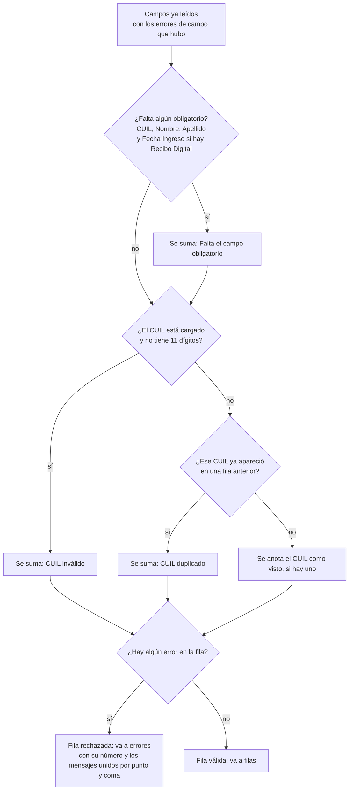

Detalles que el diagrama no muestra:

- **Los errores se acumulan**: no se corta en el primero. Una fila puede salir con varios mensajes, unidos con `; `.
- **El CUIL se valida solo por forma** (11 dígitos). No se controla el dígito verificador, a diferencia del CUIT de la empresa (`clients/validators.py::normalizar_cuits`).
- **El primer CUIL se queda con el lugar**: se anota como visto aunque esa fila tenga otros errores (por ejemplo un mail inválido). Si otra fila trae el mismo CUIL, esa segunda se rechaza como duplicada, aunque la primera también haya sido rechazada.
- Con `ingreso_obligatorio`, una fecha de ingreso que no se entiende suma **dos** mensajes: «Fecha inválida...» y «Falta el campo obligatorio 'fecha_ingreso'».
- El mensaje de campo obligatorio usa el **nombre interno** del campo (`apellido`, `cuil`, `fecha_ingreso`), no la etiqueta de la columna, y el orden entre varios faltantes no es fijo.
- Los campos de la plantilla que no vienen en el archivo se leen como vacíos (texto `""`, fecha sin valor, booleano falso).

#### 1.5.6 Fechas aceptadas

`_parse_fecha` entiende lo que realmente trae un Excel. Siempre se interpreta **primero el día** (`5/3/2020` es el 5 de marzo).

| Qué llega | Ejemplos | Resultado |
|---|---|---|
| Fecha real de Excel (una celda con formato fecha) | — | Esa fecha. |
| Número de serie de Excel, **solo si la celda llega como número** (en un `.xlsx`), entre 1 y 80000 | `43905` | 15/03/2020 (cuenta días desde el 30/12/1899). |
| Texto `DD/MM/AAAA` | `15/03/2020`, `5/3/2020` | Con o sin cero adelante. |
| Texto `DD-MM-AAAA` | `15-03-2020` | |
| Texto `AAAA-MM-DD` | `2020-03-15` | |
| Texto `DD.MM.AAAA` | `15.03.2020` | |
| Texto `AAAA/MM/DD` | `2020/03/15` | |
| Texto con hora | `2020-03-15 10:30:00`, `2020-03-15T10:30` | Se descarta la hora (se corta en el primer espacio y en la `T`). |
| Celda vacía | | Sin fecha. No es error, salvo que el campo sea obligatorio. |

Se rechazan como «Fecha inválida» (error de esa fila, el valor no se pierde en silencio):

- Mes primero (`03/15/2020`): no coincide con ningún formato.
- Año de dos dígitos (`15/03/20`).
- Cualquier texto que no sea una fecha (`mañana`).
- Un número de serie escrito como texto: en un `.csv` todo llega como texto, así que `43905` se rechaza.
- Un año fuera de 1900 a 2100 (`15/03/0020`).

El mensaje es `Fecha inválida en '<etiqueta>': '<valor>' (usá DD/MM/AAAA)`.

#### 1.5.7 Normalización de CUIL y nombres

| Dato | Función | Qué hace | Ejemplo |
|---|---|---|---|
| `Nombre`, `Apellido` (en el archivo y en el formulario manual) | `normalizar_texto` | Recorta, pasa a mayúsculas, descompone los caracteres acentuados y descarta lo que no sea ASCII (se pierden tildes y `ñ` pasa a `N`; un carácter sin equivalente ASCII desaparece), y colapsa espacios repetidos. | `García Núñez` pasa a `GARCIA NUNEZ`; `  Juan   Pérez  ` pasa a `JUAN PEREZ`. |
| `CUIL`, `Reporta A`, `Aprobador` | `normalizar_cuil` | Deja solo los dígitos, sea cual sea el separador. | `20-11111111-2` pasa a `20111111112`. |
| CUIL escrito como número en Excel | `_celda_a_texto` | Un `float` entero pierde el «.0». | `20111111112.0` pasa a `20111111112`. |
| Resto de los textos | `_celda_a_texto` | Solo se recortan los espacios de los extremos. Un `DNI`, `Legajo` o `Mail` no se pasa a mayúsculas. | |

Es la misma regla en la importación y en el formulario manual, para que el mismo empleado cargado a mano y por archivo no quede duplicado (uno con guiones en el CUIL y otro sin).

#### 1.5.8 Mensajes que ve quien importa

**El archivo se rechaza entero** (`ArchivoInvalido`; no se carga nada):

| Mensaje | Cuándo |
|---|---|
| No pudimos leer el archivo. Verificá que sea un .xlsx o .csv válido y que no esté dañado (lo más seguro es descargar la plantilla y pegar ahí tus datos). | pandas no pudo leerlo. |
| Al archivo le faltan columnas obligatorias: ... Revisá que la primera fila tenga los encabezados de la plantilla (CUIL, Nombre, Apellido, ...). | Falta `CUIL`, `Nombre`, `Apellido` o, con Recibo Digital, `Fecha Ingreso`. |
| El archivo no tiene empleados para importar. | Solo hay encabezados o todas las filas están vacías. |
| El archivo tiene N filas y el máximo por importación es 5000. Dividilo en varios archivos. | Más de 5.000 filas. |

**Una fila se rechaza** (el resto se carga; se informa `{fila, mensaje}`):

| Mensaje | Cuándo |
|---|---|
| `Mail inválido: '<valor>'` | El mail no tiene formato válido. |
| `'<Etiqueta>' supera los <N> caracteres` | Un texto más largo que su campo (por ejemplo `'Telefono' supera los 50 caracteres`). |
| `Fecha inválida en '<Etiqueta>': '<valor>' (usá DD/MM/AAAA)` | Una fecha que no se entiende. |
| `CUIL inválido en '<Etiqueta>': debe tener 11 dígitos` | `Reporta A` o `Aprobador` con algo que no son 11 dígitos. |
| `Falta el campo obligatorio '<campo>'` | Obligatorio vacío. |
| `CUIL inválido: debe tener 11 dígitos` | CUIL de la fila con otra cantidad de dígitos. |
| `CUIL duplicado dentro del archivo: <cuil>` | El CUIL ya apareció en una fila anterior. |

**Advertencias** (no rechazan nada; las arma `onboarding/services/nomina.py`):

| Mensaje | Cuándo |
|---|---|
| No reconocimos estas columnas y se ignoraron: ... | Encabezados que no corresponden a ningún campo (o repetidos). |
| `Fila N: el CUIL X de 'Reporta A' no está en la nómina; no se vinculó.` (o `'Aprobador'`) | El CUIL de jerarquía no está entre los empleados de la implementación. |

Dónde se muestra cada cosa: el wizard le pasa la lista completa de errores a la plantilla `step_empleados.html` (una tabla con fila y mensaje) y los avisos van por el sistema de mensajes de Django. La ficha del panel muestra el resumen más «Filas rechazadas: fila X: mensaje; ...» con las primeras 5 filas. Un `ArchivoInvalido` en el wizard además deja el evento `validacion.fallida` (paso Nómina); en el panel se agrega como error del campo `archivo`.

#### 1.5.9 La carga a la base

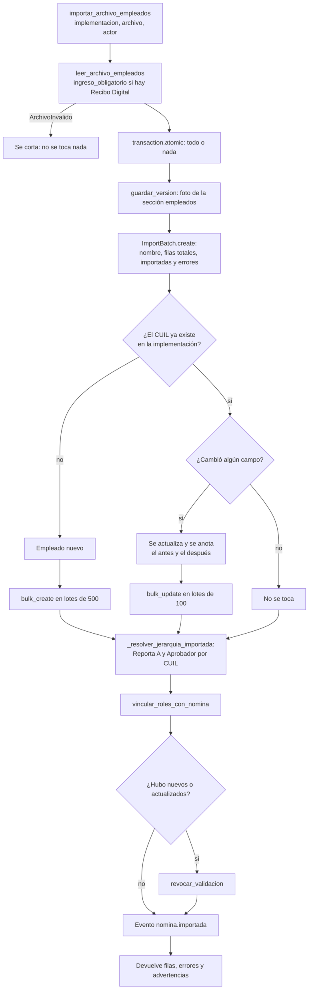

Cómo funciona, paso a paso:

- **Qué datos se cargan.** Todas las columnas de la plantilla menos `Reporta A` y `Aprobador` (esas dos se resuelven aparte). Es `CAMPOS_EMPLEADO_IMPORTADOS`, calculado desde `COLUMNAS`.
- **Se busca por CUIL dentro de la implementación.** Los que ya existen se actualizan; los demás se crean. Un mismo CUIL puede existir en otra implementación sin conflicto.
- **Solo se actualiza lo que cambió.** Volver a subir la misma planilla no reescribe a nadie. De los que cambiaron se renuevan `import_batch` y `actualizado`; los que no cambiaron conservan su lote anterior.
- **La jerarquía se resuelve en una segunda pasada**, con todos los empleados ya cargados, porque alguien puede reportar a una persona que está más abajo en el archivo. Si el CUIL referenciado no existe, no se toca esa relación y se avisa. Una celda vacía **no borra** una relación que ya existía.
- **`vincular_roles_con_nomina`** vuelve a ligar a cada persona con rol a su empleado, por CUIL.
- **`revocar_validacion`** se llama solo si hubo empleados nuevos o actualizados: si la implementación ya estaba validada, vuelve a «pendiente de validación».
- **`guardar_version` se llama siempre** (aun si no cambia nada) y guarda la foto previa de la sección «empleados».
- **`filas_importadas` cuenta las filas válidas** del archivo (nuevas, actualizadas y sin cambios), y `filas_totales` suma además las rechazadas.

**Ojo al volver a importar:**

- **Los campos de la plantilla se reemplazan por lo que trae el archivo, incluso por vacío.** Una columna que falta en el archivo se lee como vacía, así que reimportar un archivo con menos columnas **borra** esos datos en los empleados que ya existían (por ejemplo, el mail o el legajo).
- Los empleados que no figuran en el archivo no se tocan: la importación nunca borra a nadie.
- La sucursal y las relaciones de jerarquía no se pisan si el archivo no las informa.

#### 1.5.10 Qué NO se guarda

| Qué | Qué pasa | Dónde queda constancia |
|---|---|---|
| **El archivo subido** | No se guarda (datos personales, no se vuelve a usar). `ImportBatch.archivo` queda vacío. | `ImportBatch.nombre_archivo` y el campo `archivo` del evento. |
| **Las filas con error** | No se cargan ni se guardan sus datos. | `ImportBatch.errores` (todas, como `{fila, mensaje}`) y el evento (las primeras 50). Ojo: algunos mensajes incluyen el valor problemático (el mail o la fecha). |
| **Las columnas desconocidas** | Se ignoran. | La advertencia y `columnas_ignoradas` en el evento. |
| **Reporta A o Aprobador con un CUIL que no está en la nómina** | No se vincula, y no se pisa lo que había. | La advertencia con la fila y el CUIL. |
| **La sucursal** | No es una columna de la plantilla: no se asigna ni se toca. | Se elige a mano. |
| **El valor original de cada celda** | Se guarda el valor ya normalizado (nombre en mayúsculas y sin tildes, CUIL solo con dígitos, fecha como fecha). | Lo normalizado queda en `Empleado`; lo que se pisó, en el evento. |
| **Un `sexo` o un booleano no reconocidos** | Sexo queda vacío y el booleano, falso, sin avisar. | No queda constancia. |
| **Los empleados nuevos, dentro del evento** | No se copian (ya quedan en `Empleado`); solo se cuentan. | El evento `nomina.importada`. |
| **Los campos de cada empleado en el historial de versiones** | `snapshot_empleados` guarda solo CUIL, Apellido y Nombre, Legajo y Puesto. | `ImplementacionVersion`. |
| **Otras hojas del Excel** | Solo se lee la primera. | — |

En cambio, lo que la base **sí pisa** se detalla: el evento `nomina.importada` lleva `correcciones` (por empleado actualizado, el antes y el después de cada campo, hasta 500) además de `archivo`, `filas_leidas`, `nuevos`, `actualizados`, `jerarquias_vinculadas`, `filas_con_error`, `errores` (hasta 50), `errores_truncados`, `columnas_ignoradas`, `advertencias` (la cantidad) y `correcciones_truncadas`. Ese es el criterio general del registro de eventos: se guarda lo que la base pisa o borra, no lo que ya conserva.

#### 1.5.11 Alta, edición y baja manual

Las hace `onboarding/services/nomina.py`; el formulario (`EmpleadoForm`) es de `employees`. Cada operación guarda una foto del historial, hace el cambio, vuelve a vincular roles, registra su evento y revoca la validación si correspondía.

| Función (en `onboarding/services/nomina.py`) | Qué hace | Evento |
|---|---|---|
| `agregar_empleado(implementacion, empleado_form, actor)` | Guarda un `EmpleadoForm` ya validado. Devuelve `True` si se agregó. Si dos pedidos chocan por el mismo CUIL (doble clic), el segundo vuelve como error del campo `cuil` y no como página de error. | `empleado.agregado` |
| `editar_empleado(implementacion, empleado_form, actor)` | Guarda los cambios. El evento lleva el antes y el después de lo que cambió; solo revoca la validación si cambió algo. | `empleado.editado` |
| `eliminar_empleado(implementacion, empleado_id, actor)` | Borra al empleado (ignora un id que no sea numérico o que no sea de esta implementación). El evento guarda la foto completa de lo que se borró. | `empleado.eliminado` |

**Importación y formulario manual comparten las reglas clave:**

| Regla | Importación | Formulario manual |
|---|---|---|
| CUIL | Solo dígitos; 11. | Solo dígitos; 11. |
| Nombre y Apellido | `normalizar_texto`. | `normalizar_texto`. |
| CUIL repetido | Dentro del archivo: se rechaza la fila repetida. Contra la base: se **actualiza** al existente. | Se rechaza: «Ya hay un empleado cargado con ese CUIL.» |
| Fecha de ingreso con Recibo Digital | Obligatoria en cada fila. | Obligatoria. |
| Mail | `validate_email`. | La validación del campo de correo de Django. |
| Sucursal, jerarquía | Jerarquía por CUIL; la sucursal no se importa. | Se eligen en los combos, acotados a la implementación. |

#### 1.5.12 Quién usa la nómina después

- **`pendientes_de_envio`** (`onboarding/services/faltantes.py`): pide al menos un empleado y, con Recibo Digital, la fecha de ingreso de todos («Completar la fecha de ingreso de N empleados...»). Si el paso de roles está activo, también exige que cada Apoderado y Liquidador cargado figure en la nómina (por CUIL).
- **`vincular_roles_con_nomina`** (`onboarding/services/roles.py`): liga cada persona con rol a su empleado, por CUIL.
- **La configuración congelada** (`automatizacion/congelada.py`, la foto inmutable de lo aprobado que se crea al validar) guarda de la nómina solo cantidades: cuántos empleados hay y cuántos con fecha de ingreso.
- **El resumen al equipo** (`notifications/services.py`) incluye la cantidad de empleados cargados.

### 1.6 Tests que sirven de ejemplo

Los tests de `employees` están en `employees/tests/` (módulos sueltos, sin subpaquetes por tema).

| Archivo → clase | Muestra cómo se usa |
|---|---|
| `test_services.py` → `NormalizarTests` | `normalizar_texto` y `normalizar_cuil`. |
| `test_services.py` → `ParseArchivoEmpleadosTests` | Leer un CSV con `parse_archivo_empleados`: fila válida, campo faltante, CUIL inválido, CUIL duplicado, encabezados con otras mayúsculas, booleanos. |
| `test_services.py` → `SnapshotEmpleadosTests` | La foto para el historial. |
| `test_importacion.py` → `LecturaDeFechasTests` | Cada formato de fecha, el número de serie y los rechazos. |
| `test_importacion.py` → `LecturaDeArchivosRealesTests` | CUIL numérico, CSV `cp1252` con `;`, archivo roto, columnas obligatorias, filas vacías, columnas ignoradas, largos, mail, jerarquía y el tope de filas. |
| `test_importacion.py` → `CargaDeLaImportacionTests` | La carga completa con `services.importar_archivo_empleados`: reimportar actualiza sin duplicar, jerarquía, todo o nada, archivo inválido sin efectos y cantidad de consultas. |
| `test_importacion.py` → `NominaDescargadaTests` | Un texto que parece fórmula sale como texto. |
| `test_importacion.py` → `EmpleadoFormTests` | Las reglas del formulario, incluido el doble clic. |
| `test_importacion.py` → `ReimportarLaMismaPlanillaTests` | Solo se reescribe a quien cambió. |

Otros tests que pasan por la nómina: `onboarding/tests/servicios/test_empleados.py`, `onboarding/tests/servicios/test_ingreso_obligatorio.py`, `onboarding/tests/wizard/test_paso_nomina.py` y `dashboard/tests/panel/test_reporte_y_empleados.py`.

---

## 2. `notifications`

### 2.1 Para qué sirve

`notifications` **arma y envía los mails** del portal. Tiene dos usos:

- **Mails de negocio** (`services.py`): al equipo de implementación (el resumen al enviarse el relevamiento y el pedido de contacto) y al cliente (invitación, «Recibimos tu información», devolución y «Tu implementación está lista»).
- **Alerta de errores 500** (`alertas.py`): un aviso por mail, apagado por defecto, cuando la app tiene un error interno.

No guarda nada en la base: `models.py`, `views.py` y `admin.py` están vacíos y `migrations/` solo tiene `__init__.py`. Tampoco decide *cuándo* se manda un mail: eso lo hacen las acciones de `onboarding/acciones.py`, que además registran el resultado como evento (`mail.enviado` o `mail.fallido`).

### 2.2 Componentes

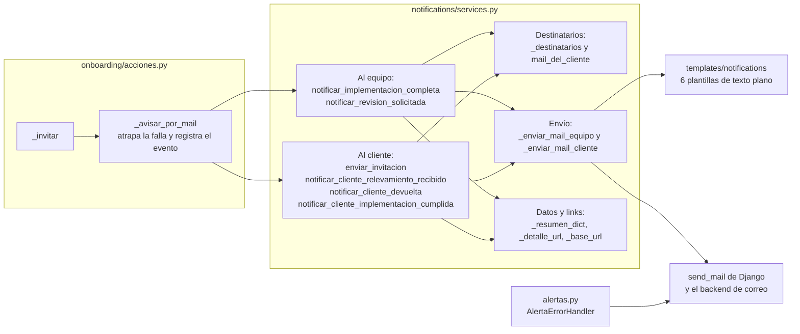

Qué necesita `notifications` de afuera: solo lee datos de la implementación y de lo que cuelga de ella (el cliente y su cuenta, los catálogos activos, las sucursales, los roles y la nómina vía `implementacion.empleados`). La única dependencia de código es `notificar_cliente_devuelta`, que importa `CODIGO_DE_PASO` y `TITULOS_PASO` de `onboarding.services` **dentro de la función**, no arriba del archivo.

### 2.3 Qué hay en cada archivo

#### `notifications/services.py`

| Función, clase o modelo | Qué hace | Quién la usa |
|---|---|---|
| `_resumen_dict(implementacion)` | Arma el diccionario con el resumen de lo relevado (variables de la [2.4.2](#242-variables-de-cada-plantilla)): empresa, contacto, módulos, liquidaciones, licencias, novedades y documentos activos, cantidades de empleados y sucursales, y roles. | `notificar_implementacion_completa`. Un test lo llama directo. |
| `_destinatarios(implementacion)` | Lista de destinatarios del equipo: la lista fija más el implementador asignado, sin repetidos. Ver [2.5](#25-cómo-se-decide-el-destinatario). | Los dos mails al equipo. |
| `_base_url(base_url=None)` | La URL pública del portal: la que llegó (sin barra final) o, si no, `settings.SITE_BASE_URL`. | `_detalle_url` y los mails al cliente. |
| `_detalle_url(implementacion, base_url=None)` | Link a la ficha de la implementación en el panel (`dashboard:implementacion_detalle`). Si armar la ruta falla, devuelve `settings.SITE_BASE_URL`. | Los dos mails al equipo. |
| `_enviar_mail_equipo(asunto, template, contexto, destinatarios)` | Renderiza la plantilla y manda el mail con `send_mail(..., fail_silently=False)`. Sin destinatarios, no manda nada: deja un `logger.warning` y devuelve lista vacía. Devuelve los destinatarios. | Los dos mails al equipo. |
| `notificar_implementacion_completa(implementacion, base_url=None)` | **Resumen al equipo** cuando el cliente envía su relevamiento. | `acciones.enviar_relevamiento` (tipo `equipo_resumen`). |
| `notificar_revision_solicitada(implementacion, base_url=None)` | **Pedido de contacto**: el cliente pidió que lo contacten. | `acciones.pedir_revision` (tipo `equipo_revision_solicitada`). |
| `mail_del_cliente(implementacion)` | A dónde escribirle al cliente: `mail_contacto` de la implementación o, si no hay, el mail de su cuenta. Vacío si no hay ninguno. Ver [2.5](#25-cómo-se-decide-el-destinatario). | Los mails «recibido», «devuelta» y «cumplida». |
| `_enviar_mail_cliente(asunto, template, contexto, destinatario)` | Renderiza y manda el mail al cliente. Sin destinatario, deja un `logger.info` y devuelve `None` (no es un error). Devuelve a quién se lo mandó. | Los cuatro mails al cliente. |
| `enviar_invitacion(usuario, base_url=None)` | **Invitación**: manda al cliente un link para crear o cambiar su contraseña. El link vence en `PASSWORD_RESET_TIMEOUT` segundos y se anula al usarse. No toca la contraseña actual. | `acciones._invitar`. |
| `notificar_cliente_relevamiento_recibido(implementacion, base_url=None)` | **«Recibimos tu información»**: confirma al cliente que Napsis recibió su relevamiento. | `acciones.enviar_relevamiento` (tipo `cliente_recibido`). |
| `notificar_cliente_devuelta(implementacion, ronda, base_url=None)` | **Devolución**: le cuenta al cliente qué tiene que corregir (el motivo y el detalle por sección de la ronda). | `acciones.devolver_al_cliente` (y `observar_firma`, que termina ahí). Tipo `cliente_devuelta`. |
| `notificar_cliente_implementacion_cumplida(implementacion, base_url=None)` | **«Tu implementación está lista»**. | `acciones.marcar_cumplida` (tipo `cliente_cumplida`). |

Las funciones públicas devuelven a quién se lo mandaron (lista, o un solo mail) o vacío si no se mandó: `onboarding/acciones.py::_avisar_por_mail` usa ese valor para decidir si registra `mail.enviado`.

#### `notifications/alertas.py`

| Función, clase o modelo | Qué hace | Quién la usa |
|---|---|---|
| `INTERVALO_SEGUNDOS` | `600` (10 minutos): cada cuánto puede repetirse el aviso de un mismo error. | `AlertaErrorHandler._avisar`. |
| `AlertaErrorHandler` | `logging.Handler` que manda un mail cuando Django registra un error 500. Ver [2.8](#28-la-alerta-de-errores-500). | `config/settings.py` (handler `alerta_mail`, colgado del logger `django.request`). |
| `AlertaErrorHandler.emit(record)` | Punto de entrada que llama el sistema de logging. Atrapa cualquier excepción de `_avisar`: un problema avisando nunca empeora el error original (solo deja un `logger.warning`). | El sistema de logging de Python. |
| `AlertaErrorHandler._avisar(record)` | Decide si corresponde avisar, arma el cuerpo y manda el mail. Los imports de Django están adentro de la función: el logging se configura al arrancar, antes de que las apps estén cargadas. | `emit`. |

#### Plantillas, apps y vacíos

| Archivo | Qué hay | Quién lo usa |
|---|---|---|
| `templates/notifications/mail_resumen.txt` | Cuerpo del resumen al equipo. | `notificar_implementacion_completa`. |
| `templates/notifications/mail_revision_solicitada.txt` | Cuerpo del pedido de contacto. | `notificar_revision_solicitada`. |
| `templates/notifications/mail_invitacion.txt` | Cuerpo de la invitación. | `enviar_invitacion`. |
| `templates/notifications/mail_cliente_recibido.txt` | Cuerpo de «Recibimos tu información». | `notificar_cliente_relevamiento_recibido`. |
| `templates/notifications/mail_cliente_devuelta.txt` | Cuerpo de la devolución. | `notificar_cliente_devuelta`. |
| `templates/notifications/mail_cliente_cumplida.txt` | Cuerpo de «Tu implementación está lista». | `notificar_cliente_implementacion_cumplida`. |
| `apps.py` → `NotificationsConfig` | Solo el nombre de la app, sin lógica. | Django. |
| `models.py`, `views.py`, `admin.py` | Vacíos. | — |
| `tests/` | Ver [2.11](#211-tests-que-sirven-de-ejemplo). | |

**Las seis plantillas son texto plano** y empiezan con ``: sin eso, Django convertiría un `&` en `&amp;` o un apóstrofo en `&#x27;` (HTML), y en un mail de texto se vería roto. Un test lo verifica (`MailsEnTextoPlanoTests`). Todas terminan en ``.

### 2.4 Los mails

#### 2.4.1 Cuál es cuál

| Mail | Función | A quién va | Cuándo sale | Asunto | Plantilla | Tipo en el evento |
|---|---|---|---|---|---|---|
| **Resumen al equipo** | `notificar_implementacion_completa` | El equipo: `IMPLEMENTATION_TEAM_EMAILS` más el implementador asignado | Cuando el cliente envía el relevamiento (paso 10), después de guardar el envío | `Nueva implementación completada: <nombre del cliente>` | `mail_resumen.txt` | `equipo_resumen` |
| **Pedido de contacto** | `notificar_revision_solicitada` | El equipo (igual que arriba) | Cuando el cliente, desde la vista de solo lectura, aprieta «Pedir que me contacten» | `Pedido de contacto: <nombre del cliente>` | `mail_revision_solicitada.txt` | `equipo_revision_solicitada` |
| **Invitación** | `enviar_invitacion` | El mail de la cuenta del cliente (`usuario.email`) | Al dar de alta una implementación cuando el cliente todavía no tiene cuenta y se carga su mail (`crear_implementacion`), al crear un acceso nuevo con mail (`entregar_acceso`) y al reenviarla desde la ficha (`invitar_cliente`) | `Tu acceso al Portal de Implementación de Napsis` | `mail_invitacion.txt` | `invitacion` |
| **Recibimos tu información** | `notificar_cliente_relevamiento_recibido` | El cliente (`mail_del_cliente`) | Cuando envía el relevamiento, junto con el resumen al equipo | `Recibimos tu información` | `mail_cliente_recibido.txt` | `cliente_recibido` |
| **Devolución** | `notificar_cliente_devuelta` | El cliente (`mail_del_cliente`) | Cuando el equipo devuelve el relevamiento (`devolver_al_cliente`) o observa la firma (`observar_firma`, que termina en la misma devolución) | `Necesitamos que revises algunos datos de tu implementación` | `mail_cliente_devuelta.txt` | `cliente_devuelta` |
| **Implementación lista** | `notificar_cliente_implementacion_cumplida` | El cliente (`mail_del_cliente`) | Cuando el equipo marca la implementación como cumplida (`marcar_cumplida`) | `Tu implementación está lista` | `mail_cliente_cumplida.txt` | `cliente_cumplida` |
| **Alerta de error 500** | `AlertaErrorHandler` | `ERROR_ALERT_EMAILS` | Cuando la app tiene un error 500 (ver [2.8](#28-la-alerta-de-errores-500)) | `[Portal Napsis] Error 500: <Tipo> en <MÉTODO ruta>` | Ninguna: el cuerpo se arma en el código | No registra evento |

Las demás acciones (validar, anular, reabrir, reasignar, comentar...) **no mandan mail**. El remitente de todos es `DEFAULT_FROM_EMAIL`.

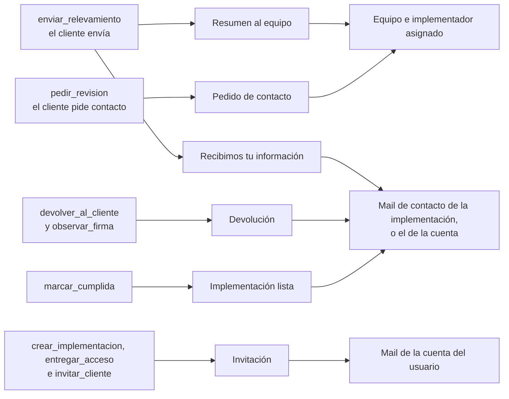

#### 2.4.2 Variables de cada plantilla

**Mails al equipo.** Todos los valores salen de la implementación (`implementacion`) y de su cliente. `_resumen_dict` arma más variables de las que la plantilla usa (`nombre` e `implementador`), y la función las pasa igual al contexto.

| Variable | De dónde sale | Resumen | Pedido de contacto |
|---|---|---|---|
| `razon_social` | `cliente.razon_social`, o `cliente.nombre` si está vacía | Sí | Sí |
| `nombre` | `cliente.nombre` | No la usa la plantilla | — |
| `cuits` | `cliente.cuits` | Sí | — |
| `implementador` | `implementacion.asignado_nombre` (nombre completo o usuario del asignado; vacío si no hay) | No la usa la plantilla | — |
| `mail_contacto`, `telefono` | `implementacion.mail_contacto`, `implementacion.telefono` | Sí | — |
| `modulos` | Nombres de los módulos activos, separados por coma | Sí | — |
| `liquidaciones` | Nombres de los tipos de liquidación activos (ordenados por su orden y nombre). Si está vacío, la plantilla muestra «-» | Sí | — |
| `licencias`, `novedades`, `documentos_legajo` | Nombres de los activos, separados por coma | Sí | — |
| `cantidad_empleados`, `cantidad_sucursales` | Cantidad de empleados y de sucursales de la implementación | Sí | — |
| `roles` | `<Rol>: <Apellido y Nombre>` de cada persona con rol, separados por coma | Sí | — |
| `mensaje` | `implementacion.revision_mensaje`. Si está vacío, la plantilla muestra «(sin mensaje adicional)» | — | Sí |
| `detalle_url` | Link a la ficha en el panel (`dashboard:implementacion_detalle`) | Sí | Sí |

**Mails al cliente.**

| Variable | De dónde sale | Invitación | Recibido | Devolución | Lista |
|---|---|---|---|---|---|
| `usuario` | La cuenta (`User`); la plantilla muestra `usuario.username` | Sí | — | — | — |
| `link` | Ver la tabla de links de abajo | Sí | Sí | Sí | Sí |
| `login_url` | URL base más la ruta `login` | Sí | — | — | — |
| `dias` | `PASSWORD_RESET_TIMEOUT // 86400`: días de validez del link (hoy 7) | Sí | — | — | — |
| `razon_social` | `cliente.razon_social`, o `cliente.nombre` si está vacía | — | Sí | Sí | Sí |
| `implementador` | `implementacion.asignado_nombre`. Si está vacío, la plantilla omite la frase | — | Sí | Sí | Sí |
| `motivo` | `ronda.motivo` | — | — | Sí | — |
| `observaciones` | Lista de pares `(título del paso, texto)` armada con `ronda.observaciones`. El título sale de `TITULOS_PASO` según `CODIGO_DE_PASO`; si el código no se conoce, se muestra el código | — | — | Sí | — |

| Mail | Qué es `link` |
|---|---|
| Invitación | URL base más la ruta `clave_confirmar`, con el id de la cuenta codificado (`urlsafe_base64_encode`) y un token de `default_token_generator` (un código que Django genera para esa cuenta y que deja de valer cuando se usa o vence). Lleva a crear la contraseña. |
| Recibimos tu información | URL base más la ruta `login`. |
| Devolución | URL base más `implementacion.get_absolute_url()` (el paso 1 del wizard de esa implementación). |
| Implementación lista | URL base más la ruta `login`. |

La **URL base** sale de `_base_url`: el `base_url` que reciben las acciones (las vistas pasan `request.build_absolute_uri("/")`) o, si no hay pedido web (una API o un agente), `settings.SITE_BASE_URL`.

### 2.5 Cómo se decide el destinatario

**Al equipo** (`_destinatarios`): la lista fija `IMPLEMENTATION_TEAM_EMAILS` más el implementador asignado.

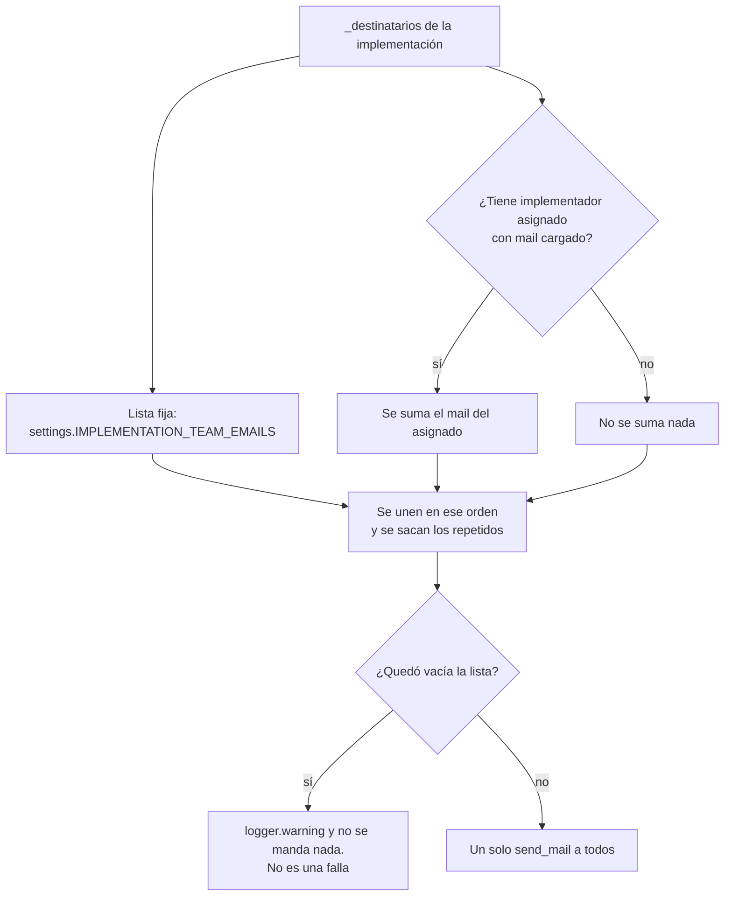

- Es **un solo mail** con todos los destinatarios: cada uno ve a los demás.
- Un asignado sin mail no rompe nada: simplemente no se suma.
- `IMPLEMENTATION_TEAM_EMAILS` se arma en `config/settings.py` separando por comas, **sin recortar espacios**: se escribe sin espacios después de la coma.

**Al cliente** (`mail_del_cliente`): el mail de contacto de la implementación o, si no hay, el de la cuenta con la que entra.

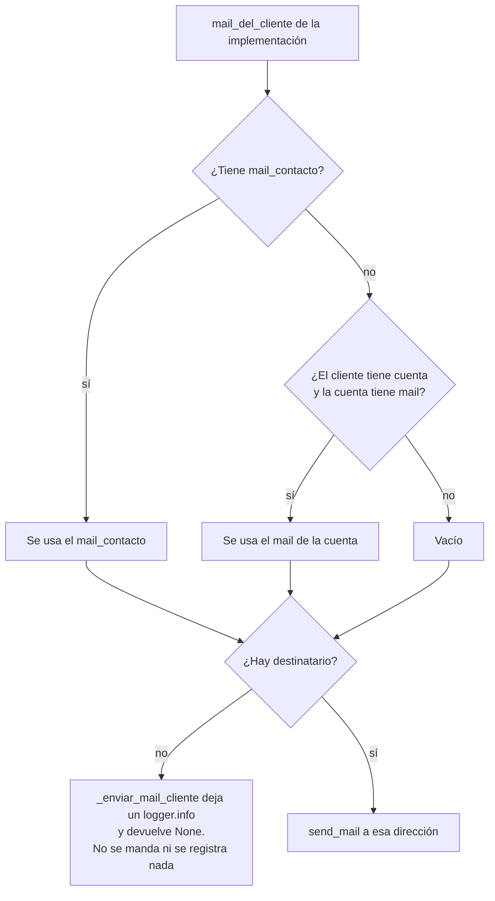

La **invitación** es la excepción: no usa `mail_del_cliente`, va directo al mail de la cuenta (`usuario.email`). Antes de pedirla, `invitar_cliente` completa ese mail con el de contacto de la implementación si la cuenta no tenía, y avisa con un error si no hay ninguno.

### 2.6 El contrato: un mail que falla no rompe la operación

Un mail es un efecto lateral: si el servidor de correo está caído, no puede deshacer un envío de relevamiento, una devolución o un alta que ya se hicieron. Eso se garantiza en **tres lugares** que trabajan juntos:

1. **`notifications/services.py` no atrapa nada.** Manda con `send_mail(..., fail_silently=False)`, así que cualquier falla (SMTP caído, dirección rechazada) sale como excepción. No decide qué hacer con ella.
2. **Las acciones mandan los mails *después* de la transacción.** En `enviar_relevamiento`, `devolver_al_cliente`, `marcar_cumplida`, `pedir_revision` y `crear_implementacion`, el cambio y su evento se guardan primero (bloque `transaction.atomic`) y recién después se avisa. Un mail que falla no puede deshacer lo ya hecho.
3. **`_avisar_por_mail` atrapa la falla** (`onboarding/acciones.py`). Ejecuta el envío dentro de un `try`: si sale bien y hubo destinatario, registra el evento `mail.enviado` (con `tipo` y `destinatarios`); si falla, registra `mail.fallido` (con `tipo` y el **nombre de la excepción**, no su mensaje), escribe el traceback en el log con `logger.exception` y devuelve un aviso para mostrar (si la acción lo pidió).

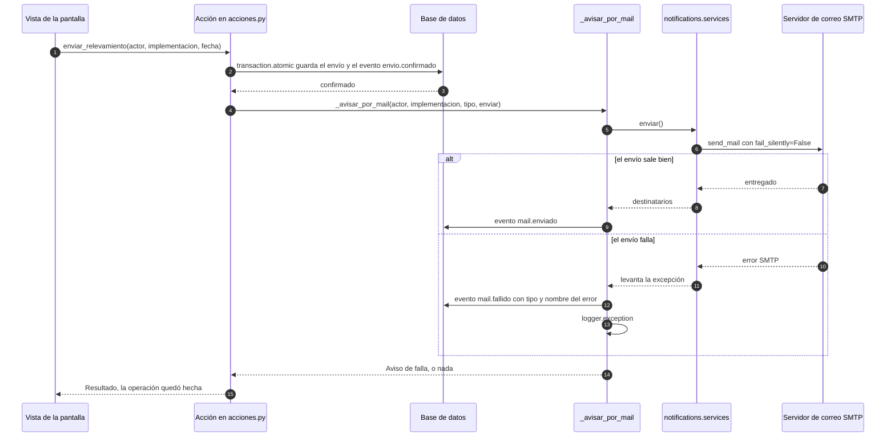

**Qué se entera la persona cuando un mail falla** (según el `descripcion_falla` que pasa cada acción):

| Mail (`tipo`) | Acción | Aviso en pantalla si falla |
|---|---|---|
| `invitacion` | `crear_implementacion`, `entregar_acceso`, `invitar_cliente` | Sí (advertencia): `No se pudo enviar el mail a <mail>. Usuario: <usuario>. Probá de nuevo desde la ficha con «Enviar mail para crear contraseña».` |
| `cliente_devuelta` | `devolver_al_cliente` | Sí: `Quedó devuelta, pero no se pudo avisarle al cliente por mail.` |
| `cliente_cumplida` | `marcar_cumplida` | Sí: `Quedó cumplida, pero no se pudo avisarle al cliente por mail.` |
| `equipo_resumen` y `cliente_recibido` | `enviar_relevamiento` | No. El cliente ve su envío confirmado; queda solo el evento y el log. |
| `equipo_revision_solicitada` | `pedir_revision` | No. El cliente igual ve `Le avisamos al equipo de Napsis que necesitás que te contacten.` |

Más reglas del contrato:

- **Sin destinatario no es una falla.** Si no hay a quién escribirle (equipo sin lista ni asignado, cliente sin mail), el envío se omite, queda un log y no se registra ningún evento.
- **Hay un tope de espera.** `EMAIL_TIMEOUT` (10 segundos por defecto) evita que un SMTP que no responde deje colgado el proceso de la web (el comentario de `config/settings.py` habla del worker de gunicorn). El envío es síncrono: se hace dentro del pedido web, no en una cola.
- **Dónde mirar.** En los eventos de la implementación (`mail.enviado`, `mail.fallido`) y en el log de errores de la app (`logs/errores.log`, ver el README).
- Los tests de cada caso hacen `patch` de la función de `notificaciones` con `side_effect=OSError` y verifican que la operación quedó hecha (ver [2.11](#211-tests-que-sirven-de-ejemplo)).

### 2.7 Configuración que usa

| Variable (en `config/settings.py`) | Para qué | Valor por defecto |
|---|---|---|
| `IMPLEMENTATION_TEAM_EMAILS` | Equipo que recibe los mails al equipo (lista separada por comas, de la variable de entorno del mismo nombre). | Vacía. |
| `DEFAULT_FROM_EMAIL` | Remitente de todos los mails. | `portal@napsislatam.com` |
| `SITE_BASE_URL` | URL base para los links cuando no hay un pedido web. | `http://localhost:8000` |
| `EMAIL_BACKEND` | Cómo se entrega el mail. | El backend de consola (los mails se ven en la terminal). |
| `EMAIL_HOST`, `EMAIL_PORT`, `EMAIL_HOST_USER`, `EMAIL_HOST_PASSWORD`, `EMAIL_USE_TLS`, `EMAIL_USE_SSL` | El servidor SMTP. En producción van en `.env.mail` (ver `deploy/CORREO.md`). | Puerto 587, TLS sí, SSL no. |
| `EMAIL_TIMEOUT` | Segundos de espera al servidor SMTP. | 10 |
| `PASSWORD_RESET_TIMEOUT` | Validez del link de la invitación, en segundos. | 7 días |
| `ERROR_ALERT_EMAILS` | Quién recibe la alerta de errores 500. | Vacía: la alerta está apagada. |

### 2.8 La alerta de errores 500

`AlertaErrorHandler` está colgado del logger `django.request` (en `LOGGING` de `config/settings.py`, handler `alerta_mail`, nivel `ERROR`). Django escribe ahí cada error interno. Dos cuidados:

- **Un mail por tipo de error cada 10 minutos.** Si algo se rompe (por ejemplo la base caída), cada pedido daría un 500: sin tope serían cientos de mails y cada uno haría esperar al usuario por el SMTP.
- **Sin datos del pedido.** Incluye el error y dónde ocurrió, pero no el cuerpo del POST (que puede tener datos personales de la nómina o contraseñas). Del pedido solo van el método, la ruta y el nombre del usuario.

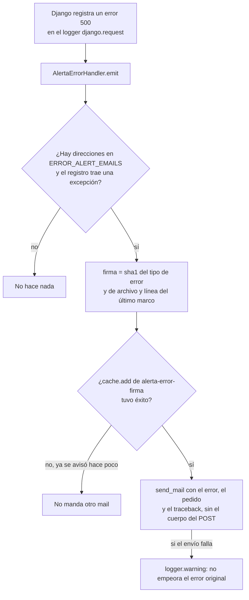

La clave de la caché es `alerta-error-<firma>` y dura `INTERVALO_SEGUNDOS`. Con `ERROR_ALERT_EMAILS` vacía no hace nada.

### 2.9 Lo que no pasa por `notifications`

El mail de **«Olvidé mi contraseña»** lo manda Django mismo, desde `clients/views.py` (`RecuperarClaveView`, con `RecuperarClaveForm` de `clients/forms.py`) y sus plantillas `clave/mail_recuperar.txt` y `clave/mail_recuperar_asunto.txt`. No usa `notifications/services.py` ni registra eventos. Comparte con la invitación el mismo link de creación de contraseña (la ruta `clave_confirmar`), que sirve para crearla o para cambiarla.

### 2.10 Cómo agregar un mail nuevo

1. Crear la plantilla `.txt` en `templates/notifications/`, entre `` y ``.
2. Agregar en `notifications/services.py` una función que arme el contexto y llame a `_enviar_mail_equipo` o `_enviar_mail_cliente`, y que **devuelva a quién se lo mandó**.
3. Llamarla desde la acción correspondiente de `onboarding/acciones.py` **después** de la transacción y **a través de `_avisar_por_mail`**, con un `tipo` nuevo (y un `descripcion_falla` si la persona tiene que enterarse).
4. Escribir el test: con `patch` de la función de `notificaciones` y `side_effect=OSError`, la operación tiene que quedar hecha y tiene que haber un evento `mail.fallido`.
5. Actualizar las tablas de [2.4.1](#241-cuál-es-cuál) y de [2.6](#26-el-contrato-un-mail-que-falla-no-rompe-la-operación), y las de `flujos-de-negocio.md` si cambia una regla.

### 2.11 Tests que sirven de ejemplo

Los tests de la app están en `notifications/tests/` (módulos sueltos). Los de las acciones que mandan mails, en `onboarding/tests/`.

| Archivo → clase | Muestra cómo se usa |
|---|---|
| `notifications/tests/test_services.py` → `NotificarImplementacionCompletaTests` | El resumen al equipo, y que sin destinatarios no manda nada y deja un warning. |
| `test_services.py` → `NotificarRevisionSolicitadaTests` | El pedido de contacto. |
| `test_services.py` → `DestinatariosConImplementadorAsignadoTests` | El equipo más el asignado, sin repetir y con un asignado sin mail. |
| `notifications/tests/test_mails_al_cliente.py` → `InvitacionAlCrearTests` | La invitación al dar de alta: el link crea la contraseña, se usa una sola vez, y si el envío falla igual se crea y se avisa. |
| `test_mails_al_cliente.py` → `ReenvioDesdeLaFichaTests` | Reenviar la invitación (no cambia la contraseña actual). |
| `test_mails_al_cliente.py` → `RecuperarContrasenaTests` | «Olvidé mi contraseña» (el caso de la [2.9](#29-lo-que-no-pasa-por-notifications)). |
| `test_mails_al_cliente.py` → `ConfirmacionesAlClienteTests` | «Recibimos tu información», y que si falla el cliente igual queda enviado. |
| `test_mails_al_cliente.py` → `AvisoDeImplementacionCumplidaTests` | «Tu implementación está lista» (mail de contacto o de la cuenta; si falla, queda cumplida). |
| `test_mails_al_cliente.py` → `MailsEnTextoPlanoTests` | Que no salgan entidades HTML. |
| `notifications/tests/test_alertas.py` → `AlertaDeErrorPorMailTests`, `ConfiguracionDeLaAlertaTests` | La alerta: un mail por tipo de error cada 10 minutos, sin los datos del pedido, y conectada al logger. |
| `onboarding/tests/acciones/test_envio.py`, `test_crear.py`, `test_estado.py` y `onboarding/tests/revision/test_devolver.py` | Los eventos `mail.enviado` y `mail.fallido` y que la operación sobreviva a un mail caído. |
