# La app `onboarding`

**Propósito.** `onboarding` es la app del cliente y de todo lo que se puede *hacer* con una implementación: el wizard (el formulario por pasos que el cliente completa con un link propio; a cada implementación le aplican solo los pasos de sus módulos contratados), los servicios que guardan cada sección del relevamiento y controlan qué falta, y las acciones (crear, enviar, validar, devolver, cumplir). Las pantallas del cliente (`onboarding/views.py`) y del equipo (`dashboard/views.py`) llaman al mismo código, que no conoce el pedido web (`request`): las acciones reciben un *actor* —quién lo hace— y devuelven un *resultado*; los servicios de guardado reciben el actor (para el evento y el historial) y devuelven lo que corresponda a cada uno. El panorama de todo el portal está en [`../arquitectura.md`](../arquitectura.md); esta página baja al detalle de cada archivo. Los diagramas son [Mermaid](https://mermaid.js.org/): GitHub los dibuja directamente.

Índice: [Vocabulario](#vocabulario) · [1. Componentes](#1-componentes-de-la-app) · [2. Mapa del wizard](#2-mapa-del-wizard-urls-pasos-y-vistas) · [3. views.py](#3-viewspy) · [4. acciones.py](#4-accionespy) · [5. forms.py](#5-formspy) · [6. services/](#6-services-el-paquete-de-servicios) (módulos: [pasos](#servicespasospy), [fechas](#servicesfechaspy), [faltantes](#servicesfaltantespy), [secciones](#servicesseccionespy), [roles](#servicesrolespy), [firma](#servicesfirmapy), [nomina](#servicesnominapy)) · [7. urls.py](#7-urlspy) · [8. templatetags](#8-templatetagspasospy) · [9. Templates](#9-templates-templatesonboarding) · [10. Dependencias](#10-dependencias-hacia-otras-apps) · [11. Cómo agregar un paso o una acción](#11-cómo-agregar-un-paso-o-una-acción)

---

## Vocabulario

Los términos de Django y del proyecto que aparecen en esta página, en una línea cada uno.

| Término | Qué es |
|---|---|
| **Wizard** | Formulario partido en pasos numerados; el cliente lo completa con un link propio por implementación. |
| **Vista (view)** | Función de Python que recibe el pedido web y devuelve la respuesta: una página, una redirección o un archivo. |
| **`request`** | Objeto que Django arma con el pedido del navegador: el usuario, los datos enviados (`POST`) y los archivos subidos. |
| **URLconf (`urls.py`)** | Tabla que dice qué vista atiende cada dirección. Cada línea (`path`) puede llevar un *nombre*, que sirve para generar la dirección sin escribirla a mano (`redirect`, ``). |
| **Template** | Archivo HTML con marcas de Django (`{{ dato }}`, ``) que se completa con un diccionario de datos llamado *contexto*. |
| **Template tag** | Función de Python que un template puede llamar con ``; vive en una carpeta `templatetags/` y se activa con ``. |
| **Formulario (`Form`, `ModelForm`)** | Clase que declara campos, valida lo que llegó por POST y deja los datos limpios en `cleaned_data`. El `ModelForm` además sabe guardarse en un modelo. |
| **Formset** | Varios formularios iguales (filas) que se validan juntos; por ejemplo, las filas de sucursales. |
| **Mixin** | Clase que no se usa sola: se mezcla con otras para sumarles comportamiento. |
| **Modelo** | Clase que representa una tabla de la base de datos (por ejemplo `Implementacion`). |
| **`transaction.atomic`** | Bloque en el que o se guarda todo o no se guarda nada. |
| **Context manager (`with`)** | Bloque que prepara algo antes y lo cierra después; acá, `cambio_de_seccion`. |
| **`messages`** | Sistema de Django para mostrar un aviso (éxito, error) una sola vez, en la página siguiente. |
| **`bulk_create` / `bulk_update`** | Insertar o actualizar muchas filas con pocas consultas a la base. |
| **Actor** | Quién hace la acción: cliente, implementador, admin, sistema… (`automatizacion/actores.py`). |
| **Resultado** | Lo que devuelve una acción: errores, avisos y la implementación (`acciones.Resultado`). |
| **Evento** | Registro de «quién hizo qué» (`EventoImplementacion`); solo se agrega, nunca se modifica. |
| **Sección** | Bloque del relevamiento que tiene su propia foto en el historial, identificado con un texto como `"roles"` o `"sucursales"`. |
| **Versión (historial)** | Foto de una sección tomada *antes* de cambiarla (`ImplementacionVersion`), para que las personas la consulten. |
| **Validación vigente / revocar** | La implementación está validada mientras `validada_en` tenga fecha. *Revocar* la deja en `None` porque alguien cambió algo después. |
| **Ronda** | Una devolución numerada del equipo al cliente (`RondaRevision`). |
| **Token** | Texto secreto de cada implementación: es la parte `<token>` del link `/r/<token>/`. |
| **`base_url`** | La dirección pública del portal. Llega como parámetro porque las acciones no tienen `request` para averiguarla. |

---

## 1. Componentes de la app

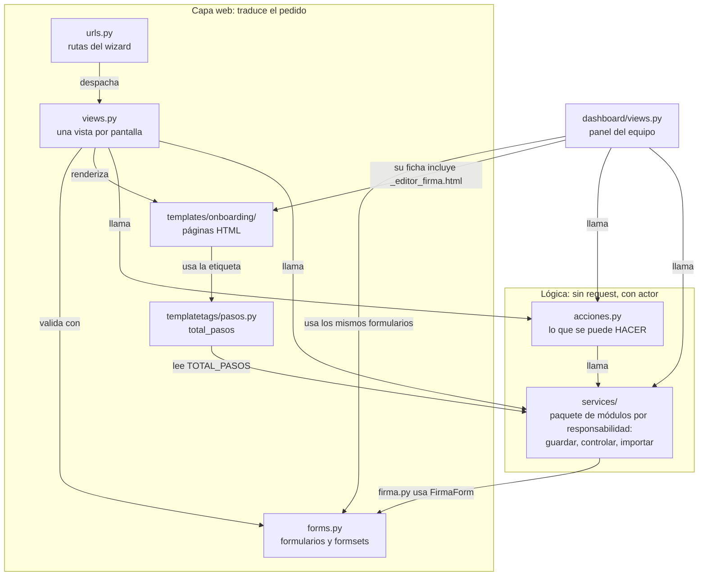

Cómo leerlo:

- **El wizard del cliente** es `urls.py` → `views.py` → (`forms.py`, `acciones.py`, `services/`) → un template. La vista traduce; no decide reglas de negocio.
- **El panel del equipo** (`dashboard/views.py`) no pasa por `onboarding/views.py`: llama directo a `acciones.py` y a `services/`, con los mismos formularios. Por eso un cambio en una regla de guardado vale para el cliente y para el equipo a la vez.
- **`acciones.py` y `services/` no importan nada de la capa web** (ni `views.py`, ni templates). La única excepción de import es `services/firma.py`, que usa `FirmaForm` de `forms.py` (y `forms.py` no importa `services/`, así que no hay ciclo). El `request` aparece en un solo lugar: `Resultado.mostrar(request)`, que usan las pantallas para mostrar los avisos.
- Los demás módulos de `services/` no se ven acá: están en la [sección 6](#6-services-el-paquete-de-servicios).

---

## 2. Mapa del wizard: URLs, pasos y vistas

Las URLs viven bajo `/r/` (`config/urls.py`: `path("r/", include("onboarding.urls"))`). El wizard tiene **una sola vista para todos los pasos** (`wizard_step`), que despacha a una función por paso a través del diccionario `_HANDLERS`.

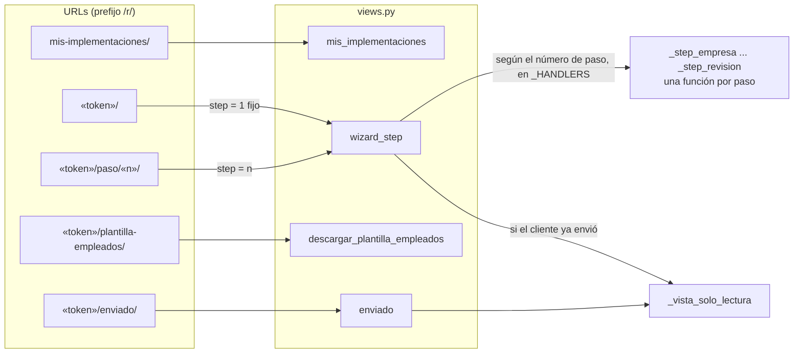

**Qué decide `wizard_step` antes de llegar al paso.** Cada pedido pasa por estos controles, en este orden:

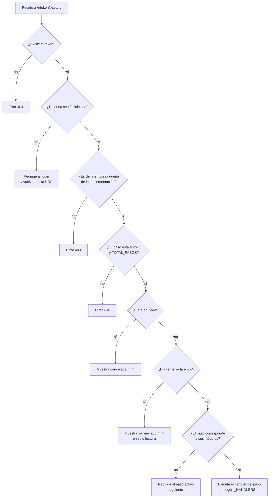

**Los pasos, en orden.** Los números y los textos se definen una sola vez, en `services/pasos.py`. Un paso condicional aparece solo si el cliente contrató alguno de los módulos indicados (se mira el `codigo` del módulo, no su nombre).

| Paso y constante | Título | Aparece con | Vista (handler) | Template |
|---|---|---|---|---|
| 1 `PASO_DATOS` | Datos de contacto | siempre | `_step_empresa` | `step_empresa.html` |
| 2 `PASO_MODULOS` | Módulos contratados | siempre | `_step_modulos` | `step_modulos.html` |
| 3 `PASO_SUCURSALES` | Sucursales | Fichada | `_step_sucursales` | `step_sucursales.html` |
| 4 `PASO_NOMINA` | Carga de empleados | siempre | `_step_empleados` | `step_empleados.html` |
| 5 `PASO_ROLES` | Apoderado/s, Liquidador y Admin. de RRHH | Recibo Digital o Legajos | `_step_roles` | `step_roles.html` |
| 6 `PASO_CONFIGURACION` | Configuración y adjuntos | Recibo Digital | `_step_configuracion` | `step_configuracion.html` |
| 7 `PASO_FIRMA` | Firma del recibo | Recibo Digital | `_step_firma` | `step_firma.html` (incluye `_editor_firma.html`) |
| 8 `PASO_LICENCIAS` | Licencias y Novedades | Novedades | `_step_licencias_novedades` | `step_licencias_novedades.html` |
| 9 `PASO_DOCUMENTOS` | Documentos de Legajo Digital | Legajos | `_step_documentos` | `step_documentos.html` |
| 10 `PASO_REVISION` | Revisión y envío | siempre | `_step_revision` | `step_revision.html` |

**Qué hace cada handler al guardar.**

| Vista | Formulario | Guarda con | Si el formulario no valida |
|---|---|---|---|
| `_step_empresa` | `EmpresaForm` | `services.guardar_datos_contacto` | registra `validacion.fallida` |
| `_step_modulos` | `ModulosForm` | `services.guardar_modulos`; si el equipo fijó los módulos (`modulos_editables_por_cliente` en falso) no guarda nada y avanza | no registra |
| `_step_sucursales` | `SucursalFormSet` | `services.guardar_sucursales` | registra |
| `_step_empleados` | `EmpleadoForm` e `ImportarArchivoForm` (de `employees/forms.py`) | `importar_archivo_empleados`, `agregar_empleado`, `editar_empleado`, `eliminar_empleado` | registra al agregar y al editar; si el archivo no se puede leer registra el motivo; si el formulario del archivo no valida, no registra |
| `_step_roles` | `rol_formset_obligatorio(...)` | `services.guardar_roles` | registra |
| `_step_configuracion` | `ConfiguracionForm` | `guardar_datos_contacto` y `guardar_liquidaciones` | registra |
| `_step_firma` | `FirmaForm` | `services.guardar_firma` (sin modelo de recibo subido no muestra el formulario) | registra |
| `_step_licencias_novedades` | `LicenciasNovedadesForm` | `services.guardar_licencias_y_novedades` | no registra |
| `_step_documentos` | `DocumentosLegajoForm` | `services.guardar_documentos` | no registra |
| `_step_revision` | `FechaImplementacionForm` | `acciones.enviar_relevamiento`, solo si no hay pendientes | registra, con la lista de pendientes o con los errores de la fecha |

**Cómo avanza el cliente.** Después de guardar bien, `_redirect_next` calcula el siguiente paso *activo*, sube `paso_actual` (solo si el paso es mayor) y redirige. Como el cliente puede entrar a cualquier paso activo cambiando la URL, lo que de verdad protege el envío es `pendientes_de_envio` en el paso 10, no el orden de los pasos.

Las URLs completas, con su nombre y quién las usa, están en la [sección 7](#7-urlspy).

---

## 3. `views.py`

**Responsabilidad.** Traducir el pedido web a llamadas de negocio y de vuelta a una respuesta. Cada vista arma el `Actor` desde el usuario (`_actor`), valida con un formulario, llama a un servicio o a una acción, y decide si renderiza un template o redirige. No aplica reglas de negocio; lo único que escribe por su cuenta es `paso_actual` (`_marcar_progreso`).

**Diagrama 1: entradas, control de acceso y navegación.** (`mis_implementaciones` no llama a otras capas: arma el listado con `cliente.implementaciones`.)

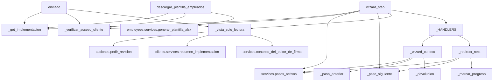

**Diagrama 2: los pasos que guardan una sección simple.**

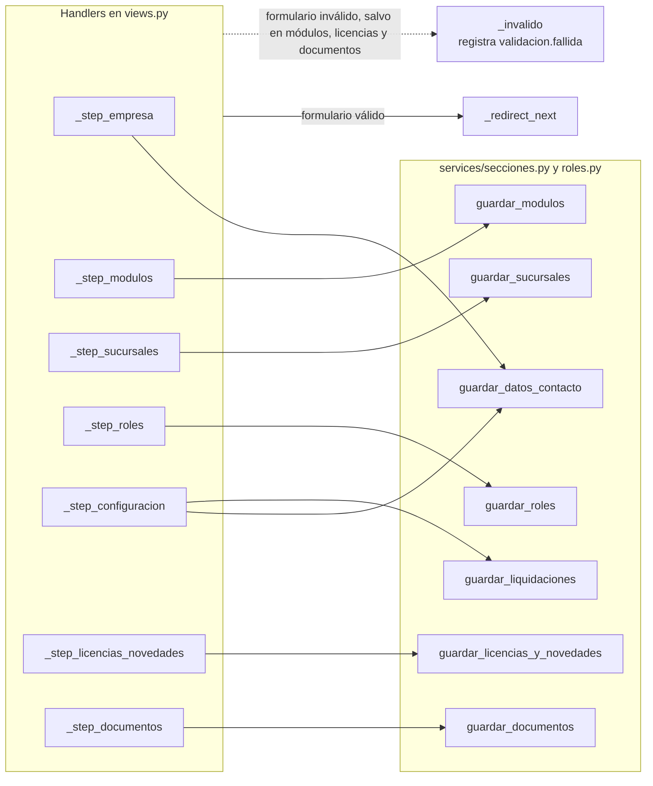

**Diagrama 3: firma, nómina y revisión.**

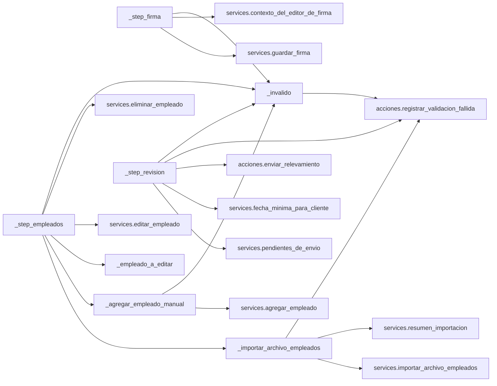

**Funciones y clases.** (En «eventos que deja» van los de los servicios y acciones que cada vista llama, incluidos los mails que mandan las acciones; ver las convenciones al principio de la [sección 6](#6-services-el-paquete-de-servicios). La marca (R) describe lo que hace el servicio, que también usa el panel: desde el wizard esa revocación no llega a darse, porque el cliente solo edita mientras el relevamiento no está enviado y una validación solo existe con el relevamiento enviado.)

| Función o clase | Qué hace | Quién la usa | Eventos que deja |
|---|---|---|---|
| `_actor(request)` | Arma el `Actor` del usuario logueado (`Actor.de_usuario`): cliente, implementador o admin. | los handlers de paso (`_step_*`), `_invalido`, `_vista_solo_lectura`, `_importar_archivo_empleados` y `_agregar_empleado_manual`. `wizard_step` y `enviado` solo la usan de forma indirecta, a través de los handlers y de `_vista_solo_lectura`; `mis_implementaciones` y `descargar_plantilla_empleados` no la usan | ninguno |
| `_errores_de(formulario)` | Resume qué falló en un formulario o formset (campo y motivo, sin los valores cargados). | `_invalido` | ninguno |
| `_invalido(request, implementacion, paso, formulario)` | Deja constancia de que el cliente no pudo guardar un paso. | los handlers de paso | `validacion.fallida` |
| `mis_implementaciones` | Lista las implementaciones de la empresa del usuario. Exige login (`login_required`); si la cuenta no tiene empresa responde 403. | URL `mis_implementaciones` (a donde `clients/views.py` manda a las cuentas de cliente tras el login; el staff va al panel) | ninguno |
| `_verificar_acceso_cliente(request, implementacion)` | Devuelve una respuesta si no hay acceso (redirect al login o 403) o `None` si el acceso es válido. | `wizard_step`, `descargar_plantilla_empleados`, `enviado` | ninguno |
| `_get_implementacion(token)` | Busca la implementación por token (con su cliente) o responde 404. | `wizard_step`, `descargar_plantilla_empleados`, `enviado` | ninguno |
| `_paso_siguiente(activos, desde)` | El próximo paso activo después de `desde`, o el último si ya era el último. | `wizard_step`, `_redirect_next` | ninguno |
| `_paso_anterior(activos, desde)` | El paso activo anterior a `desde` (`None` si es el primero). | `_wizard_context` | ninguno |
| `_marcar_progreso(implementacion, paso)` | Sube `paso_actual` si el paso es mayor al guardado; nunca lo baja. | `_redirect_next` | ninguno |
| `wizard_step(request, token, step)` | Punto de entrada de los pasos: los controles del diagrama de la sección 2 y el despacho al handler. | URLs `wizard_start` y `wizard_step` | ninguno |
| `_vista_solo_lectura(request, implementacion, recien_enviado=False)` | Pantalla `ya_enviado.html`: lo enviado, el editor de firma en solo lectura y el formulario «Pedir que me contacten», que aparece solo mientras no haya un pedido de contacto sin atender (si lo hay, la pantalla muestra un aviso fijo). Tras pedir contacto redirige al primer paso, que vuelve a mostrar esta pantalla. | `wizard_step`, `enviado` | `revision.solicitada` al pedir contacto; `mail.enviado` o `mail.fallido` (tipo `equipo_revision_solicitada`) |
| `_devolucion(implementacion, paso)` | La devolución abierta (ronda): motivo general y observación de este paso; `None` si no hay. | `_wizard_context` | ninguno |
| `_wizard_context(implementacion, step, extra=None)` | Contexto común de todos los pasos: pasos activos, título, paso anterior y devolución. Ojo: `total_pasos` en este contexto es la cantidad de pasos *activos*, no la etiqueta ``. | los handlers | ninguno |
| `_redirect_next(implementacion, step)` | Tras guardar: marca el progreso y redirige al siguiente paso activo. | los handlers | ninguno |
| `_step_empresa` | Paso 1: `EmpresaForm` (teléfono, mail, razón social y CUIT). | `_HANDLERS` | `paso.guardado` (sección `datos_contacto`) (R); `validacion.fallida` si el formulario no valida |
| `_step_modulos` | Paso 2: `ModulosForm`. Recibo Digital va marcado y no se puede sacar. Si el equipo fijó los módulos, el POST solo avanza. | `_HANDLERS` | `paso.guardado` (sección `modulos`) (R) |
| `_step_roles` | Paso 5: `rol_formset_obligatorio` con el máximo de roles de la implementación y los CUIL de la nómina; ofrece la nómina para elegir a las personas. | `_HANDLERS` | `paso.guardado` (sección `roles`) (R); `validacion.fallida` si el formulario no valida |
| `_step_configuracion` | Paso 6: `ConfiguracionForm` (tipo de firma, liquidador, nomenclatura, cápitas, segmentación, banner, logo, modelo de recibo y tipos de liquidación; lo que el equipo fijó queda bloqueado). | `_HANDLERS` | `paso.guardado` (secciones `datos_contacto` y `liquidaciones`) (R); `validacion.fallida` si el formulario no valida |
| `_step_firma` | Paso 7: `FirmaForm` y editor de firma. Sin modelo de recibo subido remite al paso 6. | `_HANDLERS` | `firma.propuesta` (siempre, con (R)); `archivo.reemplazado` solo si se sube una imagen nueva y ya había una cargada; `validacion.fallida` si el formulario no valida |
| `_step_sucursales` | Paso 3: `SucursalFormSet`. | `_HANDLERS` | `paso.guardado` (sección `sucursales`) (R); `validacion.fallida` si el formulario no valida |
| `_step_licencias_novedades` | Paso 8: `LicenciasNovedadesForm` con licencias y novedades del catálogo. | `_HANDLERS` | `paso.guardado` (sección `licencias_novedades`) (R) |
| `_step_documentos` | Paso 9: `DocumentosLegajoForm`: tipos de documento y «otros documentos» en texto libre. | `_HANDLERS` | `paso.guardado` (sección `documentos`) (R) |
| `_importar_archivo_empleados(request, implementacion)` | Acción `importar` del paso 4: valida el archivo, lo importa y muestra el resumen con `messages`. Devuelve `(import_form, errores)`. | `_step_empleados` | `nomina.importada` (R); `validacion.fallida` solo si el archivo no se puede leer (`ArchivoInvalido`: ilegible, sin columnas obligatorias o demasiado grande); si falla el formulario del archivo (extensión o tamaño máximo) no registra nada |
| `_agregar_empleado_manual(request, implementacion)` | Acción `agregar_manual` del paso 4. Devuelve el formulario a mostrar (vacío si se agregó). | `_step_empleados` | `empleado.agregado` (R); `validacion.fallida` si el formulario no valida |
| `_empleado_a_editar(implementacion, empleado_id)` | El empleado de esa implementación si el id es numérico y existe; si no, `None`. | `_step_empleados` | ninguno |
| `_step_empleados` | Paso 4: maneja las acciones POST `guardar_edicion`, `importar`, `agregar_manual`, `eliminar` y `continuar` (solo avanza si hay al menos un empleado); `?editar=<id>` abre la edición. | `_HANDLERS` | `empleado.editado`, `nomina.importada`, `empleado.agregado`, `empleado.eliminado` (R); `validacion.fallida` al editar o agregar con datos inválidos y al importar un archivo ilegible |
| `descargar_plantilla_empleados(request, token)` | Descarga `plantilla_empleados_napsis.xlsx` (planilla vacía de nómina). | URL `plantilla_empleados` | ninguno |
| `_step_revision` | Paso 10: arma el resumen, muestra los pendientes y, con `accion=enviar`, llama a `enviar_relevamiento` y redirige a `enviado`, solo si no hay pendientes y la fecha es válida; si no, registra `validacion.fallida` y vuelve a mostrar el paso. | `_HANDLERS` | `implementacion.fecha_cambiada` (si la fecha cambió), `envio.confirmado`, `mail.enviado` o `mail.fallido` por cada mail (`equipo_resumen` y `cliente_recibido`); `validacion.fallida` si hay pendientes o la fecha no valida |
| `enviado(request, token)` | Pantalla de «recién enviado»: `_vista_solo_lectura(recien_enviado=True)`. | URL `enviado` (redirect de `_step_revision`) | ninguno |
| `_HANDLERS` | Diccionario `{número de paso: handler}`. | `wizard_step` | ninguno |

**Tests de ejemplo:** `onboarding/tests/wizard/` (`test_paso_empresa.py`, `test_paso_nomina.py`, `test_paso_roles.py`, `test_paso_configuracion.py`, `test_orden.py`, `test_envio.py`, `test_acceso.py`).

---

## 4. `acciones.py`

**Responsabilidad.** Lo que se puede *hacer* con una implementación, sin saber de pantallas. Cada acción:

- recibe un **actor** y **no conoce el `request`**: si hace falta la URL pública del portal para armar un link, llega como `base_url`;
- aplica las reglas y guarda todo en **una transacción**, junto con su **evento**;
- manda los mails **después** de guardar; un mail que falla nunca deshace lo hecho: queda registrado (`mail.fallido`) y, en las acciones que lo prevén (invitación, devolución y cumplida), se suma un aviso de advertencia al resultado; en el envío del relevamiento y en el pedido de contacto la falla solo queda en el evento;
- devuelve un `Resultado` con los avisos para mostrar y, si no se pudo, lo dice de una de dos formas: las acciones de alta y acceso (`crear_implementacion`, `entregar_acceso`, `invitar_cliente`) llenan `errores`; las de revisión y comentarios del equipo (`aprobar_para_configurar`, `validar_firma`, `observar_firma`, `devolver_al_cliente`, `marcar_cumplida`, `agregar_comentario`) rechazan con un `Aviso` de nivel ERROR y dejan `errores` vacío, así que `ok` sigue siendo verdadera. Quien llame no debe depender de `ok` para saber si la acción se hizo.

El evento deja `post_envio` en verdadero solo si actúa alguien que no es el cliente y la implementación ya estaba enviada (lo calcula `eventos.registrar`). Dos acciones lo fuerzan: `devolver_al_cliente` (siempre verdadero) y `reabrir` (verdadero si ya había sido enviada: para ese momento `enviado` ya está en `None` y el cálculo automático daría falso).

**Diagrama 1: el contrato de salida.**

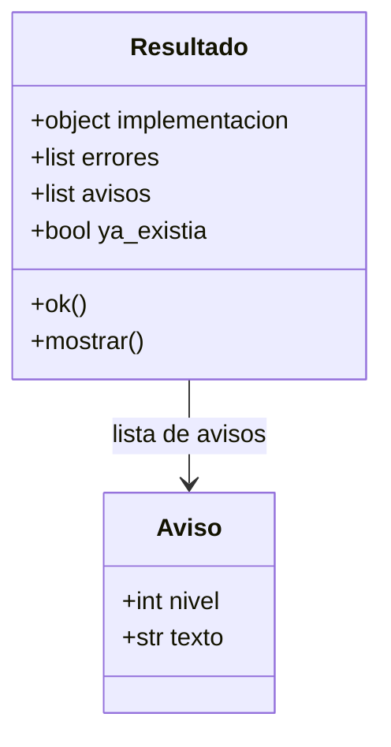

**Diagrama 2: alta y acceso del cliente, con los ayudantes.**

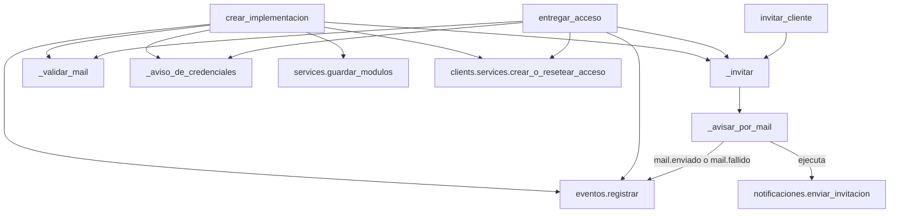

**Diagrama 3: estado y revisión por el equipo.**

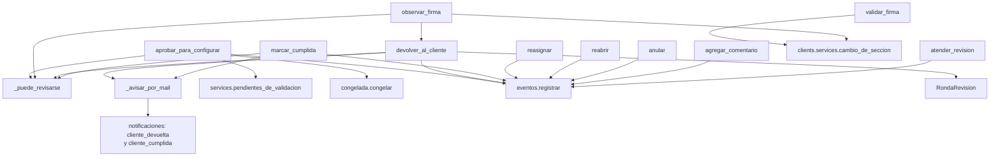

**Diagrama 4: lo que hace el cliente.**

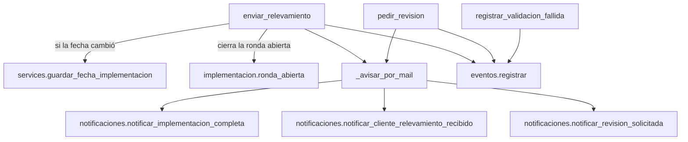

**Funciones y clases.**

| Función o clase | Qué hace | Quién la usa | Eventos que deja |
|---|---|---|---|
| `Aviso` (dataclass: `nivel`, `texto`) | Un mensaje para mostrar; `nivel` es un nivel de `django.contrib.messages`. (Una *dataclass* es una clase que solo guarda datos.) | las acciones de este archivo | ninguno |
| `Resultado` (dataclass: `implementacion`, `errores`, `avisos`, `ya_existia`) | Lo que devuelve toda acción. La propiedad `ok` es verdadera si no hay `errores`; `mostrar(request)` pasa los avisos a `messages`. Ojo: las acciones de revisión del equipo rechazan con un `Aviso` de nivel ERROR (no con `errores`), así que `ok` no alcanza para saber si se hizo la acción. | `dashboard/views.py` (`_mostrar`, `_alta_de_implementacion`) y `views._vista_solo_lectura` | ninguno |
| `_avisar_por_mail(actor, implementacion, tipo, enviar, descripcion_falla=None)` | Ejecuta `enviar()` (función sin parámetros que manda el mail y devuelve a quién). Si falla, lo loguea y devuelve un `Aviso` de advertencia con `descripcion_falla` (o `None` si no se dio: `enviar_relevamiento` y `pedir_revision` no la pasan, así que la falla solo queda en el evento). | `_invitar`, `devolver_al_cliente`, `marcar_cumplida`, `enviar_relevamiento`, `pedir_revision` | `mail.enviado` (con `tipo` y destinatarios; no si no había a quién) o `mail.fallido` (con `tipo` y nombre del error) |
| `_invitar(actor, usuario, implementacion, base_url, avisos)` | Manda el link para crear o cambiar la contraseña y suma a `avisos` el resultado: éxito, o falla con la instrucción de reenviar desde la ficha. | `crear_implementacion`, `entregar_acceso`, `invitar_cliente` | `mail.enviado` / `mail.fallido` con `tipo` `invitacion` |
| `_aviso_de_credenciales(titulo, username, password)` | Arma el `Aviso` con el usuario y la contraseña generados, que se muestran una única vez. | `crear_implementacion`, `entregar_acceso` | ninguno |
| `_validar_mail(mail)` | Devuelve el mail limpio, `""` si no vino o `None` si no es válido. | `crear_implementacion`, `entregar_acceso` | ninguno |
| `crear_implementacion(actor, *, cliente=None, datos_cliente=None, username="", mail_cliente="", implementador=None, creado_por=None, modulo_ids=(), modulos_editables=True, condiciones=None, origen=Implementacion.ORIGEN_PORTAL, id_externo=None, base_url=None)` | Crea la implementación y, si hacen falta, la empresa y la cuenta del cliente: todo o nada. Con `origen` + `id_externo` repetidos devuelve la existente (`ya_existia`) sin crear otra. Con `mail_cliente` la cuenta nace sin contraseña y se invita; sin mail se genera una contraseña que se muestra una vez. `errores` si el mail es inválido o, al crear una empresa nueva (sin `cliente`), falta su nombre o el CUIT no es válido. Solo `actor` es obligatorio. | `dashboard/views.py` (`_alta_de_implementacion`) | `implementacion.creada`; `acceso.creado` (si se creó la cuenta); `paso.guardado` (sección `modulos`); mail `invitacion` |
| `entregar_acceso(actor, cliente, username="", mail="", base_url=None, implementacion=None)` | Crea o reinicia el acceso del cliente. Con mail y cuenta nueva lo invita a crear su contraseña; si no, genera una y la muestra una vez. `implementacion` puede faltar (se llama también desde la ficha del cliente). | `dashboard/views.py` (`cliente_detalle`, `_accion_regenerar_acceso`) | `acceso.creado` (cuenta nueva) o `acceso.contrasena_reiniciada`; mail `invitacion` |
| `invitar_cliente(actor, cliente, implementacion=None, base_url=None)` | Reenvía el link de contraseña al mail de la cuenta; si no tiene, usa el de contacto de la implementación y lo guarda en la cuenta. `errores` si no hay acceso creado o no hay mail. | `dashboard/views.py` (`cliente_detalle`, `_accion_enviar_invitacion`) | mail `invitacion` |
| `reasignar(actor, implementacion, nuevo)` | Cambia el implementador asignado. | `dashboard/views.py` (`_accion_reasignar`) | `implementacion.reasignada` |
| `reabrir(actor, implementacion)` | «Regenerar el link»: vuelve a pendiente, paso 1, sin envío, sin validación y sin fechas de cancelación ni de cumplimiento. El evento guarda el estado anterior. | `dashboard/views.py` (`_accion_regenerar_link`) | `estado.reabierta` (con `post_envio` si ya había sido enviada) |
| `anular(actor, implementacion)` | Pasa a cancelada con `implementacion.anular()`. La acción no controla el estado de origen. | `dashboard/views.py` (`_accion_anular`) | `estado.cancelada` |
| `_puede_revisarse(implementacion)` | Verdadero si está pendiente y enviada: el estado en el que el equipo puede validar, devolver u observar. | `aprobar_para_configurar`, `observar_firma`, `devolver_al_cliente`, `marcar_cumplida` | ninguno |
| `aprobar_para_configurar(actor, implementacion)` | El equipo da por buena la documentación. Exige pendiente, enviada y sin validar, y `pendientes_de_validacion` vacío. En una transacción pone `validada_en`, crea la configuración congelada y registra el evento; si un archivo no se puede leer (`ArchivoNoDisponible`) no queda nada y avisa. | `dashboard/views.py` (`_accion_aprobar_para_configurar`) | `estado.validada` (con ronda, versión y huella de la congelada) |
| `validar_firma(actor, implementacion)` | Marca la firma como validada. Error si no hay firma con imagen; si ya estaba validada no hace nada. | `dashboard/views.py` (`_accion_validar_firma`) | `firma.validada` (R) |
| `observar_firma(actor, implementacion, motivos, comentario="", base_url=None)` | Marca la firma como observada con motivos del catálogo cerrado (`UbicacionFirma.MOTIVOS`; se descartan repetidos y desconocidos) y devuelve el relevamiento al cliente con `devolver_al_cliente`, con la observación del paso `firma`. Exige imagen cargada, al menos un motivo y estado pendiente y enviada. | `dashboard/views.py` (`_accion_observar_firma`) | `firma.observada` (R) y, por la devolución, `ronda.devuelta` y mail `cliente_devuelta` |
| `devolver_al_cliente(actor, implementacion, motivo, observaciones=None, base_url=None)` | Abre una ronda numerada, saca la implementación del envío y de la validación (`enviado` y `validada_en` en `None`), la manda al paso de revisión (`paso_actual = PASO_REVISION`) y avisa por mail. Exige motivo y estado pendiente y enviada. Las observaciones son `{código de paso: texto}`; se descartan las vacías y las de códigos que no existen. | `dashboard/views.py` (`_accion_devolver_al_cliente`), `observar_firma` | `ronda.devuelta` (con `post_envio` forzado); mail `cliente_devuelta` |
| `marcar_cumplida(actor, implementacion, base_url=None)` | Exige pendiente, enviada y validada. Pasa a cumplida con `implementacion.marcar_cumplida()` y avisa al cliente; si el mail falla, queda cumplida igual. | `dashboard/views.py` (`_accion_marcar_cumplida`) | `estado.cumplida`; mail `cliente_cumplida` |
| `agregar_comentario(actor, implementacion, texto, autor=None)` | Nota privada del equipo (`ComentarioInterno`). Solo actores del equipo (`actores.TIPOS_DEL_EQUIPO`), texto no vacío y de hasta `ComentarioInterno.MAX_LARGO` caracteres. | `dashboard/views.py` (`_accion_agregar_comentario`) | `comentario.agregado` (solo el id: el texto ya lo guarda el comentario) |
| `atender_revision(actor, implementacion)` | Marca atendido el pedido de contacto del cliente. | `dashboard/views.py` (`_accion_atender_revision`) | `revision.atendida` |
| `registrar_validacion_fallida(actor, implementacion, paso, errores)` | Deja constancia de lo que el cliente no pudo completar, sin los valores. | `views._invalido`, `views._importar_archivo_empleados`, `views._step_revision` | `validacion.fallida` |
| `enviar_relevamiento(actor, implementacion, fecha, base_url=None)` | El cliente envía. **No repite el control de faltantes**: quien llama tiene que haber verificado que `pendientes_de_envio` esté vacío. En una transacción guarda la fecha si cambió, pone `enviado`, cierra la ronda abierta (`respondida_en`) y registra el evento; después manda los mails al equipo y al cliente. | `views._step_revision` | `implementacion.fecha_cambiada` (si la fecha cambió), `envio.confirmado`; mails `equipo_resumen` y `cliente_recibido` |
| `pedir_revision(actor, implementacion, mensaje, base_url=None)` | El cliente pide que lo contacten (`implementacion.pedir_revision`) y se avisa al equipo por mail. | `views._vista_solo_lectura` | `revision.solicitada`; mail `equipo_revision_solicitada` |

**Tests de ejemplo:** `onboarding/tests/acciones/` (`test_crear.py`, `test_acceso.py`, `test_estado.py`, `test_envio.py`, `test_comentarios.py`, `test_validaciones_registradas.py`) y `onboarding/tests/revision/` (validar, devolver y cumplir). `onboarding/tests/base.py` tiene `BaseWizard` y `EnviadaBase` para armar una implementación completa.

---

## 5. `forms.py`

**Responsabilidad.** Declarar y validar lo que se carga en cada pantalla, tanto del wizard del cliente como de la ficha del panel (por eso varios formularios los usa `dashboard/views.py`). **Los formularios no registran eventos ni guardan secciones**: eso lo hacen los servicios y las acciones que los reciben. La única excepción es `CamposEmpresaMixin.save`, que además de la implementación guarda razón social y CUIT en el `Cliente`.

**Diagrama: herencia y mixins.** Los formularios que no aparecen heredan directo de `Form` de Django y no comparten código. `RolesObligatoriosFormSet` es, en el código, `_RolesObligatoriosFormSet` (con guion bajo inicial: es de uso interno); en el diagrama se escribe sin él.

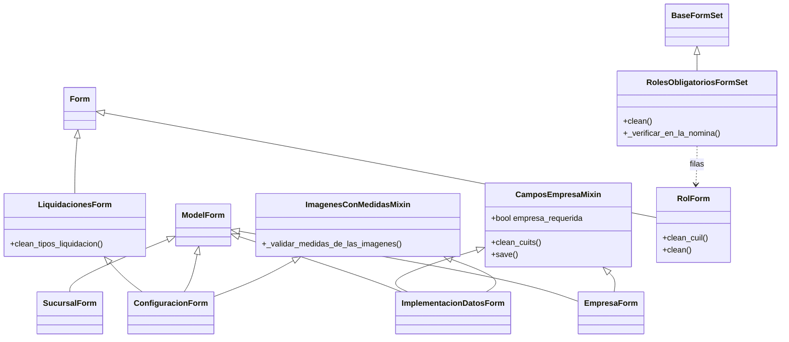

**Funciones y clases.** Todas dejan «ninguno» en la columna de eventos, salvo la aclaración de `CamposEmpresaMixin`.

| Función o clase | Qué hace | Quién la usa | Eventos que deja |
|---|---|---|---|
| `CAMPOS_DATOS_CONTACTO`, `CAMPOS_CONFIGURACION` | Listas de campos de `Implementacion` que completa el cliente (contacto; tipo de firma, liquidador, nomenclatura, cápitas, segmentación, banner, logo y modelo de recibo). Son la única fuente de verdad de los formularios que las usan. | `EmpresaForm`, `ConfiguracionForm`, `ImplementacionDatosForm` | ninguno |
| `AYUDA_BANNER`, `AYUDA_LOGO` | Textos de ayuda con las medidas aceptadas. | `ImagenesConMedidasMixin` | ninguno |
| `ImagenesConMedidasMixin` | Suma a `banner` y `logo` los validadores de medidas (`clients/validators.py`) y su ayuda. | `ConfiguracionForm`, `ImplementacionDatosForm` | ninguno |
| `CamposEmpresaMixin` | Suma los campos razón social y CUIT(s) a un formulario de `Implementacion`: viven en `Cliente`, pero se piden junto con el contacto. `empresa_requerida` dice si son obligatorios; `clean_cuits` normaliza; `save` los guarda en el `Cliente`. | `EmpresaForm`, `ImplementacionDatosForm` | ninguno (su `save` escribe en `Cliente`, sin evento) |
| `EmpresaForm` | Paso 1: teléfono, mail, razón social y CUIT, estos dos obligatorios. | `views._step_empresa` | ninguno |
| `ImplementacionDatosForm` | Edición completa de contacto y configuración, para el equipo desde la ficha. | `dashboard/views.py` | ninguno |
| `ModulosForm(modulos_qs, activos_ids, disabled)` | Un casillero por módulo. Recibo Digital va marcado y deshabilitado; con `disabled` (módulos fijados por el equipo) todos se ven pero no se pueden cambiar. | `views._step_modulos` | ninguno |
| `RolForm` | Una fila de rol: rol, apellido y nombre, CUIL (11 dígitos, se normaliza) y mail. | `RolFormSet`, `rol_formset_obligatorio` | ninguno |
| `RolFormSet` | Formset de `RolForm` (con filas extra, hoy 6, y con baja). Sin exigencias: es el del panel. | `dashboard/views.py` | ninguno |
| `_RolesObligatoriosFormSet` | Variante del wizard: exige al menos una persona por cada rol y, si se le pasan `cuils_nomina`, que el Apoderado y el Liquidador figuren en la nómina por CUIL. | `rol_formset_obligatorio` | ninguno |
| `rol_formset_obligatorio(max_roles, cuils_nomina=None)` | Arma el formset del wizard con tantas filas como `max_roles` y rechaza que se manden más. Con `cuils_nomina=None` no verifica la nómina. | `views._step_roles` | ninguno |
| `LiquidacionesForm(implementacion)` | Qué tipos de liquidación usa la empresa (al menos uno); precarga los activos. | `ConfiguracionForm` (hereda), `dashboard/views.py` | ninguno |
| `ConfiguracionForm` | Paso 6: tipo de firma, liquidador utilizado, nomenclatura, cápitas, segmentación, banner, logo, modelo de recibo (PDF, obligatorio si falta) y tipos de liquidación (heredado de `LiquidacionesForm`). No incluye las condiciones del proceso: esas son de `CondicionesForm`, un formulario aparte. Lo que el equipo fijó (`tipo_firma`, `nomenclatura_pdf`, `segmentacion_liquidador`) se muestra pero queda deshabilitado, así que editar el formulario a mano no lo cambia. | `views._step_configuracion` | ninguno |
| `FIRMA_RESOLUCION_MINIMA`, `FIRMA_FORMATOS`, `CAMPOS_DE_RECUADRO`, `NOMBRES_DE_RECUADRO` | Constantes de la firma: resolución mínima de la imagen (hoy 200 × 60 px), formatos aceptados (hoy JPEG y PNG) y los cuatro valores de cada recuadro (`x`, `y`, `ancho`, `alto`). | `FirmaForm` | ninguno |
| `FirmaForm(firma=None)` | Imagen de la firma, página y los tres recuadros. Los recuadros se editan en % (0 a 100) y `geometria()` los devuelve como fracciones (0 a 1). `clean_imagen` abre la imagen con PIL (formato y tamaño); `clean` exige recuadros de al menos 1 % y dentro de la página. | `views._step_firma`, `services/firma.py`, `dashboard/views.py` | ninguno |
| `SucursalForm`, `SucursalFormSet` | Una sucursal (nombre, dirección y observaciones) y su formset (con filas extra, hoy 5, y con baja). | `views._step_sucursales`, `dashboard/views.py` | ninguno |
| `LicenciasNovedadesForm(licencias_qs, novedades_qs, estado_por_licencia, estado_por_novedad)` | Un casillero por licencia y por novedad. Las licencias `automatica` van marcadas y deshabilitadas. | `views._step_licencias_novedades`, `dashboard/views.py` | ninguno |
| `DocumentosLegajoForm(tipos_qs, estado_por_tipo)` | Un casillero por tipo de documento y un texto libre «Otros documentos». `parse_otros_documentos()` lo convierte en `[(nombre, [campos])]`. | `views._step_documentos`, `services/secciones.py` (`guardar_documentos`), `dashboard/views.py` | ninguno |
| `CondicionesForm(implementacion=None)` | Qué deja fijo el equipo (tipo de firma, nomenclatura, área única) y cuántas personas con rol puede cargar el cliente (hoy, de 3 a 6). `aplicar(implementacion)` vuelca todo en la implementación sin guardarla. | `dashboard/views.py`, `acciones.crear_implementacion`, `services.guardar_condiciones`, `seed_demo` | ninguno |
| `FechaImplementacionForm(implementacion, minima)` | Fecha de salida en productivo, opcional. Rechaza fechas anteriores a `minima`, salvo que sea la que el equipo ya había puesto. | `views._step_revision` | ninguno |
| `PedirRevisionForm` | Mensaje opcional del cliente al pedir que lo contacten. | `views._vista_solo_lectura` | ninguno |

**Tests de ejemplo:** `onboarding/tests/formularios/` (`test_campos.py`, `test_roles.py`, `test_condiciones.py`), `onboarding/tests/imagenes/`, `onboarding/tests/firma/test_formulario.py` y `onboarding/tests/liquidaciones/test_formulario.py`.

---

## 6. `services/`: el paquete de servicios

Los servicios guardan cada sección del relevamiento y controlan qué falta. Son un **paquete de módulos chicos, cada uno con una responsabilidad**, más un `__init__.py` que es la puerta de entrada. No conocen el `request`: los que guardan algo reciben el `Actor`.

**Convenciones de las tablas de esta sección y de las anteriores.**

- Los nombres de la columna de eventos son los de `EventoImplementacion.accion`.
- **`paso.guardado`** es el evento que deja `cambio_de_seccion` por defecto: lleva la sección y los `cambios` (antes y después de cada campo). Casi todos los `guardar_*` lo dejan.
- **(R)** significa que, si había una validación vigente y la sección cambió, se deja además **`estado.validacion_revocada`** (ver el diagrama de `cambio_de_seccion` en [`services/secciones.py`](#servicesseccionespy)). Cambiar solo la fecha de implementación no la revoca.
- Cada guardado con `cambio_de_seccion` deja también una fila de historial (`ImplementacionVersion`) con la foto de la sección *antes* del cambio; no figura en las tablas porque no es un evento.

### `services/__init__.py`

**Responsabilidad.** Re-exportar los nombres públicos de los módulos del paquete para que el resto del código escriba `from onboarding import services` y llame `services.guardar_roles(...)` (o importe un nombre suelto con `from onboarding.services import NOMBRE`). Esa es la puerta de entrada documentada del paquete; `__all__` lista todo lo que se exporta. Los nombres privados (los que empiezan con `_`) no se re-exportan.

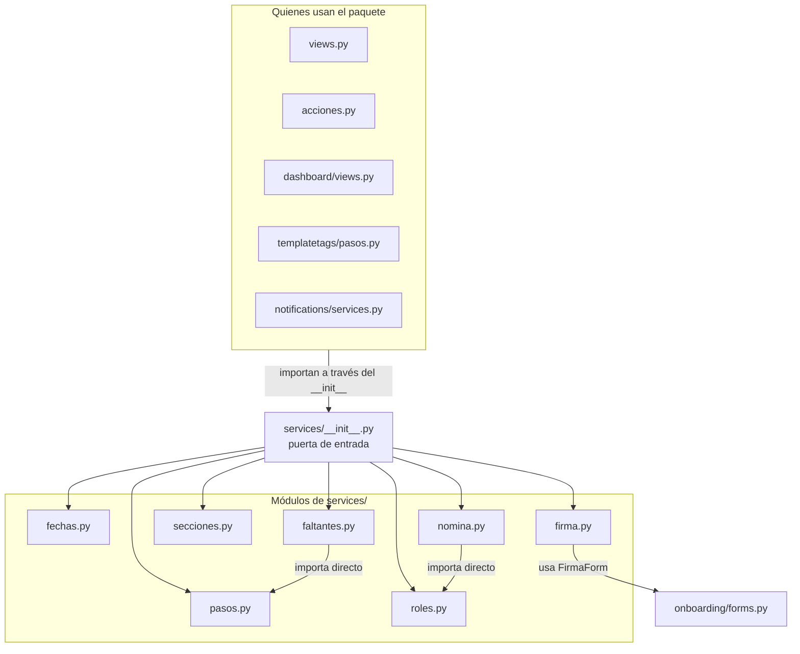

| Nombre | Qué hace | Quién lo usa | Eventos que deja |
|---|---|---|---|
| `onboarding.services` (el paquete) | Puerta de entrada: re-exporta lo público de los módulos del paquete. | `views.py`, `acciones.py`, `dashboard/views.py` (como `onboarding_services`), `templatetags/pasos.py`, `notifications/services.py` (importa `CODIGO_DE_PASO` y `TITULOS_PASO` dentro de `notificar_cliente_devuelta`), `seed_demo` | ninguno |

Qué re-exporta de cada módulo, como índice para saber dónde buscar:

| Módulo | Nombres |
|---|---|
| `pasos.py` | `TOTAL_PASOS`, `PASO_*` (uno por paso), `TITULOS_PASO`, `CODIGO_DE_PASO`, `PASO_REQUIERE_MODULO`, `pasos_activos` |
| `fechas.py` | `DIAS_HABILES_MINIMOS_CLIENTE`, `sumar_dias_habiles`, `fecha_minima_para_cliente` |
| `faltantes.py` | `pendientes_de_envio`, `pendientes_de_validacion` |
| `secciones.py` | `guardar_condiciones`, `guardar_fecha_implementacion`, `guardar_datos_contacto`, `guardar_modulos`, `guardar_sucursales`, `guardar_licencias_y_novedades`, `guardar_liquidaciones`, `guardar_documentos`, `tipos_documento_disponibles`, `estado_actual_licencias`, `estado_actual_novedades`, `estado_actual_documentos` |
| `roles.py` | `guardar_roles`, `vincular_roles_con_nomina` |
| `firma.py` | `guardar_firma`, `contexto_del_editor_de_firma` |
| `nomina.py` | `importar_archivo_empleados`, `resumen_importacion`, `agregar_empleado`, `editar_empleado`, `eliminar_empleado`, `LOTE_ACTUALIZACION`, `CAMPOS_EMPLEADO_IMPORTADOS`, `MAX_CORRECCIONES_EN_EVENTO`, `MAX_ERRORES_EN_EVENTO` |

### La regla de importación entre módulos

**Los módulos de `services/` se importan entre sí directamente, nunca a través del `__init__`.** Dentro del paquete se escribe `from onboarding.services.pasos import PASO_DATOS`, no `from onboarding.services import PASO_DATOS` ni `from . import ...`. Desde afuera del paquete, al revés: se importa siempre a través de la puerta de entrada, ya sea `from onboarding import services` (y `services.nombre(...)`) o `from onboarding.services import NOMBRE`; las dos formas pasan por el `__init__`.

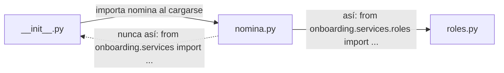

- **Por qué.** El `__init__` importa todos los módulos del paquete al cargarse. Si `nomina.py` hiciera `from onboarding.services import vincular_roles_con_nomina`, Python tendría que terminar de cargar el `__init__`, que a su vez está en medio de importar `nomina`: un ciclo. Importando el módulo concreto, cada módulo depende solo de los que realmente necesita.
- **Los imports internos que hay hoy** son solo dos: `faltantes.py` importa de `pasos.py`, y `nomina.py` importa `vincular_roles_con_nomina` de `roles.py`. `fechas.py`, `pasos.py`, `roles.py` y `secciones.py` no importan a otros módulos del paquete. `firma.py` importa `FirmaForm` de `onboarding/forms.py` (no es un módulo de `services/`, y `forms.py` no importa los servicios).
- **Cómo verificarlo.** `grep -rnE "from onboarding.services import|from \. import" onboarding/services/` no debería devolver nada.
- **Qué implica para los tests.** Un `patch` tiene que apuntar al módulo donde el nombre se *usa*. Ejemplo real: `patch("onboarding.services.nomina._resolver_jerarquia_importada")`. Parchear el nombre en la puerta de entrada solo afecta a quien llama a través de ella (vistas, acciones, panel), no a las llamadas entre módulos del paquete.
- **Si dos módulos se necesitan entre sí**, lo compartido se saca a un tercer módulo; no se resuelve importando por el `__init__`.

### `services/pasos.py`

**Responsabilidad.** Definir los pasos del wizard, una sola vez: sus números, títulos y códigos, y cuáles aplican a cada implementación según los módulos contratados. Las observaciones de una devolución se guardan con el **código** del paso (no con su número), así no se pierden si el orden cambia.

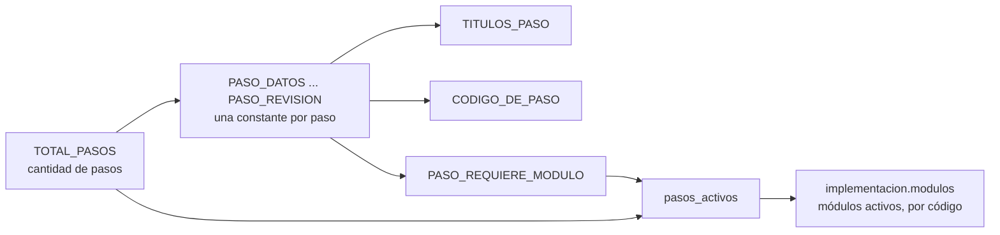

| Función o clase | Qué hace | Quién la usa | Eventos que deja |
|---|---|---|---|
| `TOTAL_PASOS` | Cantidad de pasos del wizard (hoy 10). | `views.wizard_step` (rango válido), `templatetags/pasos.py`, `pasos_activos` | ninguno |
| `PASO_DATOS`, `PASO_MODULOS`, `PASO_SUCURSALES`, `PASO_NOMINA`, `PASO_ROLES`, `PASO_CONFIGURACION`, `PASO_FIRMA`, `PASO_LICENCIAS`, `PASO_DOCUMENTOS`, `PASO_REVISION` | Los números de paso, en el orden del wizard (se generan con un `range` hasta `TOTAL_PASOS`). | `views.py` (`_HANDLERS` y los handlers), `faltantes.py`, `acciones.devolver_al_cliente` (`PASO_REVISION`), `dashboard/views.py` (`PASO_REVISION`) | ninguno |
| `TITULOS_PASO` | `{número: título}` para mostrar. | `views._wizard_context`, `dashboard/views.py`, `notifications/services.py` | ninguno |
| `CODIGO_DE_PASO` | `{número: código estable}` (`"datos"`, `"modulos"`, `"sucursales"`, `"nomina"`, `"roles"`, `"configuracion"`, `"firma"`, `"licencias"`, `"documentos"`, `"revision"`). | `views._devolucion`, `acciones.devolver_al_cliente`, `dashboard/views.py`, `notifications/services.py` | ninguno |
| `PASO_REQUIERE_MODULO` | `{número: conjunto de códigos de módulo}` de los pasos condicionales. Los que no figuran (datos, módulos, nómina y revisión) son universales. | `pasos_activos`; `seed_modulos.py` lo nombra en un comentario | ninguno |
| `pasos_activos(implementacion)` | La lista ordenada de pasos que le corresponden a esta implementación: los universales y los condicionales cuyo módulo está activo. | `faltantes.pendientes_de_envio`, `views.py` (`wizard_step`, `_wizard_context`, `_redirect_next`), `dashboard/views.py`, `seed_demo` | ninguno |

**Tests de ejemplo:** `onboarding/tests/servicios/test_pasos.py`, `onboarding/tests/wizard/test_orden.py`.

### `services/fechas.py`

**Responsabilidad.** La fecha de implementación que puede pedir el cliente: el mínimo exigido y el cálculo de días hábiles (lunes a viernes; no se descuentan feriados). El equipo puede poner cualquier fecha desde el panel.

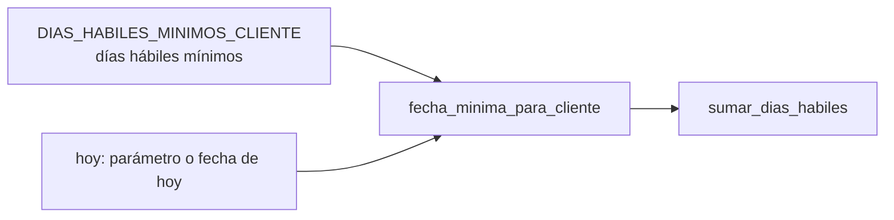

| Función o clase | Qué hace | Quién la usa | Eventos que deja |
|---|---|---|---|
| `DIAS_HABILES_MINIMOS_CLIENTE` | Días hábiles mínimos (hoy 10) desde hoy para la fecha que pide el cliente. | `fecha_minima_para_cliente` | ninguno |
| `sumar_dias_habiles(desde, cantidad)` | La fecha que queda `cantidad` días hábiles después de `desde`. | `fecha_minima_para_cliente` | ninguno |
| `fecha_minima_para_cliente(hoy=None)` | Primera fecha que el cliente puede pedir (hoy, o `hoy` si se pasa, más el mínimo). | `views._step_revision`, que se la pasa como `minima` a `FechaImplementacionForm` | ninguno |

**Ojo.** Los textos «10 días hábiles» de `FechaImplementacionForm` (la ayuda y el mensaje de error, en `forms.py`) están escritos a mano: si cambia `DIAS_HABILES_MINIMOS_CLIENTE`, hay que cambiarlos también.

**Tests de ejemplo:** `onboarding/tests/servicios/test_pasos.py`, `onboarding/tests/wizard/test_envio.py`.

### `services/faltantes.py`

**Responsabilidad.** El control único de «qué falta para enviar» y «qué falta para validar». Lo usan el paso de revisión del wizard, la ficha del panel y la acción de validar, así que las tres dicen siempre lo mismo. Solo lee: no guarda nada ni deja eventos.

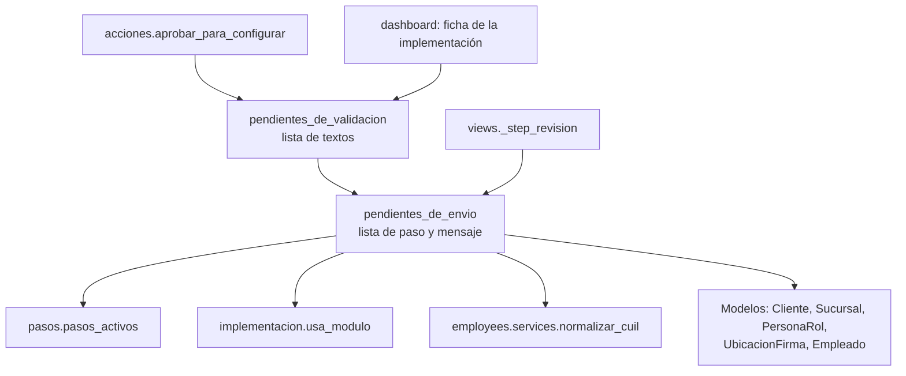

| Función o clase | Qué hace | Quién la usa | Eventos que deja |
|---|---|---|---|
| `pendientes_de_envio(implementacion)` | Lo que falta para poder enviar, como lista de `{"paso": N, "mensaje": ...}` ordenada por paso (vacía = listo). Es la validación que de verdad protege el envío, porque el cliente puede saltar de un paso a otro por la URL. | `views._step_revision`, `pendientes_de_validacion` | ninguno |
| `pendientes_de_validacion(implementacion)` | Los textos de lo que le impide al equipo validar: lo mismo que impide el envío, más que la firma tiene que estar validada. | `acciones.aprobar_para_configurar`, `dashboard/views.py` (ficha) | ninguno |

**Las reglas de `pendientes_de_envio`**, en el orden en que se evalúan (el resultado se ordena por paso):

| Regla | Paso al que remite | Se evalúa cuando |
|---|---|---|
| Razón social y CUIT de la empresa cargados | `PASO_DATOS` | siempre |
| Recibo Digital activo | `PASO_MODULOS` | siempre |
| Al menos una sucursal con nombre | `PASO_SUCURSALES` | el paso de sucursales está activo (Fichada) |
| Al menos una persona con nombre para cada rol de `PersonaRol.ROL_CHOICES` | `PASO_ROLES` | el paso de roles está activo |
| Cada persona con rol de `PersonaRol.ROLES_EN_NOMINA` figura en la nómina, por CUIL | `PASO_ROLES` | el paso de roles está activo |
| Modelo de recibo subido | `PASO_CONFIGURACION` | el paso de configuración está activo |
| Al menos un tipo de liquidación activo | `PASO_CONFIGURACION` | el paso de configuración está activo |
| Imagen de la firma cargada; y que la firma no esté observada | `PASO_FIRMA` | el paso de firma está activo |
| Al menos un empleado en la nómina | `PASO_NOMINA` | siempre |
| Todos los empleados con fecha de ingreso | `PASO_NOMINA` | hay empleados y la implementación usa Recibo Digital |

`pendientes_de_validacion` suma un texto más: «Falta validar la firma del recibo», cuando usa Recibo Digital, hay imagen de firma y su estado sigue en `propuesta`.

**Tests de ejemplo:** `onboarding/tests/servicios/test_pendientes.py`, `test_ingreso_obligatorio.py`, `onboarding/tests/revision/test_reglas.py`.

### `services/secciones.py`

**Responsabilidad.** Guardar las secciones simples de una implementación: datos de contacto o configuración, módulos, sucursales, licencias y novedades, liquidaciones, documentos de legajo, condiciones y fecha. Cada `guardar_*` pasa por `cambio_de_seccion` (de `clients/services.py`), que deja la foto anterior en el historial y el evento con el antes y el después. Las usan por igual el wizard del cliente y el panel del equipo, para que apliquen las mismas reglas.

**Qué hace `cambio_de_seccion` en cada guardado** (es un *context manager*: el `guardar_*` hace su cambio dentro del bloque `with`):

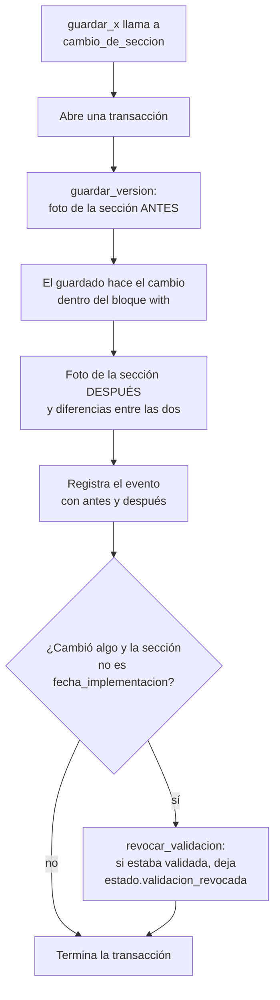

**Diagrama de funciones.**

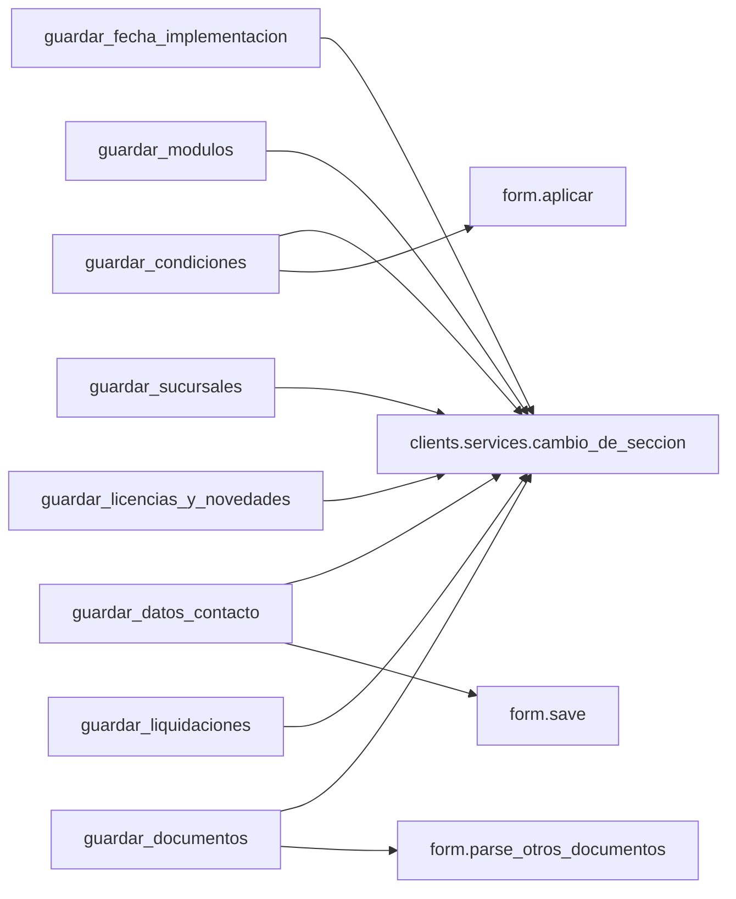

**Las secciones y quién las guarda.** El texto de la sección es lo que identifica la foto en el historial y en los eventos.

| Sección | La guarda | Dónde se arma su foto |
|---|---|---|
| `datos_contacto` | `guardar_datos_contacto` | `clients/services.py` (`_snapshot_datos_contacto`) |
| `modulos` | `guardar_modulos` (también `acciones.crear_implementacion`) | `clients/services.py` |
| `roles` | `guardar_roles` (`roles.py`) | `clients/services.py` |
| `sucursales` | `guardar_sucursales` | `clients/services.py` |
| `licencias_novedades` | `guardar_licencias_y_novedades` | `clients/services.py` |
| `liquidaciones` | `guardar_liquidaciones` | `clients/services.py` |
| `firma` | `guardar_firma` (`firma.py`), `acciones.validar_firma`, `acciones.observar_firma` | `clients/services.py` |
| `documentos` | `guardar_documentos` | `clients/services.py` |
| `fecha_implementacion` | `guardar_fecha_implementacion` | `clients/services.py` |
| `condiciones` | `guardar_condiciones` | `clients/services.py` |
| `empleados` | `nomina.py` (con `guardar_version` directo, sin `cambio_de_seccion`) | `employees/services.py` (`snapshot_empleados`), registrada desde `employees/apps.py` |

| Función o clase | Qué hace | Quién la usa | Eventos que deja |
|---|---|---|---|
| `guardar_condiciones(implementacion, form, actor)` | Aplica las condiciones del proceso (`CondicionesForm` ya validado) con `form.aplicar` y guarda la implementación. | `dashboard/views.py` (`_accion_actualizar_condiciones`) | `implementacion.condiciones_actualizadas` (sección `condiciones`) (R) |
| `guardar_fecha_implementacion(implementacion, fecha, actor)` | Guarda la fecha de salida en productivo (`None` la borra). La usa el cliente, con su mínimo, y el panel, sin límite. | `acciones.enviar_relevamiento`, `dashboard/views.py` (`_accion_actualizar_fecha_productivo`) | `implementacion.fecha_cambiada` (sección `fecha_implementacion`); no revoca la validación |
| `tipos_documento_disponibles(implementacion)` | El catálogo global de tipos de documento más los tipos «Otros» que agregó esta implementación. | `views._step_documentos`, `dashboard/views.py` | ninguno |
| `estado_actual_licencias(implementacion)` | `{id de tipo de licencia: {"activo": bool}}`, para precargar el formulario. | `views._step_licencias_novedades`, `dashboard/views.py` | ninguno |
| `estado_actual_novedades(implementacion)` | Lo mismo para las novedades. | ídem | ninguno |
| `estado_actual_documentos(implementacion)` | Lo mismo para los tipos de documento. | `views._step_documentos`, `dashboard/views.py` | ninguno |
| `guardar_datos_contacto(implementacion, form, actor)` | Guarda un formulario de datos (contacto, empresa o configuración) con `form.save()`. | `views._step_empresa`, `views._step_configuracion`, `dashboard/views.py` (`_accion_actualizar_datos`) | `paso.guardado` (sección `datos_contacto`) (R) |
| `guardar_modulos(implementacion, modulos_qs, activos_ids, actor)` | Guarda qué módulos tiene la implementación. Recibo Digital queda activo siempre: no lo puede sacar ni el cliente ni el equipo. | `views._step_modulos`, `acciones.crear_implementacion`, `dashboard/views.py` (`_accion_actualizar_modulos`) | `paso.guardado` (sección `modulos`) (R) |
| `guardar_sucursales(implementacion, formset, actor)` | Guarda las sucursales conservando las que siguen existiendo (se reconocen por el nombre, sin mayúsculas ni espacios de más), para que cada empleado no pierda la sucursal asignada al volver a guardar. Borra las que ya no están. | `views._step_sucursales`, `dashboard/views.py` | `paso.guardado` (sección `sucursales`) (R) |
| `guardar_licencias_y_novedades(implementacion, form, licencias_qs, novedades_qs, actor)` | Guarda cuáles licencias y novedades están activas. | `views._step_licencias_novedades`, `dashboard/views.py` | `paso.guardado` (sección `licencias_novedades`) (R) |
| `guardar_liquidaciones(implementacion, tipos, actor)` | Guarda qué tipos de liquidación usa la empresa; los no elegidos quedan inactivos. | `views._step_configuracion`, `dashboard/views.py` | `paso.guardado` (sección `liquidaciones`) (R) |
| `guardar_documentos(implementacion, form, todos_qs, actor)` | Guarda qué tipos de documento están activos y crea los tipos «Otros» (`es_custom`) con sus campos, a partir del texto libre del formulario. | `views._step_documentos`, `dashboard/views.py` | `paso.guardado` (sección `documentos`) (R) |

**Tests de ejemplo:** `onboarding/tests/servicios/test_guardado.py`; los eventos, en `automatizacion/tests/test_servicios_eventos.py`.

### `services/roles.py`

**Responsabilidad.** Los roles de la implementación (Apoderado/Firmante, Liquidador y Admin. de RRHH) y su vínculo con la nómina: cada persona con rol se liga, por CUIL, a su empleado.

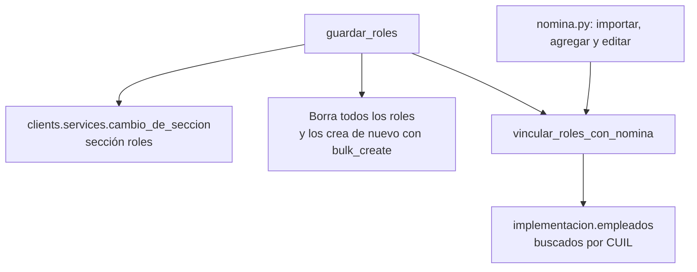

| Función o clase | Qué hace | Quién la usa | Eventos que deja |
|---|---|---|---|
| `vincular_roles_con_nomina(implementacion)` | Liga cada persona con rol a su empleado de la nómina por CUIL, y suelta el vínculo si el CUIL ya no coincide. Se llama cuando cambian los roles o la nómina. Si se borra el empleado, el vínculo queda vacío solo (así lo dice su docstring). | `guardar_roles`, `nomina.py` (`_cargar_empleados`, `agregar_empleado`, `editar_empleado`) | ninguno |
| `guardar_roles(implementacion, formset, actor)` | Reemplaza los roles: borra todos, crea los del formset (ignorando filas marcadas para borrar o sin nombre) y vincula con la nómina. A diferencia de las sucursales, no conserva filas. | `views._step_roles`, `dashboard/views.py` (`_accion_actualizar_roles`) | `paso.guardado` (sección `roles`) (R) |

**Tests de ejemplo:** `onboarding/tests/servicios/test_guardado.py`, `onboarding/tests/wizard/test_paso_roles.py`.

### `services/firma.py`

**Responsabilidad.** La firma del recibo: guardar lo que el cliente (o el equipo, al corregir) decide sobre la imagen y su ubicación, y armar el contexto que necesita el editor de firma.

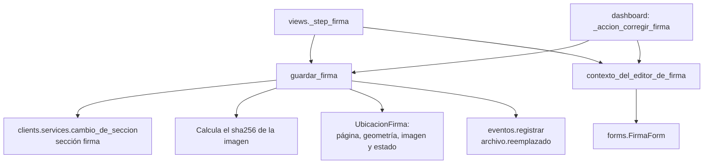

**Estados de la firma y quién los cambia.**

```mermaid
stateDiagram-v2
    direction LR
    state "Propuesta por el cliente" as Propuesta
    state "Validada" as Validada
    state "Observada" as Observada

    [*] --> Propuesta: el cliente la guarda por primera vez
    [*] --> Validada: el equipo la carga (guardar_firma)
    Propuesta --> Propuesta: el cliente cambia algo
    Propuesta --> Validada: el equipo valida (validar_firma) o corrige (guardar_firma)
    Validada --> Propuesta: el cliente cambia algo
    Propuesta --> Observada: el equipo observa (observar_firma)
    Validada --> Observada: el equipo observa (observar_firma)
    Observada --> Propuesta: el cliente guarda (es su respuesta)
    Observada --> Validada: el equipo valida (validar_firma) o corrige (guardar_firma)
```

Si el cliente vuelve a guardar sin cambiar nada y la firma ya estaba validada, sigue validada.

| Función o clase | Qué hace | Quién la usa | Eventos que deja |
|---|---|---|---|
| `guardar_firma(implementacion, actor, *, pagina, geometria, imagen=None)` | Guarda página, recuadros y, si se sube, la imagen (con su `sha256`). La imagen anterior no se borra: queda en disco y el evento apunta a las dos. Si guarda el cliente, la firma queda *propuesta* cuando algo cambió o estaba observada. Si guarda el equipo, es una corrección posterior al envío y queda *validada*. | `views._step_firma`, `dashboard/views.py` (`_accion_corregir_firma`) | `firma.propuesta` (cliente) o `firma.corregida_por_implementador` (equipo) (R); `archivo.reemplazado` si había imagen anterior y se subió otra |
| `contexto_del_editor_de_firma(implementacion, firma, form=None)` | El contexto del editor: el formulario, el de solo lectura, la firma y las URL del modelo de recibo y de la imagen. | `views._step_firma`, `views._vista_solo_lectura`, `dashboard/views.py` | ninguno |

**Tests de ejemplo:** `onboarding/tests/firma/test_servicio.py` (los principales estados del diagrama) y `test_revision.py` (validar y observar la firma).

### `services/nomina.py`

**Responsabilidad.** La nómina de empleados: importación desde un archivo y alta, edición y baja manual. Cada operación deja la foto anterior (`guardar_version`, sección `empleados`), revoca la validación si cambió algo y registra el evento. El principio del registro: se guarda lo que la base pisa o borra, no lo que ya conserva (cada empleado nuevo queda en `Empleado`, así que solo se cuenta).

```mermaid
flowchart TD
    imp["importar_archivo_empleados"] --> leer["employees.services.leer_archivo_empleados"]
    imp --> carga["_cargar_empleados"]
    carga --> gv["clients.services.guardar_version"]
    carga --> jer["_resolver_jerarquia_importada"]
    carga --> vr["roles.vincular_roles_con_nomina"]
    carga --> rv["clients.services.revocar_validacion"]
    carga --> ev["eventos.registrar"]
    add["agregar_empleado"] --> gv
    add --> vr
    add --> rv
    add --> ev
    edit["editar_empleado"] --> gv
    edit --> vr
    edit --> rv
    edit --> ev
    edit --> vj["_valor_json"]
    borrar["eliminar_empleado"] --> gv
    borrar --> rv
    borrar --> ev
    borrar --> vj
```

**Qué hace `_cargar_empleados`** (el centro de la importación, todo dentro de una transacción):

```mermaid
flowchart TD
    A["Archivo leído:<br/>filas válidas y errores"] --> B["Guarda la versión de empleados<br/>y crea el ImportBatch"]
    B --> C["Compara cada fila con la nómina, por CUIL"]
    C --> D{"¿Ya existe el CUIL?"}
    D -->|"no"| E["Va a la lista de nuevos"]
    D -->|"sí"| F{"¿Cambió algún campo?"}
    F -->|"sí"| G["Va a actualizados, con el antes<br/>y después en correcciones"]
    F -->|"no"| H["No se toca"]
    E --> I["bulk_create y bulk_update en lotes"]
    G --> I
    I --> J["Segunda pasada: liga Reporta A<br/>y Aprobador por CUIL"]
    J --> K["Vincula los roles con la nómina"]
    K --> L{"¿Hubo nuevos o actualizados?"}
    L -->|"sí"| M["Revoca la validación"]
    L -->|"no"| N["Sigue"]
    M --> O["Evento nomina.importada"]
    N --> O
```

| Función o clase | Qué hace | Quién la usa | Eventos que deja |
|---|---|---|---|
| `LOTE_ACTUALIZACION` | Tamaño de lote del `bulk_update` (hoy 100): con lotes grandes MySQL tarda mucho más que con varios chicos. | `_cargar_empleados` y `_resolver_jerarquia_importada` | ninguno |
| `CAMPOS_EMPLEADO_IMPORTADOS` | Los campos de `Empleado` que vienen del archivo (las columnas, sin `reporta_a` ni `aprobador`, que se resuelven aparte). | `_cargar_empleados` | ninguno |
| `MAX_CORRECCIONES_EN_EVENTO`, `MAX_ERRORES_EN_EVENTO` | Lo más que se detalla en el evento de importación (hoy, 500 correcciones y 50 errores); el resto queda contado en el resumen. | `_cargar_empleados` | ninguno |
| `_valor_json(valor)` | Un valor de un campo listo para un evento: las relaciones, por su id. | `editar_empleado`, `eliminar_empleado` | ninguno |
| `_resolver_jerarquia_importada(implementacion, filas, advertencias)` | Segunda pasada de la importación: liga Reporta A y Aprobador por CUIL, ya con todos cargados. Si el CUIL referenciado no está en la nómina, no toca esa relación y suma una advertencia. Devuelve cuántos empleados cambiaron. | `_cargar_empleados` | ninguno |
| `importar_archivo_empleados(implementacion, archivo, actor)` | Lee y carga un archivo de empleados. Devuelve `(filas, errores, advertencias)`: la lista de filas válidas leídas, la lista de errores por fila y la lista de avisos. Todo o nada; las filas con error no se cargan pero no impiden las demás. Si el archivo no sirve (ilegible, sin columnas obligatorias, demasiado grande) levanta `ArchivoInvalido` antes de tocar nada. El archivo no se guarda (tiene datos personales). | `views._importar_archivo_empleados`, `dashboard/views.py` (`_accion_importar_empleados`) | `nomina.importada` (con conteos, errores y correcciones, truncados a los máximos) (R) |
| `_cargar_empleados(implementacion, archivo, lectura, actor)` | Hace la carga dentro de la transacción, como en el diagrama de arriba. | `importar_archivo_empleados` | `nomina.importada` (R) |
| `resumen_importacion(filas, errores, advertencias, maximo_detalle=5)` | Los mensajes para mostrar después de importar, como lista de `(nivel, texto)`. | `views._importar_archivo_empleados`, `dashboard/views.py` | ninguno |
| `agregar_empleado(implementacion, empleado_form, actor)` | Valida el `EmpleadoForm` (devuelve `False` si no es válido; quien la llama no tiene que validarlo antes) y, si lo es, lo guarda. Devuelve `True` si se agregó. Si el CUIL ya existe (doble clic o dos personas a la vez), marca el error en el formulario y devuelve `False`. | `views._agregar_empleado_manual`, `dashboard/views.py` | `empleado.agregado` (R) |
| `editar_empleado(implementacion, empleado_form, actor)` | Valida el `EmpleadoForm` con `instance` (devuelve `False` si no es válido) y guarda sus cambios. El evento lleva el antes y el después de lo que cambió. Devuelve `True` si se guardó. | `views._step_empleados`, `dashboard/views.py` | `empleado.editado`; (R) solo si algo cambió |
| `eliminar_empleado(implementacion, empleado_id, actor)` | Borra un empleado de esta implementación. Ignora ids no numéricos o inexistentes. El evento guarda la foto completa de lo borrado. | `views._step_empleados`, `dashboard/views.py` | `empleado.eliminado` (R) |

**Tests de ejemplo:** `onboarding/tests/servicios/test_empleados.py` y `test_ingreso_obligatorio.py`, `employees/tests/test_importacion.py`, y los eventos en `automatizacion/tests/test_servicios_eventos.py`.

---

## 7. `urls.py`

**Responsabilidad.** Declarar las rutas del wizard. El archivo define `app_name = "onboarding"`, así que los nombres se usan con ese prefijo (`onboarding:wizard_step`), y se monta bajo `/r/` en `config/urls.py`.

```mermaid
flowchart LR
    subgraph rutas["urlpatterns"]
        p1["mis-implementaciones/"]
        p2["«token»/"]
        p3["«token»/paso/«step»/"]
        p4["«token»/plantilla-empleados/"]
        p5["«token»/enviado/"]
    end
    p1 --> mis["views.mis_implementaciones"]
    p2 -->|"kwargs fijo step=1"| ws["views.wizard_step"]
    p3 --> ws
    p4 --> plant["views.descargar_plantilla_empleados"]
    p5 --> env["views.enviado"]
```

| Ruta | Nombre | Qué hace | Quién la usa | Eventos que deja |
|---|---|---|---|---|
| `/r/mis-implementaciones/` | `mis_implementaciones` | Listado de las implementaciones de la empresa del usuario. | `clients/views.py` (destino tras el login), `templates/perfil.html` | ninguno |
| `/r/<token>/` | `wizard_start` | Atajo al paso 1 (`step=1` fijo). Ninguna parte del código lo usa por nombre. | quien reciba el link corto | ninguno |
| `/r/<token>/paso/<int:step>/` | `wizard_step` | Un paso del wizard. | `Implementacion.get_absolute_url` (paso 1, el link que muestra el panel), los redirects de `views.py`, `base_wizard.html` y los `step_*.html` | los del paso (ver la sección 2) |
| `/r/<token>/plantilla-empleados/` | `plantilla_empleados` | Descarga la planilla vacía de nómina. | `step_empleados.html` | ninguno |
| `/r/<token>/enviado/` | `enviado` | Pantalla «recién enviado». | redirect de `views._step_revision` | ninguno |

**Ojo con el orden.** `mis-implementaciones/` va *antes* de `<str:token>/` a propósito: Django prueba las rutas en orden y esa dirección también encajaría como un token.

**Tests de ejemplo:** `onboarding/tests/wizard/test_acceso.py`.

---

## 8. `templatetags/pasos.py`

**Responsabilidad.** Una única etiqueta de template, `total_pasos`, para mostrar «paso N/total» sin escribir el número a mano. Comparte el nombre con `services/pasos.py`, pero es otro archivo: lo único que toma de ahí es la constante `TOTAL_PASOS` (a través de `onboarding.services`), así que al sumar un paso la etiqueta se actualiza sola. No calcula ni usa los pasos activos (`pasos_activos`). Un template la activa con ``.

```mermaid
flowchart LR
    tpl["Templates con load pasos:<br/>mis_implementaciones, home,<br/>cliente_detalle, implementacion_detalle"] --> tag["total_pasos"]
    tag --> k["services.TOTAL_PASOS"]
```

| Función o clase | Qué hace | Quién la usa | Eventos que deja |
|---|---|---|---|
| `register` | La `template.Library()` donde se registra la etiqueta. | Django, al cargar `` | ninguno |
| `total_pasos()` | `simple_tag` que devuelve `TOTAL_PASOS`. Es la cantidad *total* de pasos, no la de pasos activos de una implementación. | `templates/onboarding/mis_implementaciones.html`, `templates/dashboard/home.html`, `cliente_detalle.html` e `implementacion_detalle.html` | ninguno |

---

## 9. Templates (`templates/onboarding/`)

**Responsabilidad.** Las páginas del cliente. Viven en la carpeta `templates/` de la raíz del proyecto, no dentro de la app. Los pasos extienden `base_wizard.html`, que dibuja la cabecera (los pasos activos, la devolución abierta, el título y el link «Volver al paso anterior») y deja el hueco `step_content`.

```mermaid
flowchart TD
    base["base.html"]
    bw["base_wizard.html"]
    pasos["Los pasos del wizard: step_empresa, step_modulos,<br/>step_sucursales, step_empleados, step_roles,<br/>step_configuracion, step_firma,<br/>step_licencias_novedades, step_documentos,<br/>step_revision"]
    ya["ya_enviado.html"]
    canc["cancelada.html"]
    mis["mis_implementaciones.html"]
    editor["_editor_firma.html"]
    hist["clients/_historial_versiones.html"]
    dsh["dashboard/implementacion_detalle.html"]

    base --> bw
    base --> ya
    base --> canc
    base --> mis
    bw --> pasos
    pasos -->|"step_firma incluye"| editor
    ya -->|"incluye"| editor
    ya -->|"incluye"| hist
    dsh -->|"incluye"| editor
    dsh -->|"incluye"| hist
```

| Template | Qué muestra | Quién lo usa | Contexto que recibe |
|---|---|---|---|
| `base_wizard.html` | Cabecera común de los pasos. | todos los `step_*.html` (extienden) | de `_wizard_context`: `implementacion`, `cliente`, `paso`, `total_pasos`, `titulo_paso`, `pasos`, `paso_anterior`, `devolucion` |
| `step_empresa.html` | El formulario del paso de datos de contacto (`PASO_DATOS`). | `_step_empresa` | `form` |
| `step_modulos.html` | Un casillero por módulo, con un texto distinto si el equipo fijó los módulos. | `_step_modulos` | `form`, `editable` |
| `step_sucursales.html` | Las filas del formset de sucursales. | `_step_sucursales` | `formset` |
| `step_empleados.html` | Edición de un empleado, carga manual o por archivo (con selector), errores de importación y la tabla de empleados. | `_step_empleados` | `import_form`, `empleado_form`, `empleados`, `errores_import`, `editando`, `edicion_form` |
| `step_roles.html` | Las filas de roles y un buscador de la nómina que completa la fila (con un script en la propia página, alimentado con `json_script`). | `_step_roles` | `formset`, `max_roles`, `nomina`, `paso_nomina` |
| `step_configuracion.html` | El formulario del paso de configuración y adjuntos (`PASO_CONFIGURACION`). | `_step_configuracion` | `form` |
| `step_firma.html` | El editor de firma, o el aviso de que falta el modelo de recibo con el link al paso de configuración (`PASO_CONFIGURACION`). | `_step_firma` | `sin_modelo`, `paso_configuracion` o, con modelo: `form`, `form_lectura`, `firma`, `modelo_url`, `imagen_url` |
| `step_licencias_novedades.html` | Dos tablas de casilleros: licencias y novedades. | `_step_licencias_novedades` | `form`, `licencias_rows`, `novedades_rows` |
| `step_documentos.html` | La tabla de tipos de documento y el texto libre de «otros». | `_step_documentos` | `form`, `tipos_rows` |
| `step_revision.html` | Resumen de lo cargado, los pendientes con link a su paso, la fecha pedida y el botón de enviar (deshabilitado con pendientes). | `_step_revision` | `resumen`, `pendientes`, `fecha_form` |
| `ya_enviado.html` | Todo lo enviado en solo lectura, el pedido de contacto y el historial de versiones. | `_vista_solo_lectura` | lo de `resumen_implementacion`, más `recien_enviado`, `pedir_revision_form` y el contexto del editor de firma |
| `cancelada.html` | Aviso de implementación anulada. | `wizard_step` | `implementacion` |
| `mis_implementaciones.html` | La tabla de implementaciones del cliente, con estado, fecha y link. | `mis_implementaciones` | `cliente`, `implementaciones` |
| `_editor_firma.html` | El editor de firma: campos de imagen y página, el escenario donde se arrastran los recuadros (`static/firma_editor.js`, con pdf.js) y la tabla de ajuste con números. Con `solo_lectura` muestra el escenario sin los campos visibles ni la tabla de ajuste: la página y los recuadros van como campos ocultos, que son los que lee el script para dibujar; con `diferido`, el script lo inicia recién cuando se abre el desplegable (`details`) que lo contiene. | `step_firma.html`, `ya_enviado.html` y `dashboard/implementacion_detalle.html` | `form`, `modelo_url`, `imagen_url`, y `solo_lectura` o `diferido` según el caso |

---

## 10. Dependencias hacia otras apps

```mermaid
flowchart LR
    subgraph onb["onboarding"]
        v["views.py"]
        a["acciones.py"]
        s["services/"]
        f["forms.py"]
    end
    cl["clients"]
    em["employees"]
    au["automatizacion"]
    no["notifications"]
    ca["catalog"]

    v --> cl
    v --> em
    v --> au
    v --> ca
    a --> cl
    a --> au
    a --> no
    s --> cl
    s --> em
    s --> au
    s --> ca
    f --> cl
    f --> em
    f --> ca
```

**Qué usa `onboarding` de cada app.**

| App | Qué usa | Desde dónde |
|---|---|---|
| `clients` | Modelos (`Implementacion`, `Modulo`, `Cliente`, `PersonaRol`, `Sucursal`, `UbicacionFirma`, `RondaRevision`, `ComentarioInterno`, `ImplementacionLicencia`, `ImplementacionLiquidacion`, `ImplementacionNovedad`, `ImplementacionTipoDocumento`) y la función `geometria_inicial_de_firma` (de `clients/models.py`, no es un modelo). Servicios: `cambio_de_seccion`, `guardar_version`, `revocar_validacion`, `foto_de_seccion`, `crear_o_resetear_acceso`, `resumen_implementacion`. Validadores: `normalizar_cuits` y las validaciones de medidas y tamaño de archivos. | las vistas, las acciones, los servicios y los formularios |
| `catalog` | `TipoDocumento`, `TipoLiquidacion`, `TipoLicencia`, `TipoNovedad`. | `secciones.py`, `forms.py`, `views.py` |
| `employees` | Formularios (`EmpleadoForm`, `ImportarArchivoForm`), servicios (`leer_archivo_empleados`, `normalizar_cuil`, `COLUMNAS`, `CUIL_RE`, `ArchivoInvalido`, `generar_plantilla_xlsx`) y modelos (`Empleado`, `ImportBatch`). | `views.py`, `faltantes.py`, `roles.py`, `nomina.py`, `forms.py` |
| `automatizacion` | `actores` (`Actor`, `CLIENTE`, `TIPOS_DEL_EQUIPO`), `eventos.registrar` y `congelada` (`congelar`, `ArchivoNoDisponible`). | `views.py`, `acciones.py`, `firma.py`, `nomina.py` |
| `notifications` | `notifications.services` (importado como `notificaciones`): `enviar_invitacion`, `notificar_cliente_devuelta`, `notificar_cliente_implementacion_cumplida`, `notificar_implementacion_completa`, `notificar_cliente_relevamiento_recibido`, `notificar_revision_solicitada`. | `acciones.py` |

**Quién depende de `onboarding`.**

| App o archivo | Qué usa |
|---|---|
| `dashboard/views.py` | `acciones`, `services` (como `onboarding_services`, incluida `contexto_del_editor_de_firma`) y varios formularios de `forms.py`. |
| `notifications/services.py` | `CODIGO_DE_PASO` y `TITULOS_PASO`, importados dentro de `notificar_cliente_devuelta`. |
| `clients` | Las URLs `onboarding:wizard_step` (en `Implementacion.get_absolute_url`) y `onboarding:mis_implementaciones` (en `clients/views.py`, solo para las cuentas de cliente). |
| `templates/perfil.html` | La URL `onboarding:mis_implementaciones`, en el botón «Volver» de las cuentas de cliente. |
| `dashboard` (plantillas y `seed_demo`) | La etiqueta ``; `CondicionesForm` y `pasos_activos`. La plantilla `implementacion_detalle.html` incluye `_editor_firma.html`. |

**Una dependencia en sentido contrario que conviene conocer.** `clients/services.py` guarda las fotos por sección en `_SNAPSHOT_BUILDERS`; `employees/apps.py` registra la de `"empleados"` con `registrar_snapshot_builder`. `nomina.py` llama a `guardar_version(implementacion, "empleados", actor)`, así que depende de que ese registro ya se haya hecho al arrancar.

---

## 11. Cómo agregar un paso o una acción

### Un paso nuevo al wizard

1. **Definir el paso** en `services/pasos.py`: sumar 1 a `TOTAL_PASOS`, agregar `PASO_X` en la tupla (en el lugar donde debe ir: los números siguientes se corren, y `PASO_REVISION` tiene que seguir último), y una entrada en `TITULOS_PASO`, otra en `CODIGO_DE_PASO` y, si solo aplica con ciertos módulos, otra en `PASO_REQUIERE_MODULO`. Cuidado: `paso_actual` de las implementaciones en curso se guarda como número; las observaciones de las devoluciones no, porque usan el código. Además, exportar `PASO_X` en `services/__init__.py` (el `import` desde `onboarding.services.pasos` y su entrada en `__all__`): `views.py` importa las constantes de ahí, y sin eso daría `ImportError` al cargar. Los módulos de `services/` (como `faltantes.py`) la importan directo de `onboarding.services.pasos`.
2. **Dar una foto a la sección** en `clients/services.py`: una función `_snapshot_x(implementacion)` y su entrada en `_SNAPSHOT_BUILDERS` (o `registrar_snapshot_builder` si la sección es de otra app). Sin eso, `cambio_de_seccion` falla con `KeyError`.
3. **El formulario** en `forms.py`.
4. **El guardado** en `services/secciones.py` (o en un módulo nuevo de `services/`): `guardar_x(implementacion, form, actor)` con `with cambio_de_seccion(implementacion, "x", actor):`. Exportarlo en `services/__init__.py` (el `import` y `__all__`). Si el módulo nuevo necesita a otro de `services/`, lo importa directo, no por el `__init__`.
5. **La regla de faltantes**, si el paso es obligatorio: en `services/faltantes.py`, dentro de `pendientes_de_envio`, un `{"paso": PASO_X, "mensaje": ...}` protegido por `if PASO_X in activos`.
6. **La vista** en `views.py`: `_step_x(request, implementacion, step)` con el patrón de los demás (GET arma el formulario; POST valida, llama a `services.guardar_x(...)` y devuelve `_redirect_next`; si no valida, `_invalido(...)`; al final `render` con `_wizard_context`). Registrarla en `_HANDLERS` e importar la constante (`from .services import PASO_X`, ya exportada según el punto 1).
7. **El template** `templates/onboarding/step_x.html`: extiende `onboarding/base_wizard.html` y define el bloque `step_content`.
8. **Si el dato también se muestra o se congela**: `clients/services.py` (`resumen_implementacion`) y `ya_enviado.html` para la consulta; `automatizacion/congelada.py` (`contenido_de`) para la configuración congelada. Si el equipo lo edita desde el panel: una función `_accion_*` en `dashboard/views.py` y su entrada en `ACCIONES_DE_LA_FICHA`, y la tarjeta de la sección (de solo lectura, con su formulario de edición) en `templates/dashboard/implementacion_detalle.html`.
9. **Los números de paso escritos a mano**: si el paso se inserta en el medio, los siguientes se corren y hay que revisar los que están fijos en el código: `dashboard/management/commands/seed_demo.py` (usa `paso(5)`, `paso(6)`, etc. para decidir qué datos de demostración carga) y los tests que arman la URL con un número de paso.
10. **Tests y documentación**: un `test_paso_x.py` en `onboarding/tests/wizard/` y, para el servicio, uno en `onboarding/tests/servicios/`; actualizar la tabla de pasos de [`../arquitectura.md`](../arquitectura.md) y la de esta página.

### Una acción nueva

1. **La función** en `acciones.py`: `nombre(actor, implementacion, ..., base_url=None)`. El primer parámetro es el `actor`; nunca recibe el `request`. `base_url` solo si manda un mail con link.
2. **Las precondiciones primero**: si no se puede, devolver `Resultado(implementacion=implementacion, avisos=[Aviso(messages.ERROR, "...")])` (o `errores=[...]`) sin tocar nada. Para estados, reutilizar `_puede_revisarse`.
3. **Los cambios y el evento** en el mismo `with transaction.atomic():`, con `eventos.registrar(actor, "familia.verbo", implementacion, datos={...})`. Si cambia algo que se configura, pasar por `cambio_de_seccion` (que revoca la validación si el cambio fue real y la sección no está en `SECCIONES_QUE_NO_INVALIDAN`; si la sección nueva no debe invalidarla, hay que sumarla a ese conjunto, en `clients/services.py`) o llamar a `revocar_validacion`.
4. **Los mails después** de la transacción, con `_avisar_por_mail(actor, implementacion, "tipo", lambda: notificaciones.xxx(implementacion, base_url=base_url), descripcion_falla="...")`; si devuelve un `Aviso`, sumarlo a la lista de avisos. Un mail caído no deshace la acción.
5. **Devolver un `Resultado`**.
6. **Llamarla**: desde `views.py` como `acciones.nombre(_actor(request), implementacion, ...).mostrar(request)`; desde el panel, con una función `_accion_*` en `dashboard/views.py` y su entrada en `ACCIONES_DE_LA_FICHA`.
7. **Tests y documentación**: un test en `onboarding/tests/acciones/` (con `BaseWizard` o `EnviadaBase` de `onboarding/tests/base.py`) y el nombre del evento nuevo en la tabla «Eventos que existen hoy» de [`../arquitectura.md`](../arquitectura.md).
