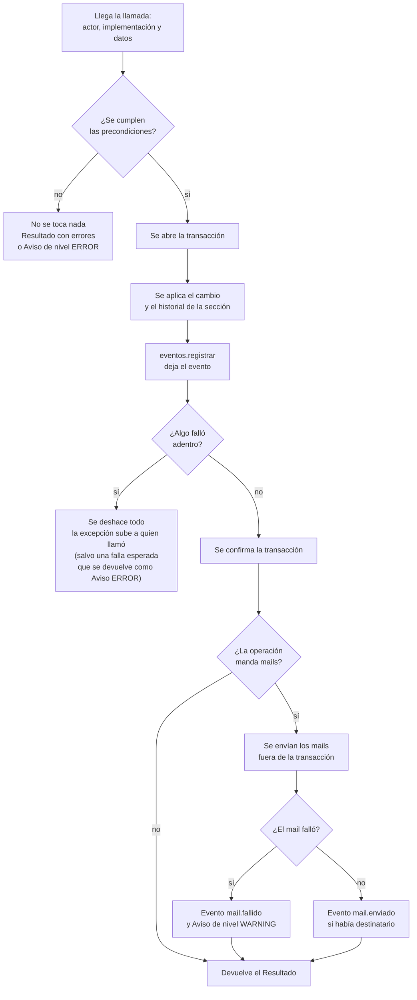
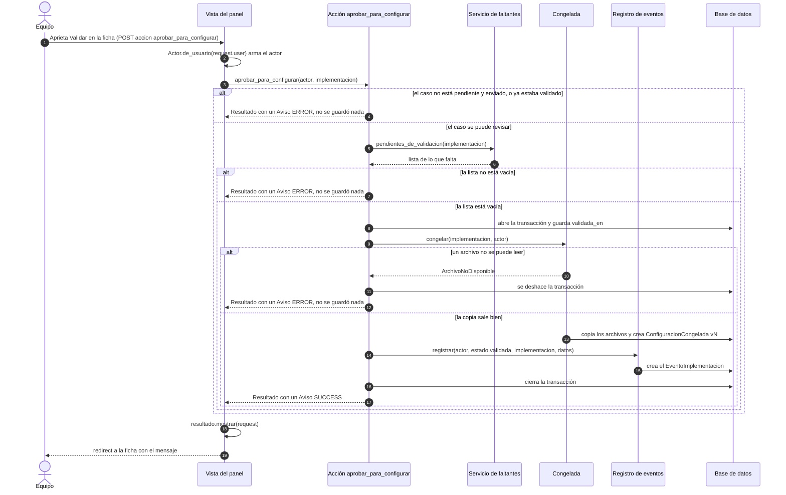
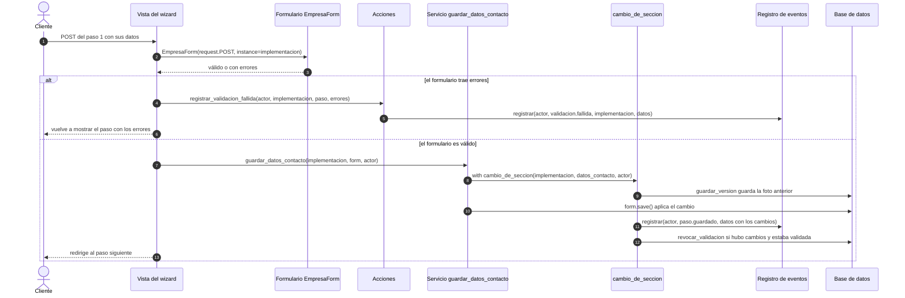
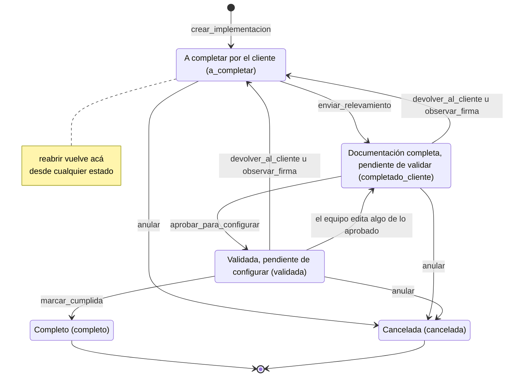
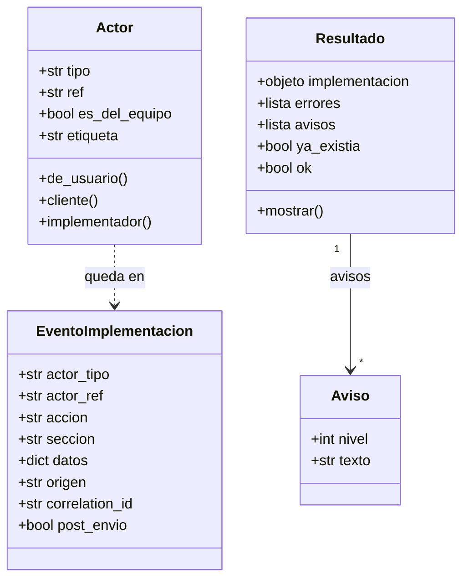

# Operaciones públicas: el contrato de la herramienta

Este documento es el **contrato** del Portal de Implementación: la lista corta de operaciones que cualquier integración futura (una API, un agente, un comando de `manage.py` o una tarea programada) debe usar **en lugar de tocar los modelos directamente**. Los modelos son las clases de Python que representan las tablas de la base de datos (`Implementacion`, `Empleado`, `EventoImplementacion`…).

Todo lo que no figura acá no es público y puede cambiar sin aviso (ver [la sección 6](#6-qué-no-es-público)). El portal es una herramienta de **estado, control y trabajo del equipo**: no se conecta con Napsis, así que ninguna operación configura nada allá; releva, controla, registra y guarda lo aprobado.

Es el complemento de [`arquitectura.md`](arquitectura.md) (el mapa general). Los ejemplos de uso reales están en los tests: `onboarding/tests/acciones/`, `onboarding/tests/revision/`, `onboarding/tests/servicios/`, `onboarding/tests/firma/` y `automatizacion/tests/`. Cada vez que se agregue o cambie una operación hay que actualizar este documento (ver el checklist de la sección 1.5).

Índice: [1. Cómo leer este documento](#1-cómo-leer-este-documento-y-reglas-de-uso) · [2. La lista corta](#2-la-lista-corta) · [3. Detalle de cada operación](#3-detalle-de-cada-operación) · [4. Catálogo de eventos](#4-catálogo-de-eventos) · [5. Contratos de datos](#5-contratos-de-datos) · [6. Qué NO es público](#6-qué-no-es-público)

---

## 1. Cómo leer este documento y reglas de uso

### 1.1 Términos que aparecen

**De Django** (el framework web sobre el que está hecho el portal):

- **Modelo**: clase de Python que representa una tabla de la base. `Modelo.objects` es el punto de entrada para consultarlo y para crear filas.
- **Request**: el pedido web que recibe una vista (quién es el usuario, qué se envió, a qué URL).
- **Vista** (`views.py`): función que recibe el request y devuelve una página o un redirect. Traduce el pedido a una llamada a una operación; no decide reglas de negocio.
- **Formulario** (`Form`, `ModelForm`): clase que valida datos (`is_valid()`); el de modelo además los guarda (`save()`). Los servicios `guardar_*` de sección reciben el formulario **ya validado**; `agregar_empleado` y `editar_empleado` lo validan por su cuenta.
- **Formset**: conjunto de formularios iguales, uno por fila (roles, sucursales).
- **Transacción** (`transaction.atomic()`): bloque «todo o nada»: si algo falla adentro, la base vuelve a como estaba antes de entrar.
- **Sistema de mensajes** (`django.contrib.messages`): avisos que se muestran una vez en la próxima pantalla. Sus niveles (`SUCCESS`, `WARNING`, `ERROR`) son el `nivel` de un `Aviso`.
- **Queryset**: resultado de una consulta a la base; se puede seguir filtrando antes de leerlo.
- **Comando de gestión**: programa que se corre con `python manage.py <nombre>`, fuera de cualquier pantalla (por ejemplo `exportar_eventos`).
- **Dataclass**: clase de Python pensada para guardar datos (`Actor`, `Resultado`, `Aviso`).
- **Administrador de contexto** (`with ...`): bloque que prepara algo al entrar y lo cierra al salir; `cambio_de_seccion` es uno.
- **Variable de contexto** (`contextvars`): valor que Python guarda por pedido o por tarea; ahí vive el identificador de correlación.

**Del proyecto:**

- **Implementación**: un caso de implementación de un cliente (modelo `Implementacion`). El **cliente** es la empresa (`Cliente`); una misma empresa puede tener varias implementaciones.
- **Wizard**: las pantallas, de a un paso, que completa el cliente; cuáles le tocan depende de los módulos que contrató (ver [5.3](#53-pendientes_de_envio-y-pendientes_de_validacion)). Entra con su cuenta desde el link de su implementación. **Panel** y **ficha**: las pantallas del equipo (el listado y el detalle de una implementación).
- **Actor**: quién hace la cosa (ver [5.1](#51-actor)).
- **Sección**: unidad de guardado y de historial de una implementación (`datos_contacto`, `modulos`, `roles`…).
- **Evento**: registro de solo agregado de algo que pasó (ver [la sección 4](#4-catálogo-de-eventos)).
- **Ronda**: una devolución al cliente (`RondaRevision`), numerada; se cierra cuando el cliente vuelve a enviar.
- **Configuración congelada**: foto inmutable de lo aprobado al validar (ver [5.4](#54-la-configuración-congelada)).
- **Estado visual**: el estado que ve el equipo; se deriva de otros campos, no es una columna (`Implementacion.estado_visual`).

### 1.2 Qué es una operación pública

Una operación pública es una función de la lista corta de la [sección 2](#2-la-lista-corta). Vive en una de estas puertas de entrada:

- **`onboarding/acciones.py`** (`from onboarding import acciones`): lo que se puede **hacer** sobre un caso: crear, dar acceso, reasignar, enviar, validar, devolver, cumplir.
- **`onboarding/services/`** (`from onboarding import services`): guardar cada sección, la nómina, el control de faltantes y las fechas. El paquete re-exporta sus nombres públicos en su `__init__.py` (junto con algunas constantes de uso interno: ver [6.2](#62-públicas-por-nombre-pero-de-uso-interno)) y se usa siempre así (`services.guardar_roles(...)`), no importando los submódulos.
- **Piezas de apoyo**: `automatizacion/` (actores, eventos, configuración congelada), `clients/services.py` y `clients/models.py` (lecturas), `employees/services.py` y `dashboard/reportes.py` (lectura y exportación de la nómina y del listado).

Las pantallas (`onboarding/views.py`, `dashboard/views.py`) son **clientes** de estas operaciones: traducen un pedido web a una llamada y el resultado a mensajes. Una API o un agente sería otro cliente igual.

### 1.3 Las reglas

**1. El actor es obligatorio.** Toda operación que cambia algo recibe un `Actor` (quién la hace). En `acciones` es el **primer** parámetro; en los servicios de guardado va **al final** (`guardar_roles(implementacion, formset, actor)`), salvo `guardar_firma(implementacion, actor, *, ...)`: mirá la firma exacta de cada una. El actor decide la etiqueta del historial, la marca `post_envio` de los eventos y qué operaciones están permitidas (`agregar_comentario` solo acepta al equipo). Se arma con `Actor.de_usuario(usuario)`, `Actor.cliente(ref)`, `Actor.implementador(ref)` o `Actor(tipo, ref)` (ver [5.1](#51-actor)).

**2. Las operaciones no conocen el request.** Lo que necesitarían del pedido web llega como parámetro: el `actor`, la `base_url` (la URL pública del portal, para armar los links de los mails; si no llega se usa `settings.SITE_BASE_URL`) o el `autor`. El único código que toca un request es `Resultado.mostrar(request)`, y lo llama la vista, no la operación.

**3. Cada operación que escribe datos corre en una transacción.** El cambio y el evento se guardan juntos: o queda todo o no queda nada. Las operaciones que guardan una sección (las `guardar_*`, la nómina, `validar_firma` y `observar_firma`) guardan además el historial de la sección (`ImplementacionVersion`); las acciones que solo cambian el estado del caso (`reasignar`, `reabrir`, `anular`, `devolver_al_cliente`, `marcar_cumplida`…) no lo crean. Tres operaciones no cumplen esto de punta a punta: `registrar_validacion_fallida` (solo registra un evento, sin transacción propia), `invitar_cliente` (copia el mail de contacto a la cuenta fuera de toda transacción) y `observar_firma` (usa dos transacciones seguidas); están en [6.4](#64-excepciones-y-huecos-conocidos). Los **mails se mandan después** de guardar y un mail que falla nunca deshace lo ya hecho: queda el evento `mail.fallido` y, si corresponde, un `Aviso` de nivel `WARNING`.

**4. Cómo se informa el resultado y los errores.** Las acciones devuelven un `Resultado` (ver [5.2](#52-resultado-y-aviso)), salvo `registrar_validacion_fallida`, que devuelve `None`; los servicios devuelven lo suyo (nada, un objeto, una tupla o un booleano, está en cada firma). Hay tres tipos de falla y se tratan distinto:

| Tipo de falla | Qué pasa | Cómo la ves |
|---|---|---|
| Una regla de negocio no se cumple (falta un dato, el estado no corresponde) | La operación **no toca nada** y devuelve el motivo | En `Resultado.errores` **o** en un `Aviso` de nivel `ERROR` (según la operación, ver abajo) |
| Falla un mail | Lo ya hecho se conserva | Evento `mail.fallido` y, si la operación lo prevé, un `Aviso` de nivel `WARNING` |
| Falla algo inesperado (base caída, disco) | Se deshace la transacción | La excepción sube a quien llamó. Una falla esperada no sube: `aprobar_para_configurar` atrapa `ArchivoNoDisponible` al congelar y la devuelve como un `Aviso` de nivel `ERROR` |

Atención: las acciones **no son uniformes** al rechazar. Hoy se informa así:

| Operación | Cómo informa un rechazo | Cómo saber que se hizo |
|---|---|---|
| `crear_implementacion`, `entregar_acceso`, `invitar_cliente` | Lista `errores` con los textos | `resultado.ok`; en `crear_implementacion`, mirá además `resultado.ya_existia` (si es `True`, el caso ya estaba y no se creó nada) |
| `aprobar_para_configurar`, `validar_firma`, `observar_firma`, `devolver_al_cliente`, `marcar_cumplida`, `agregar_comentario` | Un `Aviso` de nivel `messages.ERROR`; `errores` queda **vacío** | `resultado.ok` es `True` aunque se haya rechazado: hay que buscar avisos de nivel `ERROR` |
| `reasignar`, `reabrir`, `anular`, `atender_revision`, `enviar_relevamiento`, `pedir_revision` | No rechazan: las precondiciones son de quien llama | Siempre se hacen |
| `registrar_validacion_fallida` | No rechaza ni devuelve nada (`None`) | Siempre se registra |

Para el segundo grupo, el chequeo es `any(a.nivel == messages.ERROR for a in resultado.avisos)`. Los textos de los avisos están escritos para una persona: **no se comparan** para decidir nada.

**5. Todo cambio deja un evento.** Cada operación registra su evento con `eventos.registrar(...)` dentro de la misma transacción. El evento guarda quién (`actor_tipo`, `actor_ref`), qué (`accion`, `seccion`, `datos`), cuándo (`momento`), el identificador de correlación del pedido (`correlation_id`) y la marca `post_envio` (la acción es de alguien que no es el cliente y la documentación ya estaba enviada: una **corrección**). Se registra lo que la base pisa o borra, no lo que ya conserva. Hay pocas excepciones conocidas: están en [6.4](#64-excepciones-y-huecos-conocidos).

**6. Nunca se saltea una acción tocando los modelos.** Escribir directo en un modelo (`implementacion.estado = "cumplida"`, `Empleado.objects.create(...)`) se saltea las precondiciones, el historial, la baja de la validación, el evento y los mails. Si falta una operación, se agrega (checklist de [1.5](#15-checklist-para-agregar-una-operación-nueva)); no se rodea.

**7. Los permisos son de quien llama.** Las operaciones **no verifican permisos** (la única excepción es `agregar_comentario`, que exige un actor del equipo). Hoy los verifica la vista: `staff_member_required` en el panel, `_verificar_acceso_cliente` en el wizard (la cuenta logueada tiene que ser la del cliente de esa implementación) y `admin_requerido` en la gestión de implementadores. Una API tiene que replicar esos controles. También son de la vista y los formularios los bloqueos de edición del cliente: `wizard_step` muestra la pantalla de caso cancelado sin llamar a ningún paso y pasa a solo lectura un caso ya enviado (solo acepta el pedido de revisión), `_step_modulos` ignora el POST si el equipo no dejó editar los módulos y los formularios bloquean los campos que el equipo fijó con las condiciones. Ningún `guardar_*` ni ninguna acción revisa nada de eso: quien los llame directo podría editar un caso cancelado o ya enviado, así que una API tiene que replicar también estos bloqueos. Lo mismo vale para algunas precondiciones que la operación no repite (por ejemplo, `enviar_relevamiento` no vuelve a calcular `pendientes_de_envio`): están marcadas en cada detalle como «de quien llama».

#### Anatomía de una operación



### 1.4 Dos llamadas típicas de punta a punta

**El equipo valida la documentación** (vista, acción, servicio de control, configuración congelada, evento):



**El cliente guarda un paso del wizard** (vista, formulario, servicio de sección, historial y evento):



### 1.5 Checklist para agregar una operación nueva

1. **Elegí dónde vive.** Una acción de negocio o un cambio de estado va en `onboarding/acciones.py`. El guardado de una sección va en el módulo que corresponda de `onboarding/services/` y se **re-exporta** en su `__init__.py` (también en `__all__`).
2. **Firma sin request.** `actor` como primer parámetro en una acción; si hace falta la URL pública, `base_url=None`. Nada de `request` ni `request.user` adentro, y no se llama al sistema de mensajes (`messages.add_message`, `messages.success`…): se devuelven `Aviso`, cuyo `nivel` sí usa las constantes de `messages` (`messages.SUCCESS`…).
3. **Precondiciones primero.** Antes de tocar nada, si no se cumplen, devolvé un `Resultado` con `errores` (o un `Aviso` de nivel `ERROR`, como las acciones del segundo grupo de la tabla de la regla 4). Elegí uno y documentalo.
4. **Una transacción.** El cambio y su evento van dentro de `with transaction.atomic():`. Para guardar una sección usá `cambio_de_seccion`, que ya deja la foto anterior, calcula el antes y el después, registra el evento y, si corresponde, quita la validación.
5. **El evento.** `eventos.registrar(actor, "familia.accion", implementacion, seccion=..., datos={...})`. El nombre va en minúsculas con puntos y los `datos` tienen que ser serializables a JSON. Guardá lo que la base pisa o borra; no copies lo que ya conserva (ni contraseñas, ni datos personales de la nómina). Si el cambio puede ocurrir con la documentación ya enviada, no pases `post_envio`: se calcula solo, salvo que la operación misma deje `enviado` en `None` antes de registrar el evento (como `devolver_al_cliente` y `reabrir`): ahí hay que pasarlo explícito.
6. **Mails después, y nunca rompen.** Mandalos fuera de la transacción con `_avisar_por_mail`, que registra `mail.fallido` si falla y `mail.enviado` solo si había destinatario. Devuelve un `Aviso` de nivel `WARNING` únicamente si le pasaste `descripcion_falla`; si no, la falla solo queda en el evento.
7. **¿Invalida lo aprobado?** Si cambia algo de lo que se va a configurar, tiene que llamar a `revocar_validacion` (o usar `cambio_de_seccion`, que lo hace). Si la sección no debe invalidar, agregala a `SECCIONES_QUE_NO_INVALIDAN` en `clients/services.py`.
8. **¿Sección nueva?** Registrá cómo se toma su foto en `clients/services.py` (`_SNAPSHOT_BUILDERS`) o desde otra app con `registrar_snapshot_builder`.
9. **¿Entra en lo que se congela?** Cambiá `contenido_de` en `automatizacion/congelada.py` y revisá si hay que subir `VERSION_ESQUEMA`.
10. **Tests y documentación.** Un test en `onboarding/tests/acciones/` (o el paquete del tema) que cubra: se hace y deja su evento, se rechaza sin tocar nada, y el mail que falla no la deshace. Después, sumá la operación a este documento: fila en la [sección 2](#2-la-lista-corta), detalle en la 3 y evento en la [4](#4-catálogo-de-eventos).

---

## 2. La lista corta

Todas las operaciones públicas. «Quién» es quién la ejecuta hoy en el producto (las operaciones no lo verifican, salvo donde se indica). Los eventos entre paréntesis son los que dejan de más según el caso. Toda operación de guardado que le quita la validación a un caso ya validado deja además `estado.validacion_revocada`.

### Ciclo de vida del caso

| Operación | Módulo | Para qué sirve | Quién | Evento que deja |
|---|---|---|---|---|
| `crear_implementacion` | `onboarding/acciones.py` | Crea el caso (y la empresa y su acceso, si hacen falta) | equipo (alta desde el panel) | `implementacion.creada` (+ `paso.guardado` de módulos, `acceso.creado`, `mail.*`) |
| `entregar_acceso` | `onboarding/acciones.py` | Crea o reinicia la cuenta con la que el cliente entra | equipo | `acceso.creado` o `acceso.contrasena_reiniciada` (+ `mail.*`) |
| `invitar_cliente` | `onboarding/acciones.py` | Reenvía el link para crear o cambiar la contraseña | equipo | `mail.enviado` o `mail.fallido` |
| `reasignar` | `onboarding/acciones.py` | Cambia quién lleva la implementación | equipo | `implementacion.reasignada` |
| `reabrir` | `onboarding/acciones.py` | Vuelve el caso al principio («regenerar el link») | equipo | `estado.reabierta` |
| `anular` | `onboarding/acciones.py` | Cancela el caso | equipo | `estado.cancelada` |
| `marcar_cumplida` | `onboarding/acciones.py` | Da por terminada la implementación (solo si está validada) | equipo | `estado.cumplida` (+ `mail.*`) |

### Relevamiento del cliente

| Operación | Módulo | Para qué sirve | Quién | Evento que deja |
|---|---|---|---|---|
| `guardar_datos_contacto` | `onboarding/services/secciones.py` | Guarda los datos de la empresa, el contacto y la configuración | cliente o equipo | `paso.guardado` |
| `guardar_modulos` | `onboarding/services/secciones.py` | Guarda qué módulos tiene el caso (Recibo Digital siempre) | cliente o equipo | `paso.guardado` |
| `guardar_sucursales` | `onboarding/services/secciones.py` | Guarda las sucursales conservando las que siguen | cliente o equipo | `paso.guardado` |
| `guardar_roles` | `onboarding/services/roles.py` | Guarda Apoderado, Liquidador y Admin. de RRHH | cliente o equipo | `paso.guardado` |
| `guardar_liquidaciones` | `onboarding/services/secciones.py` | Guarda los tipos de liquidación que usa la empresa | cliente o equipo | `paso.guardado` |
| `guardar_licencias_y_novedades` | `onboarding/services/secciones.py` | Guarda qué licencias y novedades se activan | cliente o equipo | `paso.guardado` |
| `guardar_documentos` | `onboarding/services/secciones.py` | Guarda los documentos de legajo (y los «Otros») | cliente o equipo | `paso.guardado` |
| `guardar_condiciones` | `onboarding/services/secciones.py` | Fija qué decide el cliente y qué deja fijo el equipo | equipo | `implementacion.condiciones_actualizadas` |
| `guardar_fecha_implementacion` | `onboarding/services/secciones.py` | Guarda la fecha de salida en productivo | equipo; cliente (al enviar) | `implementacion.fecha_cambiada` |
| `guardar_firma` | `onboarding/services/firma.py` | Guarda la ubicación y la imagen de la firma del recibo | cliente (propone); equipo (corrige) | `firma.propuesta` o `firma.corregida_por_implementador` (+ `archivo.reemplazado`) |
| `importar_archivo_empleados` | `onboarding/services/nomina.py` | Carga la nómina desde un .xlsx o .csv | cliente o equipo | `nomina.importada` |
| `agregar_empleado` | `onboarding/services/nomina.py` | Agrega un empleado a mano | cliente o equipo | `empleado.agregado` |
| `editar_empleado` | `onboarding/services/nomina.py` | Cambia los datos de un empleado | cliente o equipo | `empleado.editado` |
| `eliminar_empleado` | `onboarding/services/nomina.py` | Borra un empleado de la nómina | cliente o equipo | `empleado.eliminado` |
| `vincular_roles_con_nomina` | `onboarding/services/roles.py` | Liga cada rol a su empleado por CUIL (auxiliar) | sistema (la llaman `guardar_roles`, la importación y el alta y la edición de empleados) | ninguno propio |
| `enviar_relevamiento` | `onboarding/acciones.py` | El cliente envía el relevamiento completo | cliente | `envio.confirmado` (+ `implementacion.fecha_cambiada`, `mail.*`) |
| `pedir_revision` | `onboarding/acciones.py` | El cliente pide que lo contacten | cliente | `revision.solicitada` (+ `mail.*`) |
| `registrar_validacion_fallida` | `onboarding/acciones.py` | Deja constancia de lo que el cliente no pudo completar | cliente | `validacion.fallida` |

### Revisión del equipo

| Operación | Módulo | Para qué sirve | Quién | Evento que deja |
|---|---|---|---|---|
| `aprobar_para_configurar` | `onboarding/acciones.py` | Valida la documentación y congela la configuración | equipo | `estado.validada` |
| `devolver_al_cliente` | `onboarding/acciones.py` | Devuelve el relevamiento al cliente (abre una ronda) | equipo | `ronda.devuelta` (+ `mail.*`) |
| `validar_firma` | `onboarding/acciones.py` | Da por buena la firma que propuso el cliente | equipo | `firma.validada` |
| `observar_firma` | `onboarding/acciones.py` | Rechaza la firma con motivos y devuelve el caso | equipo | `firma.observada` y `ronda.devuelta` (+ `mail.*`) |
| `agregar_comentario` | `onboarding/acciones.py` | Deja una nota privada del equipo | equipo (lo exige la operación) | `comentario.agregado` |
| `atender_revision` | `onboarding/acciones.py` | Marca como atendido el pedido de contacto | equipo | `revision.atendida` |

### Consultas de solo lectura (no dejan evento)

| Operación | Módulo | Para qué sirve | Quién |
|---|---|---|---|
| `pendientes_de_envio` | `onboarding/services/faltantes.py` | Qué falta para poder enviar | cualquiera |
| `pendientes_de_validacion` | `onboarding/services/faltantes.py` | Qué falta para poder validar | cualquiera |
| `pasos_activos` | `onboarding/services/pasos.py` | Qué pasos del wizard le corresponden al caso | cualquiera |
| `fecha_minima_para_cliente`, `sumar_dias_habiles` | `onboarding/services/fechas.py` | Fecha mínima que puede pedir el cliente; días hábiles | cualquiera |
| `tipos_documento_disponibles`, `estado_actual_licencias`, `estado_actual_novedades`, `estado_actual_documentos` | `onboarding/services/secciones.py` | Lo que necesitan los formularios de cada paso | cualquiera |
| `contexto_del_editor_de_firma` | `onboarding/services/firma.py` | Contexto del editor de firma (ayuda de pantalla) | cualquiera |
| `resumen_importacion` | `onboarding/services/nomina.py` | Mensajes para mostrar después de importar | cualquiera |
| `leer_archivo_empleados` | `employees/services.py` | Lee y valida un archivo de nómina sin guardar nada | cualquiera |
| `resumen_implementacion` | `clients/services.py` | Todo lo relevado en un caso, para mostrar | cualquiera |
| `filtrar_y_ordenar_implementaciones`, `con_ultimo_movimiento` | `clients/services.py` | El listado del panel, con filtros, orden y último movimiento | equipo |
| `foto_de_seccion` | `clients/services.py` | Cómo está hoy una sección (formato del historial) | cualquiera |
| Estado de `Implementacion` (`estado_visual`, `marca_de_devolucion`, `sin_movimiento`…) | `clients/models.py` | Estado visible, devolución abierta y marca de «sin movimiento» | cualquiera |
| `generar_nomina_xlsx`, `generar_plantilla_xlsx`, `generar_reporte_implementaciones_xlsx` | `employees/services.py`, `dashboard/reportes.py` | Exportaciones a .xlsx | equipo (la nómina y el reporte); cliente (la plantilla) |

### Registro y trazabilidad

| Operación | Módulo | Para qué sirve | Quién | Evento que deja |
|---|---|---|---|---|
| `Actor` y sus constructores | `automatizacion/actores.py` | Quién hace la cosa | quien llama | ninguno |
| `eventos.registrar` | `automatizacion/eventos.py` | Guarda un evento | las demás operaciones | el evento mismo |
| `eventos.diferencias` | `automatizacion/eventos.py` | Calcula el antes y el después de una sección | las demás operaciones | ninguno |
| `correlacion.nueva`, `correlacion.actual` | `automatizacion/correlacion.py` | Identificador que une lo que pasó en un mismo pedido o corrida | `actual`: la llama `eventos.registrar`; `nueva`: quien arme un comando o una tarea (hoy ninguno la usa; en un pedido web el id lo asigna `CorrelacionMiddleware`) | ninguno |
| `congelada.congelar` | `automatizacion/congelada.py` | Crea la versión siguiente de la configuración congelada | sistema (la llama `aprobar_para_configurar`) | ninguno propio (lo deja `estado.validada`) |
| `congelada.contenido_de`, `congelada.hash_de`, `congelada.como_documento` | `automatizacion/congelada.py` | Contenido, huella y JSON descargable de la configuración | cualquiera | ninguno |
| `manage.py exportar_eventos` | `automatizacion/management/commands/exportar_eventos.py` | Exporta los eventos a JSONL | equipo | ninguno |

---

## 3. Detalle de cada operación

**Convenciones de los ejemplos.** Todos suponen estas líneas y una `implementacion` que ya existe (`CLIENTE` y `ANA` son las de `onboarding/tests/base.py`; `URL` es la que repiten los tests de `onboarding/tests/acciones/`):

```python
from datetime import date
from django.contrib import messages
from automatizacion.actores import Actor
from catalog.models import TipoLicencia, TipoLiquidacion, TipoNovedad
from clients.models import Implementacion, Modulo
from employees.forms import EmpleadoForm
from onboarding import acciones, services
from onboarding.forms import CondicionesForm, DocumentosLegajoForm, EmpresaForm, LicenciasNovedadesForm, RolFormSet, SucursalFormSet

CLIENTE = Actor.cliente("cliente_a")    # lo que hace el cliente desde el wizard
ANA = Actor.implementador("ana")        # lo que hace el equipo desde el panel
URL = "https://portal.napsis.example/"  # la URL pública del portal, para los links de los mails
```

**Patrón de guardado de una sección.** Todas las operaciones `guardar_*` de esta sección (menos las de nómina, que tienen su variante) comparten este recorrido dentro de `cambio_de_seccion`, en una sola transacción: (1) se guarda en el historial la foto de cómo estaba la sección (`ImplementacionVersion`, con `editado_por` = etiqueta del actor); (2) se aplica el cambio; (3) se registra el evento con `datos={"cambios": {...}}` (solo lo que cambió, con el antes y el después); (4) si hubo cambios y la sección invalida lo aprobado, se le quita la validación al caso (ver `revocar_validacion`). Guardar sin cambiar nada igual deja el evento (con `cambios` vacío) y no quita la validación. Los **permisos** y el **formulario válido** son de quien llama.

### 3.1 Ciclo de vida del caso

La mayoría de estas operaciones mueve el caso entre estados. Qué operación hace cada transición:



Las operaciones **no impiden** todas las transiciones que el diagrama no muestra: `anular` y `reabrir` no miran el estado de partida. Cada detalle dice qué verifica la operación y qué queda a cargo de quien llama.

#### `crear_implementacion`

*Módulo:* `onboarding/acciones.py` · *La ejecuta:* equipo (desde el panel; los parámetros `origen` e `id_externo` prevén el alta desde un sistema externo, pero hoy nada la llama así) · *Evento:* `implementacion.creada`

```python
def crear_implementacion(
    actor, *, cliente=None, datos_cliente=None, username="", mail_cliente="", implementador=None, creado_por=None,
    modulo_ids=(), modulos_editables=True, condiciones=None,
    origen=Implementacion.ORIGEN_PORTAL, id_externo=None, base_url=None,
):
```

- **Parámetros:** `cliente` es una empresa existente (`Cliente`); si no, `datos_cliente` es `{"nombre", "razon_social", "cuits"}`. `username` es el usuario sugerido para la cuenta (se normaliza y, si ya existe, se le agrega un número). `implementador` y `creado_por` son cuentas de usuario del equipo, o `None` si lo crea un sistema. `modulo_ids` son ids de `Modulo`. `condiciones` es un `CondicionesForm` ya validado, o `None`. `origen` + `id_externo` identifican el caso en el sistema que lo originó (`Implementacion.ORIGEN_PORTAL`, `ORIGEN_HUBSPOT`, `ORIGEN_API`).
- **Precondiciones:** `mail_cliente` vacío o válido; si no se pasa `cliente`, `datos_cliente["nombre"]` no vacío; `datos_cliente["cuits"]` es opcional y, si viene, tiene que pasar la normalización de CUITs. Razón social y CUIT son opcionales acá: si no se cargan, el cliente los completa en el paso 1.
- **Efecto:** en una transacción crea la empresa (si no se pasó `cliente`), crea la cuenta de acceso (solo si el cliente no tiene cuenta), crea la `Implementacion` (con `mail_contacto` igual a `mail_cliente`) y guarda los módulos con `guardar_modulos` (**Recibo Digital queda siempre activo**). Con `mail_cliente`, la cuenta nueva nace sin contraseña y se le manda una invitación; sin mail se genera una contraseña. Eventos: `paso.guardado` (sección `modulos`), `implementacion.creada` y, si creó la cuenta, `acceso.creado`. Después de la transacción, si hay invitación: `mail.enviado` o `mail.fallido` (tipo `invitacion`).
- **Idempotencia:** si ya existe un caso con el mismo `origen` e `id_externo`, no crea nada y devuelve el existente con `ya_existia=True` (sin avisos ni eventos).
- **Devuelve:** `Resultado(implementacion, avisos)`. Los avisos salen solo si se creó la cuenta de acceso (el cliente no tenía `usuario`); si ya tenía acceso, `avisos` queda vacío, con o sin `mail_cliente`. Sin mail del cliente, el aviso `SUCCESS` trae **la contraseña en claro** (con la indicación de anotarla, porque no se vuelve a mostrar): no la registres en logs ni la guardes. Con mail: aviso `SUCCESS` de invitación enviada o `WARNING` si el mail falló.
- **Errores:** `Resultado(errores=[...])` con `implementacion=None` y nada guardado: «El mail del cliente no es válido.», «Elegí un cliente existente o completá el nombre de la empresa.» o el motivo del CUIT. Los demás fallos son excepciones y deshacen todo.
- **La llama hoy:** `dashboard/views.py::_alta_de_implementacion`.

```python
# como lo llamaría una integración futura: hoy el único llamador es el panel
resultado = acciones.crear_implementacion(
    Actor("servicio", "hubspot"), datos_cliente={"nombre": "Acme"}, mail_cliente="gerencia@acme.com",
    origen="hubspot", id_externo="deal-77", base_url=URL,
)
if resultado.ok:
    implementacion = resultado.implementacion   # con ya_existia=True si ese deal ya estaba
```

#### `entregar_acceso`

*Módulo:* `onboarding/acciones.py` · *La ejecuta:* equipo · *Evento:* `acceso.creado` o `acceso.contrasena_reiniciada`

```python
def entregar_acceso(actor, cliente, username="", mail="", base_url=None, implementacion=None):
```

- **Precondiciones:** `mail` vacío o válido. `implementacion` es opcional (el evento se asocia a ella si se pasa).
- **Efecto:** en una transacción crea la cuenta del cliente si no tenía (con `mail`: sin contraseña, para invitarlo; sin `mail`: con contraseña generada) o, si ya tenía, le **genera una contraseña nueva** (la anterior deja de servir) y la deja sin permisos de equipo. Evento `acceso.creado` (cuenta nueva) o `acceso.contrasena_reiniciada`, con `{cliente_id, username, invitacion}`. Si no hay contraseña (invitación), manda el mail y deja `mail.enviado` o `mail.fallido` (tipo `invitacion`).
- **Devuelve:** `Resultado(implementacion, avisos)`. Con contraseña, el aviso `SUCCESS` la trae en claro («Acceso creado para el cliente» o «Nueva contraseña generada»): se muestra una única vez.
- **Errores:** `errores=["El mail no es válido."]`.
- **La llama hoy:** `dashboard/views.py::cliente_detalle` y `_accion_regenerar_acceso`.

```python
resultado = acciones.entregar_acceso(ANA, implementacion.cliente, mail="gerencia@acme.com", base_url=URL)
for aviso in resultado.avisos:
    print(aviso.nivel, aviso.texto)   # ojo: puede traer la contraseña en claro
print(resultado.errores)
```

#### `invitar_cliente`

*Módulo:* `onboarding/acciones.py` · *La ejecuta:* equipo · *Evento:* `mail.enviado` o `mail.fallido`

```python
def invitar_cliente(actor, cliente, implementacion=None, base_url=None):
```

- **Precondiciones:** el cliente tiene cuenta (`usuario`) y la cuenta tiene mail o, si no, la `implementacion` pasada tiene `mail_contacto`.
- **Efecto:** si la cuenta no tenía mail, le copia el de contacto de la implementación (sin evento propio). Manda el link para crear o cambiar la contraseña (no toca la actual). Evento `mail.enviado` o `mail.fallido` (tipo `invitacion`).
- **Devuelve:** `Resultado(implementacion, avisos)`: `SUCCESS` si salió o `WARNING` si el mail falló («probá de nuevo desde la ficha»).
- **Errores:** `errores=["El cliente todavía no tiene acceso creado."]` o `["No hay un mail cargado para este cliente: completalo en los datos de contacto."]`.
- **La llama hoy:** `dashboard/views.py::cliente_detalle` y `_accion_enviar_invitacion`.

```python
resultado = acciones.invitar_cliente(ANA, implementacion.cliente, implementacion=implementacion, base_url=URL)
if not resultado.ok:
    print(resultado.errores[0])   # sin cuenta o sin mail cargado
```

#### `reasignar`

*Módulo:* `onboarding/acciones.py` · *La ejecuta:* equipo · *Evento:* `implementacion.reasignada`

```python
def reasignar(actor, implementacion, nuevo):
```

- **Precondiciones (de quien llama):** `nuevo` es una cuenta de usuario del equipo y está activa; el panel la elige entre `dashboard.services.asignables()`. La operación no lo verifica.
- **Efecto:** en una transacción guarda `implementador_asignado = nuevo` y registra `{desde, hacia}` con los nombres de usuario (`desde` es `None` si no tenía a nadie).
- **Devuelve:** `Resultado(implementacion, avisos)` con un aviso `SUCCESS` («Implementación asignada a …»).
- **Errores:** ninguno propio. Con `nuevo=None` falla con una excepción y se deshace.
- **La llama hoy:** `dashboard/views.py::_accion_reasignar`.

```python
from django.contrib.auth.models import User
bruno = User.objects.get(username="bruno")   # una cuenta del equipo, activa
resultado = acciones.reasignar(ANA, implementacion, bruno)
print(resultado.avisos[0].texto)
```

#### `reabrir`

*Módulo:* `onboarding/acciones.py` · *La ejecuta:* equipo · *Evento:* `estado.reabierta`

```python
def reabrir(actor, implementacion):
```

- **Precondiciones (de quien llama):** ninguna verificada. Desde cualquier estado vuelve al principio.
- **Efecto:** en una transacción deja `estado` pendiente, `paso_actual = 1`, y borra `enviado`, `validada_en`, `cancelada_en` y `cumplida_en`. No toca las rondas ni las configuraciones congeladas ya creadas. Evento con `{"antes": {estado, paso_actual, enviado, cancelada_en, cumplida_en, validada_en}}` y `post_envio` verdadero si el caso estaba enviado.
- **Devuelve:** `Resultado(implementacion)`, sin avisos.
- **Errores:** ninguno.
- **La llama hoy:** `dashboard/views.py::_accion_regenerar_link`.

```python
acciones.reabrir(ANA, implementacion)
assert implementacion.estado_visual == Implementacion.VISUAL_A_COMPLETAR
print(implementacion.paso_actual)   # 1
```

#### `anular`

*Módulo:* `onboarding/acciones.py` · *La ejecuta:* equipo · *Evento:* `estado.cancelada`

```python
def anular(actor, implementacion):
```

- **Precondiciones (de quien llama):** que el caso esté pendiente. La operación **no lo verifica**: anular uno ya cumplido lo deja cancelado.
- **Efecto:** en una transacción llama a `Implementacion.anular()` (`estado` cancelada y `cancelada_en` ahora) y registra `{"estado_anterior": ...}`.
- **Devuelve:** `Resultado(implementacion)`, sin avisos. **Errores:** ninguno.
- **La llama hoy:** `dashboard/views.py::_accion_anular`.

```python
if implementacion.estado == Implementacion.ESTADO_PENDIENTE:   # la operación no lo verifica
    acciones.anular(ANA, implementacion)
print(implementacion.estado_visual_label)   # «Cancelada»
```

#### `marcar_cumplida`

*Módulo:* `onboarding/acciones.py` · *La ejecuta:* equipo · *Evento:* `estado.cumplida`

```python
def marcar_cumplida(actor, implementacion, base_url=None):
```

- **Precondiciones:** el caso está pendiente, enviado por el cliente y **validado** (`validada_en` cargado). La configuración parte de lo que se aprobó.
- **Efecto:** en una transacción llama a `Implementacion.marcar_cumplida()` (`estado` cumplida y `cumplida_en` ahora) y registra `{"estado_anterior": ...}`. Después, un mail al cliente («tu implementación está lista») con `mail.enviado` o `mail.fallido` (tipo `cliente_cumplida`). Si el cliente no tiene mail cargado no se manda nada ni se registra nada.
- **Devuelve:** `Resultado(implementacion, avisos)`: sin avisos si todo salió bien; `WARNING` «Quedó cumplida, pero no se pudo avisarle al cliente por mail.» si el mail falló.
- **Errores:** un `Aviso` de nivel `ERROR` («Solo se puede marcar como cumplida una implementación ya validada.»); `errores` queda vacío y no se toca nada.
- **La llama hoy:** `dashboard/views.py::_accion_marcar_cumplida`.

```python
resultado = acciones.marcar_cumplida(ANA, implementacion, base_url=URL)
rechazada = any(a.nivel == messages.ERROR for a in resultado.avisos)
print("rechazada" if rechazada else implementacion.estado_visual_label)   # «Completo»
```

### 3.2 Relevamiento del cliente

#### 3.2.1 Guardado de secciones

Todas siguen el [patrón de guardado de una sección](#3-detalle-de-cada-operación). Reciben formularios o conjuntos de datos **ya validados**: no devuelven errores de validación (la validación es del formulario, antes de llamar) y devuelven `None`, salvo `guardar_firma`.

#### `guardar_datos_contacto`

*Módulo:* `onboarding/services/secciones.py` · *La ejecuta:* cliente (pasos 1 y 6) o equipo (ficha) · *Evento:* `paso.guardado` (sección `datos_contacto`)

```python
def guardar_datos_contacto(implementacion, form, actor):
```

- **Precondiciones:** `form` es un formulario de `Implementacion` ya validado (`is_valid()`): `EmpresaForm` (paso 1), `ConfiguracionForm` (paso 6) o `ImplementacionDatosForm` (ficha del panel).
- **Efecto:** `form.save()` dentro del patrón de sección. `EmpresaForm` e `ImplementacionDatosForm` además actualizan la razón social y los CUIT del `Cliente`.
- **Devuelve:** `None`. **Errores:** no valida; si el formulario es inválido, no llames.
- **La llama hoy:** `onboarding/views.py::_step_empresa` y `_step_configuracion`; `dashboard/views.py::_accion_actualizar_datos`.

```python
datos = {"razon_social": "Acme S.A.", "cuits": "30-50001091-2", "telefono": "011-4000", "mail_contacto": "a@acme.com"}
form = EmpresaForm(datos, instance=implementacion)
if form.is_valid():
    services.guardar_datos_contacto(implementacion, form, CLIENTE)
```

#### `guardar_modulos`

*Módulo:* `onboarding/services/secciones.py` · *La ejecuta:* cliente (paso 2, si el equipo le dejó editar módulos) o equipo · *Evento:* `paso.guardado` (sección `modulos`)

```python
def guardar_modulos(implementacion, modulos_qs, activos_ids, actor):
```

- **Precondiciones:** `modulos_qs` es el queryset de módulos a considerar (hoy siempre `Modulo.objects.all()`); `activos_ids` es el conjunto de ids de los que quedan activos.
- **Efecto:** cada módulo de `modulos_qs` queda activo si su id está en `activos_ids` **o si es Recibo Digital** (no se puede sacar, ni el cliente ni el equipo). Los demás quedan inactivos.
- **Devuelve:** `None`. **Errores:** ninguno.
- **La llama hoy:** `onboarding/views.py::_step_modulos`; `dashboard/views.py::_accion_actualizar_modulos`; `crear_implementacion`.

```python
fichada = Modulo.objects.get(codigo=Modulo.FICHADA)
services.guardar_modulos(implementacion, Modulo.objects.all(), {fichada.pk}, ANA)
print(list(implementacion.modulos.filter(activo=True).values_list("modulo__codigo", flat=True)))
# ['recibo_digital', 'fichada']
```

#### `guardar_sucursales`

*Módulo:* `onboarding/services/secciones.py` · *La ejecuta:* cliente o equipo · *Evento:* `paso.guardado` (sección `sucursales`)

```python
def guardar_sucursales(implementacion, formset, actor):
```

- **Precondiciones:** `formset` es un `SucursalFormSet` ya validado.
- **Efecto:** conserva las sucursales que siguen existiendo (se reconocen por el nombre, sin distinguir mayúsculas ni espacios de más), actualiza sus datos, crea las nuevas y borra las que ya no están. Ignora las filas marcadas para borrar y las que no tienen nombre, calle ni localidad. Como las conserva, cada empleado no pierde la sucursal asignada al volver a guardar el paso.
- **Devuelve:** `None`. **Errores:** ninguno.
- **La llama hoy:** `onboarding/views.py::_step_sucursales`; `dashboard/views.py::_accion_actualizar_sucursales`.

```python
formset = SucursalFormSet({
    "form-TOTAL_FORMS": "1", "form-INITIAL_FORMS": "0", "form-0-nombre": "Casa central", "form-0-calle": "Mitre",
})
if formset.is_valid():
    services.guardar_sucursales(implementacion, formset, CLIENTE)
```

#### `guardar_roles`

*Módulo:* `onboarding/services/roles.py` · *La ejecuta:* cliente o equipo · *Evento:* `paso.guardado` (sección `roles`)

```python
def guardar_roles(implementacion, formset, actor):
```

- **Precondiciones:** `formset` ya validado: `RolFormSet` (panel, sin exigencias) o el que arma `rol_formset_obligatorio(max_roles, cuils_nomina)` (wizard: exige los tres roles y que Apoderado y Liquidador estén en la nómina).
- **Efecto:** borra todas las personas con rol y las recrea con las filas del formset (ignora las marcadas para borrar y las sin `apellido_nombre`); después llama a `vincular_roles_con_nomina`. En el evento, `cambios` trae la lista completa antes y después (bajo la clave `lista`).
- **Devuelve:** `None`. **Errores:** ninguno.
- **La llama hoy:** `onboarding/views.py::_step_roles`; `dashboard/views.py::_accion_actualizar_roles`.

```python
datos = {"form-TOTAL_FORMS": "1", "form-INITIAL_FORMS": "0", "form-0-rol": "liquidador",
         "form-0-apellido_nombre": "Ruiz, Luis", "form-0-cuil": "20222222223"}
formset = RolFormSet(datos)
if formset.is_valid():
    services.guardar_roles(implementacion, formset, ANA)
```

#### `guardar_liquidaciones`

*Módulo:* `onboarding/services/secciones.py` · *La ejecuta:* cliente (paso 6) o equipo · *Evento:* `paso.guardado` (sección `liquidaciones`)

```python
def guardar_liquidaciones(implementacion, tipos, actor):
```

- **Precondiciones:** `tipos` es un iterable de `TipoLiquidacion` (los elegidos; en las pantallas, `form.cleaned_data["tipos_liquidacion"]`). El formulario exige al menos uno; la operación no.
- **Efecto:** deja activos los tipos elegidos y **inactivos todos los demás** del catálogo.
- **Devuelve:** `None`. **Errores:** ninguno.
- **La llama hoy:** `onboarding/views.py::_step_configuracion`; `dashboard/views.py::_accion_actualizar_liquidaciones`.

```python
tipos = TipoLiquidacion.objects.all()[:1]   # los elegidos; el resto queda inactivo
services.guardar_liquidaciones(implementacion, tipos, ANA)
print(implementacion.liquidaciones.filter(activo=True).count())   # 1
```

#### `guardar_licencias_y_novedades`

*Módulo:* `onboarding/services/secciones.py` · *La ejecuta:* cliente o equipo · *Evento:* `paso.guardado` (sección `licencias_novedades`)

```python
def guardar_licencias_y_novedades(implementacion, form, licencias_qs, novedades_qs, actor):
```

- **Precondiciones:** `form` es un `LicenciasNovedadesForm` ya validado; `licencias_qs` y `novedades_qs` son los catálogos considerados (`TipoLicencia.objects.all()`, `TipoNovedad.objects.all()`).
- **Efecto:** cada licencia y cada novedad queda activa o inactiva según su casilla en `form.cleaned_data`. En el evento, las claves de `cambios` llevan el camino del grupo («Licencias › Vacaciones»).
- **Devuelve:** `None`. **Errores:** ninguno.
- **La llama hoy:** `onboarding/views.py::_step_licencias_novedades`; `dashboard/views.py::_accion_actualizar_licencias_novedades`.

```python
licencias, novedades = TipoLicencia.objects.all(), TipoNovedad.objects.all()
form = LicenciasNovedadesForm({f"licencia_{licencias[0].pk}_activo": "on"}, licencias_qs=licencias, novedades_qs=novedades)
if form.is_valid():
    services.guardar_licencias_y_novedades(implementacion, form, licencias, novedades, CLIENTE)
```

#### `guardar_documentos`

*Módulo:* `onboarding/services/secciones.py` · *La ejecuta:* cliente o equipo · *Evento:* `paso.guardado` (sección `documentos`)

```python
def guardar_documentos(implementacion, form, todos_qs, actor):
```

- **Precondiciones:** `form` es un `DocumentosLegajoForm` ya validado; `todos_qs` es lo que devuelve `tipos_documento_disponibles(implementacion)`.
- **Efecto:** activa o desactiva cada tipo de documento según su casilla y, por cada línea del campo «otros documentos» (`Nombre: campo 1, campo 2`), crea (si no existe) un `TipoDocumento` propio de la implementación (`es_custom=True`) con sus campos y lo deja activo.
- **Devuelve:** `None`. **Errores:** ninguno.
- **La llama hoy:** `onboarding/views.py::_step_documentos`; `dashboard/views.py::_accion_actualizar_documentos`.

```python
todos = services.tipos_documento_disponibles(implementacion)
form = DocumentosLegajoForm({"otros_documentos": "Carnet de manejo: Vencimiento, Adjunto"}, tipos_qs=todos)
if form.is_valid():
    services.guardar_documentos(implementacion, form, todos, CLIENTE)
```

#### `guardar_condiciones`

*Módulo:* `onboarding/services/secciones.py` · *La ejecuta:* equipo · *Evento:* `implementacion.condiciones_actualizadas` (sección `condiciones`)

```python
def guardar_condiciones(implementacion, form, actor):
```

- **Precondiciones:** `form` es un `CondicionesForm` ya validado.
- **Efecto:** `form.aplicar(implementacion)` y `implementacion.save()` dentro del patrón de sección. Cada dato que el equipo completa queda bloqueado para el cliente; el que deja sin elegir lo decide el cliente.
- **Devuelve:** `None`. **Errores:** ninguno.
- **La llama hoy:** `dashboard/views.py::_accion_actualizar_condiciones`.

```python
form = CondicionesForm({"tipo_firma": "digital", "max_roles": "4"})
if form.is_valid():
    services.guardar_condiciones(implementacion, form, ANA)   # el tipo de firma queda fijo para el cliente
```

#### `guardar_fecha_implementacion`

*Módulo:* `onboarding/services/secciones.py` · *La ejecuta:* equipo (sin límite) y cliente (al enviar) · *Evento:* `implementacion.fecha_cambiada` (sección `fecha_implementacion`)

```python
def guardar_fecha_implementacion(implementacion, fecha, actor):
```

- **Precondiciones:** `fecha` es una `date` o `None` (la borra). El **mínimo de días hábiles** que se le exige al cliente (`DIAS_HABILES_MINIMOS_CLIENTE`) lo aplica el formulario `FechaImplementacionForm`, que recibe la fecha mínima ya calculada (la vista la saca de `fecha_minima_para_cliente()`) y acepta una fecha anterior al mínimo si es igual a la que el equipo ya dejó cargada; esta operación no lo verifica.
- **Efecto:** guarda `fecha_salida_productivo`. Esta sección **no quita la validación**: está en `SECCIONES_QUE_NO_INVALIDAN`.
- **Devuelve:** `None`. **Errores:** ninguno.
- **La llama hoy:** `dashboard/views.py::_accion_actualizar_fecha_productivo`; `enviar_relevamiento`.

```python
services.guardar_fecha_implementacion(implementacion, date(2026, 12, 1), ANA)
services.guardar_fecha_implementacion(implementacion, None, ANA)   # la borra
print(implementacion.fecha_salida_productivo)                      # None
```

#### `guardar_firma`

*Módulo:* `onboarding/services/firma.py` · *La ejecuta:* cliente (propone) o equipo (corrige) · *Evento:* `firma.propuesta` o `firma.corregida_por_implementador` (+ `archivo.reemplazado`)

```python
def guardar_firma(implementacion, actor, *, pagina, geometria, imagen=None):
```

- **Precondiciones:** `pagina` es `"primera"`, `"ultima"` o `"todas"`; `geometria` es `{"empresa", "conforme", "disconforme"}`, cada uno con `x`, `y`, `ancho` y `alto` como fracciones de 0 a 1; `imagen` es un archivo subido o `None` (conserva la que hay). La validación de la imagen (JPG o PNG, mínimo 200 × 60 px) y de los recuadros (dentro de la página) es de `FirmaForm`, antes de llamar.
- **Efecto:** guarda la página y los recuadros de la firma general (la que vale para todos los tipos de liquidación). Si llega una imagen, calcula su `sha256` y la guarda como archivo nuevo: **la anterior no se borra** y, si ya había una, queda el evento `archivo.reemplazado` apuntando a las dos (ruta y `sha256`). Si el actor es de tipo `cliente`, la firma queda **«propuesta»** cuando algo cambió o si estaba «observada» (guardar es su respuesta); si no cambió nada, conserva su estado. Con **cualquier otro tipo de actor**, queda **«validada»** (es una corrección posterior al envío).
- **Devuelve:** la `UbicacionFirma` guardada. **Errores:** ninguno propio.
- **La llama hoy:** `onboarding/views.py::_step_firma`; `dashboard/views.py::_accion_corregir_firma`.

```python
from clients.models import geometria_inicial_de_firma
firma = services.guardar_firma(
    implementacion, CLIENTE, pagina="ultima", geometria=geometria_inicial_de_firma(), imagen=archivo_subido,
)
print(firma.estado)   # «propuesta»
```

#### 3.2.2 Nómina de empleados

Estas operaciones guardan antes la foto de la sección `empleados` en el historial, registran sus eventos con `seccion="empleados"` y, si dejaron la nómina distinta, le quitan la validación al caso (`estado.validacion_revocada`): `agregar_empleado` y `eliminar_empleado` siempre, `editar_empleado` solo si hubo cambios e `importar_archivo_empleados` solo si hubo empleados nuevos o con datos actualizados (un archivo que únicamente cambia `reporta_a` o `aprobador` no la quita). El evento nunca copia lo que la base ya conserva (los empleados nuevos); sí guarda lo que pisa o borra.

#### `importar_archivo_empleados`

*Módulo:* `onboarding/services/nomina.py` · *La ejecuta:* cliente o equipo · *Evento:* `nomina.importada`

```python
def importar_archivo_empleados(implementacion, archivo, actor):
```

- **Precondiciones:** `archivo` es un .xlsx o .csv subido (la extensión y el tamaño los valida `ImportarArchivoForm`). Tiene que traer las columnas CUIL, Nombre y Apellido (más Fecha Ingreso si el caso usa Recibo Digital) y no pasar del máximo de filas por importación (`MAX_FILAS_IMPORTACION`, en `employees/services.py`).
- **Efecto:** lee el archivo **antes** de tocar nada; después, en una transacción todo o nada: guarda la foto de la sección, crea un `ImportBatch` (nombre del archivo, filas y errores), crea los empleados nuevos y actualiza solo los que cambiaron (se reconocen por CUIL; actualiza en lotes de `LOTE_ACTUALIZACION`), liga `reporta_a` y `aprobador` por CUIL en una segunda pasada, y llama a `vincular_roles_con_nomina`. Si hubo empleados nuevos o actualizados, quita la validación. El archivo **no se guarda** (tiene datos personales). Las filas con error no se cargan pero no impiden cargar las demás.
- **Devuelve:** una tupla `(filas, errores, advertencias)`: `filas` son las filas válidas (diccionarios con `numero_fila`); `errores`, las rechazadas (`{"fila", "mensaje"}`); `advertencias`, textos sueltos.
- **Errores:** `employees.services.ArchivoInvalido` (el mensaje está pensado para mostrárselo a quien subió el archivo), **antes** de tocar nada y sin evento: archivo ilegible, sin columnas obligatorias, vacío o demasiado grande. La vista del wizard (`onboarding/views.py::_importar_archivo_empleados`) registra entonces `validacion.fallida` (paso de nómina); la del panel (`dashboard/views.py::_accion_importar_empleados`) solo muestra el error en el formulario, sin dejar evento.
- **La llama hoy:** `onboarding/views.py::_importar_archivo_empleados`; `dashboard/views.py::_accion_importar_empleados`.

```python
from employees.services import ArchivoInvalido
try:
    filas, errores, advertencias = services.importar_archivo_empleados(implementacion, archivo, CLIENTE)
except ArchivoInvalido as error:
    print(error)   # el archivo no sirve: no se tocó nada
```

#### `agregar_empleado`

*Módulo:* `onboarding/services/nomina.py` · *La ejecuta:* cliente o equipo · *Evento:* `empleado.agregado`

```python
def agregar_empleado(implementacion, empleado_form, actor):
```

- **Precondiciones:** `empleado_form` es un `EmpleadoForm(datos, implementacion=implementacion)`; la operación llama a `is_valid()` por su cuenta.
- **Efecto:** en una transacción guarda la foto de la sección, crea el empleado, llama a `vincular_roles_con_nomina`, registra `{"empleado_id": ...}` (nada de datos personales) y quita la validación.
- **Devuelve:** `True` si se agregó, `False` si el formulario no es válido o el CUIL ya estaba (doble clic, dos personas a la vez): en ese caso agrega el error al campo `cuil` del formulario y no deja evento.
- **Errores:** por `False` y `empleado_form.errors`.
- **La llama hoy:** `onboarding/views.py::_agregar_empleado_manual`; `dashboard/views.py::_accion_agregar_empleado`.

```python
form = EmpleadoForm(
    {"cuil": "20-11111111-2", "nombre": "juan", "apellido": "pérez", "fecha_ingreso": "2020-01-01"},
    implementacion=implementacion,
)
agregado = services.agregar_empleado(implementacion, form, CLIENTE)   # False: mirá form.errors
```

#### `editar_empleado`

*Módulo:* `onboarding/services/nomina.py` · *La ejecuta:* cliente o equipo · *Evento:* `empleado.editado`

```python
def editar_empleado(implementacion, empleado_form, actor):
```

- **Precondiciones:** `empleado_form` es un `EmpleadoForm(datos, instance=empleado, implementacion=implementacion)`; la operación llama a `is_valid()` por su cuenta.
- **Efecto:** en una transacción guarda la foto de la sección, guarda el empleado, llama a `vincular_roles_con_nomina` y registra `{"empleado_id", "cambios": {campo: {"antes", "despues"}}}`. Solo si `cambios` no está vacío quita la validación. Guardar sin cambiar nada igual deja el evento.
- **Devuelve:** `True` si se guardó; `False` si el formulario es inválido o el CUIL choca con otro empleado (error en el campo `cuil`).
- **Errores:** por `False` y `empleado_form.errors`.
- **La llama hoy:** `onboarding/views.py::_step_empleados`; `dashboard/views.py::_accion_editar_empleado`.

```python
empleado = implementacion.empleados.get(cuil="20111111112")
datos = {"cuil": empleado.cuil, "nombre": empleado.nombre, "apellido": empleado.apellido, "puesto": "Gerente"}
form = EmpleadoForm(datos, instance=empleado, implementacion=implementacion)   # ajustá los obligatorios
services.editar_empleado(implementacion, form, ANA)
```

#### `eliminar_empleado`

*Módulo:* `onboarding/services/nomina.py` · *La ejecuta:* cliente o equipo · *Evento:* `empleado.eliminado`

```python
def eliminar_empleado(implementacion, empleado_id, actor):
```

- **Precondiciones:** `empleado_id` es el id del empleado (número o texto). Si no es numérico o el empleado no es de esta implementación, **no hace nada** (sin evento).
- **Efecto:** en una transacción guarda la foto de la sección, borra el empleado (el vínculo de un rol con ese empleado queda vacío solo), registra `{"empleado_id", "foto"}` con la **foto** de lo que se borró (la base lo pierde): todos los campos editables del empleado, sin las marcas automáticas `creado` y `actualizado`, y las relaciones por su id. También quita la validación.
- **Devuelve:** `None`. **Errores:** ninguno.
- **La llama hoy:** `onboarding/views.py::_step_empleados`; `dashboard/views.py::_accion_eliminar_empleado`.

```python
empleado = implementacion.empleados.first()
services.eliminar_empleado(implementacion, empleado.pk, ANA)   # acepta el id como número o como texto
print(implementacion.empleados.count())
```

#### `vincular_roles_con_nomina`

*Módulo:* `onboarding/services/roles.py` · *La ejecuta:* sistema (la llaman `guardar_roles`, la importación y el alta y la edición de empleados) · *Evento:* ninguno propio

```python
def vincular_roles_con_nomina(implementacion):
```

- **Precondiciones:** ninguna.
- **Efecto:** liga cada persona con rol a su empleado de la nómina por CUIL y corrige los vínculos que cambiaron. No registra eventos: es consecuencia de operaciones que sí los dejan.
- **Devuelve:** `None`. **Errores:** ninguno.
- **Cuándo llamarla a mano:** casi nunca; ya la hacen `guardar_roles`, la importación y el alta y la edición de empleados. La baja no la llama: el vínculo del rol queda vacío solo, por la regla de borrado de `PersonaRol.empleado` (`SET_NULL`).

```python
services.vincular_roles_con_nomina(implementacion)   # idempotente
print([(r.apellido_nombre, r.empleado_id) for r in implementacion.roles.all()])
```

#### 3.2.3 Envío, pedido de contacto y constancia de errores

#### `enviar_relevamiento`

*Módulo:* `onboarding/acciones.py` · *La ejecuta:* cliente · *Evento:* `envio.confirmado`

```python
def enviar_relevamiento(actor, implementacion, fecha, base_url=None):
```

- **Precondiciones (de quien llama):** `services.pendientes_de_envio(implementacion)` está vacío, y la fecha respeta el mínimo para el cliente (lo controla `FechaImplementacionForm`, que acepta una fecha anterior al mínimo si es igual a la que ya tenía el caso). **La operación no vuelve a controlar nada:** si se la llama con pendientes, igual marca el envío. `fecha` es una `date` o `None`.
- **Efecto:** en una transacción: si `fecha` es distinta de la que ya tiene el caso, la guarda con `guardar_fecha_implementacion` (evento `implementacion.fecha_cambiada`; `None` la borra); marca `enviado = ahora`; si había una ronda abierta, la cierra (`respondida_en`); registra `envio.confirmado` con `{"fecha_salida_productivo", "empleados", "ronda"}` (`ronda` solo si cerró una). **Después** manda dos mails, cada uno con su `mail.enviado` o `mail.fallido`: `equipo_resumen` (al equipo: la lista fija `IMPLEMENTATION_TEAM_EMAILS` más el implementador asignado) y `cliente_recibido` (al mail de contacto del cliente o, si no hay, al de su cuenta).
- **Devuelve:** `Resultado(implementacion)`, sin avisos (una falla de mail solo queda en el evento: el cliente no pierde lo que ya terminó).
- **Errores:** ninguno propio.
- **La llama hoy:** `onboarding/views.py::_step_revision`.

```python
if not services.pendientes_de_envio(implementacion):     # la operación no lo vuelve a controlar
    resultado = acciones.enviar_relevamiento(CLIENTE, implementacion, date(2026, 12, 1), base_url=URL)
    print(resultado.implementacion.enviado)
```

#### `pedir_revision`

*Módulo:* `onboarding/acciones.py` · *La ejecuta:* cliente (con el relevamiento ya enviado) · *Evento:* `revision.solicitada`

```python
def pedir_revision(actor, implementacion, mensaje, base_url=None):
```

- **Precondiciones:** ninguna verificada; la pantalla solo lo ofrece después del envío.
- **Efecto:** en una transacción llama a `Implementacion.pedir_revision(mensaje)` (marca `revision_solicitada`, guarda el mensaje y la fecha, y borra `revision_atendida_en`) y registra `{"mensaje": ...}`. Después avisa al equipo por mail (`mail.enviado` o `mail.fallido`, tipo `equipo_revision_solicitada`).
- **Devuelve:** `Resultado(implementacion, avisos)` con un aviso `SUCCESS` («Le avisamos al equipo de Napsis que necesitás que te contacten.»). **Errores:** ninguno (si el mail falla, el pedido queda igual).
- **La llama hoy:** `onboarding/views.py::_vista_solo_lectura`.

```python
resultado = acciones.pedir_revision(CLIENTE, implementacion, "Llamen por favor", base_url=URL)
implementacion.refresh_from_db()
print(implementacion.revision_solicitada, resultado.avisos[0].texto)
```

#### `registrar_validacion_fallida`

*Módulo:* `onboarding/acciones.py` · *La ejecuta:* cliente (a través de la pantalla) · *Evento:* `validacion.fallida`

```python
def registrar_validacion_fallida(actor, implementacion, paso, errores):
```

- **Precondiciones:** `paso` es el número del paso; `errores` es un diccionario serializable a JSON con **qué falló, sin los valores cargados en los campos** (la vista usa `{campo: [mensajes]}` para un formulario, `{"filas", "generales"}` para un formset y `{"pendientes": [...]}` para el envío). Ojo con `pendientes`: son los mensajes de `pendientes_de_envio`, y algunos nombran a una persona con rol («… no figura en la nómina…»); ese texto queda guardado en el evento.
- **Efecto:** registra el evento `{"paso", "errores"}`. No usa `cambio_de_seccion` ni `transaction.atomic`.
- **Devuelve:** `None`. **Errores:** ninguno.
- **La llama hoy:** `onboarding/views.py::_invalido`, `_importar_archivo_empleados` y `_step_revision`.

```python
acciones.registrar_validacion_fallida(
    CLIENTE, implementacion, services.PASO_DATOS, {"cuits": ["inválido"]},   # solo qué falló, sin los valores cargados
)
```

### 3.3 Revisión del equipo

#### `aprobar_para_configurar`

*Módulo:* `onboarding/acciones.py` · *La ejecuta:* equipo · *Evento:* `estado.validada`

```python
def aprobar_para_configurar(actor, implementacion):
```

- **Precondiciones:** el caso está pendiente, enviado por el cliente y **todavía sin validar**, y `services.pendientes_de_validacion(implementacion)` está vacío (se recalcula: el equipo pudo cambiar datos después del envío; incluye que la firma esté validada).
- **Efecto:** en una transacción guarda `validada_en = ahora`, **congela la configuración** (`congelada.congelar`: crea la versión siguiente de `ConfiguracionCongelada` y copia los archivos a `congeladas/<uuid>/v<N>/` con su `sha256`) y registra `estado.validada` con `{"ronda": <cantidad de rondas>, "congelada": {"version", "hash"}}`.
- **Devuelve:** `Resultado(implementacion, avisos)` con un aviso `SUCCESS` («Documentación validada…, configuración congelada vN»).
- **Errores:** un `Aviso` de nivel `ERROR`, sin tocar la base: «Solo se puede validar una implementación enviada por el cliente y todavía sin validar.», «No se puede validar: todavía falta completar datos obligatorios. …» (con los textos de lo que falta) o «No se pudo validar: no se pudo leer el archivo «…»…» si un archivo congelado no se puede leer. `errores` queda vacío y `ok` es `True`: hay que mirar los avisos.
- **Ojo:** el rollback es el de la base. Las copias de archivos que ya se hubieran escrito en `congeladas/` antes de una falla no se borran.
- **La llama hoy:** `dashboard/views.py::_accion_aprobar_para_configurar`.

```python
resultado = acciones.aprobar_para_configurar(ANA, implementacion)
if any(a.nivel == messages.ERROR for a in resultado.avisos):
    print(resultado.avisos[0].texto)   # por qué no se pudo
else:
    print(implementacion.congeladas.order_by("-version").first().hash)
```

#### `devolver_al_cliente`

*Módulo:* `onboarding/acciones.py` · *La ejecuta:* equipo · *Evento:* `ronda.devuelta`

```python
def devolver_al_cliente(actor, implementacion, motivo, observaciones=None, base_url=None):
```

- **Precondiciones:** `motivo` no vacío (se recorta); el caso está pendiente y enviado por el cliente (puede estar validado). `observaciones` es opcional: `{código de paso: texto}` con los códigos de `CODIGO_DE_PASO` (ver [5.3](#53-pendientes_de_envio-y-pendientes_de_validacion)); se descartan las vacías y las de pasos que no existen.
- **Efecto:** en una transacción crea la `RondaRevision` (número = rondas + 1, `devuelta_por` = `actor.ref`), saca el caso del envío (`enviado = None`, `validada_en = None`) y lo manda al paso `PASO_REVISION`; registra `ronda.devuelta` con `{"ronda", "motivo", "observaciones"}` y `post_envio` verdadero. Después manda el mail al cliente con lo que hay que ajustar (`mail.enviado` o `mail.fallido`, tipo `cliente_devuelta`). La ronda se cierra cuando el cliente vuelve a enviar.
- **Devuelve:** `Resultado(implementacion, avisos)`: `SUCCESS` «Devuelta al cliente (ronda N).» y, si el mail falló, además un `WARNING` («Quedó devuelta, pero no se pudo avisarle al cliente por mail.»).
- **Errores:** un `Aviso` de nivel `ERROR` sin tocar nada: «Contale al cliente qué tiene que corregir o completar.» o «Solo se puede devolver una implementación que el cliente ya envió.».
- **La llama hoy:** `dashboard/views.py::_accion_devolver_al_cliente`.

```python
resultado = acciones.devolver_al_cliente(
    ANA, implementacion, "Faltan los legajos del personal nuevo.",
    observaciones={"nomina": "Falta el personal de Rosario."}, base_url=URL,
)
print(implementacion.marca_de_devolucion)   # «Devuelta, ronda 1»
```

#### `validar_firma`

*Módulo:* `onboarding/acciones.py` · *La ejecuta:* equipo · *Evento:* `firma.validada`

```python
def validar_firma(actor, implementacion):
```

- **Precondiciones:** hay una firma con imagen cargada.
- **Efecto:** dentro del patrón de sección (`firma`): estado «validada», sin motivos ni comentario, `validada_por` = etiqueta del actor, `validada_en` = ahora. Si la firma **ya estaba validada**, no hace nada (sin evento ni avisos).
- **Devuelve:** `Resultado(implementacion, avisos)` con `SUCCESS` «Firma validada.» (sin avisos si ya estaba).
- **Errores:** un `Aviso` de nivel `ERROR`: «Todavía no hay una firma cargada para validar.».
- **La llama hoy:** `dashboard/views.py::_accion_validar_firma`.

```python
resultado = acciones.validar_firma(ANA, implementacion)
print([a.texto for a in resultado.avisos])   # ['Firma validada.'], o [] si ya estaba validada
print(implementacion.firma.estado)           # «validada»
```

#### `observar_firma`

*Módulo:* `onboarding/acciones.py` · *La ejecuta:* equipo · *Evento:* `firma.observada` y después `ronda.devuelta`

```python
def observar_firma(actor, implementacion, motivos, comentario="", base_url=None):
```

- **Precondiciones:** hay una firma con imagen; `motivos` es una lista de códigos del catálogo cerrado (`ilegible`, `baja_calidad`, `tamano_excesivo`, `superpone_texto`, `no_replicable`, `otro`) con al menos uno válido (se quitan los repetidos y los desconocidos); el caso está pendiente y enviado por el cliente. `comentario` es opcional.
- **Efecto:** deja la firma «observada» con sus motivos y comentario (evento `firma.observada` con `{"motivos", "comentario", "cambios"}`; si el caso estaba validado, a continuación queda `estado.validacion_revocada`, de la sección `firma`) y **devuelve el caso al cliente** llamando a `devolver_al_cliente` con un texto armado con los motivos y la observación de la sección `firma`: ronda, evento `ronda.devuelta` y mail. Son **dos transacciones seguidas**: si la segunda falla con una excepción, la firma queda observada sin ronda.
- **Devuelve:** lo mismo que `devolver_al_cliente`.
- **Errores:** un `Aviso` de nivel `ERROR` sin tocar nada: «Todavía no hay una firma cargada para observar.», «Elegí al menos un motivo de la lista.» o «Solo se puede devolver una implementación que el cliente ya envió.».
- **La llama hoy:** `dashboard/views.py::_accion_observar_firma`.

```python
resultado = acciones.observar_firma(
    ANA, implementacion, ["ilegible", "baja_calidad"], "Probá con fondo blanco.", base_url=URL,
)
print(implementacion.firma.estado, implementacion.marca_de_devolucion)   # observada, Devuelta, ronda N
```

#### `agregar_comentario`

*Módulo:* `onboarding/acciones.py` · *La ejecuta:* equipo (lo exige la operación) · *Evento:* `comentario.agregado`

```python
def agregar_comentario(actor, implementacion, texto, autor=None):
```

- **Precondiciones:** el tipo de actor es del equipo (`implementador` o `admin`: `actores.TIPOS_DEL_EQUIPO`); `texto` no vacío (se recorta) y de hasta `ComentarioInterno.MAX_LARGO` caracteres. `autor` es la cuenta que lo escribe (opcional).
- **Efecto:** en una transacción crea el `ComentarioInterno` (nota **privada**: el cliente nunca la ve, ni en pantallas, ni en mails ni en lo congelado; no se edita ni se borra) con `autor_nombre` = nombre completo o usuario de `autor`, o `actor.ref` si no hay `autor`; registra `{"comentario_id": ...}` (sin el texto). Cuenta como movimiento del caso.
- **Devuelve:** `Resultado(implementacion, avisos)` con `SUCCESS` «Comentario guardado.».
- **Errores:** un `Aviso` de nivel `ERROR` sin tocar nada: «Solo el equipo de implementación puede dejar comentarios.», «Escribí el comentario.» o «El comentario puede tener hasta 2000 caracteres.».
- **La llama hoy:** `dashboard/views.py::_accion_agregar_comentario`.

```python
resultado = acciones.agregar_comentario(ANA, implementacion, "Lo llamé: manda los legajos el lunes.")
print(resultado.avisos[0].texto)   # «Comentario guardado.»
print(implementacion.comentarios.first().autor_nombre)   # «ana» (el actor.ref: no se pasó autor)
```

#### `atender_revision`

*Módulo:* `onboarding/acciones.py` · *La ejecuta:* equipo · *Evento:* `revision.atendida`

```python
def atender_revision(actor, implementacion):
```

- **Precondiciones:** ninguna verificada (no comprueba que haya un pedido de contacto abierto).
- **Efecto:** en una transacción llama a `Implementacion.marcar_revision_atendida()` (`revision_atendida_en` = ahora) y registra el evento, sin `datos`.
- **Devuelve:** `Resultado(implementacion)`, sin avisos. **Errores:** ninguno.
- **La llama hoy:** `dashboard/views.py::_accion_atender_revision`.

```python
acciones.atender_revision(ANA, implementacion)
implementacion.refresh_from_db()
print(implementacion.revision_atendida_en)
```

### 3.4 Consultas de solo lectura

Ninguna deja evento ni toca la base (las exportaciones solo leen). Se pueden llamar con cualquier actor, y sin actor.

#### `pendientes_de_envio`

*Módulo:* `onboarding/services/faltantes.py`

```python
def pendientes_de_envio(implementacion):
```

- **Precondiciones:** ninguna. **Efecto:** ninguno.
- **Devuelve:** lista de `{"paso": N, "mensaje": "..."}` ordenada por paso; **lista vacía = se puede enviar**. Es la **única fuente** de «qué falta»: el wizard (paso de revisión), la ficha y la validación usan este mismo control. Las reglas están en [5.3](#53-pendientes_de_envio-y-pendientes_de_validacion). El cliente puede saltar de un paso a otro por la URL, así que esta es la validación que de verdad protege el envío.
- **Errores:** ninguno.
- **La llama hoy:** `onboarding/views.py::_step_revision`; `pendientes_de_validacion`.

```python
for pendiente in services.pendientes_de_envio(implementacion):
    print(pendiente["paso"], pendiente["mensaje"])
# lista vacía = listo para enviar
```

#### `pendientes_de_validacion`

*Módulo:* `onboarding/services/faltantes.py`

```python
def pendientes_de_validacion(implementacion):
```

- **Precondiciones:** ninguna. **Efecto:** ninguno.
- **Devuelve:** lista de **textos** (no de diccionarios): los mensajes de `pendientes_de_envio` más «Falta validar la firma del recibo.» cuando el caso usa Recibo Digital y la firma está cargada pero sigue «propuesta». Vacía = se puede validar.
- **Errores:** ninguno.
- **La llama hoy:** `aprobar_para_configurar`; `dashboard/views.py::implementacion_detalle` (solo si el caso está enviado y sin validar).

```python
faltan = services.pendientes_de_validacion(implementacion)   # lista de textos
print("Se puede validar" if not faltan else " ".join(faltan))
```

#### `pasos_activos`

*Módulo:* `onboarding/services/pasos.py`

```python
def pasos_activos(implementacion):
```

- **Precondiciones:** ninguna. **Efecto:** ninguno.
- **Devuelve:** la lista ordenada de números de paso que le corresponden al caso según sus módulos activos (ver la tabla de pasos en [5.3](#53-pendientes_de_envio-y-pendientes_de_validacion)). Los pasos 1, 2, 4 y 10 son de todos los casos.
- **Errores:** ninguno.
- **La llama hoy:** `onboarding/views.py::wizard_step` y `_wizard_context`; `dashboard/views.py::implementacion_detalle`.

```python
pasos = services.pasos_activos(implementacion)   # los números de paso que le tocan al caso, en orden
print([services.TITULOS_PASO[p] for p in pasos])
```

#### `fecha_minima_para_cliente` y `sumar_dias_habiles`

*Módulo:* `onboarding/services/fechas.py`

```python
def sumar_dias_habiles(desde, cantidad):
def fecha_minima_para_cliente(hoy=None):
```

- **Precondiciones:** `desde` y `hoy` son `date`; `cantidad` es un entero. **Efecto:** ninguno.
- **Devuelve:** una `date`. `sumar_dias_habiles` cuenta lunes a viernes (los feriados no se descuentan). `fecha_minima_para_cliente` suma `DIAS_HABILES_MINIMOS_CLIENTE` a `hoy` (por defecto, la fecha local de hoy): es la primera fecha que el cliente puede pedir; el equipo puede poner cualquiera.
- **Errores:** ninguno.
- **Las llama hoy:** `fecha_minima_para_cliente` solo la llama `onboarding/views.py::_step_revision`, que le pasa el resultado a `FechaImplementacionForm(..., minima=...)` (el formulario no llama a ninguna de las dos); `sumar_dias_habiles` solo la usa `fecha_minima_para_cliente`. Quien arme otro cliente tiene que calcular `minima` y pasársela al formulario.

```python
print(services.sumar_dias_habiles(date(2026, 10, 16), 1))   # viernes 16 -> lunes 19/10/2026
print(services.fecha_minima_para_cliente())                 # hoy + los días hábiles mínimos
```

#### `tipos_documento_disponibles`, `estado_actual_licencias`, `estado_actual_novedades` y `estado_actual_documentos`

*Módulo:* `onboarding/services/secciones.py`

```python
def tipos_documento_disponibles(implementacion):
def estado_actual_licencias(implementacion):
def estado_actual_novedades(implementacion):
def estado_actual_documentos(implementacion):
```

- **Precondiciones:** ninguna. **Efecto:** ninguno.
- **Devuelven:** `tipos_documento_disponibles`, una lista con el catálogo global de tipos de documento más los «Otros» que agregó esta implementación. Las otras tres, `{id del tipo: {"activo": bool}}` con lo que ya está guardado: es lo que necesitan los formularios (`estado_por_licencia`, `estado_por_novedad`, `estado_por_tipo`) para mostrar las casillas.
- **Errores:** ninguno.
- **Las llaman hoy:** `onboarding/views.py` (pasos 8 y 9) y `dashboard/views.py::implementacion_detalle`.

```python
tipos = services.tipos_documento_disponibles(implementacion)   # catálogo global + los «Otros» de este caso
activos = services.estado_actual_documentos(implementacion)    # {tipo_documento_id: {"activo": bool}}
print(len(tipos), sum(1 for estado in activos.values() if estado["activo"]))
```

#### `contexto_del_editor_de_firma`

*Módulo:* `onboarding/services/firma.py` · *Es una ayuda de pantalla*

```python
def contexto_del_editor_de_firma(implementacion, firma, form=None):
```

- **Precondiciones:** `firma` es la `UbicacionFirma` del caso o `None`; `form` es un `FirmaForm` (si no, arma uno). **Efecto:** ninguno.
- **Devuelve:** un diccionario con las claves `form`, `form_lectura`, `firma`, `modelo_url` e `imagen_url` (vacías si no hay modelo de recibo o imagen). Sirve para el editor del cliente, el de la ficha y el de solo lectura; no es útil fuera de una pantalla.
- **Errores:** ninguno.
- **La llama hoy:** `onboarding/views.py::_step_firma` y `_vista_solo_lectura`; `dashboard/views.py::implementacion_detalle`.

```python
contexto = services.contexto_del_editor_de_firma(implementacion, implementacion.firma)
print(sorted(contexto))   # ['firma', 'form', 'form_lectura', 'imagen_url', 'modelo_url']
```

#### `resumen_importacion`

*Módulo:* `onboarding/services/nomina.py`

```python
def resumen_importacion(filas, errores, advertencias, maximo_detalle=5):
```

- **Precondiciones:** los tres valores que devolvió `importar_archivo_empleados`. **Efecto:** ninguno.
- **Devuelve:** una lista de `(nivel, texto)` con los mensajes para mostrar: éxito o aviso por las filas rechazadas, más hasta `maximo_detalle` advertencias y «... y N avisos más.». Es presentación: una API devuelve `filas`, `errores` y `advertencias` tal cual.
- **Errores:** ninguno.
- **La llama hoy:** `onboarding/views.py::_importar_archivo_empleados`; `dashboard/views.py::_accion_importar_empleados`.

```python
for nivel, texto in services.resumen_importacion(filas, errores, advertencias):
    print(nivel, texto)   # «Se importaron N empleados correctamente.»
```

#### `leer_archivo_empleados`

*Módulo:* `employees/services.py`

```python
def leer_archivo_empleados(django_file, ingreso_obligatorio=False):
```

- **Precondiciones:** un archivo .xlsx o .csv subido. Con `ingreso_obligatorio=True` (Recibo Digital) la fecha de ingreso es obligatoria en cada fila. **Efecto:** ninguno: no guarda nada (sirve para validar un archivo antes de importarlo).
- **Devuelve:** `ResultadoLectura(filas, errores, columnas_ignoradas)`: las filas válidas (con `numero_fila`), las rechazadas (`{"fila", "mensaje"}`) y los encabezados que no corresponden a ningún campo.
- **Errores:** levanta `ArchivoInvalido` si el archivo en sí no sirve (ilegible, sin las columnas obligatorias, vacío o con más filas que el máximo por importación, `MAX_FILAS_IMPORTACION`).
- **La llama hoy:** `importar_archivo_empleados`.

```python
from employees.services import leer_archivo_empleados
lectura = leer_archivo_empleados(archivo, ingreso_obligatorio=True)
print(len(lectura.filas), len(lectura.errores), lectura.columnas_ignoradas)
```

#### `resumen_implementacion`

*Módulo:* `clients/services.py`

```python
def resumen_implementacion(implementacion):
```

- **Precondiciones:** ninguna. **Efecto:** ninguno.
- **Devuelve:** un diccionario de solo lectura con todo lo relevado: `implementacion`, `cliente`, `modulos_activos`, `roles`, `sucursales`, `licencias_activas`, `novedades_activas`, `liquidaciones_activas`, `firma`, `documentos_activos`, `empleados` y `versiones` (las más recientes del historial, con un tope fijo en la función). Varios valores son querysets (se leen al usarlos).
- **Errores:** ninguno.
- **La llama hoy:** `onboarding/views.py::_vista_solo_lectura`; `dashboard/views.py::implementacion_detalle`.

```python
from clients.services import resumen_implementacion
contexto = resumen_implementacion(implementacion)
print(contexto["modulos_activos"].count(), contexto["empleados"].count())
```

#### `filtrar_y_ordenar_implementaciones` y `con_ultimo_movimiento`

*Módulo:* `clients/services.py`

```python
def filtrar_y_ordenar_implementaciones(queryset, params):
def con_ultimo_movimiento(queryset):
```

- **Precondiciones:** `queryset` es un queryset de `Implementacion`; `params` es un diccionario con las claves del listado: `cliente`, `estado`, `creado_desde`, `creado_hasta`, `fecha_impl_desde`, `fecha_impl_hasta`, `ordenar` (`cliente`, `estado`, `fecha_implementacion` o `creado`) y `direccion` (`asc` o `desc`). Un `estado` o un `ordenar` desconocido no filtra ni rompe. El `estado` acepta los estados visuales y `sin_movimiento`.
- **Efecto:** ninguno. **Devuelve:** el queryset filtrado y ordenado, con `movimiento_en` (cuándo fue lo último que pasó), `estado_orden`, `ronda_abierta_numero` y `fecha_implementacion` calculados sin una consulta por fila. `con_ultimo_movimiento` agrega solo `movimiento_en`.
- **Errores:** ninguno.
- **La llama hoy:** `filtrar_y_ordenar_implementaciones`, solo `dashboard/views.py::home`; `con_ultimo_movimiento`, esa función y `dashboard/reportes.py` (este la usa sin filtros ni orden propio).

```python
from clients.services import filtrar_y_ordenar_implementaciones
qs = filtrar_y_ordenar_implementaciones(Implementacion.objects.all(), {"estado": "validada", "ordenar": "cliente"})
print([i.cliente.nombre for i in qs])
```

#### `foto_de_seccion`

*Módulo:* `clients/services.py`

```python
def foto_de_seccion(implementacion, seccion):
```

- **Precondiciones:** `seccion` es una sección registrada: `datos_contacto`, `modulos`, `roles`, `sucursales`, `licencias_novedades`, `liquidaciones`, `firma`, `documentos`, `fecha_implementacion`, `condiciones` o `empleados`. Una sección desconocida levanta `KeyError`. **Efecto:** ninguno.
- **Devuelve:** cómo está **hoy** esa sección en la base (se relee), con el mismo formato que usan el historial y los eventos.
- **Errores:** `KeyError` si la sección no existe.
- **La llama hoy:** `crear_implementacion` (la sección `condiciones` en el evento de alta).

```python
from clients.services import foto_de_seccion
print(foto_de_seccion(implementacion, "condiciones"))   # {'Tipo de firma': ..., 'Máximo de personas con rol': ..., ...}
```

#### Estado de una `Implementacion` (propiedades y métodos de solo lectura)

*Módulo:* `clients/models.py`

| Nombre | Devuelve |
|---|---|
| `estado_visual` | Uno de `VISUAL_A_COMPLETAR`, `VISUAL_COMPLETADO_CLIENTE`, `VISUAL_VALIDADA`, `VISUAL_COMPLETO`, `VISUAL_CANCELADA` (se deriva de `estado`, `enviado` y `validada_en`) |
| `estado_visual_label` | El texto del estado visual («Validada - Pendiente de configurar», …) |
| `marca_de_devolucion` | «Devuelta, ronda N» mientras haya una devolución sin responder; si no, `""` |
| `ronda_abierta` | La `RondaRevision` sin responder, o `None` |
| `ultimo_movimiento` | Fecha del último evento (o de la creación si no hubo ninguno) |
| `sin_movimiento`, `dias_sin_movimiento` | Si está pendiente y lleva `DIAS_SIN_MOVIMIENTO` días sin eventos; cuántos días lleva |
| `usa_modulo(codigo)` | Si tiene ese módulo contratado y activo (`Modulo.RECIBO_DIGITAL`, `Modulo.FICHADA`, …) |
| `firma` | La `UbicacionFirma` general, o `None` |
| `asignado_nombre` | Nombre de quien la lleva, o `""` |
| `get_absolute_url()` | La ruta del link del cliente (paso 1 del wizard, con su token) |
| `Implementacion.opciones_de_filtro_de_estado()`, `limite_sin_movimiento(ahora=None)`, `filtro_visual(clave)` | Opciones del filtro «Estado»; la fecha límite de «sin movimiento»; el `Q()` de un estado visual |

```python
print(implementacion.estado_visual, "|", implementacion.estado_visual_label)
print(implementacion.marca_de_devolucion or "sin devolución abierta", implementacion.sin_movimiento)
print(implementacion.usa_modulo(Modulo.RECIBO_DIGITAL))
```

- **Precondiciones:** ninguna. **Efecto:** ninguno. **Errores:** ninguno. **Las usan hoy:** las pantallas, el listado y el reporte.

#### Exportaciones a .xlsx

*Módulos:* `employees/services.py` y `dashboard/reportes.py`

```python
def generar_plantilla_xlsx():
def generar_nomina_xlsx(empleados):
def generar_reporte_implementaciones_xlsx():
```

- **Precondiciones:** `empleados` es un iterable de `Empleado` (conviene `select_related("reporta_a", "aprobador")`). **Efecto:** ninguno.
- **Devuelven:** un `io.BytesIO` con el archivo: la plantilla vacía para cargar la nómina; la nómina de un caso (mismas columnas que la plantilla); un reporte con una fila por implementación (todas, sin filtros).
- **Errores:** ninguno.
- **Las llaman hoy:** `onboarding/views.py::descargar_plantilla_empleados` (la plantilla, que solo se ofrece a la cuenta del cliente de la implementación); `dashboard/views.py::descargar_nomina` y `exportar_implementaciones` (la nómina y el reporte, para el equipo).

```python
from employees.services import generar_nomina_xlsx
buffer = generar_nomina_xlsx(implementacion.empleados.select_related("reporta_a", "aprobador"))
with open("nomina.xlsx", "wb") as archivo:
    archivo.write(buffer.getvalue())
```

### 3.5 Registro y trazabilidad

#### `eventos.registrar`

*Módulo:* `automatizacion/eventos.py` · *Evento:* el que se registra

```python
def registrar(actor, accion, implementacion=None, *, seccion="", datos=None, post_envio=None, origen=None):
```

- **Precondiciones:** `actor` es un `Actor`; `accion` es el nombre del evento (ver la [sección 4](#4-catálogo-de-eventos)); `datos` es serializable a JSON (se admiten fechas y UUID). Se la llama **dentro de la misma transacción** que el cambio que describe.
- **Efecto:** crea un `EventoImplementacion`. `post_envio` se calcula solo: es verdadero si hay implementación, ya fue enviada y el actor **no es** un cliente; se puede forzar pasándolo. `origen` se deduce del actor: `sistema` si el actor es de tipo `sistema`, `web` en los demás casos. **Ninguna operación pública le pasa a `eventos.registrar` el `origen` del evento** (`web`, `api`, `sistema` o `comando`): los eventos de un servicio o un agente quedan con origen `web` (ver [6.4](#64-excepciones-y-huecos-conocidos)). No hay que confundirlo con el `origen` del caso que recibe `crear_implementacion` (`Implementacion.origen`). `correlation_id` sale de `correlacion.actual()`.
- **Devuelve:** el `EventoImplementacion` creado. **Errores:** una excepción si los `datos` no son serializables (si se llama dentro de una transacción, la deshace).
- **La llaman:** las demás operaciones, no las pantallas.

```python
from django.db import transaction
from automatizacion import eventos
with transaction.atomic():
    ...  # el cambio
    eventos.registrar(ANA, "implementacion.reasignada", implementacion, datos={"desde": "ana", "hacia": "bruno"})
```

Los eventos son de **solo agregado**: guardar uno ya existente, `update()`, `delete()` o `bulk_update()` levantan `EventoInmutable`. Si se borra la implementación, el evento queda con su `implementacion_uuid`.

#### `eventos.diferencias`

*Módulo:* `automatizacion/eventos.py`

```python
def diferencias(antes, despues, prefijo=""):
```

- **Precondiciones:** dos fotos de una sección (diccionarios o listas). **Efecto:** ninguno.
- **Devuelve:** `{campo: {"antes": a, "despues": d}}` solo con lo que cambió. Los diccionarios anidados se comparan con el camino «Grupo › campo»; las listas se comparan enteras bajo la clave `lista`. Sin cambios, `{}`.
- **Errores:** ninguno.

```python
cambios = eventos.diferencias({"Teléfono": "111", "Mail": "a@a.com"}, {"Teléfono": "222", "Mail": "a@a.com"})
print(cambios)   # {'Teléfono': {'antes': '111', 'despues': '222'}}
```

#### `Actor`

*Módulo:* `automatizacion/actores.py` · Detalle en [5.1](#51-actor)

```python
Actor(tipo, ref="")
Actor.de_usuario(usuario)
Actor.cliente(ref="")
Actor.implementador(ref="")
SISTEMA_PORTAL  # Actor("sistema", "portal")
```

- **Precondiciones:** `tipo` es uno de `actores.TIPOS`; otro valor levanta `ValueError`. **Efecto:** ninguno.
- **Devuelve:** un `Actor` inmutable. `de_usuario` da: superusuario → `admin`, staff → `implementador`, el resto → `cliente`; sin cuenta o anónimo → `SISTEMA_PORTAL`. Un servicio o un agente se arma a mano.

```python
actor = Actor.de_usuario(request.user)      # desde una vista
servicio = Actor("servicio", "hubspot")     # desde una integración
print(actor.es_del_equipo, servicio.etiqueta)
```

#### `correlacion.nueva` y `correlacion.actual`

*Módulo:* `automatizacion/correlacion.py`

```python
def actual():
def nueva():
```

- **Precondiciones:** ninguna. **Efecto:** `nueva()` abre un identificador en el contexto actual. En un **pedido web** lo asigna solo el `CorrelacionMiddleware` (lo toma del encabezado `X-Request-ID` si tiene un formato razonable) y lo devuelve en la respuesta. **Fuera de un pedido** (comandos, tareas) hay que llamar a `nueva()` una vez al empezar; si no, los eventos quedan con `correlation_id` vacío.
- **Devuelve:** `actual()`, el identificador vigente (`""` si no hay); `nueva()`, el identificador nuevo.
- **Errores:** ninguno.

```python
from automatizacion import correlacion
correlacion.nueva()                                   # una vez, al empezar el comando o la tarea
acciones.reasignar(ANA, implementacion, bruno)        # su evento lleva ese correlation_id
print(correlacion.actual())
```

#### `congelada.congelar`

*Módulo:* `automatizacion/congelada.py` · *Evento:* ninguno propio (lo deja `estado.validada`)

```python
def congelar(implementacion, actor):
```

- **Precondiciones:** se llama **dentro de la transacción de la aprobación** y después de comprobar que el caso se puede validar. No la uses suelta: lo que se congela es lo que el equipo aprobó, y eso lo decide `aprobar_para_configurar`.
- **Efecto:** calcula la versión siguiente, arma el contenido (`contenido_de`), copia los archivos del caso (modelo de recibo, logo, banner e imagen de la firma, los que existan) a `congeladas/<uuid>/v<N>/<campo><extensión>` con su `sha256`, y crea la `ConfiguracionCongelada` con su huella y `creada_por` = etiqueta del actor.
- **Devuelve:** la `ConfiguracionCongelada` creada.
- **Errores:** `congelada.ArchivoNoDisponible` (con el atributo `campo`) si un archivo no se puede leer. La configuración es de solo lectura: guardarla de nuevo o borrarla levanta `CongeladaInmutable`.

```python
from automatizacion import congelada
try:
    foto = congelada.congelar(implementacion, ANA)   # normalmente lo hace aprobar_para_configurar
except congelada.ArchivoNoDisponible as error:
    print("no se pudo leer", error.campo)
```

#### `congelada.contenido_de`, `congelada.hash_de` y `congelada.como_documento`

*Módulo:* `automatizacion/congelada.py`

```python
def contenido_de(implementacion):
def hash_de(contenido, archivos):
def como_documento(congelada):
```

- **Precondiciones:** ninguna (`como_documento` recibe una `ConfiguracionCongelada`). **Efecto:** ninguno.
- **Devuelven:** `contenido_de`, lo que se congelaría **hoy** (sin guardar nada), con la estructura de [5.4](#54-la-configuración-congelada). `hash_de`, la huella (sha256 en hexadecimal) del contenido y del `sha256` de cada archivo, **no** de sus rutas. `como_documento`, un único diccionario descargable con los metadatos.
- **Errores:** ninguno.
- **Las llama hoy:** `dashboard/views.py::descargar_congelada` (`como_documento`).

```python
contenido = congelada.contenido_de(implementacion)        # lo que se congelaría hoy, sin guardar
ultima = implementacion.congeladas.order_by("-version").first()
documento = congelada.como_documento(ultima)              # el JSON descargable
print(documento["hash"] == congelada.hash_de(ultima.contenido, ultima.archivos))   # True
```

#### `manage.py exportar_eventos`

*Módulo:* `automatizacion/management/commands/exportar_eventos.py` (comando de gestión)

```
python manage.py exportar_eventos [--desde AAAA-MM-DD] [--hasta AAAA-MM-DD] [--implementacion UUID] [--salida ARCHIVO]
```

- **Precondiciones:** las fechas, si se pasan, en formato `AAAA-MM-DD` (inclusive); `--implementacion` es el `uuid` del caso.
- **Efecto:** ninguno sobre la base: escribe un JSON por línea (JSONL) en `--salida` o, sin ella, en la salida estándar. Nada sale solo del portal: exportar es una decisión explícita.
- **Devuelve:** una línea por evento con `id`, `momento`, `implementacion` (uuid), `actor_tipo`, `actor_ref`, `accion`, `seccion`, `datos`, `origen`, `correlation_id`, `post_envio` y `version_esquema`.
- **Errores:** `CommandError` si una fecha no es válida.

```
python manage.py exportar_eventos --desde 2026-10-01 --implementacion 8f2c... --salida eventos.jsonl
```

---

## 4. Catálogo de eventos

Estos son los nombres de evento. Todos se guardan en `EventoImplementacion` con estos campos fijos: `implementacion` y `implementacion_uuid`, `momento`, `actor_tipo`, `actor_ref`, `accion`, `seccion`, `datos`, `origen`, `correlation_id`, `post_envio` y `version_esquema` (`eventos.registrar` no lo pasa: queda el valor por defecto del campo). Lo que cambia de un evento a otro es `accion`, `seccion` y la forma de `datos`. Las fechas y los UUID de los `datos` se guardan como texto.

| Evento | Lo dispara | `seccion` | Qué guarda en `datos` |
|---|---|---|---|
| **Alta y acceso** | | | |
| `implementacion.creada` | `crear_implementacion` | | `origen`, `id_externo`, `cliente_id`, `cliente_nuevo`, `implementador` (usuario o `None`), `modulos` (códigos, ordenados), `condiciones` (la foto de esa sección), `con_invitacion` |
| `acceso.creado` | `crear_implementacion` (cuenta nueva) y `entregar_acceso` (cliente sin cuenta) | | Desde `crear_implementacion`: `username`, `invitacion`. Desde `entregar_acceso`: `cliente_id`, `username`, `invitacion`. Nunca la contraseña |
| `acceso.contrasena_reiniciada` | `entregar_acceso` (cliente con cuenta) | | `cliente_id`, `username`, `invitacion` |
| `implementacion.reasignada` | `reasignar` | | `desde`, `hacia` (usuarios) |
| **Secciones del relevamiento** | | | |
| `paso.guardado` | Las `guardar_*` de sección (`guardar_datos_contacto`, `guardar_modulos`, `guardar_sucursales`, `guardar_roles`, `guardar_liquidaciones`, `guardar_licencias_y_novedades`, `guardar_documentos`) | La sección: `datos_contacto`, `modulos`, `sucursales`, `roles`, `liquidaciones`, `licencias_novedades` o `documentos` | `cambios`: `{campo: {"antes", "despues"}}` (vacío si no cambió nada) |
| `implementacion.condiciones_actualizadas` | `guardar_condiciones` | `condiciones` | `cambios` |
| `implementacion.fecha_cambiada` | `guardar_fecha_implementacion` (también al enviar, si la fecha cambia) | `fecha_implementacion` | `cambios` |
| `validacion.fallida` | `registrar_validacion_fallida` | | `paso`, `errores` (qué falló, sin los valores de los campos; en el envío, la lista `pendientes` con sus mensajes, que pueden nombrar a una persona con rol) |
| **Nómina** | | | |
| `nomina.importada` | `importar_archivo_empleados` | `empleados` | `archivo`, `filas_leidas`, `nuevos`, `actualizados`, `jerarquias_vinculadas`, `filas_con_error`, `errores` (hasta `MAX_ERRORES_EN_EVENTO`), `errores_truncados`, `columnas_ignoradas`, `advertencias` (cantidad), `correcciones` (hasta `MAX_CORRECCIONES_EN_EVENTO`: `{"empleado_id", "cambios"}`), `correcciones_truncadas` |
| `empleado.agregado` | `agregar_empleado` | `empleados` | `empleado_id` |
| `empleado.editado` | `editar_empleado` | `empleados` | `empleado_id`, `cambios` (campo → antes y después) |
| `empleado.eliminado` | `eliminar_empleado` | `empleados` | `empleado_id`, `foto` (los campos editables del empleado borrado, sin `creado` ni `actualizado`; las relaciones, por su id) |
| **Envío** | | | |
| `envio.confirmado` | `enviar_relevamiento` | | `fecha_salida_productivo`, `empleados` (cantidad) y `ronda` (solo si cerró una devolución) |
| **Estados** | | | |
| `estado.validada` | `aprobar_para_configurar` | | `ronda` (cantidad de rondas), `congelada`: `{"version", "hash"}` |
| `estado.validacion_revocada` | Cualquier guardado que cambie lo aprobado (vía `revocar_validacion`) | La sección que lo causó | Sin `datos` |
| `estado.cumplida` | `marcar_cumplida` | | `estado_anterior` |
| `estado.cancelada` | `anular` | | `estado_anterior` |
| `estado.reabierta` | `reabrir` | | `antes`: `{estado, paso_actual, enviado, cancelada_en, cumplida_en, validada_en}` |
| **Devoluciones** | | | |
| `ronda.devuelta` | `devolver_al_cliente` (y `observar_firma`) | | `ronda`, `motivo`, `observaciones` (`{código de paso: texto}`). Siempre con `post_envio` verdadero |
| **Firma** | | | |
| `firma.propuesta` | `guardar_firma` con un actor cliente | `firma` | `cambios` |
| `firma.corregida_por_implementador` | `guardar_firma` con cualquier otro actor | `firma` | `cambios` |
| `firma.validada` | `validar_firma` | `firma` | `cambios` |
| `firma.observada` | `observar_firma` | `firma` | `motivos`, `comentario`, `cambios` |
| `archivo.reemplazado` | `guardar_firma` (si subió una imagen y ya había otra) | `firma` | `campo` (`imagen_firma`), `anterior` y `nuevo`: `{"ruta", "sha256"}` |
| **Contacto** | | | |
| `revision.solicitada` | `pedir_revision` | | `mensaje` |
| `revision.atendida` | `atender_revision` | | Sin `datos` |
| **Comentarios** | | | |
| `comentario.agregado` | `agregar_comentario` | | `comentario_id` (el texto no se copia) |
| **Mails** | | | |
| `mail.enviado` | Cualquier operación que manda un mail y tuvo a quién | | `tipo`, `destinatarios` (lista) |
| `mail.fallido` | Cualquier operación cuyo mail falló | | `tipo`, `error` (nombre de la excepción) |

Valores de `tipo` en los mails: `invitacion`, `cliente_devuelta`, `cliente_cumplida`, `equipo_resumen`, `cliente_recibido` y `equipo_revision_solicitada`.

**Cuándo va `post_envio` verdadero:** lo calcula `eventos.registrar` (actor distinto de cliente y caso ya enviado). Se fuerza en `ronda.devuelta` (siempre verdadero, porque justo antes se saca el caso del envío) y en `estado.reabierta` (verdadero si el caso estaba enviado).

---

## 5. Contratos de datos

### 5.1 Actor

Dataclass inmutable (`frozen=True`) en `automatizacion/actores.py`.

| Campo o miembro | Qué es |
|---|---|
| `tipo` | Uno de `"cliente"`, `"implementador"`, `"admin"`, `"sistema"`, `"servicio"`, `"agente"` (`actores.TIPOS`). Otro valor levanta `ValueError` |
| `ref` | Texto libre que identifica al actor: el nombre de usuario de una persona o el nombre del servicio (`"hubspot"`). Por defecto `""` |
| `es_del_equipo` | `True` si el tipo es `implementador` o `admin` (`actores.TIPOS_DEL_EQUIPO`). `servicio`, `agente` y `sistema` **no** son del equipo |
| `etiqueta` | Lo que se guarda como «editado por» en el historial: `"Cliente"` para un cliente; para los demás, `ref` o, si está vacío, el tipo |
| `Actor.de_usuario(usuario)` | Superusuario → `admin`, staff → `implementador`, el resto → `cliente`; sin cuenta o anónimo → `SISTEMA_PORTAL` |
| `Actor.cliente(ref)`, `Actor.implementador(ref)` | Atajos |
| `SISTEMA_PORTAL` | `Actor("sistema", "portal")` |

Qué hace el tipo de actor en las operaciones: `agregar_comentario` solo acepta `implementador` y `admin`; `guardar_firma` deja la firma «propuesta» si el actor es `cliente` y algo cambió o estaba «observada» (si no cambió nada, conserva su estado), y «validada» con cualquier otro; `eventos.registrar` marca `post_envio` si el actor no es `cliente` y la implementación ya fue enviada (se puede forzar con el parámetro), y deduce `origen` (`sistema` para el tipo `sistema`, `web` para el resto).



### 5.2 Resultado y Aviso

Dataclasses de `onboarding/acciones.py`. Las **acciones** devuelven un `Resultado`, salvo `registrar_validacion_fallida`, que devuelve `None`.

| Campo | Tipo | Significado |
|---|---|---|
| `implementacion` | `Implementacion` o `None` | El caso sobre el que se actuó. Es `None` si `crear_implementacion` no pudo crear nada, si `entregar_acceso` o `invitar_cliente` se llamaron sin `implementacion` y en todo resultado con `errores` |
| `errores` | lista de textos | Por qué no se pudo hacer (solo `crear_implementacion`, `entregar_acceso` e `invitar_cliente` lo usan). Vacía = sin errores |
| `avisos` | lista de `Aviso` | Mensajes para mostrar a una persona |
| `ya_existia` | `bool` | Solo `crear_implementacion`: el caso ya estaba (mismo `origen` e `id_externo`) |
| `ok` (propiedad) | `bool` | `True` cuando `errores` está vacío. **No dice si una acción del segundo grupo de la [regla 4](#13-las-reglas) se rechazó** |
| `mostrar(request)` | método | Vuelca los `avisos` en el sistema de mensajes de Django, para las pantallas. **No muestra los `errores`**: el panel lo hace aparte (`_mostrar`) |

`Aviso` tiene dos campos: `nivel` (un nivel de `django.contrib.messages`; las operaciones usan `SUCCESS`, `WARNING` y `ERROR`) y `texto` (en español, escrito para una persona: no se parsea). Algunos avisos `SUCCESS` traen una **contraseña en claro**; tratalos como secretos.

**Los servicios no devuelven `Resultado`.** Cada uno devuelve lo suyo: nada (`guardar_*` de sección y `eliminar_empleado`), la `UbicacionFirma` (`guardar_firma`), una tupla `(filas, errores, advertencias)` (`importar_archivo_empleados`) o un booleano (`agregar_empleado`, `editar_empleado`). Sus errores son: excepciones propias (`employees.services.ArchivoInvalido`, que levanta `leer_archivo_empleados` y, a través de ella, `importar_archivo_empleados`; y `automatizacion.congelada.ArchivoNoDisponible`, que levanta `congelar` y que `aprobar_para_configurar` convierte en un `Aviso` de nivel `ERROR`; ninguna de las dos sale de `onboarding.services`), el error cargado en el formulario con `False`, o una excepción cualquiera, que deshace la transacción.

### 5.3 `pendientes_de_envio` y `pendientes_de_validacion`

`pendientes_de_envio(implementacion)` devuelve una **lista de diccionarios ordenada por `paso`** (vacía = listo):

```python
[{"paso": 1, "mensaje": "Completar la razón social y el CUIT de la empresa."},
 {"paso": 4, "mensaje": "Cargar la nómina de empleados (al menos una persona)."}]
```

`pendientes_de_validacion(implementacion)` devuelve una **lista de textos** (los mismos mensajes, sin el paso, más el de la firma). Las reglas, en el orden en que se evalúan (el resultado se ordena por paso al final):

| Condición | `paso` | `mensaje` |
|---|---|---|
| Falta la razón social o el CUIT del cliente | 1 | Completar la razón social y el CUIT de la empresa. |
| No tiene Recibo Digital | 2 | Recibo Digital es obligatorio en toda implementación. |
| Con Fichada: ninguna sucursal con nombre | 3 | Cargar al menos una sucursal (el módulo Fichada la necesita). |
| Con Recibo Digital o Legajos: falta algún rol | 5 | Cargar al menos una persona para cada rol. Falta: … |
| Con Recibo Digital o Legajos: un Apoderado o Liquidador cuyo CUIL no figura en la nómina (también si no tiene CUIL cargado) | 5 | … no figura en la nómina: cargalo como empleado o corregí su CUIL. |
| Con Recibo Digital: sin modelo de recibo | 6 | Subir el modelo de recibo (PDF). |
| Con Recibo Digital: ningún tipo de liquidación activo | 6 | Elegir al menos un tipo de liquidación. |
| Con Recibo Digital: sin firma o sin imagen | 7 | Subir la imagen de la firma y ubicarla sobre el recibo. |
| Con Recibo Digital: firma «observada» | 7 | Ajustar la firma según lo que pidió el equipo de Napsis. |
| Sin empleados | 4 | Cargar la nómina de empleados (al menos una persona). |
| Con empleados y Recibo Digital: algunos sin fecha de ingreso | 4 | Completar la fecha de ingreso de N empleado(s) (es obligatoria para Recibo Digital). |
| Solo en `pendientes_de_validacion`: Recibo Digital, firma con imagen y todavía «propuesta» | | Falta validar la firma del recibo. |

**Los pasos del wizard.** Los números se definen una sola vez, en `onboarding/services/pasos.py`. Las observaciones de una devolución se guardan con el **código** del paso, no con su número.

| Paso | Constante | Código (`CODIGO_DE_PASO`) | Título | Aparece con el módulo |
|---|---|---|---|---|
| 1 | `PASO_DATOS` | `datos` | Datos de contacto | siempre |
| 2 | `PASO_MODULOS` | `modulos` | Módulos contratados | siempre |
| 3 | `PASO_SUCURSALES` | `sucursales` | Sucursales | Fichada |
| 4 | `PASO_NOMINA` | `nomina` | Carga de empleados | siempre |
| 5 | `PASO_ROLES` | `roles` | Apoderado/s, Liquidador y Admin. de RRHH | Recibo Digital o Legajos |
| 6 | `PASO_CONFIGURACION` | `configuracion` | Configuración y adjuntos | Recibo Digital |
| 7 | `PASO_FIRMA` | `firma` | Firma del recibo | Recibo Digital |
| 8 | `PASO_LICENCIAS` | `licencias` | Licencias y Novedades | Novedades |
| 9 | `PASO_DOCUMENTOS` | `documentos` | Documentos de Legajo Digital | Legajos |
| 10 | `PASO_REVISION` | `revision` | Revisión y envío | siempre |

Los códigos de módulo son `recibo_digital`, `comunicacion`, `fichada`, `legajos` y `novedades` (`Modulo.RECIBO_DIGITAL`, `COMUNICACION`, `FICHADA`, `LEGAJOS`, `NOVEDADES`).

### 5.4 La configuración congelada

Una fila de `ConfiguracionCongelada` por cada validación. Es de **solo lectura** (no se modifica ni se borra: si algo cambia, se crea otra versión) y **sobrevive a la implementación** (queda el `implementacion_uuid`).

| Campo | Qué es |
|---|---|
| `implementacion`, `implementacion_uuid` | El caso (la relación se anula si se borra; el uuid queda) |
| `version` | 1, 2, 3… por caso (única con el uuid) |
| `version_esquema` | Versión de la estructura de `contenido` (el valor de `VERSION_ESQUEMA` en `automatizacion/congelada.py`) |
| `contenido` | El JSON de abajo |
| `archivos` | Lista de copias inmutables: `{"campo", "ruta", "sha256", "bytes", "nombre_original"}`. `campo` es `modelo_recibo`, `logo`, `banner` o `firma_imagen`, solo los que existan |
| `hash` | Huella de 64 caracteres del contenido y de los `sha256` de los archivos (no de las rutas): el mismo contenido da la misma huella con otro número de versión |
| `creada_por`, `creada_en` | Etiqueta del actor y momento |

**Claves de `contenido`** (todo con códigos estables y ordenado, para que el mismo contenido dé siempre la misma huella):

| Clave | Contenido |
|---|---|
| `esquema` | La versión del esquema (el valor de `VERSION_ESQUEMA`) |
| `implementacion` | `{"uuid", "origen", "id_externo"}` |
| `empresa` | `{"razon_social", "cuits" (lista de textos), "telefono", "mail_contacto"}` |
| `fecha_salida_productivo` | Fecha ISO (`AAAA-MM-DD`) o `None` |
| `condiciones` | `{"tipo_firma", "nomenclatura_pdf", "segmentacion_liquidador", "liquidador_utilizado", "cantidad_capitas", "max_roles"}` |
| `modulos` | Lista ordenada de códigos de los módulos activos |
| `liquidaciones` | Lista ordenada de códigos de los tipos de liquidación activos |
| `firma` | `None` o `{"pagina", "geometria", "estado"}` (`geometria`: tres recuadros `empresa`, `conforme` y `disconforme`, cada uno con `x`, `y`, `ancho` y `alto` entre 0 y 1) |
| `roles` | Lista de `{"rol", "apellido_nombre", "cuil", "mail"}`, ordenada por rol, CUIL y nombre |
| `sucursales` | Lista de `{"nombre", "calle", "altura", "piso_depto", "codigo_postal", "localidad", "entre_calles", "observaciones"}`, ordenada por nombre, calle y altura |
| `licencias`, `novedades` | Listas ordenadas de códigos de los activos |
| `documentos` | Un elemento por tipo activo: `{"codigo", "personalizado": false}` para los del catálogo; `{"codigo": null, "personalizado": true, "nombre", "campos": [{"nombre", "obligatorio"}]}` para los «Otros» |
| `nomina` | Solo cantidades: `{"empleados", "con_fecha_ingreso"}` (los datos personales ya los conserva la base) |

Un ítem de catálogo sin código se identifica como `nombre:<nombre>`. Los comentarios internos del equipo **nunca** forman parte de lo congelado.

### 5.5 Otros datos que viajan en las operaciones

- **Motivos de firma** (`UbicacionFirma.MOTIVOS`, catálogo cerrado): `ilegible`, `baja_calidad`, `tamano_excesivo`, `superpone_texto`, `no_replicable`, `otro`. Se registra el código, no el texto.
- **Estados de la firma** (`UbicacionFirma`): `propuesta`, `validada`, `observada`. **Páginas**: `primera`, `ultima`, `todas`.
- **Roles** (`PersonaRol`): `apoderado`, `liquidador`, `admin_rrhh`. Apoderado y Liquidador tienen que figurar en la nómina (`ROLES_EN_NOMINA`).
- **Ronda** (`RondaRevision`): `numero`, `motivo`, `observaciones` (`{código de paso: texto}`), `devuelta_por`, `devuelta_en` y `respondida_en` (vacía mientras esté abierta).
- **Estado del caso** (`Implementacion.estado`): `pendiente`, `cumplida` o `cancelada`. El estado que ve el equipo (`estado_visual`) se deriva de `estado`, `enviado` y `validada_en`.

---

## 6. Qué NO es público

Lo que no está en las secciones 2 y 3 **no es público**: puede cambiar, moverse o desaparecer sin aviso, y una integración que lo use se rompe sola.

### 6.1 Funciones con guion bajo inicial

El guion bajo marca que son detalles de implementación. No las importes ni las llames desde afuera de su módulo. Si hace falta algo de lo que hacen, se promueve a pública (se renombra sin guion y se documenta acá) en lugar de importarla con guion.

| Módulo | Privadas |
|---|---|
| `onboarding/acciones.py` | `_avisar_por_mail`, `_invitar`, `_aviso_de_credenciales`, `_validar_mail`, `_puede_revisarse` |
| `onboarding/services/nomina.py` | `_valor_json`, `_resolver_jerarquia_importada`, `_cargar_empleados` |
| `clients/services.py` | `_snapshot_*` (una por sección), `_SNAPSHOT_BUILDERS`, `_fresca` |
| `automatizacion/congelada.py` | `_codigo`, `_cuits`, `_documentos`, `_archivos_de`, `_copiar_archivos` |
| `automatizacion/correlacion.py` | `_actual`, `_VALIDO` |
| `notifications/services.py` | `_resumen_dict`, `_destinatarios`, `_base_url`, `_detalle_url`, `_enviar_mail_equipo`, `_enviar_mail_cliente` |
| `onboarding/views.py` y `dashboard/views.py` | Todo lo que empieza con `_` (`_actor`, `_invalido`, `_accion_*`, `_manejar_accion_implementacion`…): las vistas **usan** el contrato, no son parte de él |

### 6.2 Públicas por nombre, pero de uso interno

No tienen guion bajo, pero **no son operaciones del contrato**: son piezas con las que se arman las operaciones (o las que llaman las operaciones). Se usan desde una operación nueva (ver el checklist), no desde una integración.

- **`notifications/services.py`** (`notificar_implementacion_completa`, `notificar_revision_solicitada`, `notificar_cliente_relevamiento_recibido`, `notificar_cliente_devuelta`, `notificar_cliente_implementacion_cumplida`, `enviar_invitacion`, `mail_del_cliente`): llamarlos directo saltea el control de que un mail caído no rompa nada y no deja `mail.enviado` ni `mail.fallido`. Los mails salen por las acciones.
- **`clients/services.py`**: `cambio_de_seccion`, `guardar_version`, `revocar_validacion`, `registrar_snapshot_builder` (piezas para escribir operaciones), `crear_o_resetear_acceso` (la usan `crear_implementacion` y `entregar_acceso`; usada suelta crea cuentas o reinicia contraseñas sin dejar evento) y `generar_password` (la usan esa función y `dashboard/services.py`; solo devuelve una contraseña al azar, no toca cuentas).
- **`dashboard/services.py`** (`crear_implementador`, `resetear_password`, `dar_de_baja`, `reactivar`, `implementadores`, `asignables`): administración de las cuentas del equipo. No reciben actor y no dejan evento: están fuera del contrato (`asignables()` es solo la lista de a quién se puede reasignar).
- **`employees/services.py`**: `parse_archivo_empleados`, `normalizar_texto`, `normalizar_cuil`, `snapshot_empleados`. Utilidades de parseo y normalización.
- **Constantes de `onboarding/services/`** que el `__init__.py` re-exporta en `__all__` además de las operaciones: `LOTE_ACTUALIZACION`, `CAMPOS_EMPLEADO_IMPORTADOS`, `MAX_CORRECCIONES_EN_EVENTO`, `MAX_ERRORES_EN_EVENTO`, `PASO_REQUIERE_MODULO` y `TOTAL_PASOS`. Son detalles de la importación, de los eventos y de los pasos: no son parte del contrato.
- **`automatizacion/correlacion.py`**: aparte de `nueva` y `actual`, `desde_encabezado`, `CorrelacionMiddleware` y `CorrelacionFilter` son infraestructura (el middleware asigna el identificador en cada pedido web y el filtro lo agrega a cada línea del log): no se llaman desde una operación.
- **`notifications/alertas.py`**: el aviso por mail de los errores 500 (un handler de logging), sin relación con las operaciones.

### 6.3 El acceso directo a los modelos

**Escribir** directamente en un modelo está prohibido: se saltea la regla 6. La tabla dice qué usar en su lugar.

| No hagas | Usá |
|---|---|
| `Implementacion.objects.create(...)`, `Cliente.objects.create(...)` | `crear_implementacion` |
| `implementacion.estado = ...`, `.anular()`, `.marcar_cumplida()` | `anular`, `marcar_cumplida` |
| `.pedir_revision()`, `.marcar_revision_atendida()` | `pedir_revision`, `atender_revision` |
| Asignar `enviado`, `validada_en`, `paso_actual`, `implementador_asignado` | `enviar_relevamiento`, `aprobar_para_configurar`, `devolver_al_cliente`, `reabrir`, `reasignar` |
| `PersonaRol`, `Sucursal`, `ImplementacionModulo`, `ImplementacionLiquidacion`, `ImplementacionLicencia`, `ImplementacionNovedad`, `ImplementacionTipoDocumento` | Las `guardar_*` |
| `Empleado.objects.*`, `ImportBatch.objects.*` | `importar_archivo_empleados`, `agregar_empleado`, `editar_empleado`, `eliminar_empleado` |
| `UbicacionFirma.objects.*` | `guardar_firma`, `validar_firma`, `observar_firma` |
| `RondaRevision.objects.create`, `ComentarioInterno.objects.create` | `devolver_al_cliente`, `agregar_comentario` |
| `EventoImplementacion.objects.create`, `ConfiguracionCongelada.objects.create` | `eventos.registrar`, `congelada.congelar` (esta, solo dentro de `aprobar_para_configurar`) |
| `queryset.update(...)` sobre cualquiera de esos modelos | Lo mismo que arriba: `update()` no pasa por ninguna regla ni deja evento |

Los eventos y las configuraciones congeladas son de solo agregado: modificar o borrar uno levanta `EventoInmutable` o `CongeladaInmutable`.

**Leer** modelos directamente tampoco es parte del contrato (una migración puede cambiar su forma). Usá las [consultas de 3.4](#34-consultas-de-solo-lectura). Además de lo que devuelve `resumen_implementacion` (ver 3.4, que incluye `implementacion.versiones`), la ficha del panel lee directamente `implementacion.rondas`, `implementacion.comentarios` y `implementacion.congeladas`, y esas relaciones se pueden consultar de solo lectura. La relación `implementacion.eventos` también existe y se puede leer, pero hoy ninguna pantalla la usa: `Implementacion.ultimo_movimiento` consulta `EventoImplementacion` directamente.

### 6.4 Excepciones y huecos conocidos

Cosas que hoy no cumplen del todo el contrato. Se documentan para no copiarlas en una integración y para tenerlas presentes al diseñarla.

**Cambian datos sin dejar evento propio:**

- `onboarding/views.py::_marcar_progreso` guarda `paso_actual` al avanzar de paso.
- `dashboard/views.py::_accion_actualizar_modulos` guarda `modulos_editables_por_cliente` directo en el modelo, después de `guardar_modulos`.
- `invitar_cliente` copia el mail de contacto a la cuenta (queda el evento del mail, no el de ese cambio).
- `vincular_roles_con_nomina` cambia el vínculo de los roles; es consecuencia de operaciones que sí dejan evento.
- La administración de cuentas de `dashboard/services.py` (ver 6.2).

**Huecos del contrato para quien integre:**

- **`origen` de los eventos.** Las operaciones no lo reciben: `eventos.registrar` lo deduce del tipo de actor y ningún llamador lo pasa, así que un servicio o un agente que llame a las acciones deja eventos con origen `web` (solo el actor de tipo `sistema` deja `sistema`). Los valores `api` y `comando` de `EventoImplementacion` no se usan. No hay que confundirlo con el `origen` del caso (`Implementacion.origen`), que sí recibe `crear_implementacion`.
- **Detectar un rechazo.** Dos estilos distintos (`errores` y `Aviso` de nivel `ERROR`); `ok` solo sirve para el primero (ver la regla 4).
- **Posición del actor.** Primero en las acciones, último en casi todos los servicios.
- **Precondiciones a cargo de quien llama:** `enviar_relevamiento` no vuelve a controlar `pendientes_de_envio` ni el mínimo de fecha; `anular` y `reabrir` no miran el estado de partida; `reasignar` no verifica que `nuevo` sea del equipo y activo; los `guardar_*` de sección no validan, reciben formularios ya validados (`agregar_empleado` y `editar_empleado` validan por su cuenta, e `importar_archivo_empleados` valida el archivo antes de tocar nada).
- **Los servicios de guardado reciben objetos de Django** (formularios, formsets, querysets), no datos simples: una API tiene que armar el formulario con sus datos y llamar a `is_valid()` antes.
- **Operaciones sin una transacción de punta a punta** (ver la regla 3): `observar_firma` usa dos seguidas (si la segunda falla, la firma queda observada sin ronda); `invitar_cliente`, cuando copia el mail de contacto a la cuenta, lo guarda fuera de toda transacción y registra el evento del mail por separado; `registrar_validacion_fallida` solo registra un evento, sin transacción propia.
- **Archivos de `congelar`:** si algo falla después de copiarlos, el rollback de la base no los borra.
